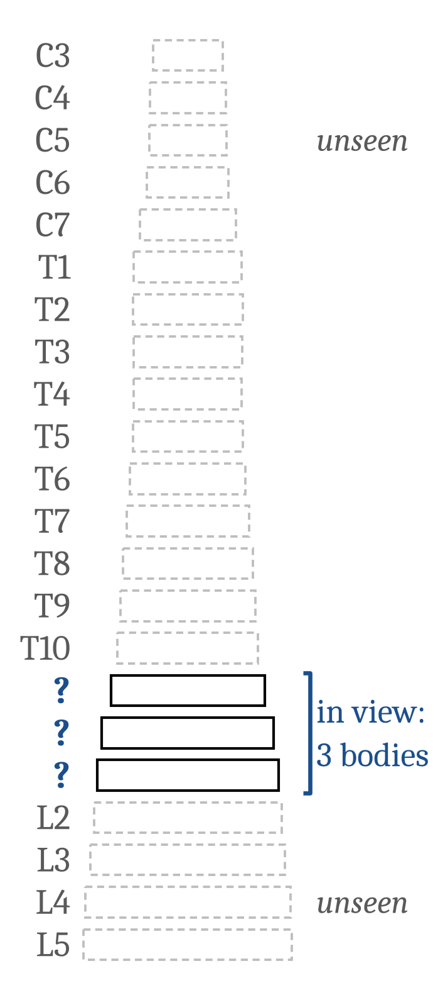
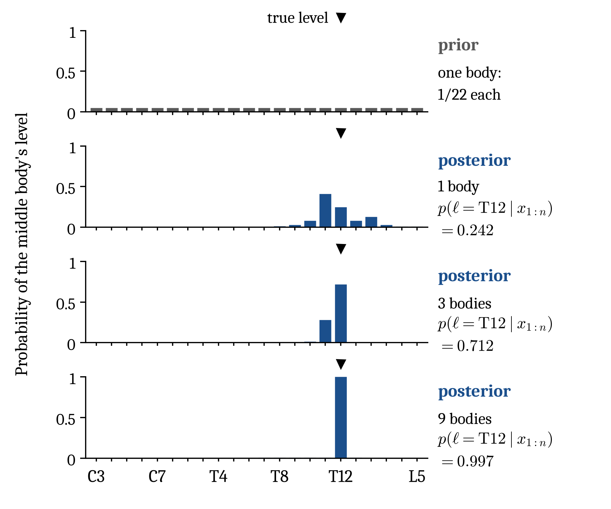
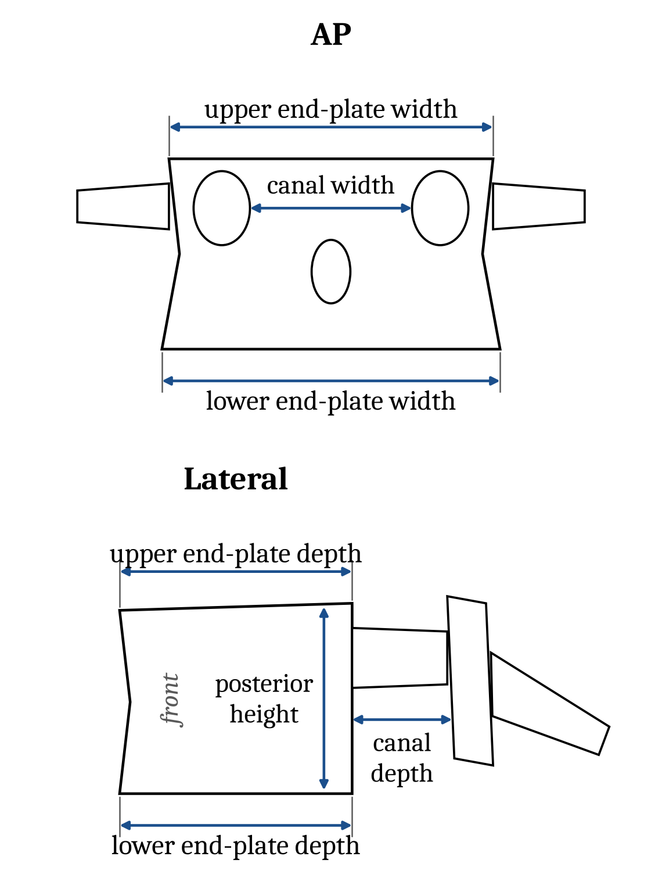
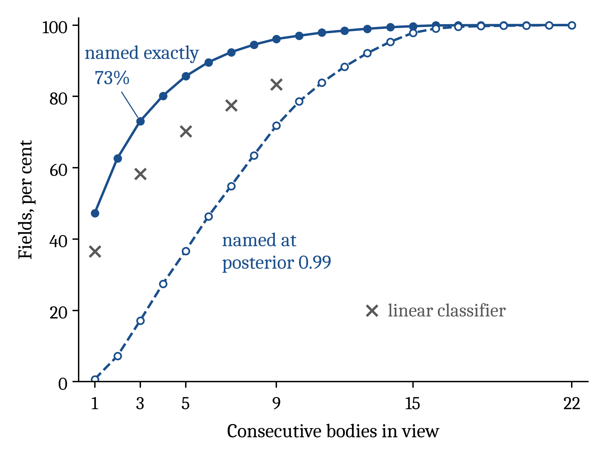
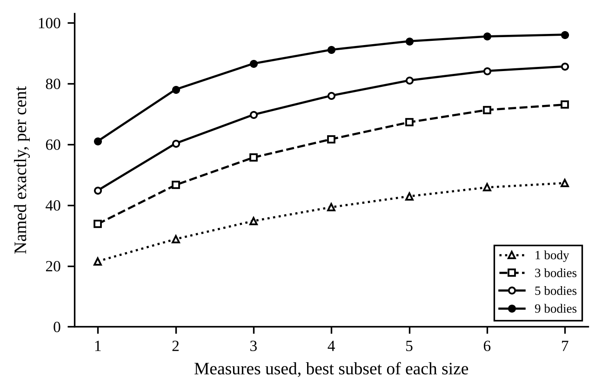
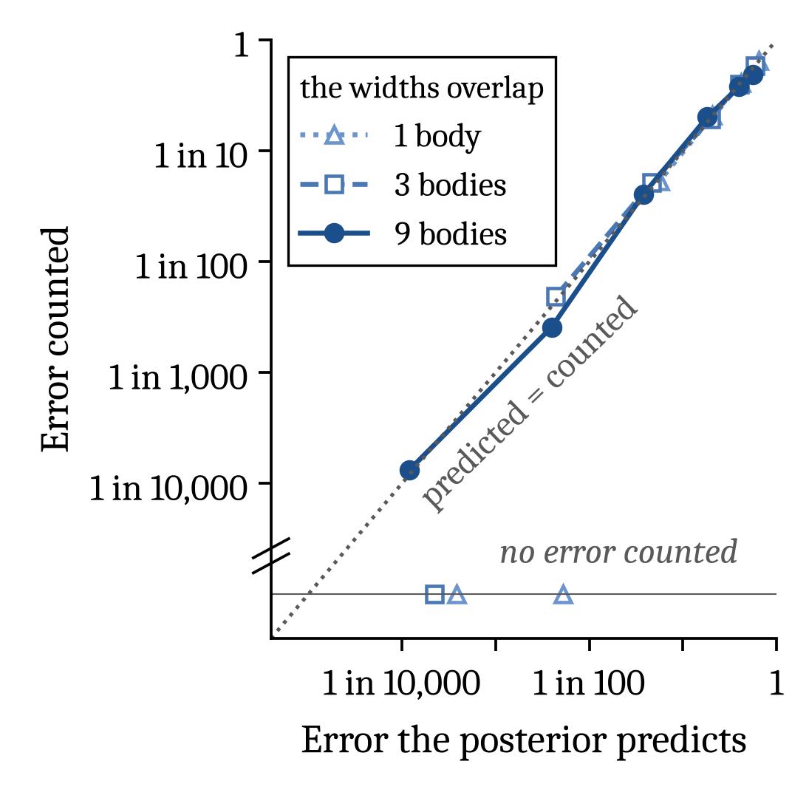
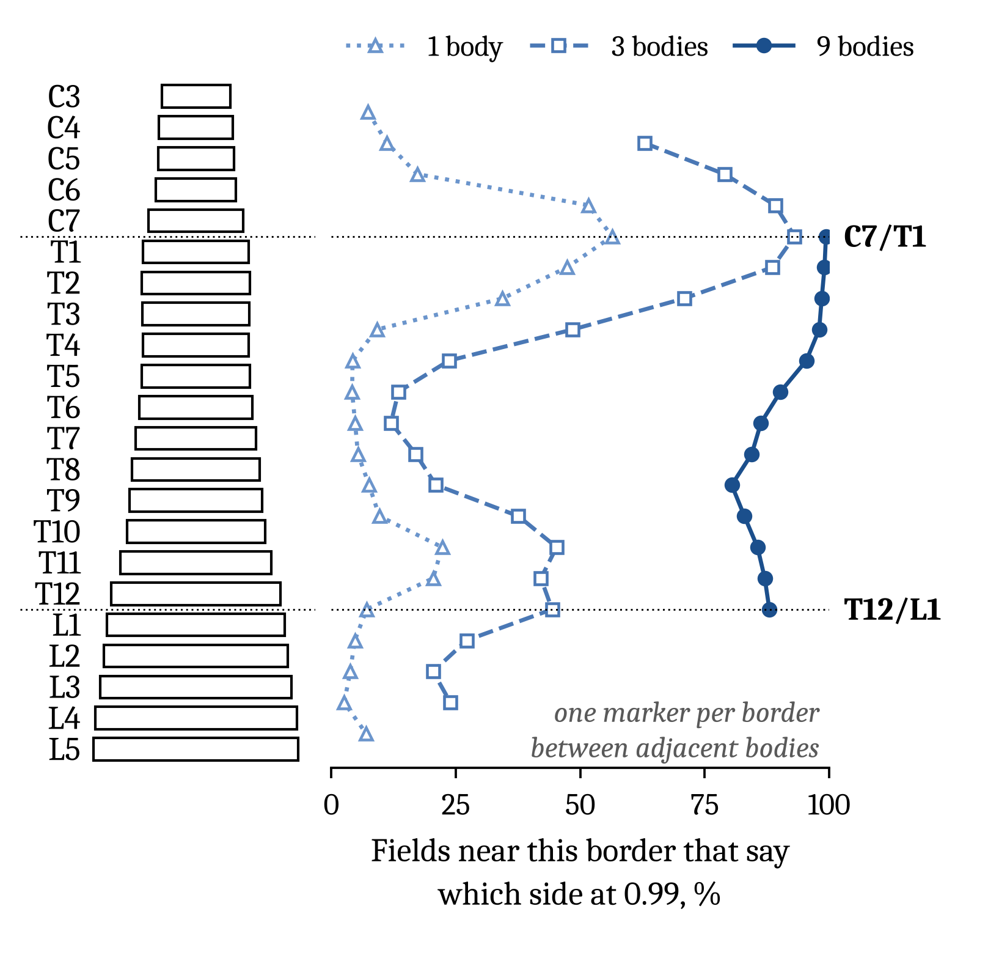
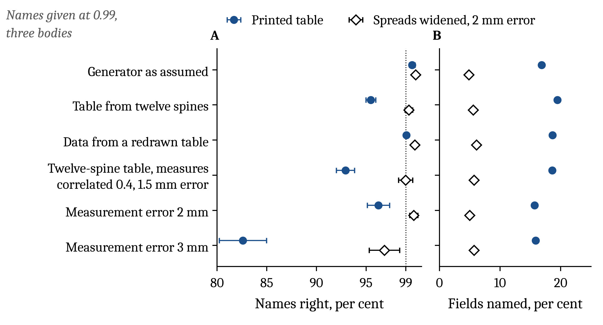

# bordercall: naming vertebrae with Bayes' rule over Panjabi's tables

Confidential: a pre-filing draft in a private repository. Nothing here goes to a public place before the provisional is filed.

A view of the spine often shows a few vertebral bodies and neither C2 nor the sacrum to count from. This repository asks one question of such a view: given what can be measured on the bodies in it, which levels are they? It answers with one rule, the exact Bayes rule over Panjabi's published tables. The white paper calls it SchwingCheck. The rule fits nothing. It scores every place the bodies could occupy in a column from C3 to L5 and returns the whole posterior over those places.

Every number below comes from synthetic columns drawn from Panjabi's tables. No patient has been measured yet.

Everything else this repository built on the way, including the junction predictor, the neighbour and identifiability studies, the fitted classifiers, the decks and the white paper, now sits under [archive/](archive/), unchanged and still runnable. [archive/README.md](archive/README.md) is the old README, and [TODO.md](TODO.md) is the work left for the next account. Text, figures and equations below come from the exact-rule slide deck ([archive/slides/exact/](archive/slides/exact/), built by [archive/slides/make_exact_slides.py](archive/slides/make_exact_slides.py)) and from its record.

## The priority for the next account: the rest of Panjabi's tables

The owner, 27 October 2026: the next account works on this and nothing else until the owner says otherwise.

The rule uses seven of Panjabi's measures, the linear dimensions a SPINEPS mask can measure. The four papers hold far more:

- the pedicle widths and heights, already transcribed but unused;
- the surface areas;
- the angles;
- the pars interarticularis;
- the spinous and transverse processes;
- the rib articulations;
- the uncovertebral joints;
- the articular facets of the fourth paper, 1993: widths, heights, areas, interfacet distances, plane angles and card angles, superior and inferior, left and right, C2 to L5.

[archive/bordercall/reference/build_panjabi.py](archive/bordercall/reference/build_panjabi.py) lists what it leaves out, and the scanned papers are in [archive/bordercall/reference/papers/](archive/bordercall/reference/papers/).

The next account transcribes every remaining table of all four papers, going past what a SPINEPS segmentation can measure, so that every number can be checked against the image of the cell it was read from. It then rewrites the rule and the generator in PyMC, proved against the code below, and scores the rule with the longer list, to see how much more measurements raise accuracy: at 1, 3 and 9 bodies, by plane, by how each measure could be read, and per phenotype. [TODO.md](TODO.md), item P, gives the five steps, a to e, the owner set on 27 October 2026, and the traps. Steps a to d are done: the provenance record of every value printed in the four papers' tables, of every number their text states about the tables and of what they print about their twelve specimens ([archive/bordercall/reference/provenance/](archive/bordercall/reference/provenance/README.md)), the package and the PyMC rewrite ([schwingcheck/](schwingcheck/README.md)); step e, the scoring with the longer list, is next.

After that, and only when the owner says so, the work turns to gold tier 1, 2 and 3 data: full spines from C2 to the sacrum, with real images and human annotation. That data is for testing this Bayesian generator empirically against segmentations of real spines.

## The problem



A field shows n consecutive bodies, with seven measures per body. Body i of the field is level k + i - 1, where C3 = 1 and L5 = 22. Naming the field therefore means choosing its place k: once k is known, every body in the field has its name. There are 23 - n places.

```math
x_{1:n} = (x_1, \ldots, x_n),\quad x_i \in \mathbb{R}^{7},\qquad k \in \{1, \ldots, 23-n\}
```

## The rule

```math
p(k \mid x_{1:n}) = \dfrac{p(x_{1:n} \mid k)\, p(k)}{\sum_{k'}\; p(x_{1:n} \mid k')\, p(k')}
```

```math
p(x_{1:n} \mid k) = \int \prod_{m=1}^{7} \mathcal{N}\left(x_{m,1:n} \mid s\,\mu_{m,k:k+n-1},\; \Sigma_{m,k:k+n-1}(s)\right) p(s)\, ds
```

```math
\Sigma_{m,k:k+n-1}(s) = s^2 \rho^2\, \sigma \sigma^{\mathrm{T}} + \mathrm{diag}\left(s^2 (1-\rho^2)\, \sigma^2 + \sigma_{\mathrm{err}}^2\right)
```

```math
\log s \sim \mathcal{N}(0,\, 0.07^2),\qquad \rho = 0.5,\qquad \sigma_{\mathrm{err}} = 1\ \mathrm{mm}
```

The rule is exact inference by enumeration.

- **The prior.** For a field of n bodies, each of the 23 - n places has prior 1/(23 - n).
- **The likelihood at one place.** Fix the column's size s. Each measure's n values are then jointly normal. The mean is s times the table's means at levels k to k + n - 1. The covariance is a rank-one term plus a diagonal:
  - the rank-one term, s^2 rho^2 sigma sigma', is the patient's own offset in that measure, shared by every level of the column;
  - the diagonal holds the per-level spread, s^2 (1 - rho^2) sigma^2, plus the measurement error, sigma_err^2.
- **No matrix is inverted.** Because the covariance is rank one plus a diagonal, its inverse (Sherman and Morrison 1950) and its determinant (the matrix determinant lemma) have closed forms.
- **The size.** The measures are independent given s. The likelihood is their product, integrated over log s by Gauss-Hermite quadrature on 161 nodes (Golub and Welsch 1969). The record measures the quadrature's own error.
- **The posterior.** Under the uniform prior, the posterior is the normalised likelihood.

The rule needs no fitting, no relaxation, no tolerance and no optimality gap, and it returns the entire ranked distribution over places, not only the best one. Because it is the generator's own posterior, it is the Bayes rule for this generator (Duda, Hart and Stork 2001, chapter 2). Two approximations remain, and the record measures both. The likelihood leaves out the generator's 0.5 mm floor, which touched 4 of 308,000 values. The 161-node quadrature moves no posterior by more than 1e-9 against a 1,801-node reference. A network can match it on average but never beat it, so the question "can a network do this" becomes "how far is this ceiling from one". On three bodies, a fitted network reached 71.6% and the best fitted rule 72.2%, against the rule's 73.1% on the same fields; a linear classifier reached 58.2%.



## What it guarantees, while the generator is the truth

The guarantees below hold while two things are true: the columns come from the generator, and every place is as common among the fields as the rule's uniform prior says.

```math
\hat{k} = \arg\max_{k}\, p(k \mid x_{1:n}),\qquad \hat{p} = p(\hat{k} \mid x_{1:n})
```

```math
\Pr\left(\hat{k} = k \mid \hat{p} \geq 1-\varepsilon\right) = \mathbb{E}\left[\hat{p} \mid \hat{p} \geq 1-\varepsilon\right] \geq 1-\varepsilon
```

```math
\ell = k + \lfloor (n-1)/2 \rfloor,\qquad \Pr(\ell \geq c \mid x_{1:n}) = \sum_{k:\, \ell \geq c} p(k \mid x_{1:n})
```

1. **Nothing does better.** No function of the same measurements, whether formula or network, names fields correctly more often than this rule. Its error is the floor for any network.
2. **Nothing is perfect.** No function names every field correctly while fewer than 22 bodies are in view. Every place gives every field a positive density, so the Bayes error is positive.
3. **The posterior is the chance of being right.** Answer only when the top posterior reaches 0.99, and the name is right at least 99% of the times it is given. Abstaining by this threshold is also the best way to abstain: among rules that answer the same share of fields, none is right more often (Chow 1970).
4. **Weaker statements keep the guarantee.** A statement about a border, such as "the middle body is at or below c", is a sum of the same posterior. A claim made at 0.99 is therefore right at least 99% of the times it is made, and two claims about one field are both right at least 98% of the time.
5. **One rule takes any n.** All of the above holds for any number of bodies, from 1 to 22.

Each guarantee is an average over fields. It holds within any group chosen by the measurements, such as the fields the rule calls lumbar. It does not hold within a group chosen by the truth, such as the fields whose middle body is near T12/L1, so the rates the record gives per true level are measurements, not guarantees.

## The measures it uses



| Measure | Key in the code | Seen in | Panjabi's row |
|---|---|---|---|
| Upper end-plate width | `endplate` | AP | EPWu |
| Lower end-plate width | `endplate_lower` | AP | EPWl |
| Canal width | `canal_w` | AP | SCW |
| Posterior body height | `h_post` | AP and lateral | VBHp |
| Upper end-plate depth | `endplate_depth` | lateral | EPDu |
| Lower end-plate depth | `endplate_lower_depth` | lateral | EPDl |
| Canal depth | `canal_ap` | lateral | SCD |

These seven are the linear dimensions in Panjabi's tables that a SPINEPS mask can measure, the set `SPINEPS_7` in [archive/bordercall/covariance.py](archive/bordercall/covariance.py). Which plane shows which measure is set by `REGIMES` in [archive/bordercall/neighbour.py](archive/bordercall/neighbour.py).

The table itself is [archive/bordercall/reference/panjabi_full_spine.csv](archive/bordercall/reference/panjabi_full_spine.csv). It gives the published mean and standard error for each measure and level; the population SD is the standard error times the square root of 12, the number of specimens. The table also holds the pedicle widths and heights, but the rule leaves them out because SPINEPS has no pedicle label.

## What the record already shows, from 0 to 7 measures and 1 to 22 bodies

The record scored all 127 subsets of the seven measures at every width from 1 to 22, on the same 2,000 synthetic columns, with every place of every column scored. Rates are shares of fields named exactly, in per cent, from [archive/records/exact-2026-10-26/exact.json](archive/records/exact-2026-10-26/exact.json) (keys `widths/<n>/regimes` and `widths/<n>/subsets`).

With no measure, the posterior is the prior, so the forced choice is right 1/(23 - n) of the time; that is the first column of the table. With 22 bodies, the field is the whole column: there is one place, and naming it is trivial.

| Bodies in view | No measure (the prior) | AP alone, 4 measures | Lateral alone, 4 measures | Both planes, 7 measures | Named at 0.99, both planes | Right when named at 0.99 |
|---|---|---|---|---|---|---|
| 1 | 4.5 | 36.5 | 30.1 | 47.3 | 0.7 | 100.00 (0 wrong of 299) |
| 2 | 4.8 | 48.4 | 42.8 | 62.7 | 7.2 | 99.70 (9 wrong of 3,030) |
| 3 | 5.0 | 58.2 | 53.4 | 73.1 | 17.1 | 99.78 (15 wrong of 6,848) |
| 5 | 5.6 | 73.4 | 68.3 | 85.7 | 36.7 | 99.81 (25 wrong of 13,207) |
| 7 | 6.2 | 83.2 | 77.4 | 92.4 | 54.9 | 99.86 (25 wrong of 17,564) |
| 9 | 7.1 | 89.1 | 83.6 | 96.1 | 71.8 | 99.93 (15 wrong of 20,112) |
| 12 | 9.1 | 94.5 | 91.0 | 98.5 | 88.3 | 99.95 (9 wrong of 19,435) |
| 15 | 12.5 | 98.2 | 96.4 | 99.7 | 97.8 | 99.98 (3 wrong of 15,651) |
| 18 | 20.0 | 99.5 | 98.7 | 99.97 | 99.7 | 100.00 (0 wrong of 9,971) |
| 22 | 100.0 | 100.0 | 100.0 | 100.0 | 100.0 | 100.00 (0 wrong of 2,000) |



**When only some measures can be taken.** The table below reads the same 127 subsets in two fixed orders, chosen before reading them. "AP first" adds the three AP-only measures (upper width, lower width, canal width), then posterior height, then the three lateral-only measures (upper depth, lower depth, canal depth). "Lateral first" adds the three lateral-only measures, then posterior height, then the three AP-only measures. The row "best of each size" is the best subset of each size, found on the same scoring columns, so it is a description and not a claim. One AP view beats one lateral view at every width from 1 to 21 bodies (at 22, both name the single place). After four measures, AP first names 58.2% of three-body fields and lateral first 53.4%.

| Bodies | Order | 1 measure | 2 | 3 | 4 | 5 | 6 | 7 |
|---|---|---|---|---|---|---|---|---|
| 1 | AP first | 21.5 | 27.4 | 33.9 | 36.5 | 40.4 | 44.2 | 47.3 |
| 1 | lateral first | 17.8 | 22.8 | 27.0 | 30.1 | 37.9 | 42.7 | 47.3 |
| 1 | best of each size | 21.5 | 28.8 | 34.8 | 39.3 | 42.9 | 45.8 | 47.3 |
| 3 | AP first | 33.6 | 44.0 | 54.3 | 58.2 | 64.1 | 68.7 | 73.1 |
| 3 | lateral first | 27.9 | 37.9 | 48.2 | 53.4 | 63.0 | 68.6 | 73.1 |
| 3 | best of each size | 33.8 | 46.6 | 55.7 | 61.7 | 67.3 | 71.3 | 73.1 |
| 9 | AP first | 59.8 | 77.4 | 86.6 | 89.1 | 92.2 | 94.5 | 96.1 |
| 9 | lateral first | 47.4 | 65.5 | 79.2 | 83.6 | 90.7 | 94.0 | 96.1 |
| 9 | best of each size | 61.1 | 78.1 | 86.6 | 91.1 | 93.9 | 95.5 | 96.1 |



**The posterior is the chance of being right.** The error the posterior predicts matches the error counted, bin by bin, down to about 1 in 1,000. Below that the counts run out: at 1 in 10,000 the agreement rests on 2 errors counted in 15,038 nine-body fields with posterior above 0.999.



**What one body can say for certain.** The record gives the following, over all fields unless a group is named:

- **Region.** A single body names its region (cervical, thoracic or lumbar) for 60.9% of fields, with 21 wrong of 26,786; only 2 of those errors are far from both junctions.
- **C7/T1.** Of single bodies within two levels of C7/T1, 56.4% say which side they lie on, and are right 99.84% of the time (7 wrong of 4,514).
- **T12/L1.** Of single bodies within two levels of T12/L1, only 7.1% say which side they lie on, and they are right 97.89% of the time (12 wrong of 568). That is short of 99%, which can happen because this group is chosen by the true level.
- **T12/L1 over all fields.** The same claims about T12/L1, taken over all single bodies, are right 99.96% of the time (13 wrong of 30,943).
- **Nine bodies.** Nine bodies settle the side of T12/L1 for 88.0% of fields whose middle body is T11 to L1.



## Where the rule is weak: the table, not the mathematics

The posterior is only as good as the table. All numbers here are for three bodies at posterior 0.99, from `robust` in the same record.

| World | Rule | Right when named | Share named |
|---|---|---|---|
| The generator is the truth | nominal | 99.78% | 17.1% |
| The rule's table estimated from 12 spines, as Panjabi's are | nominal | 95.5% | 19.5% |
| The same | predictive, nothing tuned | 97.6% | 14.8% |
| The same | honest | 99.3%; lumbar names 96.7% (8 wrong of 246) | 5.5% |
| Printed table, 3 mm of measurement error | nominal | 82.6% | 15.9% |
| The same | honest | 96.8%, short of 99% | 5.7% |

The nominal rule takes its table as given, the printed one or, in the twelve-spine rows, the re-estimated one, and 1 mm of error. The predictive rule takes a new spine's spread about a twelve-spine mean and SD. The honest rule widens each spread by the root of 1 + 1/12 and assumes 2 mm of error, the 2 mm chosen on a separate pilot of sixteen worlds. The first row's columns are the main scoring columns; the others are separate synthetic columns, 40 worlds of 100 columns for a table world and 500 columns for an error world.

```math
\tilde{\sigma}_{m,\ell} = \sigma_{m,\ell}\sqrt{1 + 1/12},\qquad \sigma_{\mathrm{err}} = 2\ \mathrm{mm}
```



Other limits, stated plainly:

- **Typical columns only.** The rule has no anomalous places: no sixth lumbar body, no thirteenth rib-bearing body, no fused L5.
- **Uniform prior.** The prior over places is uniform. A real series, where lumbar fields are commoner, needs its own prior.
- **Independent measures.** The measures are taken as independent given size; nothing published supplies their correlation.
- **One error for all.** Every measure carries the same 1 mm error.
- **The generator's floor.** The generator floors values at 0.5 mm, and the likelihood leaves that floor out; the record counts the values it touched.
- **Speed.** The posterior for three bodies took a median of 13.6 ms (at most 17.4 ms over 50 calls) on four CPUs ([archive/records/whitepaper-2026-10-26/second_opinion.json](archive/records/whitepaper-2026-10-26/second_opinion.json), key `latency`).

## Run it

The implementation is [archive/bordercall/exact.py](archive/bordercall/exact.py). It takes its generator from [panjabi.py](archive/bordercall/panjabi.py) and the measure lists from [covariance.py](archive/bordercall/covariance.py) and [neighbour.py](archive/bordercall/neighbour.py). It needs Python 3 with numpy, and matplotlib for the figures.

```
cd archive/bordercall
python run.py exact --outdir ../records/exact-2026-10-26             # exact.json, 4,652 s on 4 CPUs
python run.py exact-supplement --outdir ../records/exact-2026-10-26  # supplement.json, 879 s
python run.py exact-figures --json ../records/exact-2026-10-26/exact.json --outdir ../records/exact-2026-10-26/figures
python run.py exact-slide-figures --json ../records/exact-2026-10-26/exact.json --outdir ../records/exact-2026-10-26/slide-figures
cd .. && python3 -m unittest discover -s tests                       # 242 tests, about two minutes
```

To name one field, run this from the repository's root. Here the three bodies carry Panjabi's means at T11, T12 and L1:

```python
import sys
sys.path.insert(0, "archive/bordercall")
import numpy as np
import exact as E
import panjabi as P

ref = P.load_reference(measures=E.MEASURES7)
mu, sd = E.table_arrays(ref, E.MEASURES7)        # 7 measures x 22 levels, C3 to L5
synth = dict(rho=0.5, noise_mm=1.0, scale_sd=0.07)

# one field: rows are the measures in E.MEASURES7's order, columns the bodies from the top of
# the view down, in millimetres
X = mu[:, 15:18][None, :, :]
LL = E.field_loglik(X, mu, sd, synth)
_, logw = E.quadrature(synth["scale_sd"])
post = E.posterior(E.log_evidence(LL, logw))[0]   # one probability per place, 23 - n of them
for k in np.argsort(-post)[:3]:
    print("%s to %s  %.3f" % (E.LEVELS[k], E.LEVELS[k + 2], post[k]))
```

It prints `T11 to L1 0.608`, `T10 to T12 0.286` and `T12 to L2 0.076`. Even a field of exact means is not named at 0.99 from three bodies near T12/L1, which is the junction the record finds hardest.

## Adding a measurement

The rule treats every measure the same way, so a new measure needs no change to the mathematics:

1. **Add the measure to the table.** [The reference table](archive/bordercall/reference/panjabi_full_spine.csv) is generated, so do not edit it by hand.
   - *A Panjabi measure.* Its values go into [build_panjabi.py](archive/bordercall/reference/build_panjabi.py), in the region tables and the `CANON` map. Then rebuild the table with `python build_panjabi.py`.
   - *A measure from another source.* It needs its own rows (`measure,level,mean,sem,n`, one per level from C3 to L5) in a table the build does not overwrite.
2. **Add its name to the measure list.** `run.py exact` has no flag for the list: the run uses `MEASURES7` in exact.py, which is `SPINEPS_7` in covariance.py. Add the measure there and to the planes that show it (`REGIMES`). The likelihood (`place_loglik`, `field_loglik`) takes any number of measures.
3. **Keep the assumptions in view.**
   - *Independence.* A new measure is taken as independent of the others given size. A measure that largely repeats another, such as a second width, would then be counted twice and make the posterior too confident. The dense likelihood `joint_log_evidence` takes one exchangeable correlation r, but only between the patient's offsets in different measures. Given size, two measures at one level are then correlated at most rho^2 r = 0.25 r, so it cannot stand for a near-duplicate measure. A full covariance estimated from CT is the real answer (TODO.md).
   - *Error.* The 1 mm error is one number for all measures. A measure read less precisely needs its own error: a one-line change in `place_loglik`, and the same change in the generator (`panjabi.synthesize`), so that the columns it is scored on carry that error.
4. **Score it before believing it.** Rerun `python run.py exact`. A longer list redraws the scoring columns, so judge the new measure against the seven-measure subset scored in the same run, not against the table above.

The first candidates are already in the table: the pedicle widths and heights. They need a measurer, since SPINEPS draws no pedicle. The identifiability study found that pedicle rows lift the lumbar levels most ([archive/docs/LEVEL_IDENTIFIABILITY_RESULTS.md](archive/docs/LEVEL_IDENTIFIABILITY_RESULTS.md)).

## What is next

[TODO.md](TODO.md) lists the work for the next account:

- wrapping each measurement as one object;
- a larger population table from public de-identified full-spine CTs counted from C2;
- the validation grid from 0 to N measures and 0 to K bodies;
- first and above all, the rest of Panjabi's tables (item P);
- the experiments not yet run: bodies with gaps between them, gaps the reader does not know about, and measures missing on some bodies;
- the long programme of turning this from a predictive rule into a generative tool.

## Layout

- `README.md`: this page.
- `TODO.md`: the future work.
- `schwingcheck/`: the exact rule lifted out of the archive as a package on data shaped for PyMC (TODO.md item P step c): the checked table of the four papers as one long CSV written from the provenance record, the twelve specimens of the thoracic paper's Table 1, the rule vectorised with gaps and missing values, the generator, the scores and every result as ArviZ InferenceData; and the rule and the generator rewritten in PyMC (step d): the naming model, which sums the level out exactly and samples only the patient's size, the rule as one compiled PyTensor function, the fixed-level baseline, the generator as a forward model, the covariates and the models' graphs; its own [README](schwingcheck/README.md), tests under `tests/` and the pinned environment `requirements-schwingcheck.txt`.
- `holdings/`: what is held of each evidence tier. `gold-tier-3.md` gives the gold 3 count and ENHANCE.PET 1.6k's share of it; `count_enhance_pet.py` recounts ENHANCE.PET's whole spines, variants and rib readings from the published masks, with tests under `holdings/tests/`.
- `archive/`: everything from before 27 October 2026, moved as it was:
  - `bordercall/`: the package, `exact.py` among it;
  - `records/`: every run's record;
  - `docs/`: the results write-ups and the white paper copy, `SCHWINGCHECK_LEVELCHECK.md`;
  - `slides/`: the decks;
  - `tests/`, `research/` and `testdata/`;
  - `HANDOFF.md` and `CHECKPOINT_2026-10-26.md`: the older restart pages.

## References

Anatomy

1. Panjabi MM, Duranceau J, Goel V, Oxland T, Takata K. Cervical human vertebrae: quantitative three-dimensional anatomy of the middle and lower regions. Spine 1991;16(8):861-869.
2. Panjabi MM, Takata K, Goel V, Federico D, Oxland T, Duranceau J, Krag M. Thoracic human vertebrae: quantitative three-dimensional anatomy. Spine 1991;16(8):888-901.
3. Panjabi MM, Goel V, Oxland T, Takata K, Duranceau J, Krag M, Price M. Human lumbar vertebrae: quantitative three-dimensional anatomy. Spine 1992;17(3):299-306.
4. Panjabi MM, Oxland T, Takata K, Goel V, Duranceau J, Krag M. Articular facets of the human spine: quantitative three-dimensional anatomy. Spine 1993;18(10):1298-1310.
5. Benzel EC. Biomechanics of Spine Stabilization. 3rd ed. New York: Thieme; 2015. doi:10.1055/b-003-106374. The reference for the spine's regional anatomy and for the drawing style of this repository's figures.
6. Steinmetz MP, Berven SH, Benzel EC, eds. Benzel's Spine Surgery: Techniques, Complication Avoidance, and Management. 5th ed. Philadelphia: Elsevier; 2022.

Statistics

7. Duda RO, Hart PE, Stork DG. Pattern Classification. 2nd ed. New York: Wiley; 2001. Chapter 2, Bayesian decision theory: the Bayes rule and its error.
8. Chow CK. On optimum recognition error and reject tradeoff. IEEE Trans Inf Theory 1970;16(1):41-46. Abstaining by a threshold on the posterior.
9. Sherman J, Morrison WJ. Adjustment of an inverse matrix corresponding to a change in one element of a given matrix. Ann Math Stat 1950;21(1):124-127. The closed-form inverse of a rank-one update.
10. Golub GH, Welsch JH. Calculation of Gauss quadrature rules. Math Comput 1969;23(106):221-230. The quadrature over the patient's size.
11. Gelman A, Carlin JB, Stern HS, Dunson DB, Vehtari A, Rubin DB. Bayesian Data Analysis. 3rd ed. Boca Raton: CRC Press; 2013. Posteriors, credible sets and posterior predictive checks.
12. Gneiting T, Raftery AE. Strictly proper scoring rules, prediction, and estimation. J Am Stat Assoc 2007;102(477):359-378. The log loss the record reports.
13. Li H, Ruan J, Durbin R. Mapping short DNA sequencing reads and calling variants using mapping quality scores. Genome Res 2008;18(11):1851-1858. The mapping quality the record reports beside each posterior.
14. Cameron AC, Miller DL. A practitioner's guide to cluster-robust inference. J Hum Resour 2015;50(2):317-372. Standard errors clustered by column.
