# Table 2. Vertebral Body Dimensions

Cervical, PDF page 3, printed page 863; Panjabi_1991_Cervical_Spine_16-8_861-869.pdf (sha256 a95f369e673c6567cd6061a8d0925883f78edbe643f92bcaaca45cbd4ec99391), rendered at 300 dpi by render.py.

Every cell below is the box layout.py cut from the rendered page, and the two strings are what the two reading passes read in it (README.md). A dash is printed where the paper prints one. The value column is what provenance.csv carries.

| cell | row | column | measure | level | printed | value | pass 1 | pass 2 | image |
|---|---|---|---|---|---|---|---|---|---|
| r01_c00 | EPDu | C2 | EPDu | C2 | - | (none) | - | - | 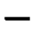 |
| r01_c01 | EPDu | C3 | EPDu | C3 | 15.0 | mean 15.0 mm | 15.0 | 15.0 | 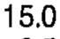 |
| r01_c02 | EPDu | C4 | EPDu | C4 | 15.3 | mean 15.3 mm | 15.3 | 15.3 | 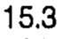 |
| r01_c03 | EPDu | C5 | EPDu | C5 | 15.2 | mean 15.2 mm | 15.2 | 15.2 | 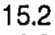 |
| r01_c04 | EPDu | C6 | EPDu | C6 | 16.4 | mean 16.4 mm | 16.4 | 16.4 | 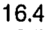 |
| r01_c05 | EPDu | C7 | EPDu | C7 | 18.1 (C3-5) | mean 18.1 mm | 18.1 (C3-5) | 18.1 (C3-5) | 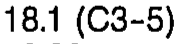 |
| r02_c00 | EPDu | C2 | EPDu | C2 | - | (none) | - | - | 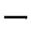 |
| r02_c01 | EPDu | C3 | EPDu | C3 | 0.55 | sem 0.55 mm | 0.55 | 0.55 | 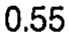 |
| r02_c02 | EPDu | C4 | EPDu | C4 | 0.75 | sem 0.75 mm | 0.75 | 0.75 | 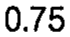 |
| r02_c03 | EPDu | C5 | EPDu | C5 | 0.35 | sem 0.35 mm | 0.35 | 0.35 | 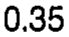 |
| r02_c04 | EPDu | C6 | EPDu | C6 | 0.52 | sem 0.52 mm | 0.52 | 0.52 | 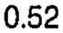 |
| r02_c05 | EPDu | C7 | EPDu | C7 | 0.66 | sem 0.66 mm | 0.66 | 0.66 | 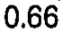 |
| r03_c00 | EPWu | C2 | EPWu | C2 | - | (none) | - | - | 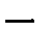 |
| r03_c01 | EPWu | C3 | EPWu | C3 | 15.8 | mean 15.8 mm | 15.8 | 15.8 |  |
| r03_c02 | EPWu | C4 | EPWu | C4 | 17.2 | mean 17.2 mm | 17.2 | 17.2 | 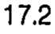 |
| r03_c03 | EPWu | C5 | EPWu | C5 | 17.5 | mean 17.5 mm | 17.5 | 17.5 | 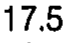 |
| r03_c04 | EPWu | C6 | EPWu | C6 | 18.5 (C3) | mean 18.5 mm | 18.5 (C3) | 18.5 (C3) | 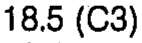 |
| r03_c05 | EPWu | C7 | EPWu | C7 | 21.8 (C3-6) | mean 21.8 mm | 21.8 (C3-6) | 21.8 (C3-6) | 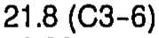 |
| r04_c00 | EPWu | C2 | EPWu | C2 | - | (none) | - | - |  |
| r04_c01 | EPWu | C3 | EPWu | C3 | 0.46 | sem 0.46 mm | 0.46 | 0.46 | 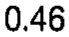 |
| r04_c02 | EPWu | C4 | EPWu | C4 | 0.66 | sem 0.66 mm | 0.66 | 0.66 | 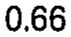 |
| r04_c03 | EPWu | C5 | EPWu | C5 | 0.58 | sem 0.58 mm | 0.58 | 0.58 |  |
| r04_c04 | EPWu | C6 | EPWu | C6 | 0.55 | sem 0.55 mm | 0.55 | 0.55 | 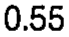 |
| r04_c05 | EPWu | C7 | EPWu | C7 | 0.66 | sem 0.66 mm | 0.66 | 0.66 | 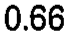 |
| r05_c00 | EPDl | C2 | EPDl | C2 | 15.6 | mean 15.6 mm | 15.6 | 15.6 | 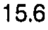 |
| r05_c01 | EPDl | C3 | EPDl | C3 | 15.6 | mean 15.6 mm | 15.6 | 15.6 |  |
| r05_c02 | EPDl | C4 | EPDl | C4 | 15.9 | mean 15.9 mm | 15.9 | 15.9 |  |
| r05_c03 | EPDl | C5 | EPDl | C5 | 17.9 | mean 17.9 mm | 17.9 | 17.9 | 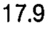 |
| r05_c04 | EPDl | C6 | EPDl | C6 | 18.5 (C2-4) | mean 18.5 mm | 18.5 (C2-4) | 18.5 (C2-4) | 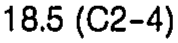 |
| r05_c05 | EPDl | C7 | EPDl | C7 | 16.8 | mean 16.8 mm | 16.8 | 16.8 | 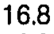 |
| r06_c00 | EPDl | C2 | EPDl | C2 | 0.58 | sem 0.58 mm | 0.58 | 0.58 |  |
| r06_c01 | EPDl | C3 | EPDl | C3 | 0.40 | sem 0.40 mm | 0.40 | 0.40 | 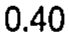 |
| r06_c02 | EPDl | C4 | EPDl | C4 | 0.38 | sem 0.38 mm | 0.38 | 0.38 | 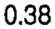 |
| r06_c03 | EPDl | C5 | EPDl | C5 | 0.52 | sem 0.52 mm | 0.52 | 0.52 | 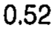 |
| r06_c04 | EPDl | C6 | EPDl | C6 | 0.69 | sem 0.69 mm | 0.69 | 0.69 | 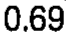 |
| r06_c05 | EPDl | C7 | EPDl | C7 | 0.32 | sem 0.32 mm | 0.32 | 0.32 | 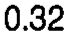 |
| r07_c00 | EPWl | C2 | EPWl | C2 | 17.5 | mean 17.5 mm | 17.5 | 17.5 | 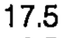 |
| r07_c01 | EPWl | C3 | EPWl | C3 | 17.2 | mean 17.2 mm | 17.2 | 17.2 | 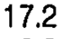 |
| r07_c02 | EPWl | C4 | EPWl | C4 | 17.0 | mean 17.0 mm | 17.0 | 17.0 | 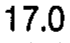 |
| r07_c03 | EPWl | C5 | EPWl | C5 | 19.4 | mean 19.4 mm | 19.4 | 19.4 | 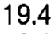 |
| r07_c04 | EPWl | C6 | EPWl | C6 | 22.0 (C2-4) | mean 22.0 mm | 22.0 (C2-4) | 22.0 (C2-4) | 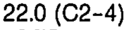 |
| r07_c05 | EPWl | C7 | EPWl | C7 | 23.4 (C2-5) | mean 23.4 mm | 23.4 (C2-5) | 23.4 (C2-5) | 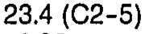 |
| r08_c00 | EPWl | C2 | EPWl | C2 | 0.52 | sem 0.52 mm | 0.52 | 0.52 |  |
| r08_c01 | EPWl | C3 | EPWl | C3 | 0.29 | sem 0.29 mm | 0.29 | 0.29 | 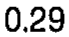 |
| r08_c02 | EPWl | C4 | EPWl | C4 | 0.49 | sem 0.49 mm | 0.49 | 0.49 | 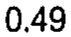 |
| r08_c03 | EPWl | C5 | EPWl | C5 | 0.40 | sem 0.40 mm | 0.40 | 0.40 | 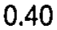 |
| r08_c04 | EPWl | C6 | EPWl | C6 | 0.75 | sem 0.75 mm | 0.75 | 0.75 | 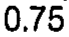 |
| r08_c05 | EPWl | C7 | EPWl | C7 | 0.98 | sem 0.98 mm | 0.98 | 0.98 |  |
| r09_c00 | VBHp | C2 | VBHp | C2 | - | (none) | - | - | 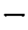 |
| r09_c01 | VBHp | C3 | VBHp | C3 | 11.6 | mean 11.6 mm | 11.6 | 11.6 |  |
| r09_c02 | VBHp | C4 | VBHp | C4 | 11.4 | mean 11.4 mm | 11.4 | 11.4 |  |
| r09_c03 | VBHp | C5 | VBHp | C5 | 11.4 | mean 11.4 mm | 11.4 | 11.4 | 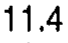 |
| r09_c04 | VBHp | C6 | VBHp | C6 | 10.9 | mean 10.9 mm | 10.9 | 10.9 |  |
| r09_c05 | VBHp | C7 | VBHp | C7 | 12.8 (C6) | mean 12.8 mm | 12.8 (C6) | 12.8 (C6) | 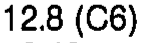 |
| r10_c00 | VBHp | C2 | VBHp | C2 | - | (none) | - | - | 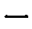 |
| r10_c01 | VBHp | C3 | VBHp | C3 | 0.35 | sem 0.35 mm | 0.35 | 0.35 | 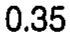 |
| r10_c02 | VBHp | C4 | VBHp | C4 | 0.43 | sem 0.43 mm | 0.43 | 0.43 | 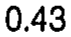 |
| r10_c03 | VBHp | C5 | VBHp | C5 | 0.32 | sem 0.32 mm | 0.32 | 0.32 | 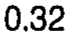 |
| r10_c04 | VBHp | C6 | VBHp | C6 | 0.26 | sem 0.26 mm | 0.26 | 0.26 |  |
| r10_c05 | VBHp | C7 | VBHp | C7 | 0.46 | sem 0.46 mm | 0.46 | 0.46 | 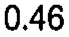 |
| r11_c00 | EPWu/EPDu | C2 | EPWu/EPDu | C2 | - | (none) | - | - | 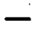 |
| r11_c01 | EPWu/EPDu | C3 | EPWu/EPDu | C3 | 1.05 | ratio 1.05 | 1.05 | 1.05 |  |
| r11_c02 | EPWu/EPDu | C4 | EPWu/EPDu | C4 | 1.12 | ratio 1.12 | 1.12 | 1.12 |  |
| r11_c03 | EPWu/EPDu | C5 | EPWu/EPDu | C5 | 1.15 | ratio 1.15 | 1.15 | 1.15 |  |
| r11_c04 | EPWu/EPDu | C6 | EPWu/EPDu | C6 | 1.13 | ratio 1.13 | 1.13 | 1.13 | 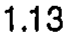 |
| r11_c05 | EPWu/EPDu | C7 | EPWu/EPDu | C7 | 1.20 | ratio 1.20 | 1.20 | 1.20 |  |
| r12_c00 | EPWl/EPDl | C2 | EPWl/EPDl | C2 | 1.12 | ratio 1.12 | 1.12 | 1.12 |  |
| r12_c01 | EPWl/EPDl | C3 | EPWl/EPDl | C3 | 1.10 | ratio 1.10 | 1.10 | 1.10 |  |
| r12_c02 | EPWl/EPDl | C4 | EPWl/EPDl | C4 | 1.07 | ratio 1.07 | 1.07 | 1.07 |  |
| r12_c03 | EPWl/EPDl | C5 | EPWl/EPDl | C5 | 1.08 | ratio 1.08 | 1.08 | 1.08 |  |
| r12_c04 | EPWl/EPDl | C6 | EPWl/EPDl | C6 | 1.19 | ratio 1.19 | 1.19 | 1.19 |  |
| r12_c05 | EPWl/EPDl | C7 | EPWl/EPDl | C7 | 1.39 | ratio 1.39 | 1.39 | 1.39 |  |
| r14_c00 | EPAu | C2 | EPAu | C2 | - | (none) | - | - |  |
| r14_c01 | EPAu | C3 | EPAu | C3 | 169.4 | mean 169.4 mm2 | 169.4 | 169.4 |  |
| r14_c02 | EPAu | C4 | EPAu | C4 | 183.0 | mean 183.0 mm2 | 183.0 | 183.0 |  |
| r14_c03 | EPAu | C5 | EPAu | C5 | 182.9 | mean 182.9 mm2 | 182.9 | 182.9 |  |
| r14_c04 | EPAu | C6 | EPAu | C6 | 221.2 (C3) | mean 221.2 mm2 | 221.2 (C3) | 221.2 (C3) |  |
| r14_c05 | EPAu | C7 | EPAu | C7 | 278.3 (C3-6) | mean 278.3 mm2 | 278.3 (C3-6) | 278.3 (C3-6) |  |
| r15_c00 | EPAu | C2 | EPAu | C2 | - | (none) | - | - |  |
| r15_c01 | EPAu | C3 | EPAu | C3 | 8.78 | sem 8.78 mm2 | 8.78 | 8.78 |  |
| r15_c02 | EPAu | C4 | EPAu | C4 | 9.32 | sem 9.32 mm2 | 9.32 | 9.32 |  |
| r15_c03 | EPAu | C5 | EPAu | C5 | 7.77 | sem 7.77 mm2 | 7.77 | 7.77 |  |
| r15_c04 | EPAu | C6 | EPAu | C6 | 7.62 | sem 7.62 mm2 | 7.62 | 7.62 |  |
| r15_c05 | EPAu | C7 | EPAu | C7 | 12.93 | sem 12.93 mm2 | 12.93 | 12.93 |  |
| r16_c00 | EPAl | C2 | EPAl | C2 | 194.4 | mean 194.4 mm2 | 194.4 | 194.4 |  |
| r16_c01 | EPAl | C3 | EPAl | C3 | 190.7 | mean 190.7 mm2 | 190.7 | 190.7 |  |
| r16_c02 | EPAl | C4 | EPAl | C4 | 199.2 | mean 199.2 mm2 | 199.2 | 199.2 |  |
| r16_c03 | EPAl | C5 | EPAl | C5 | 246.2 | mean 246.2 mm2 | 246.2 | 246.2 |  |
| r16_c04 | EPAl | C6 | EPAl | C6 | 289.9 (C2-4) | mean 289.9 mm2 | 289.9 (C2-4) | 289.9 (C2-4) |  |
| r16_c05 | EPAl | C7 | EPAl | C7 | 280.3 (C2-4) | mean 280.3 mm2 | 280.3 (C2-4) | 280.3 (C2-4) |  |
| r17_c00 | EPAl | C2 | EPAl | C2 | 9.64 | sem 9.64 mm2 | 9.64 | 9.64 |  |
| r17_c01 | EPAl | C3 | EPAl | C3 | 5.74 | sem 5.74 mm2 | 5.74 | 5.74 |  |
| r17_c02 | EPAl | C4 | EPAl | C4 | 7.27 | sem 7.27 mm2 | 7.27 | 7.27 |  |
| r17_c03 | EPAl | C5 | EPAl | C5 | 12.07 | sem 12.07 mm2 | 12.07 | 12.07 |  |
| r17_c04 | EPAl | C6 | EPAl | C6 | 16.54 | sem 16.54 mm2 | 16.54 | 16.54 |  |
| r17_c05 | EPAl | C7 | EPAl | C7 | 13.71 | sem 13.71 mm2 | 13.71 | 13.71 |  |
| r19_c00 | EPItu | C2 | EPItu | C2 | - | (none) | - | - |  |
| r19_c01 | EPItu | C3 | EPItu | C3 | 2.7 | mean 2.7 deg | 2.7 | 2.7 |  |
| r19_c02 | EPItu | C4 | EPItu | C4 | 3.5 | mean 3.5 deg | 3.5 | 3.5 |  |
| r19_c03 | EPItu | C5 | EPItu | C5 | 1.7 | mean 1.7 deg | 1.7 | 1.7 |  |
| r19_c04 | EPItu | C6 | EPItu | C6 | 4.7 | mean 4.7 deg | 4.7 | 4.7 |  |
| r19_c05 | EPItu | C7 | EPItu | C7 | 2.2 | mean 2.2 deg | 2.2 | 2.2 |  |
| r20_c00 | EPItu | C2 | EPItu | C2 | - | (none) | - | - |  |
| r20_c01 | EPItu | C3 | EPItu | C3 | 0.77 | sem 0.77 deg | 0.77 | 0.77 |  |
| r20_c02 | EPItu | C4 | EPItu | C4 | 1.5 | sem 1.5 deg | 1.5 | 1.5 |  |
| r20_c03 | EPItu | C5 | EPItu | C5 | 0.43 | sem 0.43 deg | 0.43 | 0.43 |  |
| r20_c04 | EPItu | C6 | EPItu | C6 | 1.1 | sem 1.1 deg | 1.1 | 1.1 |  |
| r20_c05 | EPItu | C7 | EPItu | C7 | 0.54 | sem 0.54 deg | 0.54 | 0.54 |  |
| r21_c00 | EPItl | C2 | EPItl | C2 | 4.2 | mean 4.2 deg | 4.2 | 4.2 |  |
| r21_c01 | EPItl | C3 | EPItl | C3 | 4.0 | mean 4.0 deg | 4.0 | 4.0 |  |
| r21_c02 | EPItl | C4 | EPItl | C4 | 2.1 | mean 2.1 deg | 2.1 | 2.1 |  |
| r21_c03 | EPItl | C5 | EPItl | C5 | 2.7 | mean 2.7 deg | 2.7 | 2.7 |  |
| r21_c04 | EPItl | C6 | EPItl | C6 | 2.7 | mean 2.7 deg | 2.7 | 2.7 |  |
| r21_c05 | EPItl | C7 | EPItl | C7 | 1.8 | mean 1.8 deg | 1.8 | 1.8 |  |
| r22_c00 | EPItl | C2 | EPItl | C2 | 1.2 | sem 1.2 deg | 1.2 | 1.2 |  |
| r22_c01 | EPItl | C3 | EPItl | C3 | 0.84 | sem 0.84 deg | 0.84 | 0.84 |  |
| r22_c02 | EPItl | C4 | EPItl | C4 | 0.4 | sem 0.4 deg | 0.4 | 0.4 |  |
| r22_c03 | EPItl | C5 | EPItl | C5 | 1.1 | sem 1.1 deg | 1.1 | 1.1 |  |
| r22_c04 | EPItl | C6 | EPItl | C6 | 0.69 | sem 0.69 deg | 0.69 | 0.69 |  |
| r22_c05 | EPItl | C7 | EPItl | C7 | 0.42 | sem 0.42 deg | 0.42 | 0.42 |  |
