# Table 3. Spinal Canal Dimensions

Cervical, PDF page 4, printed page 864; Panjabi_1991_Cervical_Spine_16-8_861-869.pdf (sha256 a95f369e673c6567cd6061a8d0925883f78edbe643f92bcaaca45cbd4ec99391), rendered at 300 dpi by render.py.

Every cell below is the box layout.py cut from the rendered page, and the two strings are what the two reading passes read in it (README.md). A dash is printed where the paper prints one. The value column is what provenance.csv carries.

| cell | row | column | measure | level | printed | value | pass 1 | pass 2 | image |
|---|---|---|---|---|---|---|---|---|---|
| r01_c00 | SCW | C2 | SCW | C2 | 24.5 | mean 24.5 mm | 24.5 | 24.5 | 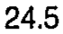 |
| r01_c01 | SCW | C3 | SCW | C3 | 22.9 | mean 22.9 mm | 22.9 | 22.9 | 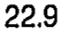 |
| r01_c02 | SCW | C4 | SCW | C4 | 24.7 | mean 24.7 mm | 24.7 | 24.7 | 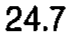 |
| r01_c03 | SCW | C5 | SCW | C5 | 24.9 | mean 24.9 mm | 24.9 | 24.9 | 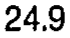 |
| r01_c04 | SCW | C6 | SCW | C6 | 25.8 | mean 25.8 mm | 25.8 | 25.8 | 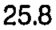 |
| r01_c05 | SCW | C7 | SCW | C7 | 24.5 | mean 24.5 mm | 24.5 | 24.5 |  |
| r02_c00 | SCW | C2 | SCW | C2 | 0.61 | sem 0.61 mm | 0.61 | 0.61 | 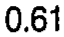 |
| r02_c01 | SCW | C3 | SCW | C3 | 1.15 | sem 1.15 mm | 1.15 | 1.15 | 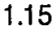 |
| r02_c02 | SCW | C4 | SCW | C4 | 0.52 | sem 0.52 mm | 0.52 | 0.52 | 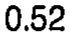 |
| r02_c03 | SCW | C5 | SCW | C5 | 1.13 | sem 1.13 mm | 1.13 | 1.13 | 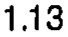 |
| r02_c04 | SCW | C6 | SCW | C6 | 0.66 | sem 0.66 mm | 0.66 | 0.66 | 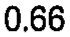 |
| r02_c05 | SCW | C7 | SCW | C7 | 0.92 | sem 0.92 mm | 0.92 | 0.92 | 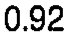 |
| r03_c00 | SCD | C2 | SCD | C2 | 21.0 (C3,C7) | mean 21.0 mm | 21.0 (C3,C7) | 21.0 (C3,C7) | 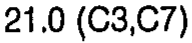 |
| r03_c01 | SCD | C3 | SCD | C3 | 16.2 | mean 16.2 mm | 16.2 | 16.2 | 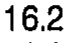 |
| r03_c02 | SCD | C4 | SCD | C4 | 17.7 | mean 17.7 mm | 17.7 | 17.7 | 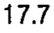 |
| r03_c03 | SCD | C5 | SCD | C5 | 17.4 | mean 17.4 mm | 17.4 | 17.4 | 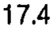 |
| r03_c04 | SCD | C6 | SCD | C6 | 18.1 | mean 18.1 mm | 18.1 | 18.1 | 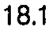 |
| r03_c05 | SCD | C7 | SCD | C7 | 15.2 | mean 15.2 mm | 15.2 | 15.2 | 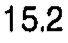 |
| r04_c00 | SCD | C2 | SCD | C2 | 0.35 | sem 0.35 mm | 0.35 | 0.35 | 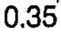 |
| r04_c01 | SCD | C3 | SCD | C3 | 1.33 | sem 1.33 mm | 1.33 | 1.33 | 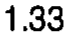 |
| r04_c02 | SCD | C4 | SCD | C4 | 0.46 | sem 0.46 mm | 0.46 | 0.46 | 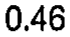 |
| r04_c03 | SCD | C5 | SCD | C5 | 0.72 | sem 0.72 mm | 0.72 | 0.72 | 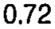 |
| r04_c04 | SCD | C6 | SCD | C6 | 0.46 | sem 0.46 mm | 0.46 | 0.46 | 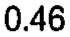 |
| r04_c05 | SCD | C7 | SCD | C7 | 1.15 | sem 1.15 mm | 1.15 | 1.15 |  |
| r05_c00 | SCW/SCD | C2 | SCW/SCD | C2 | 1.17 | ratio 1.17 | 1.17 | 1.17 |  |
| r05_c01 | SCW/SCD | C3 | SCW/SCD | C3 | 1.41 | ratio 1.41 | 1.41 | 1.41 | 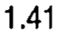 |
| r05_c02 | SCW/SCD | C4 | SCW/SCD | C4 | 1.40 | ratio 1.40 | 1.40 | 1.40 | 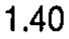 |
| r05_c03 | SCW/SCD | C5 | SCW/SCD | C5 | 1.43 | ratio 1.43 | 1.43 | 1.43 | 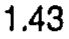 |
| r05_c04 | SCW/SCD | C6 | SCW/SCD | C6 | 1.42 | ratio 1.42 | 1.42 | 1.42 | 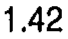 |
| r05_c05 | SCW/SCD | C7 | SCW/SCD | C7 | 1.61 | ratio 1.61 | 1.61 | 1.61 | 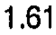 |
| r07_c00 | SCA | C2 | SCA | C2 | 374.5 (C7) | mean 374.5 mm2 | 374.5 (C7) | 374.5 (C7) | 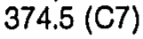 |
| r07_c01 | SCA | C3 | SCA | C3 | 248.7 | mean 248.7 mm2 | 248.7 | 248.7 | 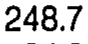 |
| r07_c02 | SCA | C4 | SCA | C4 | 272.0 | mean 272.0 mm2 | 272.0 | 272.0 | 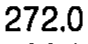 |
| r07_c03 | SCA | C5 | SCA | C5 | 249.5 | mean 249.5 mm2 | 249.5 | 249.5 | 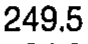 |
| r07_c04 | SCA | C6 | SCA | C6 | 266.5 | mean 266.5 mm2 | 266.5 | 266.5 | 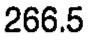 |
| r07_c05 | SCA | C7 | SCA | C7 | 223.8 | mean 223.8 mm2 | 223.8 | 223.8 | 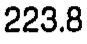 |
| r08_c00 | SCA | C2 | SCA | C2 | 13.08 | sem 13.08 mm2 | 13.08 | 13.08 | 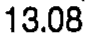 |
| r08_c01 | SCA | C3 | SCA | C3 | 34.21 | sem 34.21 mm2 | 34.21 | 34.21 | 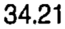 |
| r08_c02 | SCA | C4 | SCA | C4 | 26.18 | sem 26.18 mm2 | 26.18 | 26.18 | 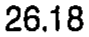 |
| r08_c03 | SCA | C5 | SCA | C5 | 34.09 | sem 34.09 mm2 | 34.09 | 34.09 | 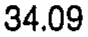 |
| r08_c04 | SCA | C6 | SCA | C6 | 24.94 | sem 24.94 mm2 | 24.94 | 24.94 | 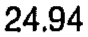 |
| r08_c05 | SCA | C7 | SCA | C7 | 36.26 | sem 36.26 mm2 | 36.26 | 36.26 | 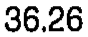 |
