# Table 4. Pedicle Dimensions

Cervical, PDF page 4, printed page 864; Panjabi_1991_Cervical_Spine_16-8_861-869.pdf (sha256 a95f369e673c6567cd6061a8d0925883f78edbe643f92bcaaca45cbd4ec99391), rendered at 300 dpi by render.py.

Every cell below is the box layout.py cut from the rendered page, and the two strings are what the two reading passes read in it (README.md). A dash is printed where the paper prints one. The value column is what provenance.csv carries.

| cell | row | column | measure | level | printed | value | pass 1 | pass 2 | image |
|---|---|---|---|---|---|---|---|---|---|
| r01_c00 | PDWr | C2 | PDWr | C2 | 7.7 | mean 7.7 mm | 7.7 | 7.7 |  |
| r01_c01 | PDWr | C3 | PDWr | C3 | 5.8 | mean 5.8 mm | 5.8 | 5.8 |  |
| r01_c02 | PDWr | C4 | PDWr | C4 | 5.7 | mean 5.7 mm | 5.7 | 5.7 | 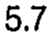 |
| r01_c03 | PDWr | C5 | PDWr | C5 | 6.1 | mean 6.1 mm | 6.1 | 6.1 |  |
| r01_c04 | PDWr | C6 | PDWr | C6 | 6.3 | mean 6.3 mm | 6.3 | 6.3 |  |
| r01_c05 | PDWr | C7 | PDWr | C7 | 6.6 | mean 6.6 mm | 6.6 | 6.6 | 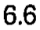 |
| r02_c00 | PDWr | C2 | PDWr | C2 | 0.35 | sem 0.35 mm | 0.35 | 0.35 | 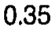 |
| r02_c01 | PDWr | C3 | PDWr | C3 | 0.64 | sem 0.64 mm | 0.64 | 0.64 | 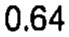 |
| r02_c02 | PDWr | C4 | PDWr | C4 | 0.60 | sem 0.60 mm | 0.60 | 0.60 |  |
| r02_c03 | PDWr | C5 | PDWr | C5 | 0.46 | sem 0.46 mm | 0.46 | 0.46 | 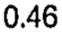 |
| r02_c04 | PDWr | C6 | PDWr | C6 | 0.49 | sem 0.49 mm | 0.49 | 0.49 | 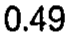 |
| r02_c05 | PDWr | C7 | PDWr | C7 | 0.42 | sem 0.42 mm | 0.42 | 0.42 | 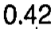 |
| r03_c00 | PDHr | C2 | PDHr | C2 | 9.4 (C3-7) | mean 9.4 mm | 9.4 (C3-7) | 9.4 (C3-7) | 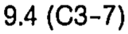 |
| r03_c01 | PDHr | C3 | PDHr | C3 | 7.6 | mean 7.6 mm | 7.6 | 7.6 |  |
| r03_c02 | PDHr | C4 | PDHr | C4 | 7.4 | mean 7.4 mm | 7.4 | 7.4 | 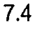 |
| r03_c03 | PDHr | C5 | PDHr | C5 | 6.7 | mean 6.7 mm | 6.7 | 6.7 |  |
| r03_c04 | PDHr | C6 | PDHr | C6 | 7.1 | mean 7.1 mm | 7.1 | 7.1 | 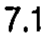 |
| r03_c05 | PDHr | C7 | PDHr | C7 | 7.5 | mean 7.5 mm | 7.5 | 7.5 | 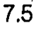 |
| r04_c00 | PDHr | C2 | PDHr | C2 | 0.46 | sem 0.46 mm | 0.46 | 0.46 | 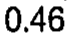 |
| r04_c01 | PDHr | C3 | PDHr | C3 | 0.46 | sem 0.46 mm | 0.46 | 0.46 | 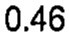 |
| r04_c02 | PDHr | C4 | PDHr | C4 | 0.42 | sem 0.42 mm | 0.42 | 0.42 | 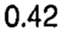 |
| r04_c03 | PDHr | C5 | PDHr | C5 | 0.42 | sem 0.42 mm | 0.42 | 0.42 | 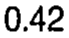 |
| r04_c04 | PDHr | C6 | PDHr | C6 | 0.39 | sem 0.39 mm | 0.39 | 0.39 | 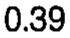 |
| r04_c05 | PDHr | C7 | PDHr | C7 | 0.32 | sem 0.32 mm | 0.32 | 0.32 | 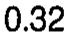 |
| r05_c00 | PDWl | C2 | PDWl | C2 | 8.3 (C3-7) | mean 8.3 mm | 8.3 (C3-7) | 8.3 (C3-7) | 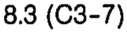 |
| r05_c01 | PDWl | C3 | PDWl | C3 | 5.4 | mean 5.4 mm | 5.4 | 5.4 |  |
| r05_c02 | PDWl | C4 | PDWl | C4 | 5.1 | mean 5.1 mm | 5.1 | 5.1 | 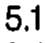 |
| r05_c03 | PDWl | C5 | PDWl | C5 | 5.1 | mean 5.1 mm | 5.1 | 5.1 |  |
| r05_c04 | PDWl | C6 | PDWl | C6 | 5.6 | mean 5.6 mm | 5.6 | 5.6 |  |
| r05_c05 | PDWl | C7 | PDWl | C7 | 6.5 (C4-5) | mean 6.5 mm | 6.5 (C4-5) | 6.5 (C4-5) | 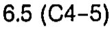 |
| r06_c00 | PDWl | C2 | PDWl | C2 | 0.07 | sem 0.07 mm | 0.07 | 0.07 | 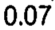 |
| r06_c01 | PDWl | C3 | PDWl | C3 | 0.32 | sem 0.32 mm | 0.32 | 0.32 | 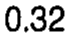 |
| r06_c02 | PDWl | C4 | PDWl | C4 | 0.46 | sem 0.46 mm | 0.46 | 0.46 | 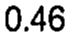 |
| r06_c03 | PDWl | C5 | PDWl | C5 | 0.35 | sem 0.35 mm | 0.35 | 0.35 | 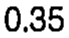 |
| r06_c04 | PDWl | C6 | PDWl | C6 | 0.39 | sem 0.39 mm | 0.39 | 0.39 | 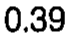 |
| r06_c05 | PDWl | C7 | PDWl | C7 | 0.35 | sem 0.35 mm | 0.35 | 0.35 | 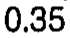 |
| r07_c00 | PDHl | C2 | PDHl | C2 | 11.1 (C3-7) | mean 11.1 mm | 11.1 (C3-7) | 11.1 (C3-7) | 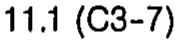 |
| r07_c01 | PDHl | C3 | PDHl | C3 | 7.2 | mean 7.2 mm | 7.2 | 7.2 | 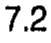 |
| r07_c02 | PDHl | C4 | PDHl | C4 | 7.3 | mean 7.3 mm | 7.3 | 7.3 | 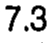 |
| r07_c03 | PDHl | C5 | PDHl | C5 | 7.3 | mean 7.3 mm | 7.3 | 7.3 |  |
| r07_c04 | PDHl | C6 | PDHl | C6 | 7.5 | mean 7.5 mm | 7.5 | 7.5 |  |
| r07_c05 | PDHl | C7 | PDHl | C7 | 7.5 | mean 7.5 mm | 7.5 | 7.5 |  |
| r08_c00 | PDHl | C2 | PDHl | C2 | 0.14 | sem 0.14 mm | 0.14 | 0.14 | 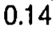 |
| r08_c01 | PDHl | C3 | PDHl | C3 | 0.35 | sem 0.35 mm | 0.35 | 0.35 | 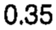 |
| r08_c02 | PDHl | C4 | PDHl | C4 | 0.49 | sem 0.49 mm | 0.49 | 0.49 | 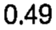 |
| r08_c03 | PDHl | C5 | PDHl | C5 | 0.39 | sem 0.39 mm | 0.39 | 0.39 | 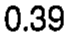 |
| r08_c04 | PDHl | C6 | PDHl | C6 | 0.32 | sem 0.32 mm | 0.32 | 0.32 | 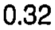 |
| r08_c05 | PDHl | C7 | PDHl | C7 | 0.28 | sem 0.28 mm | 0.28 | 0.28 | 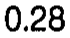 |
| r09_c00 | PDHr/PDWr | C2 | PDHr/PDWr | C2 | 1.22 | ratio 1.22 | 1.22 | 1.22 | 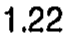 |
| r09_c01 | PDHr/PDWr | C3 | PDHr/PDWr | C3 | 1.3 | ratio 1.3 | 1.3 | 1.3 | 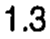 |
| r09_c02 | PDHr/PDWr | C4 | PDHr/PDWr | C4 | 1.3 | ratio 1.3 | 1.3 | 1.3 |  |
| r09_c03 | PDHr/PDWr | C5 | PDHr/PDWr | C5 | 1.1 | ratio 1.1 | 1.1 | 1.1 |  |
| r09_c04 | PDHr/PDWr | C6 | PDHr/PDWr | C6 | 1.1 | ratio 1.1 | 1.1 | 1.1 | 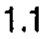 |
| r09_c05 | PDHr/PDWr | C7 | PDHr/PDWr | C7 | 1.1 | ratio 1.1 | 1.1 | 1.1 |  |
| r10_c00 | PDHl/PDWl | C2 | PDHl/PDWl | C2 | 1.34 | ratio 1.34 | 1.34 | 1.34 | 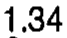 |
| r10_c01 | PDHl/PDWl | C3 | PDHl/PDWl | C3 | 1.3 | ratio 1.3 | 1.3 | 1.3 | 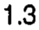 |
| r10_c02 | PDHl/PDWl | C4 | PDHl/PDWl | C4 | 1.43 | ratio 1.43 | 1.43 | 1.43 | 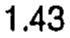 |
| r10_c03 | PDHl/PDWl | C5 | PDHl/PDWl | C5 | 1.43 | ratio 1.43 | 1.43 | 1.43 | 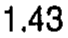 |
| r10_c04 | PDHl/PDWl | C6 | PDHl/PDWl | C6 | 1.34 | ratio 1.34 | 1.34 | 1.34 | 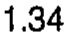 |
| r10_c05 | PDHl/PDWl | C7 | PDHl/PDWl | C7 | 1.15 | ratio 1.15 | 1.15 | 1.15 |  |
| r12_c00 | PDAr | C2 | PDAr | C2 | 32.3 | mean 32.3 mm2 | 32.3 | 32.3 | 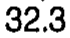 |
| r12_c01 | PDAr | C3 | PDAr | C3 | 24.2 | mean 24.2 mm2 | 24.2 | 24.2 |  |
| r12_c02 | PDAr | C4 | PDAr | C4 | 24.7 | mean 24.7 mm2 | 24.7 | 24.7 |  |
| r12_c03 | PDAr | C5 | PDAr | C5 | 23.8 | mean 23.8 mm2 | 23.8 | 23.8 | 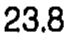 |
| r12_c04 | PDAr | C6 | PDAr | C6 | 24.5 | mean 24.5 mm2 | 24.5 | 24.5 |  |
| r12_c05 | PDAr | C7 | PDAr | C7 | 30.4 | mean 30.4 mm2 | 30.4 | 30.4 | 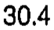 |
| r13_c00 | PDAr | C2 | PDAr | C2 | 2.44 | sem 2.44 mm2 | 2.44 | 2.44 | 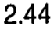 |
| r13_c01 | PDAr | C3 | PDAr | C3 | 2.69 | sem 2.69 mm2 | 2.69 | 2.69 | 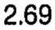 |
| r13_c02 | PDAr | C4 | PDAr | C4 | 2.65 | sem 2.65 mm2 | 2.65 | 2.65 | 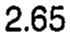 |
| r13_c03 | PDAr | C5 | PDAr | C5 | 2.83 | sem 2.83 mm2 | 2.83 | 2.83 | 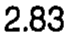 |
| r13_c04 | PDAr | C6 | PDAr | C6 | 2.58 | sem 2.58 mm2 | 2.58 | 2.58 |  |
| r13_c05 | PDAr | C7 | PDAr | C7 | 3.08 | sem 3.08 mm2 | 3.08 | 3.08 |  |
| r14_c00 | PDAl | C2 | PDAl | C2 | 51.8 (C3-7) | mean 51.8 mm2 | 51.8 (C3-7) | 51.8 (C3-7) |  |
| r14_c01 | PDAl | C3 | PDAl | C3 | 21.4 | mean 21.4 mm2 | 21.4 | 21.4 |  |
| r14_c02 | PDAl | C4 | PDAl | C4 | 24.0 | mean 24.0 mm2 | 24.0 | 24.0 |  |
| r14_c03 | PDAl | C5 | PDAl | C5 | 23.9 | mean 23.9 mm2 | 23.9 | 23.9 |  |
| r14_c04 | PDAl | C6 | PDAl | C6 | 27.9 | mean 27.9 mm2 | 27.9 | 27.9 |  |
| r14_c05 | PDAl | C7 | PDAl | C7 | 27.8 | mean 27.8 mm2 | 27.8 | 27.8 |  |
| r15_c00 | PDAl | C2 | PDAl | C2 | 0.28 | sem 0.28 mm2 | 0.28 | 0.28 |  |
| r15_c01 | PDAl | C3 | PDAl | C3 | 2.02 | sem 2.02 mm2 | 2.02 | 2.02 |  |
| r15_c02 | PDAl | C4 | PDAl | C4 | 3.08 | sem 3.08 mm2 | 3.08 | 3.08 |  |
| r15_c03 | PDAl | C5 | PDAl | C5 | 2.58 | sem 2.58 mm2 | 2.58 | 2.58 |  |
| r15_c04 | PDAl | C6 | PDAl | C6 | 2.47 | sem 2.47 mm2 | 2.47 | 2.47 |  |
| r15_c05 | PDAl | C7 | PDAl | C7 | 2.37 | sem 2.37 mm2 | 2.37 | 2.37 |  |
| r17_c00 | PDIsr | C2 | PDIsr | C2 | - | (none) | - | - |  |
| r17_c01 | PDIsr | C3 | PDIsr | C3 | 41.6 | mean 41.6 deg | 41.6 | 41.6 |  |
| r17_c02 | PDIsr | C4 | PDIsr | C4 | 44.6 | mean 44.6 deg | 44.6 | 44.6 |  |
| r17_c03 | PDIsr | C5 | PDIsr | C5 | 39.3 | mean 39.3 deg | 39.3 | 39.3 |  |
| r17_c04 | PDIsr | C6 | PDIsr | C6 | 29.6 (C3-5) | mean 29.6 deg | 29.6 (C3-5) | 29.6 (C3-5) |  |
| r17_c05 | PDIsr | C7 | PDIsr | C7 | 33.1 (C4) | mean 33.1 deg | 33.1 (C4) | 33.1 (C4) |  |
| r18_c00 | PDIsr | C2 | PDIsr | C2 | - | (none) | - | - |  |
| r18_c01 | PDIsr | C3 | PDIsr | C3 | 1.13 | sem 1.13 deg | 1.13 | 1.13 |  |
| r18_c02 | PDIsr | C4 | PDIsr | C4 | 1.66 | sem 1.66 deg | 1.66 | 1.66 |  |
| r18_c03 | PDIsr | C5 | PDIsr | C5 | 4.45 | sem 4.45 deg | 4.45 | 4.45 |  |
| r18_c04 | PDIsr | C6 | PDIsr | C6 | 2.30 | sem 2.30 deg | 2.30 | 2.30 |  |
| r18_c05 | PDIsr | C7 | PDIsr | C7 | 2.23 | sem 2.23 deg | 2.23 | 2.23 |  |
| r19_c00 | PDItr | C2 | PDItr | C2 | - | (none) | - | - |  |
| r19_c01 | PDItr | C3 | PDItr | C3 | -9.2 | mean -9.2 deg | -9.2 | -9.2 |  |
| r19_c02 | PDItr | C4 | PDItr | C4 | -8.6 | mean -8.6 deg | -8.6 | -8.6 |  |
| r19_c03 | PDItr | C5 | PDItr | C5 | -6.3 | mean -6.3 deg | -6.3 | -6.3 |  |
| r19_c04 | PDItr | C6 | PDItr | C6 | 7.1 (C3-5) | mean 7.1 deg | 7.1 (C3-5) | 7.1 (C3-5) |  |
| r19_c05 | PDItr | C7 | PDItr | C7 | 13.4 (C3-5) | mean 13.4 deg | 13.4 (C3-5) | 13.4 (C3-5) |  |
| r20_c00 | PDItr | C2 | PDItr | C2 | - | (none) | - | - |  |
| r20_c01 | PDItr | C3 | PDItr | C3 | 2.58 | sem 2.58 deg | 2.58 | 2.58 |  |
| r20_c02 | PDItr | C4 | PDItr | C4 | 2.44 | sem 2.44 deg | 2.44 | 2.44 |  |
| r20_c03 | PDItr | C5 | PDItr | C5 | 1.63 | sem 1.63 deg | 1.63 | 1.63 |  |
| r20_c04 | PDItr | C6 | PDItr | C6 | 1.13 | sem 1.13 deg | 1.13 | 1.13 |  |
| r20_c05 | PDItr | C7 | PDItr | C7 | 1.70 | sem 1.70 deg | 1.70 | 1.70 |  |
| r21_c00 | PDIsl | C2 | PDIsl | C2 | - | (none) | - | - |  |
| r21_c01 | PDIsl | C3 | PDIsl | C3 | 42.9 | mean 42.9 deg | 42.9 | 42.9 |  |
| r21_c02 | PDIsl | C4 | PDIsl | C4 | 43.9 | mean 43.9 deg | 43.9 | 43.9 |  |
| r21_c03 | PDIsl | C5 | PDIsl | C5 | 41.2 | mean 41.2 deg | 41.2 | 41.2 |  |
| r21_c04 | PDIsl | C6 | PDIsl | C6 | 34.1 | mean 34.1 deg | 34.1 | 34.1 |  |
| r21_c05 | PDIsl | C7 | PDIsl | C7 | 26.7 (C3-5) | mean 26.7 deg | 26.7 (C3-5) | 26.7 (C3-5) |  |
| r22_c00 | PDIsl | C2 | PDIsl | C2 | - | (none) | - | - |  |
| r22_c01 | PDIsl | C3 | PDIsl | C3 | 2.16 | sem 2.16 deg | 2.16 | 2.16 |  |
| r22_c02 | PDIsl | C4 | PDIsl | C4 | 2.47 | sem 2.47 deg | 2.47 | 2.47 |  |
| r22_c03 | PDIsl | C5 | PDIsl | C5 | 4.77 | sem 4.77 deg | 4.77 | 4.77 |  |
| r22_c04 | PDIsl | C6 | PDIsl | C6 | 2.16 | sem 2.16 deg | 2.16 | 2.16 |  |
| r22_c05 | PDIsl | C7 | PDIsl | C7 | 2.69 | sem 2.69 deg | 2.69 | 2.69 |  |
| r23_c00 | PDItl | C2 | PDItl | C2 | - | (none) | - | - |  |
| r23_c01 | PDItl | C3 | PDItl | C3 | -7.1 | mean -7.1 deg | -7.1 | -7.1 |  |
| r23_c02 | PDItl | C4 | PDItl | C4 | -6.5 | mean -6.5 deg | -6.5 | -6.5 |  |
| r23_c03 | PDItl | C5 | PDItl | C5 | -5.7 | mean -5.7 deg | -5.7 | -5.7 |  |
| r23_c04 | PDItl | C6 | PDItl | C6 | 5.9 (C3-5) | mean 5.9 deg | 5.9 (C3-5) | 5.9 (C3-5) |  |
| r23_c05 | PDItl | C7 | PDItl | C7 | 9.2 (C3-5) | mean 9.2 deg | 9.2 (C3-5) | 9.2 (C3-5) |  |
| r24_c00 | PDItl | C2 | PDItl | C2 | - | (none) | - | - |  |
| r24_c01 | PDItl | C3 | PDItl | C3 | 0.67 | sem 0.67 deg | 0.67 | 0.67 |  |
| r24_c02 | PDItl | C4 | PDItl | C4 | 1.66 | sem 1.66 deg | 1.66 | 1.66 |  |
| r24_c03 | PDItl | C5 | PDItl | C5 | 1.48 | sem 1.48 deg | 1.48 | 1.48 |  |
| r24_c04 | PDItl | C6 | PDItl | C6 | 2.51 | sem 2.51 deg | 2.51 | 2.51 |  |
| r24_c05 | PDItl | C7 | PDItl | C7 | 1.52 | sem 1.52 deg | 1.52 | 1.52 |  |
