# Table 5. Spinous Process and Transverse Process

Cervical, PDF page 4, printed page 864; Panjabi_1991_Cervical_Spine_16-8_861-869.pdf (sha256 a95f369e673c6567cd6061a8d0925883f78edbe643f92bcaaca45cbd4ec99391), rendered at 300 dpi by render.py.

Every cell below is the box layout.py cut from the rendered page, and the two strings are what the two reading passes read in it (README.md). A dash is printed where the paper prints one. The value column is what provenance.csv carries.

| cell | row | column | measure | level | printed | value | pass 1 | pass 2 | image |
|---|---|---|---|---|---|---|---|---|---|
| r01_c00 | SPL | C2 | SPL | C2 | 33.7 | mean 33.7 mm | 33.7 | 33.7 | 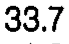 |
| r01_c01 | SPL | C3 | SPL | C3 | 29.6 | mean 29.6 mm | 29.6 | 29.6 | 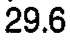 |
| r01_c02 | SPL | C4 | SPL | C4 | 30.3 | mean 30.3 mm | 30.3 | 30.3 | 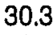 |
| r01_c03 | SPL | C5 | SPL | C5 | 28.5 | mean 28.5 mm | 28.5 | 28.5 | 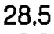 |
| r01_c04 | SPL | C6 | SPL | C6 | 34.2 | mean 34.2 mm | 34.2 | 34.2 | 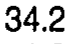 |
| r01_c05 | SPL | C7 | SPL | C7 | 45.7 (C2-6) | mean 45.7 mm | 45.7 (C2-6) | 45.7 (C2-6) | 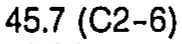 |
| r02_c00 | SPL | C2 | SPL | C2 | 1.39 | sem 1.39 mm | 1.39 | 1.39 | 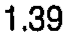 |
| r02_c01 | SPL | C3 | SPL | C3 | 0.78 | sem 0.78 mm | 0.78 | 0.78 | 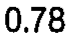 |
| r02_c02 | SPL | C4 | SPL | C4 | 1.07 | sem 1.07 mm | 1.07 | 1.07 |  |
| r02_c03 | SPL | C5 | SPL | C5 | 0.98 | sem 0.98 mm | 0.98 | 0.98 | 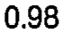 |
| r02_c04 | SPL | C6 | SPL | C6 | 1.88 | sem 1.88 mm | 1.88 | 1.88 | 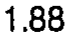 |
| r02_c05 | SPL | C7 | SPL | C7 | 0.84 | sem 0.84 mm | 0.84 | 0.84 | 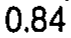 |
| r03_c00 | TPW | C2 | TPW | C2 | 52.6 | mean 52.6 mm | 52.6 | 52.6 | 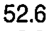 |
| r03_c01 | TPW | C3 | TPW | C3 | 50.3 | mean 50.3 mm | 50.3 | 50.3 | 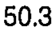 |
| r03_c02 | TPW | C4 | TPW | C4 | 48.5 | mean 48.5 mm | 48.5 | 48.5 | 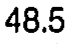 |
| r03_c03 | TPW | C5 | TPW | C5 | 46.4 | mean 46.4 mm | 46.4 | 46.4 | 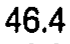 |
| r03_c04 | TPW | C6 | TPW | C6 | 49.5 | mean 49.5 mm | 49.5 | 49.5 | 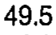 |
| r03_c05 | TPW | C7 | TPW | C7 | 66.6 (C2-6) | mean 66.6 mm | 66.6 (C2-6) | 66.6 (C2-6) | 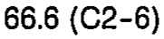 |
| r04_c00 | TPW | C2 | TPW | C2 | 2.08 | sem 2.08 mm | 2.08 | 2.08 |  |
| r04_c01 | TPW | C3 | TPW | C3 | 1.62 | sem 1.62 mm | 1.62 | 1.62 | 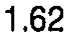 |
| r04_c02 | TPW | C4 | TPW | C4 | 2.14 | sem 2.14 mm | 2.14 | 2.14 |  |
| r04_c03 | TPW | C5 | TPW | C5 | 2.97 | sem 2.97 mm | 2.97 | 2.97 | 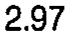 |
| r04_c04 | TPW | C6 | TPW | C6 | 2.11 | sem 2.11 mm | 2.11 | 2.11 | 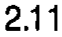 |
| r04_c05 | TPW | C7 | TPW | C7 | 1.13 | sem 1.13 mm | 1.13 | 1.13 | 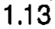 |
