# Table 6. Uncovertebral Joints

Cervical, PDF page 5, printed page 865; Panjabi_1991_Cervical_Spine_16-8_861-869.pdf (sha256 a95f369e673c6567cd6061a8d0925883f78edbe643f92bcaaca45cbd4ec99391), rendered at 300 dpi by render.py.

Every cell below is the box layout.py cut from the rendered page, and the two strings are what the two reading passes read in it (README.md). A dash is printed where the paper prints one. The value column is what provenance.csv carries.

| cell | row | column | measure | level | printed | value | pass 1 | pass 2 | image |
|---|---|---|---|---|---|---|---|---|---|
| r01_c00 | UJAru | C2 | UJAru | C2 | - | (none) | - | - | 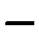 |
| r01_c01 | UJAru | C3 | UJAru | C3 | 46.7 | mean 46.7 mm2 | 46.7 | 46.7 | 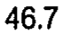 |
| r01_c02 | UJAru | C4 | UJAru | C4 | 40.9 | mean 40.9 mm2 | 40.9 | 40.9 | 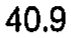 |
| r01_c03 | UJAru | C5 | UJAru | C5 | 45.3 | mean 45.3 mm2 | 45.3 | 45.3 | 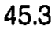 |
| r01_c04 | UJAru | C6 | UJAru | C6 | 48.8 | mean 48.8 mm2 | 48.8 | 48.8 | 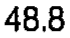 |
| r01_c05 | UJAru | C7 | UJAru | C7 | 43.1 | mean 43.1 mm2 | 43.1 | 43.1 | 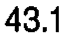 |
| r02_c00 | UJAru | C2 | UJAru | C2 | - | (none) | - | - | 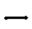 |
| r02_c01 | UJAru | C3 | UJAru | C3 | 4.27 | sem 4.27 mm2 | 4.27 | 4.27 | 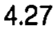 |
| r02_c02 | UJAru | C4 | UJAru | C4 | 3.18 | sem 3.18 mm2 | 3.18 | 3.18 | 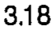 |
| r02_c03 | UJAru | C5 | UJAru | C5 | 6.09 | sem 6.09 mm2 | 6.09 | 6.09 |  |
| r02_c04 | UJAru | C6 | UJAru | C6 | 3.32 | sem 3.32 mm2 | 3.32 | 3.32 | 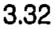 |
| r02_c05 | UJAru | C7 | UJAru | C7 | 3.84 | sem 3.84 mm2 | 3.84 | 3.84 | 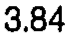 |
| r03_c00 | UJAlu | C2 | UJAlu | C2 | - | (none) | - | - | 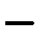 |
| r03_c01 | UJAlu | C3 | UJAlu | C3 | 40.5 | mean 40.5 mm2 | 40.5 | 40.5 | 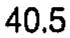 |
| r03_c02 | UJAlu | C4 | UJAlu | C4 | 37.0 | mean 37.0 mm2 | 37.0 | 37.0 | 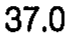 |
| r03_c03 | UJAlu | C5 | UJAlu | C5 | 40.4 | mean 40.4 mm2 | 40.4 | 40.4 | 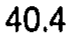 |
| r03_c04 | UJAlu | C6 | UJAlu | C6 | 58.1 | mean 58.1 mm2 | 58.1 | 58.1 | 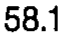 |
| r03_c05 | UJAlu | C7 | UJAlu | C7 | 41.2 | mean 41.2 mm2 | 41.2 | 41.2 | 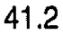 |
| r04_c00 | UJAlu | C2 | UJAlu | C2 | - | (none) | - | - | 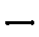 |
| r04_c01 | UJAlu | C3 | UJAlu | C3 | 3.95 | sem 3.95 mm2 | 3.95 | 3.95 | 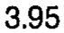 |
| r04_c02 | UJAlu | C4 | UJAlu | C4 | 3.41 | sem 3.41 mm2 | 3.41 | 3.41 | 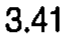 |
| r04_c03 | UJAlu | C5 | UJAlu | C5 | 4.73 | sem 4.73 mm2 | 4.73 | 4.73 | 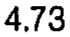 |
| r04_c04 | UJAlu | C6 | UJAlu | C6 | 7.45 | sem 7.45 mm2 | 7.45 | 7.45 | 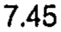 |
| r04_c05 | UJAlu | C7 | UJAlu | C7 | 3.15 | sem 3.15 mm2 | 3.15 | 3.15 | 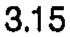 |
| r05_c00 | UJArl | C2 | UJArl | C2 | 19.8 | mean 19.8 mm2 | 19.8 | 19.8 |  |
| r05_c01 | UJArl | C3 | UJArl | C3 | 22.6 | mean 22.6 mm2 | 22.6 | 22.6 | 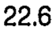 |
| r05_c02 | UJArl | C4 | UJArl | C4 | 25.5 | mean 25.5 mm2 | 25.5 | 25.5 | 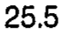 |
| r05_c03 | UJArl | C5 | UJArl | C5 | 27.2 | mean 27.2 mm2 | 27.2 | 27.2 | 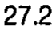 |
| r05_c04 | UJArl | C6 | UJArl | C6 | 25.6 | mean 25.6 mm2 | 25.6 | 25.6 | 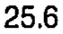 |
| r05_c05 | UJArl | C7 | UJArl | C7 | 23.4 | mean 23.4 mm2 | 23.4 | 23.4 | 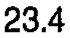 |
| r06_c00 | UJArl | C2 | UJArl | C2 | 3.70 | sem 3.70 mm2 | 3.70 | 3.70 | 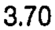 |
| r06_c01 | UJArl | C3 | UJArl | C3 | 2.51 | sem 2.51 mm2 | 2.51 | 2.51 | 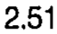 |
| r06_c02 | UJArl | C4 | UJArl | C4 | 3.26 | sem 3.26 mm2 | 3.26 | 3.26 | 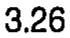 |
| r06_c03 | UJArl | C5 | UJArl | C5 | 2.94 | sem 2.94 mm2 | 2.94 | 2.94 | 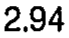 |
| r06_c04 | UJArl | C6 | UJArl | C6 | 2.66 | sem 2.66 mm2 | 2.66 | 2.66 | 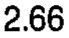 |
| r06_c05 | UJArl | C7 | UJArl | C7 | 2.71 | sem 2.71 mm2 | 2.71 | 2.71 | 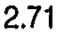 |
| r07_c00 | UJAll | C2 | UJAll | C2 | 17.7 | mean 17.7 mm2 | 17.7 | 17.7 |  |
| r07_c01 | UJAll | C3 | UJAll | C3 | 22.3 | mean 22.3 mm2 | 22.3 | 22.3 | 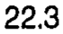 |
| r07_c02 | UJAll | C4 | UJAll | C4 | 23.5 | mean 23.5 mm2 | 23.5 | 23.5 | 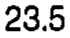 |
| r07_c03 | UJAll | C5 | UJAll | C5 | 30.5 | mean 30.5 mm2 | 30.5 | 30.5 | 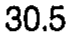 |
| r07_c04 | UJAll | C6 | UJAll | C6 | 23.9 | mean 23.9 mm2 | 23.9 | 23.9 | 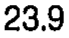 |
| r07_c05 | UJAll | C7 | UJAll | C7 | 19.0 | mean 19.0 mm2 | 19.0 | 19.0 |  |
| r08_c00 | UJAll | C2 | UJAll | C2 | 2.40 | sem 2.40 mm2 | 2.40 | 2.40 | 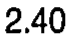 |
| r08_c01 | UJAll | C3 | UJAll | C3 | 2.89 | sem 2.89 mm2 | 2.89 | 2.89 | 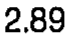 |
| r08_c02 | UJAll | C4 | UJAll | C4 | 1.96 | sem 1.96 mm2 | 1.96 | 1.96 | 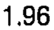 |
| r08_c03 | UJAll | C5 | UJAll | C5 | 3.84 | sem 3.84 mm2 | 3.84 | 3.84 | 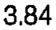 |
| r08_c04 | UJAll | C6 | UJAll | C6 | 1.79 | sem 1.79 mm2 | 1.79 | 1.79 | 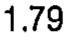 |
| r08_c05 | UJAll | C7 | UJAll | C7 | 3.00 | sem 3.00 mm2 | 3.00 | 3.00 | 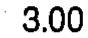 |
| r10_c00 | UJIfu | C2 | UJIfu | C2 | - | (none) | - | - | 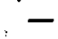 |
| r10_c01 | UJIfu | C3 | UJIfu | C3 | 76.6 | mean 76.6 deg | 76.6 | 76.6 | 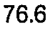 |
| r10_c02 | UJIfu | C4 | UJIfu | C4 | 76.2 | mean 76.2 deg | 76.2 | 76.2 | 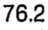 |
| r10_c03 | UJIfu | C5 | UJIfu | C5 | 82.7 | mean 82.7 deg | 82.7 | 82.7 | 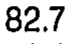 |
| r10_c04 | UJIfu | C6 | UJIfu | C6 | 104.0 (C3-5) | mean 104.0 deg | 104.0 (C3-5) | 104.0 (C3-5) | 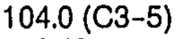 |
| r10_c05 | UJIfu | C7 | UJIfu | C7 | 115.6 (C3-6) | mean 115.6 deg | 115.6 (C3-6) | 115.6 (C3-6) | 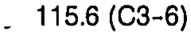 |
| r11_c00 | UJIfu | C2 | UJIfu | C2 | - | (none) | - | - |  |
| r11_c01 | UJIfu | C3 | UJIfu | C3 | 2.22 | sem 2.22 deg | 2.22 | 2.22 |  |
| r11_c02 | UJIfu | C4 | UJIfu | C4 | 2.45 | sem 2.45 deg | 2.45 | 2.45 |  |
| r11_c03 | UJIfu | C5 | UJIfu | C5 | 1.44 | sem 1.44 deg | 1.44 | 1.44 |  |
| r11_c04 | UJIfu | C6 | UJIfu | C6 | 2.40 | sem 2.40 deg | 2.40 | 2.40 |  |
| r11_c05 | UJIfu | C7 | UJIfu | C7 | 2.68 | sem 2.68 deg | 2.68 | 2.68 |  |
| r12_c00 | UJIsu | C2 | UJIsu | C2 | - | (none) | - | - |  |
| r12_c01 | UJIsu | C3 | UJIsu | C3 | 38.7 | mean 38.7 deg | 38.7 | 38.7 |  |
| r12_c02 | UJIsu | C4 | UJIsu | C4 | 40.0 | mean 40.0 deg | 40.0 | 40.0 |  |
| r12_c03 | UJIsu | C5 | UJIsu | C5 | 34.5 | mean 34.5 deg | 34.5 | 34.5 |  |
| r12_c04 | UJIsu | C6 | UJIsu | C6 | 40.8 | mean 40.8 deg | 40.8 | 40.8 |  |
| r12_c05 | UJIsu | C7 | UJIsu | C7 | 47.3 | mean 47.3 deg | 47.3 | 47.3 |  |
| r13_c00 | UJIsu | C2 | UJIsu | C2 | - | (none) | - | - |  |
| r13_c01 | UJIsu | C3 | UJIsu | C3 | 3.87 | sem 3.87 deg | 3.87 | 3.87 |  |
| r13_c02 | UJIsu | C4 | UJIsu | C4 | 2.89 | sem 2.89 deg | 2.89 | 2.89 |  |
| r13_c03 | UJIsu | C5 | UJIsu | C5 | 2.08 | sem 2.08 deg | 2.08 | 2.08 |  |
| r13_c04 | UJIsu | C6 | UJIsu | C6 | 3.52 | sem 3.52 deg | 3.52 | 3.52 |  |
| r13_c05 | UJIsu | C7 | UJIsu | C7 | 3.00 | sem 3.00 deg | 3.00 | 3.00 |  |
| r14_c00 | UJIfl | C2 | UJIfl | C2 | 78.4 | mean 78.4 deg | 78.4 | 78.4 |  |
| r14_c01 | UJIfl | C3 | UJIfl | C3 | 81.6 | mean 81.6 deg | 81.6 | 81.6 |  |
| r14_c02 | UJIfl | C4 | UJIfl | C4 | 83.5 | mean 83.5 deg | 83.5 | 83.5 |  |
| r14_c03 | UJIfl | C5 | UJIfl | C5 | 84.9 | mean 84.9 deg | 84.9 | 84.9 |  |
| r14_c04 | UJIfl | C6 | UJIfl | C6 | 106.2 (C2-5) | mean 106.2 deg | 106.2 (C2-5) | 106.2 (C2-5) |  |
| r14_c05 | UJIfl | C7 | UJIfl | C7 | 113.4 (C2-5) | mean 113.4 deg | 113.4 (C2-5) | 113.4 (C2-5) |  |
| r15_c00 | UJIfl | C2 | UJIfl | C2 | 3.20 | sem 3.20 deg | 3.20 | 3.20 |  |
| r15_c01 | UJIfl | C3 | UJIfl | C3 | 1.59 | sem 1.59 deg | 1.59 | 1.59 |  |
| r15_c02 | UJIfl | C4 | UJIfl | C4 | 1.39 | sem 1.39 deg | 1.39 | 1.39 |  |
| r15_c03 | UJIfl | C5 | UJIfl | C5 | 1.10 | sem 1.10 deg | 1.10 | 1.10 |  |
| r15_c04 | UJIfl | C6 | UJIfl | C6 | 2.28 | sem 2.28 deg | 2.28 | 2.28 |  |
| r15_c05 | UJIfl | C7 | UJIfl | C7 | 2.17 | sem 2.17 deg | 2.17 | 2.17 |  |
| r16_c00 | UJIsl | C2 | UJIsl | C2 | 63.7 (C5) | mean 63.7 deg | 63.7 (C5) | 63.7 (C5) |  |
| r16_c01 | UJIsl | C3 | UJIsl | C3 | 47.8 | mean 47.8 deg | 47.8 | 47.8 |  |
| r16_c02 | UJIsl | C4 | UJIsl | C4 | 47.8 | mean 47.8 deg | 47.8 | 47.8 |  |
| r16_c03 | UJIsl | C5 | UJIsl | C5 | 45.0 | mean 45.0 deg | 45.0 | 45.0 |  |
| r16_c04 | UJIsl | C6 | UJIsl | C6 | 49.2 | mean 49.2 deg | 49.2 | 49.2 |  |
| r16_c05 | UJIsl | C7 | UJIsl | C7 | 59.8 | mean 59.8 deg | 59.8 | 59.8 |  |
| r17_c00 | UJIsl | C2 | UJIsl | C2 | 5.05 | sem 5.05 deg | 5.05 | 5.05 |  |
| r17_c01 | UJIsl | C3 | UJIsl | C3 | 4.01 | sem 4.01 deg | 4.01 | 4.01 |  |
| r17_c02 | UJIsl | C4 | UJIsl | C4 | 3.46 | sem 3.46 deg | 3.46 | 3.46 |  |
| r17_c03 | UJIsl | C5 | UJIsl | C5 | 3.03 | sem 3.03 deg | 3.03 | 3.03 |  |
| r17_c04 | UJIsl | C6 | UJIsl | C6 | 4.33 | sem 4.33 deg | 4.33 | 4.33 |  |
| r17_c05 | UJIsl | C7 | UJIsl | C7 | 4.47 | sem 4.47 deg | 4.47 | 4.47 |  |
