# Table 7. Comparison with Previous Studies

Cervical, PDF page 8, printed page 868; Panjabi_1991_Cervical_Spine_16-8_861-869.pdf (sha256 a95f369e673c6567cd6061a8d0925883f78edbe643f92bcaaca45cbd4ec99391), rendered at 300 dpi by render.py.

Every cell below is the box layout.py cut from the rendered page, and the two strings are what the two reading passes read in it (README.md). A dash is printed where the paper prints one. The value column is what provenance.csv carries.

| cell | row | column | measure | level | printed | value | pass 1 | pass 2 | image |
|---|---|---|---|---|---|---|---|---|---|
| r00_c00 | EPDl | Level | EPDl | C2 | C2 | mean C2 | C2 | C2 |  |
| r00_c01 | EPDl | Present Study | EPDl | C2 | 15.6 | mean 15.6 mm | 15.6 | 15.6 | 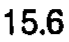 |
| r00_c02 | EPDl | Liu (1986) | EPDl | C2 | - | (none) | - | - |  |
| r00_c03 | EPDl | Nissan (1984) | EPDl | C2 | 15.3 | mean 15.3 mm | 15.3 | 15.3 |  |
| r00_c04 | EPDl | Francis (1952) | EPDl | C2 | 16.1 | mean 16.1 mm | 16.1 | 16.1 |  |
| r01_c00 | EPDl | Level | EPDl | C3 | C3 | mean C3 | C3 | C3 |  |
| r01_c01 | EPDl | Present Study | EPDl | C3 | 15.6 | mean 15.6 mm | 15.6 | 15.6 |  |
| r01_c02 | EPDl | Liu (1986) | EPDl | C3 | 14.4 | mean 14.4 mm | 14.4 | 14.4 |  |
| r01_c03 | EPDl | Nissan (1984) | EPDl | C3 | 15.6 | mean 15.6 mm | 15.6 | 15.6 |  |
| r01_c04 | EPDl | Francis (1952) | EPDl | C3 | 16.4 | mean 16.4 mm | 16.4 | 16.4 |  |
| r02_c00 | EPDl | Level | EPDl | C4 | C4 | mean C4 | C4 | C4 | 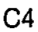 |
| r02_c01 | EPDl | Present Study | EPDl | C4 | 15.9 | mean 15.9 mm | 15.9 | 15.9 |  |
| r02_c02 | EPDl | Liu (1986) | EPDl | C4 | 14.1 | mean 14.1 mm | 14.1 | 14.1 | 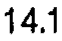 |
| r02_c03 | EPDl | Nissan (1984) | EPDl | C4 | 15.8 | mean 15.8 mm | 15.8 | 15.8 |  |
| r02_c04 | EPDl | Francis (1952) | EPDl | C4 | 16.5 | mean 16.5 mm | 16.5 | 16.5 |  |
| r03_c00 | EPDl | Level | EPDl | C5 | C5 | mean C5 | C5 | C5 |  |
| r03_c01 | EPDl | Present Study | EPDl | C5 | 17.9 | mean 17.9 mm | 17.9 | 17.9 |  |
| r03_c02 | EPDl | Liu (1986) | EPDl | C5 | 14.8 | mean 14.8 mm | 14.8 | 14.8 |  |
| r03_c03 | EPDl | Nissan (1984) | EPDl | C5 | 16.1 | mean 16.1 mm | 16.1 | 16.1 |  |
| r03_c04 | EPDl | Francis (1952) | EPDl | C5 | 16.8 | mean 16.8 mm | 16.8 | 16.8 |  |
| r04_c00 | EPDl | Level | EPDl | C6 | C6 | mean C6 | C6 | C6 |  |
| r04_c01 | EPDl | Present Study | EPDl | C6 | 18.5 | mean 18.5 mm | 18.5 | 18.5 |  |
| r04_c02 | EPDl | Liu (1986) | EPDl | C6 | 14.4 | mean 14.4 mm | 14.4 | 14.4 | 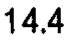 |
| r04_c03 | EPDl | Nissan (1984) | EPDl | C6 | 16.6 | mean 16.6 mm | 16.6 | 16.6 |  |
| r04_c04 | EPDl | Francis (1952) | EPDl | C6 | 17.3 | mean 17.3 mm | 17.3 | 17.3 |  |
| r05_c00 | EPDl | Level | EPDl | C7 | C7 | mean C7 | C7 | C7 |  |
| r05_c01 | EPDl | Present Study | EPDl | C7 | 16.8 | mean 16.8 mm | 16.8 | 16.8 | 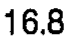 |
| r05_c02 | EPDl | Liu (1986) | EPDl | C7 | 14.5 | mean 14.5 mm | 14.5 | 14.5 |  |
| r05_c03 | EPDl | Nissan (1984) | EPDl | C7 | 16.3 | mean 16.3 mm | 16.3 | 16.3 | 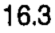 |
| r05_c04 | EPDl | Francis (1952) | EPDl | C7 | 16.7 | mean 16.7 mm | 16.7 | 16.7 | 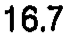 |
| r06_c00 | EPWl | Level | EPWl | C2 | C2 | mean C2 | C2 | C2 | 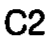 |
| r06_c01 | EPWl | Present Study | EPWl | C2 | 17.5 | mean 17.5 mm | 17.5 | 17.5 |  |
| r06_c02 | EPWl | Liu (1986) | EPWl | C2 | - | (none) | - | - |  |
| r06_c03 | EPWl | Nissan (1984) | EPWl | C2 | - | (none) | - | - | 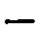 |
| r06_c04 | EPWl | Francis (1952) | EPWl | C2 | 19.5 | mean 19.5 mm | 19.5 | 19.5 |  |
| r07_c00 | EPWl | Level | EPWl | C3 | C3 | mean C3 | C3 | C3 |  |
| r07_c01 | EPWl | Present Study | EPWl | C3 | 17.2 | mean 17.2 mm | 17.2 | 17.2 | 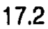 |
| r07_c02 | EPWl | Liu (1986) | EPWl | C3 | - | (none) | - | - |  |
| r07_c03 | EPWl | Nissan (1984) | EPWl | C3 | - | (none) | - | - | 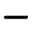 |
| r07_c04 | EPWl | Francis (1952) | EPWl | C3 | 20.5 | mean 20.5 mm | 20.5 | 20.5 |  |
| r08_c00 | EPWl | Level | EPWl | C4 | C4 | mean C4 | C4 | C4 | 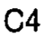 |
| r08_c01 | EPWl | Present Study | EPWl | C4 | 17.0 | mean 17.0 mm | 17.0 | 17.0 |  |
| r08_c02 | EPWl | Liu (1986) | EPWl | C4 | - | (none) | - | - | 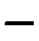 |
| r08_c03 | EPWl | Nissan (1984) | EPWl | C4 | - | (none) | - | - | 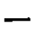 |
| r08_c04 | EPWl | Francis (1952) | EPWl | C4 | 21.5 | mean 21.5 mm | 21.5 | 21.5 |  |
| r09_c00 | EPWl | Level | EPWl | C5 | C5 | mean C5 | C5 | C5 |  |
| r09_c01 | EPWl | Present Study | EPWl | C5 | 19.4 | mean 19.4 mm | 19.4 | 19.4 |  |
| r09_c02 | EPWl | Liu (1986) | EPWl | C5 | - | (none) | - | - | 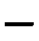 |
| r09_c03 | EPWl | Nissan (1984) | EPWl | C5 | - | (none) | - | - | 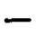 |
| r09_c04 | EPWl | Francis (1952) | EPWl | C5 | 22.5 | mean 22.5 mm | 22.5 | 22.5 |  |
| r10_c00 | EPWl | Level | EPWl | C6 | C6 | mean C6 | C6 | C6 | 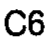 |
| r10_c01 | EPWl | Present Study | EPWl | C6 | 22.0 | mean 22.0 mm | 22.0 | 22.0 |  |
| r10_c02 | EPWl | Liu (1986) | EPWl | C6 | - | (none) | - | - | 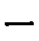 |
| r10_c03 | EPWl | Nissan (1984) | EPWl | C6 | - | (none) | - | - | 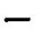 |
| r10_c04 | EPWl | Francis (1952) | EPWl | C6 | 24.8 | mean 24.8 mm | 24.8 | 24.8 |  |
| r11_c00 | EPWl | Level | EPWl | C7 | C7 | mean C7 | C7 | C7 |  |
| r11_c01 | EPWl | Present Study | EPWl | C7 | 23.4 | mean 23.4 mm | 23.4 | 23.4 | 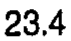 |
| r11_c02 | EPWl | Liu (1986) | EPWl | C7 | - | (none) | - | - | 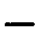 |
| r11_c03 | EPWl | Nissan (1984) | EPWl | C7 | - | (none) | - | - | 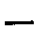 |
| r11_c04 | EPWl | Francis (1952) | EPWl | C7 | 29.3 | mean 29.3 mm | 29.3 | 29.3 | 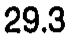 |
| r12_c00 | EPAl | Level | EPAl | C2 | C2 | mean C2 | C2 | C2 | 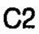 |
| r12_c01 | EPAl | Present Study | EPAl | C2 | 194.4 | mean 194.4 mm2 | 194.4 | 194.4 | 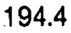 |
| r12_c02 | EPAl | Liu (1986) | EPAl | C2 | 326.8 | mean 326.8 mm2 | 326.8 | 326.8 | 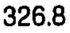 |
| r12_c03 | EPAl | Nissan (1984) | EPAl | C2 | - | (none) | - | - | 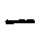 |
| r12_c04 | EPAl | Francis (1952) | EPAl | C2 | 246.6 | mean 246.6 mm2 | 246.6 | 246.6 | 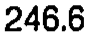 |
| r13_c00 | EPAl | Level | EPAl | C3 | C3 | mean C3 | C3 | C3 | 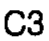 |
| r13_c01 | EPAl | Present Study | EPAl | C3 | 190.7 | mean 190.7 mm2 | 190.7 | 190.7 |  |
| r13_c02 | EPAl | Liu (1986) | EPAl | C3 | 309.7 | mean 309.7 mm2 | 309.7 | 309.7 |  |
| r13_c03 | EPAl | Nissan (1984) | EPAl | C3 | - | (none) | - | - | 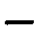 |
| r13_c04 | EPAl | Francis (1952) | EPAl | C3 | 264.0 | mean 264.0 mm2 | 264.0 | 264.0 |  |
| r14_c00 | EPAl | Level | EPAl | C4 | C4 | mean C4 | C4 | C4 |  |
| r14_c01 | EPAl | Present Study | EPAl | C4 | 199.2 | mean 199.2 mm2 | 199.2 | 199.2 |  |
| r14_c02 | EPAl | Liu (1986) | EPAl | C4 | 329.5 | mean 329.5 mm2 | 329.5 | 329.5 | 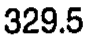 |
| r14_c03 | EPAl | Nissan (1984) | EPAl | C4 | - | (none) | - | - | 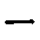 |
| r14_c04 | EPAl | Francis (1952) | EPAl | C4 | 278.6 | mean 278.6 mm2 | 278.6 | 278.6 | 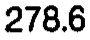 |
| r15_c00 | EPAl | Level | EPAl | C5 | C5 | mean C5 | C5 | C5 |  |
| r15_c01 | EPAl | Present Study | EPAl | C5 | 246.2 | mean 246.2 mm2 | 246.2 | 246.2 | 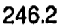 |
| r15_c02 | EPAl | Liu (1986) | EPAl | C5 | 361.1 | mean 361.1 mm2 | 361.1 | 361.1 | 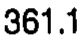 |
| r15_c03 | EPAl | Nissan (1984) | EPAl | C5 | - | (none) | - | - |  |
| r15_c04 | EPAl | Francis (1952) | EPAl | C5 | 296.9 | mean 296.9 mm2 | 296.9 | 296.9 | 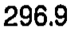 |
| r16_c00 | EPAl | Level | EPAl | C6 | C6 | mean C6 | C6 | C6 | 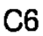 |
| r16_c01 | EPAl | Present Study | EPAl | C6 | 289.9 | mean 289.9 mm2 | 289.9 | 289.9 | 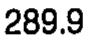 |
| r16_c02 | EPAl | Liu (1986) | EPAl | C6 | 421.7 | mean 421.7 mm2 | 421.7 | 421.7 | 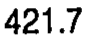 |
| r16_c03 | EPAl | Nissan (1984) | EPAl | C6 | - | (none) | - | - |  |
| r16_c04 | EPAl | Francis (1952) | EPAl | C6 | 337.0 | mean 337.0 mm2 | 337.0 | 337.0 | 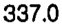 |
| r17_c00 | EPAl | Level | EPAl | C7 | C7 | mean C7 | C7 | C7 |  |
| r17_c01 | EPAl | Present Study | EPAl | C7 | 280.3 | mean 280.3 mm2 | 280.3 | 280.3 | 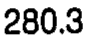 |
| r17_c02 | EPAl | Liu (1986) | EPAl | C7 | 440.5 | mean 440.5 mm2 | 440.5 | 440.5 | 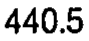 |
| r17_c03 | EPAl | Nissan (1984) | EPAl | C7 | - | (none) | - | - | 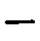 |
| r17_c04 | EPAl | Francis (1952) | EPAl | C7 | 384.3 | mean 384.3 mm2 | 384.3 | 384.3 | 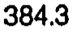 |
| r18_c00 | SCD | Level | SCD | C2 | C2 | mean C2 | C2 | C2 | 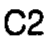 |
| r18_c01 | SCD | Present Study | SCD | C2 | 21.0 | mean 21.0 mm | 21.0 | 21.0 |  |
| r18_c02 | SCD | Liu (1986) | SCD | C2 | - | (none) | - | - |  |
| r18_c03 | SCD | Nissan (1984) | SCD | C2 | - | (none) | - | - | 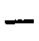 |
| r18_c04 | SCD | Francis (1952) | SCD | C2 | 22.0 | mean 22.0 mm | 22.0 | 22.0 |  |
| r19_c00 | SCD | Level | SCD | C3 | C3 | mean C3 | C3 | C3 |  |
| r19_c01 | SCD | Present Study | SCD | C3 | 16.2 | mean 16.2 mm | 16.2 | 16.2 |  |
| r19_c02 | SCD | Liu (1986) | SCD | C3 | - | (none) | - | - |  |
| r19_c03 | SCD | Nissan (1984) | SCD | C3 | - | (none) | - | - | 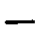 |
| r19_c04 | SCD | Francis (1952) | SCD | C3 | 16.5 | mean 16.5 mm | 16.5 | 16.5 | 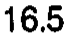 |
| r20_c00 | SCD | Level | SCD | C4 | C4 | mean C4 | C4 | C4 |  |
| r20_c01 | SCD | Present Study | SCD | C4 | 17.7 | mean 17.7 mm | 17.7 | 17.7 |  |
| r20_c02 | SCD | Liu (1986) | SCD | C4 | - | (none) | - | - |  |
| r20_c03 | SCD | Nissan (1984) | SCD | C4 | - | (none) | - | - | 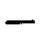 |
| r20_c04 | SCD | Francis (1952) | SCD | C4 | 15.4 | mean 15.4 mm | 15.4 | 15.4 | 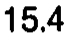 |
| r21_c00 | SCD | Level | SCD | C5 | C5 | mean C5 | C5 | C5 |  |
| r21_c01 | SCD | Present Study | SCD | C5 | 17.4 | mean 17.4 mm | 17.4 | 17.4 |  |
| r21_c02 | SCD | Liu (1986) | SCD | C5 | - | (none) | - | - |  |
| r21_c03 | SCD | Nissan (1984) | SCD | C5 | - | (none) | - | - |  |
| r21_c04 | SCD | Francis (1952) | SCD | C5 | 15.4 | mean 15.4 mm | 15.4 | 15.4 |  |
| r22_c00 | SCD | Level | SCD | C6 | C6 | mean C6 | C6 | C6 |  |
| r22_c01 | SCD | Present Study | SCD | C6 | 18.1 | mean 18.1 mm | 18.1 | 18.1 |  |
| r22_c02 | SCD | Liu (1986) | SCD | C6 | - | (none) | - | - |  |
| r22_c03 | SCD | Nissan (1984) | SCD | C6 | - | (none) | - | - |  |
| r22_c04 | SCD | Francis (1952) | SCD | C6 | 15.4 | mean 15.4 mm | 15.4 | 15.4 |  |
| r23_c00 | SCD | Level | SCD | C7 | C7 | mean C7 | C7 | C7 |  |
| r23_c01 | SCD | Present Study | SCD | C7 | 15.2 | mean 15.2 mm | 15.2 | 15.2 |  |
| r23_c02 | SCD | Liu (1986) | SCD | C7 | - | (none) | - | - |  |
| r23_c03 | SCD | Nissan (1984) | SCD | C7 | - | (none) | - | - |  |
| r23_c04 | SCD | Francis (1952) | SCD | C7 | 15.5 | mean 15.5 mm | 15.5 | 15.5 |  |
| r24_c00 | SCW | Level | SCW | C2 | C2 | mean C2 | C2 | C2 |  |
| r24_c01 | SCW | Present Study | SCW | C2 | 24.5 | mean 24.5 mm | 24.5 | 24.5 |  |
| r24_c02 | SCW | Liu (1986) | SCW | C2 | - | (none) | - | - |  |
| r24_c03 | SCW | Nissan (1984) | SCW | C2 | - | (none) | - | - |  |
| r24_c04 | SCW | Francis (1952) | SCW | C2 | 24.5 | mean 24.5 mm | 24.5 | 24.5 |  |
| r25_c00 | SCW | Level | SCW | C3 | C3 | mean C3 | C3 | C3 |  |
| r25_c01 | SCW | Present Study | SCW | C3 | 22.9 | mean 22.9 mm | 22.9 | 22.9 |  |
| r25_c02 | SCW | Liu (1986) | SCW | C3 | - | (none) | - | - |  |
| r25_c03 | SCW | Nissan (1984) | SCW | C3 | - | (none) | - | - |  |
| r25_c04 | SCW | Francis (1952) | SCW | C3 | 23.9 | mean 23.9 mm | 23.9 | 23.9 |  |
| r26_c00 | SCW | Level | SCW | C4 | C4 | mean C4 | C4 | C4 |  |
| r26_c01 | SCW | Present Study | SCW | C4 | 24.7 | mean 24.7 mm | 24.7 | 24.7 |  |
| r26_c02 | SCW | Liu (1986) | SCW | C4 | - | (none) | - | - |  |
| r26_c03 | SCW | Nissan (1984) | SCW | C4 | - | (none) | - | - |  |
| r26_c04 | SCW | Francis (1952) | SCW | C4 | 24.7 | mean 24.7 mm | 24.7 | 24.7 |  |
| r27_c00 | SCW | Level | SCW | C5 | C5 | mean C5 | C5 | C5 |  |
| r27_c01 | SCW | Present Study | SCW | C5 | 24.9 | mean 24.9 mm | 24.9 | 24.9 |  |
| r27_c02 | SCW | Liu (1986) | SCW | C5 | - | (none) | - | - |  |
| r27_c03 | SCW | Nissan (1984) | SCW | C5 | - | (none) | - | - |  |
| r27_c04 | SCW | Francis (1952) | SCW | C5 | 25.6 | mean 25.6 mm | 25.6 | 25.6 |  |
| r28_c00 | SCW | Level | SCW | C6 | C6 | mean C6 | C6 | C6 |  |
| r28_c01 | SCW | Present Study | SCW | C6 | 25.8 | mean 25.8 mm | 25.8 | 25.8 |  |
| r28_c02 | SCW | Liu (1986) | SCW | C6 | - | (none) | - | - |  |
| r28_c03 | SCW | Nissan (1984) | SCW | C6 | - | (none) | - | - |  |
| r28_c04 | SCW | Francis (1952) | SCW | C6 | 25.9 | mean 25.9 mm | 25.9 | 25.9 |  |
| r29_c00 | SCW | Level | SCW | C7 | C7 | mean C7 | C7 | C7 |  |
| r29_c01 | SCW | Present Study | SCW | C7 | 24.5 | mean 24.5 mm | 24.5 | 24.5 |  |
| r29_c02 | SCW | Liu (1986) | SCW | C7 | - | (none) | - | - |  |
| r29_c03 | SCW | Nissan (1984) | SCW | C7 | - | (none) | - | - |  |
| r29_c04 | SCW | Francis (1952) | SCW | C7 | 25.6 | mean 25.6 mm | 25.6 | 25.6 |  |
| r30_c00 | VBH | Level | VBH | C3 | C3 | mean C3 | C3 | C3 |  |
| r30_c01 | VBH | Present Study | VBH | C3 | 11.6 | mean 11.6 mm | 11.6 | 11.6 |  |
| r30_c02 | VBH | Liu (1986) | VBH | C3 | - | (none) | - | - |  |
| r30_c03 | VBH | Nissan (1984) | VBH | C3 | 14.5 | mean 14.5 mm | 14.5 | 14.5 |  |
| r30_c04 | VBH | Francis (1952) | VBH | C3 | 14.3 | mean 14.3 mm | 14.3 | 14.3 |  |
| r31_c00 | VBH | Level | VBH | C4 | C4 | mean C4 | C4 | C4 |  |
| r31_c01 | VBH | Present Study | VBH | C4 | 11.4 | mean 11.4 mm | 11.4 | 11.4 |  |
| r31_c02 | VBH | Liu (1986) | VBH | C4 | - | (none) | - | - |  |
| r31_c03 | VBH | Nissan (1984) | VBH | C4 | 13.9 | mean 13.9 mm | 13.9 | 13.9 |  |
| r31_c04 | VBH | Francis (1952) | VBH | C4 | 13.8 | mean 13.8 mm | 13.8 | 13.8 |  |
| r32_c00 | VBH | Level | VBH | C5 | C5 | mean C5 | C5 | C5 |  |
| r32_c01 | VBH | Present Study | VBH | C5 | 11.4 | mean 11.4 mm | 11.4 | 11.4 |  |
| r32_c02 | VBH | Liu (1986) | VBH | C5 | - | (none) | - | - |  |
| r32_c03 | VBH | Nissan (1984) | VBH | C5 | 13.8 | mean 13.8 mm | 13.8 | 13.8 |  |
| r32_c04 | VBH | Francis (1952) | VBH | C5 | 13.3 | mean 13.3 mm | 13.3 | 13.3 |  |
| r33_c00 | VBH | Level | VBH | C6 | C6 | mean C6 | C6 | C6 |  |
| r33_c01 | VBH | Present Study | VBH | C6 | 10.9 | mean 10.9 mm | 10.9 | 10.9 |  |
| r33_c02 | VBH | Liu (1986) | VBH | C6 | - | (none) | - | - |  |
| r33_c03 | VBH | Nissan (1984) | VBH | C6 | 13.9 | mean 13.9 mm | 13.9 | 13.9 |  |
| r33_c04 | VBH | Francis (1952) | VBH | C6 | 13.0 | mean 13.0 mm | 13.0 | 13.0 |  |
| r34_c00 | VBH | Level | VBH | C7 | C7 | mean C7 | C7 | C7 |  |
| r34_c01 | VBH | Present Study | VBH | C7 | 12.8 | mean 12.8 mm | 12.8 | 12.8 |  |
| r34_c02 | VBH | Liu (1986) | VBH | C7 | - | (none) | - | - |  |
| r34_c03 | VBH | Nissan (1984) | VBH | C7 | 14.9 | mean 14.9 mm | 14.9 | 14.9 |  |
| r34_c04 | VBH | Francis (1952) | VBH | C7 | 14.6 | mean 14.6 mm | 14.6 | 14.6 |  |
