# Table 10. Comparison with Previous Studies: Angular Dimensions and Sagittal Plane Angle of Superior Vertebrae

Facets, PDF page 11, printed page 1308; Panjabi_1993_Facets_Spine_18-10_1298-1310.pdf (sha256 2b22fe5e6c14d2289a4366f3c94879db1da0f79ae54e05a7f8e54a07e1c0279f), rendered at 300 dpi by render.py.

Every cell below is the box layout.py cut from the rendered page, and the two strings are what the two reading passes read in it (README.md). A dash is printed where the paper prints one. The value column is what provenance.csv carries.

| cell | row | column | measure | level | printed | value | pass 1 | pass 2 | image |
|---|---|---|---|---|---|---|---|---|---|
| r00_c00 | Ss | Level | Ss | T11 | T11 | mean T11 | T11 | T11 | 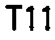 |
| r00_c01 | Ss | Present Study | Ss | T11 | 75 | mean 75 deg | 75 | 75 | 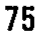 |
| r00_c02 | Ss | Malmivaara (1987) | Ss | T11 | 73 | mean 73 deg | 73 | 73 | 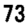 |
| r00_c03 | Ss | Ahmed (1990) | Ss | T11 | - | (none) | - | - | 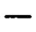 |
| r00_c04 | Ss | Van Schaik (1985) | Ss | T11 | - | (none) | - | - | 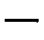 |
| r00_c05 | Ss | Horwitz & Smith (1940) | Ss | T11 | - | (none) | - | - |  |
| r01_c00 | Ss | Level | Ss | T12 | T12 | mean T12 | T12 | T12 |  |
| r01_c01 | Ss | Present Study | Ss | T12 | 70 | mean 70 deg | 70 | 70 |  |
| r01_c02 | Ss | Malmivaara (1987) | Ss | T12 | 98 | mean 98 deg | 98 | 98 | 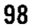 |
| r01_c03 | Ss | Ahmed (1990) | Ss | T12 | - | (none) | - | - | 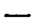 |
| r01_c04 | Ss | Van Schaik (1985) | Ss | T12 | - | (none) | - | - | 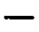 |
| r01_c05 | Ss | Horwitz & Smith (1940) | Ss | T12 | - | (none) | - | - | 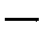 |
| r02_c00 | Ss | Level | Ss | L1 | L1 | mean L1 | L1 | L1 |  |
| r02_c01 | Ss | Present Study | Ss | L1 | 137 | mean 137 deg | 137 | 137 | 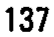 |
| r02_c02 | Ss | Malmivaara (1987) | Ss | L1 | 117 | mean 117 deg | 117 | 117 | 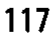 |
| r02_c03 | Ss | Ahmed (1990) | Ss | L1 | - | (none) | - | - | 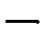 |
| r02_c04 | Ss | Van Schaik (1985) | Ss | L1 | - | (none) | - | - |  |
| r02_c05 | Ss | Horwitz & Smith (1940) | Ss | L1 | 155 | mean 155 deg | 155 | 155 | 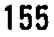 |
| r03_c00 | Ss | Level | Ss | L2 | L2 | mean L2 | L2 | L2 | 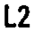 |
| r03_c01 | Ss | Present Study | Ss | L2 | 137 | mean 137 deg | 137 | 137 | 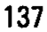 |
| r03_c02 | Ss | Malmivaara (1987) | Ss | L2 | - | (none) | - | - | 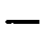 |
| r03_c03 | Ss | Ahmed (1990) | Ss | L2 | - | (none) | - | - |  |
| r03_c04 | Ss | Van Schaik (1985) | Ss | L2 | - | (none) | - | - | 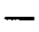 |
| r03_c05 | Ss | Horwitz & Smith (1940) | Ss | L2 | 150 | mean 150 deg | 150 | 150 | 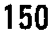 |
| r04_c00 | Ss | Level | Ss | L3 | L3 | mean L3 | L3 | L3 | 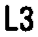 |
| r04_c01 | Ss | Present Study | Ss | L3 | 132 | mean 132 deg | 132 | 132 | 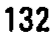 |
| r04_c02 | Ss | Malmivaara (1987) | Ss | L3 | - | (none) | - | - | 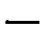 |
| r04_c03 | Ss | Ahmed (1990) | Ss | L3 | 151 | mean 151 deg | 151 | 151 | 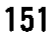 |
| r04_c04 | Ss | Van Schaik (1985) | Ss | L3 | - | (none) | - | - | 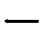 |
| r04_c05 | Ss | Horwitz & Smith (1940) | Ss | L3 | 135 | mean 135 deg | 135 | 135 | 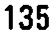 |
| r05_c00 | Ss | Level | Ss | L4 | L4 | mean L4 | L4 | L4 | 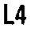 |
| r05_c01 | Ss | Present Study | Ss | L4 | 122 | mean 122 deg | 122 | 122 | 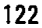 |
| r05_c02 | Ss | Malmivaara (1987) | Ss | L4 | - | (none) | - | - | 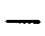 |
| r05_c03 | Ss | Ahmed (1990) | Ss | L4 | - | (none) | - | - |  |
| r05_c04 | Ss | Van Schaik (1985) | Ss | L4 | 143 | mean 143 deg | 143 | 143 | 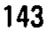 |
| r05_c05 | Ss | Horwitz & Smith (1940) | Ss | L4 | 135 | mean 135 deg | 135 | 135 | 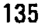 |
| r06_c00 | Ss | Level | Ss | L5 | L5 | mean L5 | L5 | L5 |  |
| r06_c01 | Ss | Present Study | Ss | L5 | 118 | mean 118 deg | 118 | 118 | 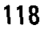 |
| r06_c02 | Ss | Malmivaara (1987) | Ss | L5 | - | (none) | - | - | 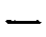 |
| r06_c03 | Ss | Ahmed (1990) | Ss | L5 | 129 | mean 129 deg | 129 | 129 | 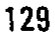 |
| r06_c04 | Ss | Van Schaik (1985) | Ss | L5 | 132 | mean 132 deg | 132 | 132 | 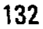 |
| r06_c05 | Ss | Horwitz & Smith (1940) | Ss | L5 | 135 | mean 135 deg | 135 | 135 | 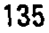 |
| r07_c00 | Ss | Level | Ss | S1 | S1 | mean S1 | S1 | S1 |  |
| r07_c01 | Ss | Present Study | Ss | S1 | - | (none) | - | - | 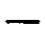 |
| r07_c02 | Ss | Malmivaara (1987) | Ss | S1 | - | (none) | - | - | 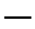 |
| r07_c03 | Ss | Ahmed (1990) | Ss | S1 | - | (none) | - | - | 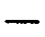 |
| r07_c04 | Ss | Van Schaik (1985) | Ss | S1 | 127 | mean 127 deg | 127 | 127 | 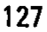 |
| r07_c05 | Ss | Horwitz & Smith (1940) | Ss | S1 | - | (none) | - | - |  |
