# Table 2. Means (and Standard Errors of the Mean) of the Superior Articular Facet Linear Dimensions

Facets, PDF page 4, printed page 1301; Panjabi_1993_Facets_Spine_18-10_1298-1310.pdf (sha256 2b22fe5e6c14d2289a4366f3c94879db1da0f79ae54e05a7f8e54a07e1c0279f), rendered at 300 dpi by render.py.

Every cell below is the box layout.py cut from the rendered page, and the two strings are what the two reading passes read in it (README.md). A dash is printed where the paper prints one. The value column is what provenance.csv carries.

| cell | row | column | measure | level | printed | value | pass 1 | pass 2 | image |
|---|---|---|---|---|---|---|---|---|---|
| r00_c00 | C2 | FCWsr | FCWsr | C2 | 16.8 (0.3) | mean 16.8 mm; sem 0.3 mm | 16.8 (0.3) | 16.8 (0.3) | 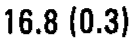 |
| r00_c01 | C2 | FCWsl | FCWsl | C2 | 16.0 (0.5) | mean 16.0 mm; sem 0.5 mm | 16.0 (0.5) | 16.0 (0.5) |  |
| r00_c02 | C2 | FCHsr | FCHsr | C2 | 18.0 (0.4) | mean 18.0 mm; sem 0.4 mm | 18.0 (0.4) | 18.0 (0.4) | 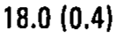 |
| r00_c03 | C2 | FCHsl | FCHsl | C2 | 17.7 (0.6) | mean 17.7 mm; sem 0.6 mm | 17.7 (0.6) | 17.7 (0.6) |  |
| r00_c04 | C2 | FCW/FCHsr | FCW/FCHsr | C2 | 0.93 | ratio 0.93 | 0.93 | 0.93 |  |
| r00_c05 | C2 | FCW/FCHsl | FCW/FCHsl | C2 | 0.90 | ratio 0.90 | 0.90 | 0.90 |  |
| r01_c00 | C3 | FCWsr | FCWsr | C3 | 11.4 (0.7) | mean 11.4 mm; sem 0.7 mm | 11.4 (0.7) | 11.4 (0.7) |  |
| r01_c01 | C3 | FCWsl | FCWsl | C3 | 10.8 (0.5) | mean 10.8 mm; sem 0.5 mm | 10.8 (0.5) | 10.8 (0.5) |  |
| r01_c02 | C3 | FCHsr | FCHsr | C3 | 12.5 (1.1) | mean 12.5 mm; sem 1.1 mm | 12.5 (1.1) | 12.5 (1.1) |  |
| r01_c03 | C3 | FCHsl | FCHsl | C3 | 10.6 (0.6) | mean 10.6 mm; sem 0.6 mm | 10.6 (0.6) | 10.6 (0.6) |  |
| r01_c04 | C3 | FCW/FCHsr | FCW/FCHsr | C3 | 0.91 | ratio 0.91 | 0.91 | 0.91 |  |
| r01_c05 | C3 | FCW/FCHsl | FCW/FCHsl | C3 | 1.02 | ratio 1.02 | 1.02 | 1.02 |  |
| r02_c00 | C4 | FCWsr | FCWsr | C4 | 12.0 (0.6) | mean 12.0 mm; sem 0.6 mm | 12.0 (0.6) | 12.0 (0.6) | 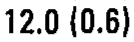 |
| r02_c01 | C4 | FCWsl | FCWsl | C4 | 11.0 (1.0) | mean 11.0 mm; sem 1.0 mm | 11.0 (1.0) | 11.0 (1.0) | 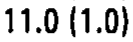 |
| r02_c02 | C4 | FCHsr | FCHsr | C4 | 12.3 (1.2) | mean 12.3 mm; sem 1.2 mm | 12.3 (1.2) | 12.3 (1.2) |  |
| r02_c03 | C4 | FCHsl | FCHsl | C4 | 12.0 (1.1) | mean 12.0 mm; sem 1.1 mm | 12.0 (1.1) | 12.0 (1.1) | 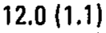 |
| r02_c04 | C4 | FCW/FCHsr | FCW/FCHsr | C4 | 0.96 | ratio 0.96 | 0.96 | 0.96 |  |
| r02_c05 | C4 | FCW/FCHsl | FCW/FCHsl | C4 | 0.91 | ratio 0.91 | 0.91 | 0.91 |  |
| r03_c00 | C5 | FCWsr | FCWsr | C5 | 12.3 (0.8) | mean 12.3 mm; sem 0.8 mm | 12.3 (0.8) | 12.3 (0.8) | 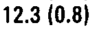 |
| r03_c01 | C5 | FCWsl | FCWsl | C5 | 11.8 (0.8) | mean 11.8 mm; sem 0.8 mm | 11.8 (0.8) | 11.8 (0.8) | 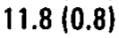 |
| r03_c02 | C5 | FCHsr | FCHsr | C5 | 12.0 (0.9) | mean 12.0 mm; sem 0.9 mm | 12.0 (0.9) | 12.0 (0.9) |  |
| r03_c03 | C5 | FCHsl | FCHsl | C5 | 11.2 (0.8) | mean 11.2 mm; sem 0.8 mm | 11.2 (0.8) | 11.2 (0.8) | 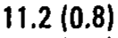 |
| r03_c04 | C5 | FCW/FCHsr | FCW/FCHsr | C5 | 1.04 | ratio 1.04 | 1.04 | 1.04 |  |
| r03_c05 | C5 | FCW/FCHsl | FCW/FCHsl | C5 | 1.05 | ratio 1.05 | 1.05 | 1.05 | 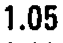 |
| r04_c00 | C6 | FCWsr | FCWsr | C6 | 11.6 (0.5) | mean 11.6 mm; sem 0.5 mm | 11.6 (0.5) | 11.6 (0.5) |  |
| r04_c01 | C6 | FCWsl | FCWsl | C6 | 13.2 (0.7) | mean 13.2 mm; sem 0.7 mm | 13.2 (0.7) | 13.2 (0.7) | 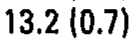 |
| r04_c02 | C6 | FCHsr | FCHsr | C6 | 10.2 (0.6) | mean 10.2 mm; sem 0.6 mm | 10.2 (0.6) | 10.2 (0.6) |  |
| r04_c03 | C6 | FCHsl | FCHsl | C6 | 11.7 (0.6) | mean 11.7 mm; sem 0.6 mm | 11.7 (0.6) | 11.7 (0.6) | 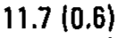 |
| r04_c04 | C6 | FCW/FCHsr | FCW/FCHsr | C6 | 1.14 | ratio 1.14 | 1.14 | 1.14 |  |
| r04_c05 | C6 | FCW/FCHsl | FCW/FCHsl | C6 | 1.13 | ratio 1.13 | 1.13 | 1.13 |  |
| r05_c00 | C7 | FCWsr | FCWsr | C7 | 12.3 (0.9) | mean 12.3 mm; sem 0.9 mm | 12.3 (0.9) | 12.3 (0.9) | 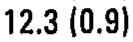 |
| r05_c01 | C7 | FCWsl | FCWsl | C7 | 12.8 (0.6) | mean 12.8 mm; sem 0.6 mm | 12.8 (0.6) | 12.8 (0.6) | 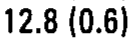 |
| r05_c02 | C7 | FCHsr | FCHsr | C7 | 12.1 (0.8) | mean 12.1 mm; sem 0.8 mm | 12.1 (0.8) | 12.1 (0.8) | 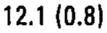 |
| r05_c03 | C7 | FCHsl | FCHsl | C7 | 10.7 (0.3) | mean 10.7 mm; sem 0.3 mm | 10.7 (0.3) | 10.7 (0.3) |  |
| r05_c04 | C7 | FCW/FCHsr | FCW/FCHsr | C7 | 1.02 | ratio 1.02 | 1.02 | 1.02 |  |
| r05_c05 | C7 | FCW/FCHsl | FCW/FCHsl | C7 | 1.20 | ratio 1.20 | 1.20 | 1.20 |  |
| r06_c00 | T1 | FCWsr | FCWsr | T1 | 13.3 (0.7) | mean 13.3 mm; sem 0.7 mm | 13.3 (0.7) | 13.3 (0.7) | 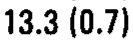 |
| r06_c01 | T1 | FCWsl | FCWsl | T1 | 14.0 (0.9) | mean 14.0 mm; sem 0.9 mm | 14.0 (0.9) | 14.0 (0.9) | 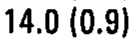 |
| r06_c02 | T1 | FCHsr | FCHsr | T1 | 12.6 (0.6) | mean 12.6 mm; sem 0.6 mm | 12.6 (0.6) | 12.6 (0.6) |  |
| r06_c03 | T1 | FCHsl | FCHsl | T1 | 12.6 (1.2) | mean 12.6 mm; sem 1.2 mm | 12.6 (1.2) | 12.6 (1.2) | 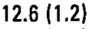 |
| r06_c04 | T1 | FCW/FCHsr | FCW/FCHsr | T1 | 1.06 | ratio 1.06 | 1.06 | 1.06 |  |
| r06_c05 | T1 | FCW/FCHsl | FCW/FCHsl | T1 | 1.11 | ratio 1.11 | 1.11 | 1.11 |  |
| r07_c00 | T2 | FCWsr | FCWsr | T2 | 11.7 (0.6) | mean 11.7 mm; sem 0.6 mm | 11.7 (0.6) | 11.7 (0.6) | 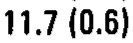 |
| r07_c01 | T2 | FCWsl | FCWsl | T2 | 12.1 (0.5) | mean 12.1 mm; sem 0.5 mm | 12.1 (0.5) | 12.1 (0.5) | 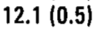 |
| r07_c02 | T2 | FCHsr | FCHsr | T2 | 12.2 (0.5) | mean 12.2 mm; sem 0.5 mm | 12.2 (0.5) | 12.2 (0.5) | 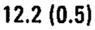 |
| r07_c03 | T2 | FCHsl | FCHsl | T2 | 13.0 (0.8) | mean 13.0 mm; sem 0.8 mm | 13.0 (0.8) | 13.0 (0.8) | 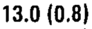 |
| r07_c04 | T2 | FCW/FCHsr | FCW/FCHsr | T2 | 0.96 | ratio 0.96 | 0.96 | 0.96 |  |
| r07_c05 | T2 | FCW/FCHsl | FCW/FCHsl | T2 | 0.94 | ratio 0.94 | 0.94 | 0.94 |  |
| r08_c00 | T3 | FCWsr | FCWsr | T3 | 10.8 (0.5) | mean 10.8 mm; sem 0.5 mm | 10.8 (0.5) | 10.8 (0.5) |  |
| r08_c01 | T3 | FCWsl | FCWsl | T3 | 10.6 (0.3) | mean 10.6 mm; sem 0.3 mm | 10.6 (0.3) | 10.6 (0.3) | 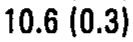 |
| r08_c02 | T3 | FCHsr | FCHsr | T3 | 10.8 (0.4) | mean 10.8 mm; sem 0.4 mm | 10.8 (0.4) | 10.8 (0.4) |  |
| r08_c03 | T3 | FCHsl | FCHsl | T3 | 11.7 (0.5) | mean 11.7 mm; sem 0.5 mm | 11.7 (0.5) | 11.7 (0.5) |  |
| r08_c04 | T3 | FCW/FCHsr | FCW/FCHsr | T3 | 1.00 | ratio 1.00 | 1.00 | 1.00 |  |
| r08_c05 | T3 | FCW/FCHsl | FCW/FCHsl | T3 | 0.90 | ratio 0.90 | 0.90 | 0.90 |  |
| r09_c00 | T4 | FCWsr | FCWsr | T4 | 10.5 (0.4) | mean 10.5 mm; sem 0.4 mm | 10.5 (0.4) | 10.5 (0.4) | 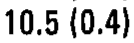 |
| r09_c01 | T4 | FCWsl | FCWsl | T4 | 10.3 (0.2) | mean 10.3 mm; sem 0.2 mm | 10.3 (0.2) | 10.3 (0.2) | 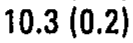 |
| r09_c02 | T4 | FCHsr | FCHsr | T4 | 11.0 (0.4) | mean 11.0 mm; sem 0.4 mm | 11.0 (0.4) | 11.0 (0.4) |  |
| r09_c03 | T4 | FCHsl | FCHsl | T4 | 11.5 (0.4) | mean 11.5 mm; sem 0.4 mm | 11.5 (0.4) | 11.5 (0.4) | 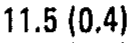 |
| r09_c04 | T4 | FCW/FCHsr | FCW/FCHsr | T4 | 0.95 | ratio 0.95 | 0.95 | 0.95 |  |
| r09_c05 | T4 | FCW/FCHsl | FCW/FCHsl | T4 | 0.90 | ratio 0.90 | 0.90 | 0.90 |  |
| r10_c00 | T5 | FCWsr | FCWsr | T5 | 10.6 (0.3) | mean 10.6 mm; sem 0.3 mm | 10.6 (0.3) | 10.6 (0.3) |  |
| r10_c01 | T5 | FCWsl | FCWsl | T5 | 9.8 (0.3) | mean 9.8 mm; sem 0.3 mm | 9.8 (0.3) | 9.8 (0.3) | 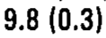 |
| r10_c02 | T5 | FCHsr | FCHsr | T5 | 12.1 (0.5) | mean 12.1 mm; sem 0.5 mm | 12.1 (0.5) | 12.1 (0.5) | 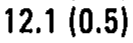 |
| r10_c03 | T5 | FCHsl | FCHsl | T5 | 10.9 (0.5) | mean 10.9 mm; sem 0.5 mm | 10.9 (0.5) | 10.9 (0.5) |  |
| r10_c04 | T5 | FCW/FCHsr | FCW/FCHsr | T5 | 0.88 | ratio 0.88 | 0.88 | 0.88 |  |
| r10_c05 | T5 | FCW/FCHsl | FCW/FCHsl | T5 | 0.91 | ratio 0.91 | 0.91 | 0.91 |  |
| r11_c00 | T6 | FCWsr | FCWsr | T6 | 9.6 (0.5) | mean 9.6 mm; sem 0.5 mm | 9.6 (0.5) | 9.6 (0.5) |  |
| r11_c01 | T6 | FCWsl | FCWsl | T6 | 10.1 (0.3) | mean 10.1 mm; sem 0.3 mm | 10.1 (0.3) | 10.1 (0.3) |  |
| r11_c02 | T6 | FCHsr | FCHsr | T6 | 11.7 (0.5) | mean 11.7 mm; sem 0.5 mm | 11.7 (0.5) | 11.7 (0.5) |  |
| r11_c03 | T6 | FCHsl | FCHsl | T6 | 11.8 (0.7) | mean 11.8 mm; sem 0.7 mm | 11.8 (0.7) | 11.8 (0.7) | 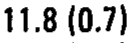 |
| r11_c04 | T6 | FCW/FCHsr | FCW/FCHsr | T6 | 0.83 | ratio 0.83 | 0.83 | 0.83 |  |
| r11_c05 | T6 | FCW/FCHsl | FCW/FCHsl | T6 | 0.86 | ratio 0.86 | 0.86 | 0.86 | 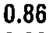 |
| r12_c00 | T7 | FCWsr | FCWsr | T7 | 9.6 (0.5) | mean 9.6 mm; sem 0.5 mm | 9.6 (0.5) | 9.6 (0.5) |  |
| r12_c01 | T7 | FCWsl | FCWsl | T7 | 9.9 (0.4) | mean 9.9 mm; sem 0.4 mm | 9.9 (0.4) | 9.9 (0.4) | 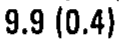 |
| r12_c02 | T7 | FCHsr | FCHsr | T7 | 11.9 (0.7) | mean 11.9 mm; sem 0.7 mm | 11.9 (0.7) | 11.9 (0.7) |  |
| r12_c03 | T7 | FCHsl | FCHsl | T7 | 11.0 (0.4) | mean 11.0 mm; sem 0.4 mm | 11.0 (0.4) | 11.0 (0.4) | 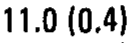 |
| r12_c04 | T7 | FCW/FCHsr | FCW/FCHsr | T7 | 0.80 | ratio 0.80 | 0.80 | 0.80 |  |
| r12_c05 | T7 | FCW/FCHsl | FCW/FCHsl | T7 | 0.90 | ratio 0.90 | 0.90 | 0.90 |  |
| r13_c00 | T8 | FCWsr | FCWsr | T8 | 10.0 (0.4) | mean 10.0 mm; sem 0.4 mm | 10.0 (0.4) | 10.0 (0.4) |  |
| r13_c01 | T8 | FCWsl | FCWsl | T8 | 10.3 (0.3) | mean 10.3 mm; sem 0.3 mm | 10.3 (0.3) | 10.3 (0.3) |  |
| r13_c02 | T8 | FCHsr | FCHsr | T8 | 11.5 (0.7) | mean 11.5 mm; sem 0.7 mm | 11.5 (0.7) | 11.5 (0.7) | 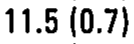 |
| r13_c03 | T8 | FCHsl | FCHsl | T8 | 11.7 (0.7) | mean 11.7 mm; sem 0.7 mm | 11.7 (0.7) | 11.7 (0.7) |  |
| r13_c04 | T8 | FCW/FCHsr | FCW/FCHsr | T8 | 0.87 | ratio 0.87 | 0.87 | 0.87 |  |
| r13_c05 | T8 | FCW/FCHsl | FCW/FCHsl | T8 | 0.89 | ratio 0.89 | 0.89 | 0.89 | 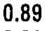 |
| r14_c00 | T9 | FCWsr | FCWsr | T9 | 11.0 (0.4) | mean 11.0 mm; sem 0.4 mm | 11.0 (0.4) | 11.0 (0.4) |  |
| r14_c01 | T9 | FCWsl | FCWsl | T9 | 10.7 (0.3) | mean 10.7 mm; sem 0.3 mm | 10.7 (0.3) | 10.7 (0.3) | 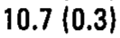 |
| r14_c02 | T9 | FCHsr | FCHsr | T9 | 12.1 (0.7) | mean 12.1 mm; sem 0.7 mm | 12.1 (0.7) | 12.1 (0.7) |  |
| r14_c03 | T9 | FCHsl | FCHsl | T9 | 11.7 (0.7) | mean 11.7 mm; sem 0.7 mm | 11.7 (0.7) | 11.7 (0.7) | 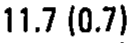 |
| r14_c04 | T9 | FCW/FCHsr | FCW/FCHsr | T9 | 0.91 | ratio 0.91 | 0.91 | 0.91 |  |
| r14_c05 | T9 | FCW/FCHsl | FCW/FCHsl | T9 | 0.91 | ratio 0.91 | 0.91 | 0.91 | 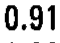 |
| r15_c00 | T10 | FCWsr | FCWsr | T10 | 11.5 (1.0) | mean 11.5 mm; sem 1.0 mm | 11.5 (1.0) | 11.5 (1.0) | 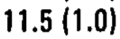 |
| r15_c01 | T10 | FCWsl | FCWsl | T10 | 12.9 (0.9) | mean 12.9 mm; sem 0.9 mm | 12.9 (0.9) | 12.9 (0.9) | 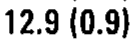 |
| r15_c02 | T10 | FCHsr | FCHsr | T10 | 12.0 (0.7) | mean 12.0 mm; sem 0.7 mm | 12.0 (0.7) | 12.0 (0.7) | 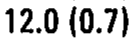 |
| r15_c03 | T10 | FCHsl | FCHsl | T10 | 12.4 (0.6) | mean 12.4 mm; sem 0.6 mm | 12.4 (0.6) | 12.4 (0.6) |  |
| r15_c04 | T10 | FCW/FCHsr | FCW/FCHsr | T10 | 0.96 | ratio 0.96 | 0.96 | 0.96 |  |
| r15_c05 | T10 | FCW/FCHsl | FCW/FCHsl | T10 | 1.03 | ratio 1.03 | 1.03 | 1.03 |  |
| r16_c00 | T11 | FCWsr | FCWsr | T11 | 11.4 (0.4) | mean 11.4 mm; sem 0.4 mm | 11.4 (0.4) | 11.4 (0.4) | 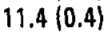 |
| r16_c01 | T11 | FCWsl | FCWsl | T11 | 11.3 (0.5) | mean 11.3 mm; sem 0.5 mm | 11.3 (0.5) | 11.3 (0.5) | 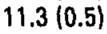 |
| r16_c02 | T11 | FCHsr | FCHsr | T11 | 12.5 (0.5) | mean 12.5 mm; sem 0.5 mm | 12.5 (0.5) | 12.5 (0.5) | 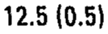 |
| r16_c03 | T11 | FCHsl | FCHsl | T11 | 12.0 (0.6) | mean 12.0 mm; sem 0.6 mm | 12.0 (0.6) | 12.0 (0.6) | 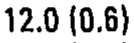 |
| r16_c04 | T11 | FCW/FCHsr | FCW/FCHsr | T11 | 0.91 | ratio 0.91 | 0.91 | 0.91 |  |
| r16_c05 | T11 | FCW/FCHsl | FCW/FCHsl | T11 | 0.95 | ratio 0.95 | 0.95 | 0.95 |  |
| r17_c00 | T12 | FCWsr | FCWsr | T12 | 11.2 (0.7) | mean 11.2 mm; sem 0.7 mm | 11.2 (0.7) | 11.2 (0.7) | 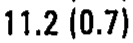 |
| r17_c01 | T12 | FCWsl | FCWsl | T12 | 10.5 (0.7) | mean 10.5 mm; sem 0.7 mm | 10.5 (0.7) | 10.5 (0.7) | 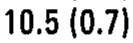 |
| r17_c02 | T12 | FCHsr | FCHsr | T12 | 13.4 (0.5) | mean 13.4 mm; sem 0.5 mm | 13.4 (0.5) | 13.4 (0.5) |  |
| r17_c03 | T12 | FCHsl | FCHsl | T12 | 12.5 (0.7) | mean 12.5 mm; sem 0.7 mm | 12.5 (0.7) | 12.5 (0.7) |  |
| r17_c04 | T12 | FCW/FCHsr | FCW/FCHsr | T12 | 0.84 | ratio 0.84 | 0.84 | 0.84 |  |
| r17_c05 | T12 | FCW/FCHsl | FCW/FCHsl | T12 | 0.84 | ratio 0.84 | 0.84 | 0.84 | 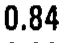 |
| r18_c00 | L1 | FCWsr | FCWsr | L1 | 10.2 (0.6) | mean 10.2 mm; sem 0.6 mm | 10.2 (0.6) | 10.2 (0.6) |  |
| r18_c01 | L1 | FCWsl | FCWsl | L1 | 10.5 (0.6) | mean 10.5 mm; sem 0.6 mm | 10.5 (0.6) | 10.5 (0.6) |  |
| r18_c02 | L1 | FCHsr | FCHsr | L1 | 12.7 (0.3) | mean 12.7 mm; sem 0.3 mm | 12.7 (0.3) | 12.7 (0.3) | 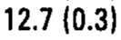 |
| r18_c03 | L1 | FCHsl | FCHsl | L1 | 12.2 (0.7) | mean 12.2 mm; sem 0.7 mm | 12.2 (0.7) | 12.2 (0.7) |  |
| r18_c04 | L1 | FCW/FCHsr | FCW/FCHsr | L1 | 0.80 | ratio 0.80 | 0.80 | 0.80 |  |
| r18_c05 | L1 | FCW/FCHsl | FCW/FCHsl | L1 | 0.86 | ratio 0.86 | 0.86 | 0.86 | 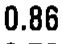 |
| r19_c00 | L2 | FCWsr | FCWsr | L2 | 11.1 (0.7) | mean 11.1 mm; sem 0.7 mm | 11.1 (0.7) | 11.1 (0.7) | 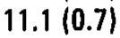 |
| r19_c01 | L2 | FCWsl | FCWsl | L2 | 11.4 (1.0) | mean 11.4 mm; sem 1.0 mm | 11.4 (1.0) | 11.4 (1.0) | 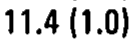 |
| r19_c02 | L2 | FCHsr | FCHsr | L2 | 14.6 (0.6) | mean 14.6 mm; sem 0.6 mm | 14.6 (0.6) | 14.6 (0.6) |  |
| r19_c03 | L2 | FCHsl | FCHsl | L2 | 14.6 (0.7) | mean 14.6 mm; sem 0.7 mm | 14.6 (0.7) | 14.6 (0.7) |  |
| r19_c04 | L2 | FCW/FCHsr | FCW/FCHsr | L2 | 0.76 | ratio 0.76 | 0.76 | 0.76 |  |
| r19_c05 | L2 | FCW/FCHsl | FCW/FCHsl | L2 | 0.78 | ratio 0.78 | 0.78 | 0.78 |  |
| r20_c00 | L3 | FCWsr | FCWsr | L3 | 13.8 (0.9) | mean 13.8 mm; sem 0.9 mm | 13.8 (0.9) | 13.8 (0.9) |  |
| r20_c01 | L3 | FCWsl | FCWsl | L3 | 13.9 (0.7) | mean 13.9 mm; sem 0.7 mm | 13.9 (0.7) | 13.9 (0.7) |  |
| r20_c02 | L3 | FCHsr | FCHsr | L3 | 16.0 (0.8) | mean 16.0 mm; sem 0.8 mm | 16.0 (0.8) | 16.0 (0.8) |  |
| r20_c03 | L3 | FCHsl | FCHsl | L3 | 15.9 (0.8) | mean 15.9 mm; sem 0.8 mm | 15.9 (0.8) | 15.9 (0.8) |  |
| r20_c04 | L3 | FCW/FCHsr | FCW/FCHsr | L3 | 0.86 | ratio 0.86 | 0.86 | 0.86 |  |
| r20_c05 | L3 | FCW/FCHsl | FCW/FCHsl | L3 | 0.87 | ratio 0.87 | 0.87 | 0.87 |  |
| r21_c00 | L4 | FCWsr | FCWsr | L4 | 14.1 (1.0) | mean 14.1 mm; sem 1.0 mm | 14.1 (1.0) | 14.1 (1.0) |  |
| r21_c01 | L4 | FCWsl | FCWsl | L4 | 15.3 (0.6) | mean 15.3 mm; sem 0.6 mm | 15.3 (0.6) | 15.3 (0.6) |  |
| r21_c02 | L4 | FCHsr | FCHsr | L4 | 16.1 (0.5) | mean 16.1 mm; sem 0.5 mm | 16.1 (0.5) | 16.1 (0.5) |  |
| r21_c03 | L4 | FCHsl | FCHsl | L4 | 17.3 (0.7) | mean 17.3 mm; sem 0.7 mm | 17.3 (0.7) | 17.3 (0.7) |  |
| r21_c04 | L4 | FCW/FCHsr | FCW/FCHsr | L4 | 0.88 | ratio 0.88 | 0.88 | 0.88 |  |
| r21_c05 | L4 | FCW/FCHsl | FCW/FCHsl | L4 | 0.89 | ratio 0.89 | 0.89 | 0.89 |  |
| r22_c00 | L5 | FCWsr | FCWsr | L5 | 16.3 (0.7) | mean 16.3 mm; sem 0.7 mm | 16.3 (0.7) | 16.3 (0.7) |  |
| r22_c01 | L5 | FCWsl | FCWsl | L5 | 14.9 (0.6) | mean 14.9 mm; sem 0.6 mm | 14.9 (0.6) | 14.9 (0.6) |  |
| r22_c02 | L5 | FCHsr | FCHsr | L5 | 17.4 (0.7) | mean 17.4 mm; sem 0.7 mm | 17.4 (0.7) | 17.4 (0.7) |  |
| r22_c03 | L5 | FCHsl | FCHsl | L5 | 17.5 (0.7) | mean 17.5 mm; sem 0.7 mm | 17.5 (0.7) | 17.5 (0.7) |  |
| r22_c04 | L5 | FCW/FCHsr | FCW/FCHsr | L5 | 0.93 | ratio 0.93 | 0.93 | 0.93 |  |
| r22_c05 | L5 | FCW/FCHsl | FCW/FCHsl | L5 | 0.85 | ratio 0.85 | 0.85 | 0.85 |  |
