# Table 3. Means (and Standard Errors of the Mean) of the Inferior Articular Facet Linear Dimensions

Facets, PDF page 4, printed page 1301; Panjabi_1993_Facets_Spine_18-10_1298-1310.pdf (sha256 2b22fe5e6c14d2289a4366f3c94879db1da0f79ae54e05a7f8e54a07e1c0279f), rendered at 300 dpi by render.py.

Every cell below is the box layout.py cut from the rendered page, and the two strings are what the two reading passes read in it (README.md). A dash is printed where the paper prints one. The value column is what provenance.csv carries.

| cell | row | column | measure | level | printed | value | pass 1 | pass 2 | image |
|---|---|---|---|---|---|---|---|---|---|
| r00_c00 | C2 | FCWir | FCWir | C2 | 11.4 (0.3) | mean 11.4 mm; sem 0.3 mm | 11.4 (0.3) | 11.4 (0.3) | 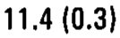 |
| r00_c01 | C2 | FCWil | FCWil | C2 | 10.4 (0.5) | mean 10.4 mm; sem 0.5 mm | 10.4 (0.5) | 10.4 (0.5) |  |
| r00_c02 | C2 | FCHir | FCHir | C2 | 13.0 (0.7) | mean 13.0 mm; sem 0.7 mm | 13.0 (0.7) | 13.0 (0.7) | 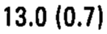 |
| r00_c03 | C2 | FCHil | FCHil | C2 | 11.8 (0.6) | mean 11.8 mm; sem 0.6 mm | 11.8 (0.6) | 11.8 (0.6) | 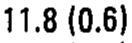 |
| r00_c04 | C2 | FCW/FCHir | FCW/FCHir | C2 | 0.88 | ratio 0.88 | 0.88 | 0.88 |  |
| r00_c05 | C2 | FCW/FCHil | FCW/FCHil | C2 | 0.88 | ratio 0.88 | 0.88 | 0.88 |  |
| r01_c00 | C3 | FCWir | FCWir | C3 | 11.7 (0.3) | mean 11.7 mm; sem 0.3 mm | 11.7 (0.3) | 11.7 (0.3) | 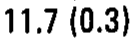 |
| r01_c01 | C3 | FCWil | FCWil | C3 | 11.0 (0.7) | mean 11.0 mm; sem 0.7 mm | 11.0 (0.7) | 11.0 (0.7) | 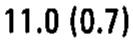 |
| r01_c02 | C3 | FCHir | FCHir | C3 | 12.9 (1.0) | mean 12.9 mm; sem 1.0 mm | 12.9 (1.0) | 12.9 (1.0) | 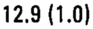 |
| r01_c03 | C3 | FCHil | FCHil | C3 | 11.9 (1.2) | mean 11.9 mm; sem 1.2 mm | 11.9 (1.2) | 11.9 (1.2) | 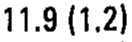 |
| r01_c04 | C3 | FCW/FCHir | FCW/FCHir | C3 | 0.90 | ratio 0.90 | 0.90 | 0.90 |  |
| r01_c05 | C3 | FCW/FCHil | FCW/FCHil | C3 | 0.92 | ratio 0.92 | 0.92 | 0.92 |  |
| r02_c00 | C4 | FCWir | FCWir | C4 | 12.2 (0.5) | mean 12.2 mm; sem 0.5 mm | 12.2 (0.5) | 12.2 (0.5) |  |
| r02_c01 | C4 | FCWil | FCWil | C4 | 11.1 (0.6) | mean 11.1 mm; sem 0.6 mm | 11.1 (0.6) | 11.1 (0.6) | 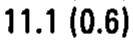 |
| r02_c02 | C4 | FCHir | FCHir | C4 | 13.0 (0.7) | mean 13.0 mm; sem 0.7 mm | 13.0 (0.7) | 13.0 (0.7) | 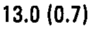 |
| r02_c03 | C4 | FCHil | FCHil | C4 | 11.5 (1.0) | mean 11.5 mm; sem 1.0 mm | 11.5 (1.0) | 11.5 (1.0) | 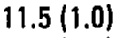 |
| r02_c04 | C4 | FCW/FCHir | FCW/FCHir | C4 | 0.94 | ratio 0.94 | 0.94 | 0.94 |  |
| r02_c05 | C4 | FCW/FCHil | FCW/FCHil | C4 | 0.97 | ratio 0.97 | 0.97 | 0.97 |  |
| r03_c00 | C5 | FCWir | FCWir | C5 | 11.2 (0.6) | mean 11.2 mm; sem 0.6 mm | 11.2 (0.6) | 11.2 (0.6) | 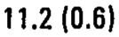 |
| r03_c01 | C5 | FCWil | FCWil | C5 | 12.3 (0.8) | mean 12.3 mm; sem 0.8 mm | 12.3 (0.8) | 12.3 (0.8) | 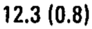 |
| r03_c02 | C5 | FCHir | FCHir | C5 | 10.8 (0.5) | mean 10.8 mm; sem 0.5 mm | 10.8 (0.5) | 10.8 (0.5) |  |
| r03_c03 | C5 | FCHil | FCHil | C5 | 11.5 (0.5) | mean 11.5 mm; sem 0.5 mm | 11.5 (0.5) | 11.5 (0.5) | 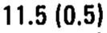 |
| r03_c04 | C5 | FCW/FCHir | FCW/FCHir | C5 | 1.04 | ratio 1.04 | 1.04 | 1.04 |  |
| r03_c05 | C5 | FCW/FCHil | FCW/FCHil | C5 | 1.07 | ratio 1.07 | 1.07 | 1.07 |  |
| r04_c00 | C6 | FCWir | FCWir | C6 | 12.7 (0.5) | mean 12.7 mm; sem 0.5 mm | 12.7 (0.5) | 12.7 (0.5) | 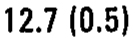 |
| r04_c01 | C6 | FCWil | FCWil | C6 | 13.1 (0.9) | mean 13.1 mm; sem 0.9 mm | 13.1 (0.9) | 13.1 (0.9) | 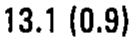 |
| r04_c02 | C6 | FCHir | FCHir | C6 | 12.3 (0.4) | mean 12.3 mm; sem 0.4 mm | 12.3 (0.4) | 12.3 (0.4) | 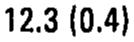 |
| r04_c03 | C6 | FCHil | FCHil | C6 | 12.2 (0.7) | mean 12.2 mm; sem 0.7 mm | 12.2 (0.7) | 12.2 (0.7) | 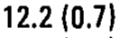 |
| r04_c04 | C6 | FCW/FCHir | FCW/FCHir | C6 | 1.03 | ratio 1.03 | 1.03 | 1.03 |  |
| r04_c05 | C6 | FCW/FCHil | FCW/FCHil | C6 | 1.07 | ratio 1.07 | 1.07 | 1.07 |  |
| r05_c00 | C7 | FCWir | FCWir | C7 | 12.6 (0.7) | mean 12.6 mm; sem 0.7 mm | 12.6 (0.7) | 12.6 (0.7) | 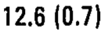 |
| r05_c01 | C7 | FCWil | FCWil | C7 | 13.9 (0.7) | mean 13.9 mm; sem 0.7 mm | 13.9 (0.7) | 13.9 (0.7) | 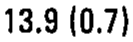 |
| r05_c02 | C7 | FCHir | FCHir | C7 | 11.4 (0.5) | mean 11.4 mm; sem 0.5 mm | 11.4 (0.5) | 11.4 (0.5) |  |
| r05_c03 | C7 | FCHil | FCHil | C7 | 13.9 (0.9) | mean 13.9 mm; sem 0.9 mm | 13.9 (0.9) | 13.9 (0.9) | 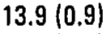 |
| r05_c04 | C7 | FCW/FCHir | FCW/FCHir | C7 | 1.10 | ratio 1.10 | 1.10 | 1.10 |  |
| r05_c05 | C7 | FCW/FCHil | FCW/FCHil | C7 | 1.00 | ratio 1.00 | 1.00 | 1.00 |  |
| r06_c00 | T1 | FCWir | FCWir | T1 | 11.9 (0.3) | mean 11.9 mm; sem 0.3 mm | 11.9 (0.3) | 11.9 (0.3) | 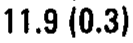 |
| r06_c01 | T1 | FCWil | FCWil | T1 | 13.2 (0.9) | mean 13.2 mm; sem 0.9 mm | 13.2 (0.9) | 13.2 (0.9) |  |
| r06_c02 | T1 | FCHir | FCHir | T1 | 12.5 (0.4) | mean 12.5 mm; sem 0.4 mm | 12.5 (0.4) | 12.5 (0.4) | 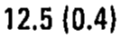 |
| r06_c03 | T1 | FCHil | FCHil | T1 | 13.3 (1.1) | mean 13.3 mm; sem 1.1 mm | 13.3 (1.1) | 13.3 (1.1) | 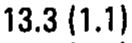 |
| r06_c04 | T1 | FCW/FCHir | FCW/FCHir | T1 | 0.96 | ratio 0.96 | 0.96 | 0.96 |  |
| r06_c05 | T1 | FCW/FCHil | FCW/FCHil | T1 | 0.99 | ratio 0.99 | 0.99 | 0.99 |  |
| r07_c00 | T2 | FCWir | FCWir | T2 | 11.1 (0.6) | mean 11.1 mm; sem 0.6 mm | 11.1 (0.6) | 11.1 (0.6) | 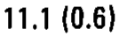 |
| r07_c01 | T2 | FCWil | FCWil | T2 | 11.0 (0.5) | mean 11.0 mm; sem 0.5 mm | 11.0 (0.5) | 11.0 (0.5) |  |
| r07_c02 | T2 | FCHir | FCHir | T2 | 11.2 (0.5) | mean 11.2 mm; sem 0.5 mm | 11.2 (0.5) | 11.2 (0.5) |  |
| r07_c03 | T2 | FCHil | FCHil | T2 | 11.8 (0.4) | mean 11.8 mm; sem 0.4 mm | 11.8 (0.4) | 11.8 (0.4) | 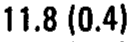 |
| r07_c04 | T2 | FCW/FCHir | FCW/FCHir | T2 | 0.98 | ratio 0.98 | 0.98 | 0.98 |  |
| r07_c05 | T2 | FCW/FCHil | FCW/FCHil | T2 | 0.93 | ratio 0.93 | 0.93 | 0.93 |  |
| r08_c00 | T3 | FCWir | FCWir | T3 | 9.9 (0.5) | mean 9.9 mm; sem 0.5 mm | 9.9 (0.5) | 9.9 (0.5) | 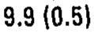 |
| r08_c01 | T3 | FCWil | FCWil | T3 | 10.4 (0.3) | mean 10.4 mm; sem 0.3 mm | 10.4 (0.3) | 10.4 (0.3) | 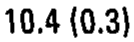 |
| r08_c02 | T3 | FCHir | FCHir | T3 | 11.0 (0.4) | mean 11.0 mm; sem 0.4 mm | 11.0 (0.4) | 11.0 (0.4) | 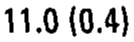 |
| r08_c03 | T3 | FCHil | FCHil | T3 | 10.7 (0.5) | mean 10.7 mm; sem 0.5 mm | 10.7 (0.5) | 10.7 (0.5) | 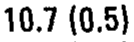 |
| r08_c04 | T3 | FCW/FCHir | FCW/FCHir | T3 | 0.90 | ratio 0.90 | 0.90 | 0.90 |  |
| r08_c05 | T3 | FCW/FCHil | FCW/FCHil | T3 | 0.97 | ratio 0.97 | 0.97 | 0.97 |  |
| r09_c00 | T4 | FCWir | FCWir | T4 | 10.4 (0.4) | mean 10.4 mm; sem 0.4 mm | 10.4 (0.4) | 10.4 (0.4) |  |
| r09_c01 | T4 | FCWil | FCWil | T4 | 9.8 (0.3) | mean 9.8 mm; sem 0.3 mm | 9.8 (0.3) | 9.8 (0.3) | 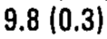 |
| r09_c02 | T4 | FCHir | FCHir | T4 | 11.0 (0.4) | mean 11.0 mm; sem 0.4 mm | 11.0 (0.4) | 11.0 (0.4) | 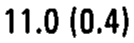 |
| r09_c03 | T4 | FCHil | FCHil | T4 | 11.0 (0.4) | mean 11.0 mm; sem 0.4 mm | 11.0 (0.4) | 11.0 (0.4) | 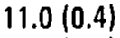 |
| r09_c04 | T4 | FCW/FCHir | FCW/FCHir | T4 | 0.94 | ratio 0.94 | 0.94 | 0.94 |  |
| r09_c05 | T4 | FCW/FCHil | FCW/FCHil | T4 | 0.89 | ratio 0.89 | 0.89 | 0.89 | 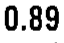 |
| r10_c00 | T5 | FCWir | FCWir | T5 | 9.7 (0.4) | mean 9.7 mm; sem 0.4 mm | 9.7 (0.4) | 9.7 (0.4) | 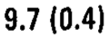 |
| r10_c01 | T5 | FCWil | FCWil | T5 | 9.7 (0.3) | mean 9.7 mm; sem 0.3 mm | 9.7 (0.3) | 9.7 (0.3) |  |
| r10_c02 | T5 | FCHir | FCHir | T5 | 10.9 (0.3) | mean 10.9 mm; sem 0.3 mm | 10.9 (0.3) | 10.9 (0.3) |  |
| r10_c03 | T5 | FCHil | FCHil | T5 | 11.2 (0.3) | mean 11.2 mm; sem 0.3 mm | 11.2 (0.3) | 11.2 (0.3) | 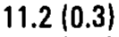 |
| r10_c04 | T5 | FCW/FCHir | FCW/FCHir | T5 | 0.89 | ratio 0.89 | 0.89 | 0.89 |  |
| r10_c05 | T5 | FCW/FCHil | FCW/FCHil | T5 | 0.87 | ratio 0.87 | 0.87 | 0.87 |  |
| r11_c00 | T6 | FCWir | FCWir | T6 | 9.6 (0.4) | mean 9.6 mm; sem 0.4 mm | 9.6 (0.4) | 9.6 (0.4) |  |
| r11_c01 | T6 | FCWil | FCWil | T6 | 9.7 (0.3) | mean 9.7 mm; sem 0.3 mm | 9.7 (0.3) | 9.7 (0.3) | 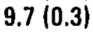 |
| r11_c02 | T6 | FCHir | FCHir | T6 | 10.3 (0.4) | mean 10.3 mm; sem 0.4 mm | 10.3 (0.4) | 10.3 (0.4) | 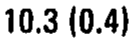 |
| r11_c03 | T6 | FCHil | FCHil | T6 | 11.1 (0.3) | mean 11.1 mm; sem 0.3 mm | 11.1 (0.3) | 11.1 (0.3) | 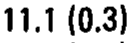 |
| r11_c04 | T6 | FCW/FCHir | FCW/FCHir | T6 | 0.93 | ratio 0.93 | 0.93 | 0.93 |  |
| r11_c05 | T6 | FCW/FCHil | FCW/FCHil | T6 | 0.87 | ratio 0.87 | 0.87 | 0.87 |  |
| r12_c00 | T7 | FCWir | FCWir | T7 | 9.8 (0.5) | mean 9.8 mm; sem 0.5 mm | 9.8 (0.5) | 9.8 (0.5) |  |
| r12_c01 | T7 | FCWil | FCWil | T7 | 10.3 (0.3) | mean 10.3 mm; sem 0.3 mm | 10.3 (0.3) | 10.3 (0.3) |  |
| r12_c02 | T7 | FCHir | FCHir | T7 | 10.6 (0.5) | mean 10.6 mm; sem 0.5 mm | 10.6 (0.5) | 10.6 (0.5) |  |
| r12_c03 | T7 | FCHil | FCHil | T7 | 11.0 (0.4) | mean 11.0 mm; sem 0.4 mm | 11.0 (0.4) | 11.0 (0.4) | 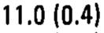 |
| r12_c04 | T7 | FCW/FCHir | FCW/FCHir | T7 | 0.92 | ratio 0.92 | 0.92 | 0.92 |  |
| r12_c05 | T7 | FCW/FCHil | FCW/FCHil | T7 | 0.94 | ratio 0.94 | 0.94 | 0.94 | 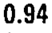 |
| r13_c00 | T8 | FCWir | FCWir | T8 | 10.4 (0.4) | mean 10.4 mm; sem 0.4 mm | 10.4 (0.4) | 10.4 (0.4) |  |
| r13_c01 | T8 | FCWil | FCWil | T8 | 10.7 (0.3) | mean 10.7 mm; sem 0.3 mm | 10.7 (0.3) | 10.7 (0.3) | 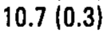 |
| r13_c02 | T8 | FCHir | FCHir | T8 | 10.9 (0.5) | mean 10.9 mm; sem 0.5 mm | 10.9 (0.5) | 10.9 (0.5) |  |
| r13_c03 | T8 | FCHil | FCHil | T8 | 11.6 (0.2) | mean 11.6 mm; sem 0.2 mm | 11.6 (0.2) | 11.6 (0.2) | 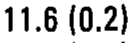 |
| r13_c04 | T8 | FCW/FCHir | FCW/FCHir | T8 | 0.95 | ratio 0.95 | 0.95 | 0.95 |  |
| r13_c05 | T8 | FCW/FCHil | FCW/FCHil | T8 | 0.92 | ratio 0.92 | 0.92 | 0.92 | 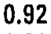 |
| r14_c00 | T9 | FCWir | FCWir | T9 | 11.9 (0.7) | mean 11.9 mm; sem 0.7 mm | 11.9 (0.7) | 11.9 (0.7) |  |
| r14_c01 | T9 | FCWil | FCWil | T9 | 12.6 (0.6) | mean 12.6 mm; sem 0.6 mm | 12.6 (0.6) | 12.6 (0.6) | 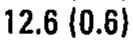 |
| r14_c02 | T9 | FCHir | FCHir | T9 | 12.3 (0.5) | mean 12.3 mm; sem 0.5 mm | 12.3 (0.5) | 12.3 (0.5) | 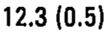 |
| r14_c03 | T9 | FCHil | FCHil | T9 | 12.5 (0.7) | mean 12.5 mm; sem 0.7 mm | 12.5 (0.7) | 12.5 (0.7) | 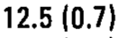 |
| r14_c04 | T9 | FCW/FCHir | FCW/FCHir | T9 | 0.97 | ratio 0.97 | 0.97 | 0.97 |  |
| r14_c05 | T9 | FCW/FCHil | FCW/FCHil | T9 | 1.01 | ratio 1.01 | 1.01 | 1.01 |  |
| r15_c00 | T10 | FCWir | FCWir | T10 | 11.9 (0.5) | mean 11.9 mm; sem 0.5 mm | 11.9 (0.5) | 11.9 (0.5) |  |
| r15_c01 | T10 | FCWil | FCWil | T10 | 11.4 (0.3) | mean 11.4 mm; sem 0.3 mm | 11.4 (0.3) | 11.4 (0.3) | 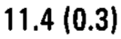 |
| r15_c02 | T10 | FCHir | FCHir | T10 | 12.4 (0.3) | mean 12.4 mm; sem 0.3 mm | 12.4 (0.3) | 12.4 (0.3) | 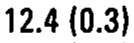 |
| r15_c03 | T10 | FCHil | FCHil | T10 | 11.7 (0.5) | mean 11.7 mm; sem 0.5 mm | 11.7 (0.5) | 11.7 (0.5) | 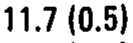 |
| r15_c04 | T10 | FCW/FCHir | FCW/FCHir | T10 | 0.96 | ratio 0.96 | 0.96 | 0.96 |  |
| r15_c05 | T10 | FCW/FCHil | FCW/FCHil | T10 | 0.97 | ratio 0.97 | 0.97 | 0.97 |  |
| r16_c00 | T11 | FCWir | FCWir | T11 | 11.4 (0.6) | mean 11.4 mm; sem 0.6 mm | 11.4 (0.6) | 11.4 (0.6) | 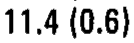 |
| r16_c01 | T11 | FCWil | FCWil | T11 | 10.9 (0.7) | mean 10.9 mm; sem 0.7 mm | 10.9 (0.7) | 10.9 (0.7) |  |
| r16_c02 | T11 | FCHir | FCHir | T11 | 13.3 (0.5) | mean 13.3 mm; sem 0.5 mm | 13.3 (0.5) | 13.3 (0.5) |  |
| r16_c03 | T11 | FCHil | FCHil | T11 | 12.5 (0.6) | mean 12.5 mm; sem 0.6 mm | 12.5 (0.6) | 12.5 (0.6) |  |
| r16_c04 | T11 | FCW/FCHir | FCW/FCHir | T11 | 0.86 | ratio 0.86 | 0.86 | 0.86 |  |
| r16_c05 | T11 | FCW/FCHil | FCW/FCHil | T11 | 0.87 | ratio 0.87 | 0.87 | 0.87 |  |
| r17_c00 | T12 | FCWir | FCWir | T12 | 9.5 (0.6) | mean 9.5 mm; sem 0.6 mm | 9.5 (0.6) | 9.5 (0.6) |  |
| r17_c01 | T12 | FCWil | FCWil | T12 | 9.8 (0.7) | mean 9.8 mm; sem 0.7 mm | 9.8 (0.7) | 9.8 (0.7) |  |
| r17_c02 | T12 | FCHir | FCHir | T12 | 12.5 (0.5) | mean 12.5 mm; sem 0.5 mm | 12.5 (0.5) | 12.5 (0.5) |  |
| r17_c03 | T12 | FCHil | FCHil | T12 | 12.7 (0.7) | mean 12.7 mm; sem 0.7 mm | 12.7 (0.7) | 12.7 (0.7) |  |
| r17_c04 | T12 | FCW/FCHir | FCW/FCHir | T12 | 0.76 | ratio 0.76 | 0.76 | 0.76 |  |
| r17_c05 | T12 | FCW/FCHil | FCW/FCHil | T12 | 0.77 | ratio 0.77 | 0.77 | 0.77 |  |
| r18_c00 | L1 | FCWir | FCWir | L1 | 12.4 (0.7) | mean 12.4 mm; sem 0.7 mm | 12.4 (0.7) | 12.4 (0.7) |  |
| r18_c01 | L1 | FCWil | FCWil | L1 | 10.7 (0.5) | mean 10.7 mm; sem 0.5 mm | 10.7 (0.5) | 10.7 (0.5) |  |
| r18_c02 | L1 | FCHir | FCHir | L1 | 15.3 (0.7) | mean 15.3 mm; sem 0.7 mm | 15.3 (0.7) | 15.3 (0.7) |  |
| r18_c03 | L1 | FCHil | FCHil | L1 | 15.7 (0.6) | mean 15.7 mm; sem 0.6 mm | 15.7 (0.6) | 15.7 (0.6) |  |
| r18_c04 | L1 | FCW/FCHir | FCW/FCHir | L1 | 0.81 | ratio 0.81 | 0.81 | 0.81 |  |
| r18_c05 | L1 | FCW/FCHil | FCW/FCHil | L1 | 0.68 | ratio 0.68 | 0.68 | 0.68 |  |
| r19_c00 | L2 | FCWir | FCWir | L2 | 12.7 (0.7) | mean 12.7 mm; sem 0.7 mm | 12.7 (0.7) | 12.7 (0.7) |  |
| r19_c01 | L2 | FCWil | FCWil | L2 | 12.7 (0.8) | mean 12.7 mm; sem 0.8 mm | 12.7 (0.8) | 12.7 (0.8) |  |
| r19_c02 | L2 | FCHir | FCHir | L2 | 16.0 (0.6) | mean 16.0 mm; sem 0.6 mm | 16.0 (0.6) | 16.0 (0.6) |  |
| r19_c03 | L2 | FCHil | FCHil | L2 | 16.3 (0.6) | mean 16.3 mm; sem 0.6 mm | 16.3 (0.6) | 16.3 (0.6) |  |
| r19_c04 | L2 | FCW/FCHir | FCW/FCHir | L2 | 0.79 | ratio 0.79 | 0.79 | 0.79 |  |
| r19_c05 | L2 | FCW/FCHil | FCW/FCHil | L2 | 0.78 | ratio 0.78 | 0.78 | 0.78 |  |
| r20_c00 | L3 | FCWir | FCWir | L3 | 13.8 (0.4) | mean 13.8 mm; sem 0.4 mm | 13.8 (0.4) | 13.8 (0.4) |  |
| r20_c01 | L3 | FCWil | FCWil | L3 | 13.4 (0.4) | mean 13.4 mm; sem 0.4 mm | 13.4 (0.4) | 13.4 (0.4) |  |
| r20_c02 | L3 | FCHir | FCHir | L3 | 15.7 (0.3) | mean 15.7 mm; sem 0.3 mm | 15.7 (0.3) | 15.7 (0.3) |  |
| r20_c03 | L3 | FCHil | FCHil | L3 | 16.4 (0.5) | mean 16.4 mm; sem 0.5 mm | 16.4 (0.5) | 16.4 (0.5) |  |
| r20_c04 | L3 | FCW/FCHir | FCW/FCHir | L3 | 0.88 | ratio 0.88 | 0.88 | 0.88 |  |
| r20_c05 | L3 | FCW/FCHil | FCW/FCHil | L3 | 0.82 | ratio 0.82 | 0.82 | 0.82 |  |
| r21_c00 | L4 | FCWir | FCWir | L4 | 14.7 (0.5) | mean 14.7 mm; sem 0.5 mm | 14.7 (0.5) | 14.7 (0.5) |  |
| r21_c01 | L4 | FCWil | FCWil | L4 | 14.1 (0.6) | mean 14.1 mm; sem 0.6 mm | 14.1 (0.6) | 14.1 (0.6) |  |
| r21_c02 | L4 | FCHir | FCHir | L4 | 16.2 (0.7) | mean 16.2 mm; sem 0.7 mm | 16.2 (0.7) | 16.2 (0.7) |  |
| r21_c03 | L4 | FCHil | FCHil | L4 | 15.6 (0.7) | mean 15.6 mm; sem 0.7 mm | 15.6 (0.7) | 15.6 (0.7) |  |
| r21_c04 | L4 | FCW/FCHir | FCW/FCHir | L4 | 0.91 | ratio 0.91 | 0.91 | 0.91 |  |
| r21_c05 | L4 | FCW/FCHil | FCW/FCHil | L4 | 0.90 | ratio 0.90 | 0.90 | 0.90 |  |
| r22_c00 | L5 | FCWir | FCWir | L5 | 15.6 (0.9) | mean 15.6 mm; sem 0.9 mm | 15.6 (0.9) | 15.6 (0.9) |  |
| r22_c01 | L5 | FCWil | FCWil | L5 | 16.1 (0.9) | mean 16.1 mm; sem 0.9 mm | 16.1 (0.9) | 16.1 (0.9) |  |
| r22_c02 | L5 | FCHir | FCHir | L5 | 18.4 (1.0) | mean 18.4 mm; sem 1.0 mm | 18.4 (1.0) | 18.4 (1.0) |  |
| r22_c03 | L5 | FCHil | FCHil | L5 | 17.3 (1.0) | mean 17.3 mm; sem 1.0 mm | 17.3 (1.0) | 17.3 (1.0) |  |
| r22_c04 | L5 | FCW/FCHir | FCW/FCHir | L5 | 0.85 | ratio 0.85 | 0.85 | 0.85 |  |
| r22_c05 | L5 | FCW/FCHil | FCW/FCHil | L5 | 0.93 | ratio 0.93 | 0.93 | 0.93 |  |
