# Table 4. Means (and Standard Errors of the Mean) of the Superior and Inferior Articular Facet Surface Areas

Facets, PDF page 5, printed page 1302; Panjabi_1993_Facets_Spine_18-10_1298-1310.pdf (sha256 2b22fe5e6c14d2289a4366f3c94879db1da0f79ae54e05a7f8e54a07e1c0279f), rendered at 300 dpi by render.py.

Every cell below is the box layout.py cut from the rendered page, and the two strings are what the two reading passes read in it (README.md). A dash is printed where the paper prints one. The value column is what provenance.csv carries.

| cell | row | column | measure | level | printed | value | pass 1 | pass 2 | image |
|---|---|---|---|---|---|---|---|---|---|
| r00_c00 | C2 | FCAsr | FCAsr | C2 | 211.3 (5.6) | mean 211.3 mm2; sem 5.6 mm2 | 211.3 (5.6) | 211.3 (5.6) |  |
| r00_c01 | C2 | FCAsl | FCAsl | C2 | 205.1 (9.2) | mean 205.1 mm2; sem 9.2 mm2 | 205.1 (9.2) | 205.1 (9.2) |  |
| r00_c02 | C2 | FCAir | FCAir | C2 | 94.6 (7.4) | mean 94.6 mm2; sem 7.4 mm2 | 94.6 (7.4) | 94.6 (7.4) | 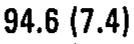 |
| r00_c03 | C2 | FCAil | FCAil | C2 | 85.0 (6.4) | mean 85.0 mm2; sem 6.4 mm2 | 85.0 (6.4) | 85.0 (6.4) | 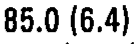 |
| r01_c00 | C3 | FCAsr | FCAsr | C3 | 101.3 (15.2) | mean 101.3 mm2; sem 15.2 mm2 | 101.3 (15.2) | 101.3 (15.2) |  |
| r01_c01 | C3 | FCAsl | FCAsl | C3 | 81.9 (8.5) | mean 81.9 mm2; sem 8.5 mm2 | 81.9 (8.5) | 81.9 (8.5) |  |
| r01_c02 | C3 | FCAir | FCAir | C3 | 105.7 (10.5) | mean 105.7 mm2; sem 10.5 mm2 | 105.7 (10.5) | 105.7 (10.5) |  |
| r01_c03 | C3 | FCAil | FCAil | C3 | 91.7 (19.3) | mean 91.7 mm2; sem 19.3 mm2 | 91.7 (19.3) | 91.7 (19.3) |  |
| r02_c00 | C4 | FCAsr | FCAsr | C4 | 104.2 (15.5) | mean 104.2 mm2; sem 15.5 mm2 | 104.2 (15.5) | 104.2 (15.5) |  |
| r02_c01 | C4 | FCAsl | FCAsl | C4 | 95.6 (19.2) | mean 95.6 mm2; sem 19.2 mm2 | 95.6 (19.2) | 95.6 (19.2) |  |
| r02_c02 | C4 | FCAir | FCAir | C4 | 105.3 (9.6) | mean 105.3 mm2; sem 9.6 mm2 | 105.3 (9.6) | 105.3 (9.6) |  |
| r02_c03 | C4 | FCAil | FCAil | C4 | 85.7 (10.7) | mean 85.7 mm2; sem 10.7 mm2 | 85.7 (10.7) | 85.7 (10.7) |  |
| r03_c00 | C5 | FCAsr | FCAsr | C5 | 107.0 (15.8) | mean 107.0 mm2; sem 15.8 mm2 | 107.0 (15.8) | 107.0 (15.8) |  |
| r03_c01 | C5 | FCAsl | FCAsl | C5 | 87.2 (12.5) | mean 87.2 mm2; sem 12.5 mm2 | 87.2 (12.5) | 87.2 (12.5) | 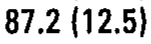 |
| r03_c02 | C5 | FCAir | FCAir | C5 | 83.0 (7.1) | mean 83.0 mm2; sem 7.1 mm2 | 83.0 (7.1) | 83.0 (7.1) |  |
| r03_c03 | C5 | FCAil | FCAil | C5 | 86.4 (9.4) | mean 86.4 mm2; sem 9.4 mm2 | 86.4 (9.4) | 86.4 (9.4) | 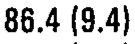 |
| r04_c00 | C6 | FCAsr | FCAsr | C6 | 79.5 (6.2) | mean 79.5 mm2; sem 6.2 mm2 | 79.5 (6.2) | 79.5 (6.2) |  |
| r04_c01 | C6 | FCAsl | FCAsl | C6 | 94.6 (9.9) | mean 94.6 mm2; sem 9.9 mm2 | 94.6 (9.9) | 94.6 (9.9) |  |
| r04_c02 | C6 | FCAir | FCAir | C6 | 97.8 (7.2) | mean 97.8 mm2; sem 7.2 mm2 | 97.8 (7.2) | 97.8 (7.2) | 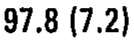 |
| r04_c03 | C6 | FCAil | FCAil | C6 | 94.4 (7.0) | mean 94.4 mm2; sem 7.0 mm2 | 94.4 (7.0) | 94.4 (7.0) |  |
| r05_c00 | C7 | FCAsr | FCAsr | C7 | 79.9 (5.5) | mean 79.9 mm2; sem 5.5 mm2 | 79.9 (5.5) | 79.9 (5.5) |  |
| r05_c01 | C7 | FCAsl | FCAsl | C7 | 83.9 (6.5) | mean 83.9 mm2; sem 6.5 mm2 | 83.9 (6.5) | 83.9 (6.5) | 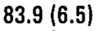 |
| r05_c02 | C7 | FCAir | FCAir | C7 | 94.3 (3.5) | mean 94.3 mm2; sem 3.5 mm2 | 94.3 (3.5) | 94.3 (3.5) | 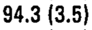 |
| r05_c03 | C7 | FCAil | FCAil | C7 | 114.6 (9.1) | mean 114.6 mm2; sem 9.1 mm2 | 114.6 (9.1) | 114.6 (9.1) |  |
| r06_c00 | T1 | FCAsr | FCAsr | T1 | 102.9 (6.0) | mean 102.9 mm2; sem 6.0 mm2 | 102.9 (6.0) | 102.9 (6.0) |  |
| r06_c01 | T1 | FCAsl | FCAsl | T1 | 114.8 (12.4) | mean 114.8 mm2; sem 12.4 mm2 | 114.8 (12.4) | 114.8 (12.4) |  |
| r06_c02 | T1 | FCAir | FCAir | T1 | 84.5 (5.5) | mean 84.5 mm2; sem 5.5 mm2 | 84.5 (5.5) | 84.5 (5.5) |  |
| r06_c03 | T1 | FCAil | FCAil | T1 | 94.4 (7.0) | mean 94.4 mm2; sem 7.0 mm2 | 94.4 (7.0) | 94.4 (7.0) |  |
| r07_c00 | T2 | FCAsr | FCAsr | T2 | 80.0 (6.9) | mean 80.0 mm2; sem 6.9 mm2 | 80.0 (6.9) | 80.0 (6.9) |  |
| r07_c01 | T2 | FCAsl | FCAsl | T2 | 93.2 (10.0) | mean 93.2 mm2; sem 10.0 mm2 | 93.2 (10.0) | 93.2 (10.0) |  |
| r07_c02 | T2 | FCAir | FCAir | T2 | 82.6 (4.9) | mean 82.6 mm2; sem 4.9 mm2 | 82.6 (4.9) | 82.6 (4.9) | 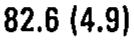 |
| r07_c03 | T2 | FCAil | FCAil | T2 | 86.8 (6.5) | mean 86.8 mm2; sem 6.5 mm2 | 86.8 (6.5) | 86.8 (6.5) | 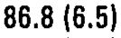 |
| r08_c00 | T3 | FCAsr | FCAsr | T3 | 79.7 (4.6) | mean 79.7 mm2; sem 4.6 mm2 | 79.7 (4.6) | 79.7 (4.6) | 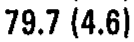 |
| r08_c01 | T3 | FCAsl | FCAsl | T3 | 85.8 (5.2) | mean 85.8 mm2; sem 5.2 mm2 | 85.8 (5.2) | 85.8 (5.2) | 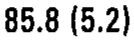 |
| r08_c02 | T3 | FCAir | FCAir | T3 | 73.3 (5.7) | mean 73.3 mm2; sem 5.7 mm2 | 73.3 (5.7) | 73.3 (5.7) | 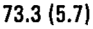 |
| r08_c03 | T3 | FCAil | FCAil | T3 | 78.9 (4.6) | mean 78.9 mm2; sem 4.6 mm2 | 78.9 (4.6) | 78.9 (4.6) | 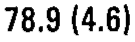 |
| r09_c00 | T4 | FCAsr | FCAsr | T4 | 74.9 (4.7) | mean 74.9 mm2; sem 4.7 mm2 | 74.9 (4.7) | 74.9 (4.7) | 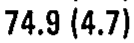 |
| r09_c01 | T4 | FCAsl | FCAsl | T4 | 79.6 (4.0) | mean 79.6 mm2; sem 4.0 mm2 | 79.6 (4.0) | 79.6 (4.0) |  |
| r09_c02 | T4 | FCAir | FCAir | T4 | 77.6 (3.4) | mean 77.6 mm2; sem 3.4 mm2 | 77.6 (3.4) | 77.6 (3.4) | 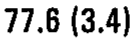 |
| r09_c03 | T4 | FCAil | FCAil | T4 | 73.2 (3.9) | mean 73.2 mm2; sem 3.9 mm2 | 73.2 (3.9) | 73.2 (3.9) | 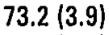 |
| r10_c00 | T5 | FCAsr | FCAsr | T5 | 85.6 (6.1) | mean 85.6 mm2; sem 6.1 mm2 | 85.6 (6.1) | 85.6 (6.1) | 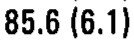 |
| r10_c01 | T5 | FCAsl | FCAsl | T5 | 73.5 (3.5) | mean 73.5 mm2; sem 3.5 mm2 | 73.5 (3.5) | 73.5 (3.5) | 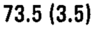 |
| r10_c02 | T5 | FCAir | FCAir | T5 | 72.3 (4.5) | mean 72.3 mm2; sem 4.5 mm2 | 72.3 (4.5) | 72.3 (4.5) | 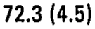 |
| r10_c03 | T5 | FCAil | FCAil | T5 | 74.6 (2.1) | mean 74.6 mm2; sem 2.1 mm2 | 74.6 (2.1) | 74.6 (2.1) |  |
| r11_c00 | T6 | FCAsr | FCAsr | T6 | 74.7 (5.4) | mean 74.7 mm2; sem 5.4 mm2 | 74.7 (5.4) | 74.7 (5.4) | 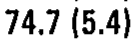 |
| r11_c01 | T6 | FCAsl | FCAsl | T6 | 77.8 (4.8) | mean 77.8 mm2; sem 4.8 mm2 | 77.8 (4.8) | 77.8 (4.8) | 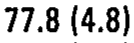 |
| r11_c02 | T6 | FCAir | FCAir | T6 | 69.4 (4.1) | mean 69.4 mm2; sem 4.1 mm2 | 69.4 (4.1) | 69.4 (4.1) |  |
| r11_c03 | T6 | FCAil | FCAil | T6 | 73.7 (3.1) | mean 73.7 mm2; sem 3.1 mm2 | 73.7 (3.1) | 73.7 (3.1) | 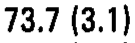 |
| r12_c00 | T7 | FCAsr | FCAsr | T7 | 75.8 (7.4) | mean 75.8 mm2; sem 7.4 mm2 | 75.8 (7.4) | 75.8 (7.4) | 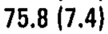 |
| r12_c01 | T7 | FCAsl | FCAsl | T7 | 74.6 (3.6) | mean 74.6 mm2; sem 3.6 mm2 | 74.6 (3.6) | 74.6 (3.6) | 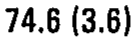 |
| r12_c02 | T7 | FCAir | FCAir | T7 | 69.6 (4.1) | mean 69.6 mm2; sem 4.1 mm2 | 69.6 (4.1) | 69.6 (4.1) |  |
| r12_c03 | T7 | FCAil | FCAil | T7 | 76.7 (4.0) | mean 76.7 mm2; sem 4.0 mm2 | 76.7 (4.0) | 76.7 (4.0) |  |
| r13_c00 | T8 | FCAsr | FCAsr | T8 | 77.5 (4.8) | mean 77.5 mm2; sem 4.8 mm2 | 77.5 (4.8) | 77.5 (4.8) | 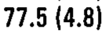 |
| r13_c01 | T8 | FCAsl | FCAsl | T8 | 78.0 (5.3) | mean 78.0 mm2; sem 5.3 mm2 | 78.0 (5.3) | 78.0 (5.3) | 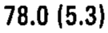 |
| r13_c02 | T8 | FCAir | FCAir | T8 | 75.9 (2.0) | mean 75.9 mm2; sem 2.0 mm2 | 75.9 (2.0) | 75.9 (2.0) |  |
| r13_c03 | T8 | FCAil | FCAil | T8 | 80.8 (2.6) | mean 80.8 mm2; sem 2.6 mm2 | 80.8 (2.6) | 80.8 (2.6) |  |
| r14_c00 | T9 | FCAsr | FCAsr | T9 | 82.1 (5.3) | mean 82.1 mm2; sem 5.3 mm2 | 82.1 (5.3) | 82.1 (5.3) | 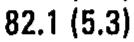 |
| r14_c01 | T9 | FCAsl | FCAsl | T9 | 83.3 (4.8) | mean 83.3 mm2; sem 4.8 mm2 | 83.3 (4.8) | 83.3 (4.8) | 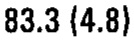 |
| r14_c02 | T9 | FCAir | FCAir | T9 | 89.5 (3.5) | mean 89.5 mm2; sem 3.5 mm2 | 89.5 (3.5) | 89.5 (3.5) | 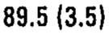 |
| r14_c03 | T9 | FCAil | FCAil | T9 | 99.0 (10.3) | mean 99.0 mm2; sem 10.3 mm2 | 99.0 (10.3) | 99.0 (10.3) |  |
| r15_c00 | T10 | FCAsr | FCAsr | T10 | 87.0 (7.5) | mean 87.0 mm2; sem 7.5 mm2 | 87.0 (7.5) | 87.0 (7.5) | 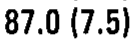 |
| r15_c01 | T10 | FCAsl | FCAsl | T10 | 94.8 (13.5) | mean 94.8 mm2; sem 13.5 mm2 | 94.8 (13.5) | 94.8 (13.5) |  |
| r15_c02 | T10 | FCAir | FCAir | T10 | 98.5 (5.3) | mean 98.5 mm2; sem 5.3 mm2 | 98.5 (5.3) | 98.5 (5.3) |  |
| r15_c03 | T10 | FCAil | FCAil | T10 | 89.8 (6.2) | mean 89.8 mm2; sem 6.2 mm2 | 89.8 (6.2) | 89.8 (6.2) | 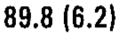 |
| r16_c00 | T11 | FCAsr | FCAsr | T11 | 91.9 (3.4) | mean 91.9 mm2; sem 3.4 mm2 | 91.9 (3.4) | 91.9 (3.4) | 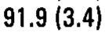 |
| r16_c01 | T11 | FCAsl | FCAsl | T11 | 87.7 (6.3) | mean 87.7 mm2; sem 6.3 mm2 | 87.7 (6.3) | 87.7 (6.3) | 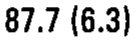 |
| r16_c02 | T11 | FCAir | FCAir | T11 | 100.3 (6.1) | mean 100.3 mm2; sem 6.1 mm2 | 100.3 (6.1) | 100.3 (6.1) |  |
| r16_c03 | T11 | FCAil | FCAil | T11 | 92.4 (8.9) | mean 92.4 mm2; sem 8.9 mm2 | 92.4 (8.9) | 92.4 (8.9) |  |
| r17_c00 | T12 | FCAsr | FCAsr | T12 | 100.8 (9.1) | mean 100.8 mm2; sem 9.1 mm2 | 100.8 (9.1) | 100.8 (9.1) |  |
| r17_c01 | T12 | FCAsl | FCAsl | T12 | 88.4 (9.2) | mean 88.4 mm2; sem 9.2 mm2 | 88.4 (9.2) | 88.4 (9.2) | 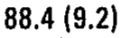 |
| r17_c02 | T12 | FCAir | FCAir | T12 | 90.8 (9.1) | mean 90.8 mm2; sem 9.1 mm2 | 90.8 (9.1) | 90.8 (9.1) |  |
| r17_c03 | T12 | FCAil | FCAil | T12 | 90.0 (7.2) | mean 90.0 mm2; sem 7.2 mm2 | 90.0 (7.2) | 90.0 (7.2) | 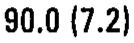 |
| r18_c00 | L1 | FCAsr | FCAsr | L1 | 96.7 (6.2) | mean 96.7 mm2; sem 6.2 mm2 | 96.7 (6.2) | 96.7 (6.2) | 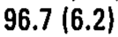 |
| r18_c01 | L1 | FCAsl | FCAsl | L1 | 99.2 (11.4) | mean 99.2 mm2; sem 11.4 mm2 | 99.2 (11.4) | 99.2 (11.4) | 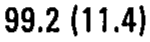 |
| r18_c02 | L1 | FCAir | FCAir | L1 | 127.9 (7.5) | mean 127.9 mm2; sem 7.5 mm2 | 127.9 (7.5) | 127.9 (7.5) | 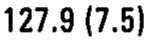 |
| r18_c03 | L1 | FCAil | FCAil | L1 | 125.9 (6.9) | mean 125.9 mm2; sem 6.9 mm2 | 125.9 (6.9) | 125.9 (6.9) |  |
| r19_c00 | L2 | FCAsr | FCAsr | L2 | 138.0 (11.4) | mean 138.0 mm2; sem 11.4 mm2 | 138.0 (11.4) | 138.0 (11.4) | 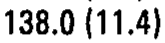 |
| r19_c01 | L2 | FCAsl | FCAsl | L2 | 148.2 (12.8) | mean 148.2 mm2; sem 12.8 mm2 | 148.2 (12.8) | 148.2 (12.8) | 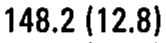 |
| r19_c02 | L2 | FCAir | FCAir | L2 | 150.9 (9.8) | mean 150.9 mm2; sem 9.8 mm2 | 150.9 (9.8) | 150.9 (9.8) |  |
| r19_c03 | L2 | FCAil | FCAil | L2 | 153.6 (10.1) | mean 153.6 mm2; sem 10.1 mm2 | 153.6 (10.1) | 153.6 (10.1) |  |
| r20_c00 | L3 | FCAsr | FCAsr | L3 | 170.3 (13.1) | mean 170.3 mm2; sem 13.1 mm2 | 170.3 (13.1) | 170.3 (13.1) |  |
| r20_c01 | L3 | FCAsl | FCAsl | L3 | 164.4 (12.0) | mean 164.4 mm2; sem 12.0 mm2 | 164.4 (12.0) | 164.4 (12.0) |  |
| r20_c02 | L3 | FCAir | FCAir | L3 | 159.8 (4.8) | mean 159.8 mm2; sem 4.8 mm2 | 159.8 (4.8) | 159.8 (4.8) |  |
| r20_c03 | L3 | FCAil | FCAil | L3 | 167.9 (9.7) | mean 167.9 mm2; sem 9.7 mm2 | 167.9 (9.7) | 167.9 (9.7) |  |
| r21_c00 | L4 | FCAsr | FCAsr | L4 | 175.0 (7.0) | mean 175.0 mm2; sem 7.0 mm2 | 175.0 (7.0) | 175.0 (7.0) | 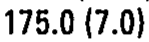 |
| r21_c01 | L4 | FCAsl | FCAsl | L4 | 194.3 (11.0) | mean 194.3 mm2; sem 11.0 mm2 | 194.3 (11.0) | 194.3 (11.0) | 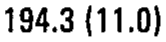 |
| r21_c02 | L4 | FCAir | FCAir | L4 | 182.1 (15.6) | mean 182.1 mm2; sem 15.6 mm2 | 182.1 (15.6) | 182.1 (15.6) |  |
| r21_c03 | L4 | FCAil | FCAil | L4 | 167.9 (11.8) | mean 167.9 mm2; sem 11.8 mm2 | 167.9 (11.8) | 167.9 (11.8) | 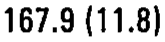 |
| r22_c00 | L5 | FCAsr | FCAsr | L5 | 211.9 (14.0) | mean 211.9 mm2; sem 14.0 mm2 | 211.9 (14.0) | 211.9 (14.0) | 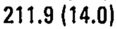 |
| r22_c01 | L5 | FCAsl | FCAsl | L5 | 199.1 (12.0) | mean 199.1 mm2; sem 12.0 mm2 | 199.1 (12.0) | 199.1 (12.0) |  |
| r22_c02 | L5 | FCAir | FCAir | L5 | 197.3 (21.8) | mean 197.3 mm2; sem 21.8 mm2 | 197.3 (21.8) | 197.3 (21.8) | 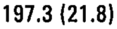 |
| r22_c03 | L5 | FCAil | FCAil | L5 | 182.7 (17.2) | mean 182.7 mm2; sem 17.2 mm2 | 182.7 (17.2) | 182.7 (17.2) | 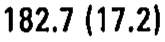 |
