# Table 5. Means (and Standard Errors of the Mean) of the Interfacet Distances

Facets, PDF page 5, printed page 1302; Panjabi_1993_Facets_Spine_18-10_1298-1310.pdf (sha256 2b22fe5e6c14d2289a4366f3c94879db1da0f79ae54e05a7f8e54a07e1c0279f), rendered at 300 dpi by render.py.

Every cell below is the box layout.py cut from the rendered page, and the two strings are what the two reading passes read in it (README.md). A dash is printed where the paper prints one. The value column is what provenance.csv carries.

| cell | row | column | measure | level | printed | value | pass 1 | pass 2 | image |
|---|---|---|---|---|---|---|---|---|---|
| r00_c00 | C2 | IFWs | IFWs | C2 | 30.3 (0.6) | mean 30.3 mm; sem 0.6 mm | 30.3 (0.6) | 30.3 (0.6) | 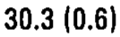 |
| r00_c01 | C2 | IFWi | IFWi | C2 | 35.9 (0.8) | mean 35.9 mm; sem 0.8 mm | 35.9 (0.8) | 35.9 (0.8) | 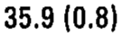 |
| r00_c02 | C2 | IFHr | IFHr | C2 | 20.1 (0.9) | mean 20.1 mm; sem 0.9 mm | 20.1 (0.9) | 20.1 (0.9) |  |
| r00_c03 | C2 | IFHl | IFHl | C2 | 20.2 (0.8) | mean 20.2 mm; sem 0.8 mm | 20.2 (0.8) | 20.2 (0.8) | 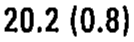 |
| r00_c04 | C2 | IFWs/IFWi | IFWs/IFWi | C2 | 0.84 | ratio 0.84 | 0.84 | 0.84 |  |
| r00_c05 | C2 | IFW/IFH | IFW/IFH | C2 | 1.64 | ratio 1.64 | 1.64 | 1.64 |  |
| r01_c00 | C3 | IFWs | IFWs | C3 | 35.9 (0.6) | mean 35.9 mm; sem 0.6 mm | 35.9 (0.6) | 35.9 (0.6) | 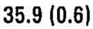 |
| r01_c01 | C3 | IFWi | IFWi | C3 | 37.8 (0.9) | mean 37.8 mm; sem 0.9 mm | 37.8 (0.9) | 37.8 (0.9) | 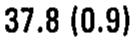 |
| r01_c02 | C3 | IFHr | IFHr | C3 | 12.2 (0.4) | mean 12.2 mm; sem 0.4 mm | 12.2 (0.4) | 12.2 (0.4) | 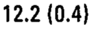 |
| r01_c03 | C3 | IFHl | IFHl | C3 | 13.0 (0.5) | mean 13.0 mm; sem 0.5 mm | 13.0 (0.5) | 13.0 (0.5) |  |
| r01_c04 | C3 | IFWs/IFWi | IFWs/IFWi | C3 | 0.95 | ratio 0.95 | 0.95 | 0.95 |  |
| r01_c05 | C3 | IFW/IFH | IFW/IFH | C3 | 2.93 | ratio 2.93 | 2.93 | 2.93 |  |
| r02_c00 | C4 | IFWs | IFWs | C4 | 37.6 (0.8) | mean 37.6 mm; sem 0.8 mm | 37.6 (0.8) | 37.6 (0.8) | 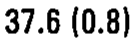 |
| r02_c01 | C4 | IFWi | IFWi | C4 | 38.0 (0.8) | mean 38.0 mm; sem 0.8 mm | 38.0 (0.8) | 38.0 (0.8) | 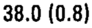 |
| r02_c02 | C4 | IFHr | IFHr | C4 | 15.8 (3.6) | mean 15.8 mm; sem 3.6 mm | 15.8 (3.6) | 15.8 (3.6) | 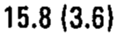 |
| r02_c03 | C4 | IFHl | IFHl | C4 | 15.9 (3.3) | mean 15.9 mm; sem 3.3 mm | 15.9 (3.3) | 15.9 (3.3) | 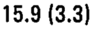 |
| r02_c04 | C4 | IFWs/IFWi | IFWs/IFWi | C4 | 0.99 | ratio 0.99 | 0.99 | 0.99 |  |
| r02_c05 | C4 | IFW/IFH | IFW/IFH | C4 | 2.38 | ratio 2.38 | 2.38 | 2.38 | 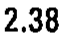 |
| r03_c00 | C5 | IFWs | IFWs | C5 | 38.3 (0.9) | mean 38.3 mm; sem 0.9 mm | 38.3 (0.9) | 38.3 (0.9) | 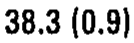 |
| r03_c01 | C5 | IFWi | IFWi | C5 | 40.5 (0.9) | mean 40.5 mm; sem 0.9 mm | 40.5 (0.9) | 40.5 (0.9) | 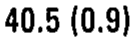 |
| r03_c02 | C5 | IFHr | IFHr | C5 | 13.3 (0.7) | mean 13.3 mm; sem 0.7 mm | 13.3 (0.7) | 13.3 (0.7) | 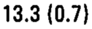 |
| r03_c03 | C5 | IFHl | IFHl | C5 | 12.7 (0.6) | mean 12.7 mm; sem 0.6 mm | 12.7 (0.6) | 12.7 (0.6) |  |
| r03_c04 | C5 | IFWs/IFWi | IFWs/IFWi | C5 | 0.94 | ratio 0.94 | 0.94 | 0.94 |  |
| r03_c05 | C5 | IFW/IFH | IFW/IFH | C5 | 3.04 | ratio 3.04 | 3.04 | 3.04 |  |
| r04_c00 | C6 | IFWs | IFWs | C6 | 39.9 (0.7) | mean 39.9 mm; sem 0.7 mm | 39.9 (0.7) | 39.9 (0.7) | 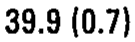 |
| r04_c01 | C6 | IFWi | IFWi | C6 | 38.8 (0.8) | mean 38.8 mm; sem 0.8 mm | 38.8 (0.8) | 38.8 (0.8) | 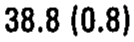 |
| r04_c02 | C6 | IFHr | IFHr | C6 | 13.9 (1.1) | mean 13.9 mm; sem 1.1 mm | 13.9 (1.1) | 13.9 (1.1) |  |
| r04_c03 | C6 | IFHl | IFHl | C6 | 13.5 (0.8) | mean 13.5 mm; sem 0.8 mm | 13.5 (0.8) | 13.5 (0.8) | 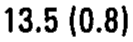 |
| r04_c04 | C6 | IFWs/IFWi | IFWs/IFWi | C6 | 1.03 | ratio 1.03 | 1.03 | 1.03 |  |
| r04_c05 | C6 | IFW/IFH | IFW/IFH | C6 | 2.88 | ratio 2.88 | 2.88 | 2.88 |  |
| r05_c00 | C7 | IFWs | IFWs | C7 | 38.6 (0.8) | mean 38.6 mm; sem 0.8 mm | 38.6 (0.8) | 38.6 (0.8) | 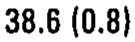 |
| r05_c01 | C7 | IFWi | IFWi | C7 | 33.6 (0.8) | mean 33.6 mm; sem 0.8 mm | 33.6 (0.8) | 33.6 (0.8) | 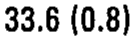 |
| r05_c02 | C7 | IFHr | IFHr | C7 | 17.6 (0.7) | mean 17.6 mm; sem 0.7 mm | 17.6 (0.7) | 17.6 (0.7) | 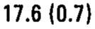 |
| r05_c03 | C7 | IFHl | IFHl | C7 | 17.0 (0.7) | mean 17.0 mm; sem 0.7 mm | 17.0 (0.7) | 17.0 (0.7) |  |
| r05_c04 | C7 | IFWs/IFWi | IFWs/IFWi | C7 | 1.15 | ratio 1.15 | 1.15 | 1.15 |  |
| r05_c05 | C7 | IFW/IFH | IFW/IFH | C7 | 2.09 | ratio 2.09 | 2.09 | 2.09 |  |
| r06_c00 | T1 | IFWs | IFWs | T1 | 33.2 (1.0) | mean 33.2 mm; sem 1.0 mm | 33.2 (1.0) | 33.2 (1.0) | 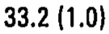 |
| r06_c01 | T1 | IFWi | IFWi | T1 | 28.2 (0.6) | mean 28.2 mm; sem 0.6 mm | 28.2 (0.6) | 28.2 (0.6) | 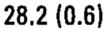 |
| r06_c02 | T1 | IFHr | IFHr | T1 | 18.0 (0.6) | mean 18.0 mm; sem 0.6 mm | 18.0 (0.6) | 18.0 (0.6) | 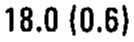 |
| r06_c03 | T1 | IFHl | IFHl | T1 | 18.6 (0.7) | mean 18.6 mm; sem 0.7 mm | 18.6 (0.7) | 18.6 (0.7) | 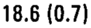 |
| r06_c04 | T1 | IFWs/IFWi | IFWs/IFWi | T1 | 1.18 | ratio 1.18 | 1.18 | 1.18 |  |
| r06_c05 | T1 | IFW/IFH | IFW/IFH | T1 | 1.68 | ratio 1.68 | 1.68 | 1.68 |  |
| r07_c00 | T2 | IFWs | IFWs | T2 | 28.2 (0.5) | mean 28.2 mm; sem 0.5 mm | 28.2 (0.5) | 28.2 (0.5) | 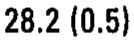 |
| r07_c01 | T2 | IFWi | IFWi | T2 | 24.3 (0.6) | mean 24.3 mm; sem 0.6 mm | 24.3 (0.6) | 24.3 (0.6) | 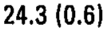 |
| r07_c02 | T2 | IFHr | IFHr | T2 | 21.2 (0.6) | mean 21.2 mm; sem 0.6 mm | 21.2 (0.6) | 21.2 (0.6) | 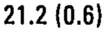 |
| r07_c03 | T2 | IFHl | IFHl | T2 | 20.9 (0.8) | mean 20.9 mm; sem 0.8 mm | 20.9 (0.8) | 20.9 (0.8) | 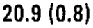 |
| r07_c04 | T2 | IFWs/IFWi | IFWs/IFWi | T2 | 1.16 | ratio 1.16 | 1.16 | 1.16 |  |
| r07_c05 | T2 | IFW/IFH | IFW/IFH | T2 | 1.25 | ratio 1.25 | 1.25 | 1.25 |  |
| r08_c00 | T3 | IFWs | IFWs | T3 | 24.6 (0.7) | mean 24.6 mm; sem 0.7 mm | 24.6 (0.7) | 24.6 (0.7) | 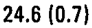 |
| r08_c01 | T3 | IFWi | IFWi | T3 | 22.3 (0.7) | mean 22.3 mm; sem 0.7 mm | 22.3 (0.7) | 22.3 (0.7) | 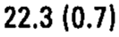 |
| r08_c02 | T3 | IFHr | IFHr | T3 | 21.5 (0.7) | mean 21.5 mm; sem 0.7 mm | 21.5 (0.7) | 21.5 (0.7) | 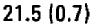 |
| r08_c03 | T3 | IFHl | IFHl | T3 | 21.1 (0.8) | mean 21.1 mm; sem 0.8 mm | 21.1 (0.8) | 21.1 (0.8) | 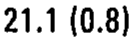 |
| r08_c04 | T3 | IFWs/IFWi | IFWs/IFWi | T3 | 1.10 | ratio 1.10 | 1.10 | 1.10 |  |
| r08_c05 | T3 | IFW/IFH | IFW/IFH | T3 | 1.10 | ratio 1.10 | 1.10 | 1.10 |  |
| r09_c00 | T4 | IFWs | IFWs | T4 | 22.1 (0.8) | mean 22.1 mm; sem 0.8 mm | 22.1 (0.8) | 22.1 (0.8) | 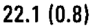 |
| r09_c01 | T4 | IFWi | IFWi | T4 | 21.1 (0.7) | mean 21.1 mm; sem 0.7 mm | 21.1 (0.7) | 21.1 (0.7) | 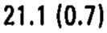 |
| r09_c02 | T4 | IFHr | IFHr | T4 | 20.9 (0.6) | mean 20.9 mm; sem 0.6 mm | 20.9 (0.6) | 20.9 (0.6) | 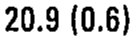 |
| r09_c03 | T4 | IFHl | IFHl | T4 | 20.1 (0.6) | mean 20.1 mm; sem 0.6 mm | 20.1 (0.6) | 20.1 (0.6) | 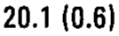 |
| r09_c04 | T4 | IFWs/IFWi | IFWs/IFWi | T4 | 1.05 | ratio 1.05 | 1.05 | 1.05 |  |
| r09_c05 | T4 | IFW/IFH | IFW/IFH | T4 | 1.04 | ratio 1.04 | 1.04 | 1.04 |  |
| r10_c00 | T5 | IFWs | IFWs | T5 | 20.8 (0.8) | mean 20.8 mm; sem 0.8 mm | 20.8 (0.8) | 20.8 (0.8) |  |
| r10_c01 | T5 | IFWi | IFWi | T5 | 20.8 (0.8) | mean 20.8 mm; sem 0.8 mm | 20.8 (0.8) | 20.8 (0.8) |  |
| r10_c02 | T5 | IFHr | IFHr | T5 | 21.2 (0.8) | mean 21.2 mm; sem 0.8 mm | 21.2 (0.8) | 21.2 (0.8) | 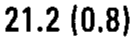 |
| r10_c03 | T5 | IFHl | IFHl | T5 | 21.1 (0.7) | mean 21.1 mm; sem 0.7 mm | 21.1 (0.7) | 21.1 (0.7) | 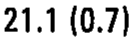 |
| r10_c04 | T5 | IFWs/IFWi | IFWs/IFWi | T5 | 1.00 | ratio 1.00 | 1.00 | 1.00 |  |
| r10_c05 | T5 | IFW/IFH | IFW/IFH | T5 | 0.98 | ratio 0.98 | 0.98 | 0.98 |  |
| r11_c00 | T6 | IFWs | IFWs | T6 | 20.9 (0.9) | mean 20.9 mm; sem 0.9 mm | 20.9 (0.9) | 20.9 (0.9) |  |
| r11_c01 | T6 | IFWi | IFWi | T6 | 21.4 (0.7) | mean 21.4 mm; sem 0.7 mm | 21.4 (0.7) | 21.4 (0.7) |  |
| r11_c02 | T6 | IFHr | IFHr | T6 | 21.8 (0.7) | mean 21.8 mm; sem 0.7 mm | 21.8 (0.7) | 21.8 (0.7) |  |
| r11_c03 | T6 | IFHl | IFHl | T6 | 22.0 (0.5) | mean 22.0 mm; sem 0.5 mm | 22.0 (0.5) | 22.0 (0.5) |  |
| r11_c04 | T6 | IFWs/IFWi | IFWs/IFWi | T6 | 0.97 | ratio 0.97 | 0.97 | 0.97 |  |
| r11_c05 | T6 | IFW/IFH | IFW/IFH | T6 | 0.97 | ratio 0.97 | 0.97 | 0.97 |  |
| r12_c00 | T7 | IFWs | IFWs | T7 | 21.0 (0.7) | mean 21.0 mm; sem 0.7 mm | 21.0 (0.7) | 21.0 (0.7) |  |
| r12_c01 | T7 | IFWi | IFWi | T7 | 22.3 (0.9) | mean 22.3 mm; sem 0.9 mm | 22.3 (0.9) | 22.3 (0.9) |  |
| r12_c02 | T7 | IFHr | IFHr | T7 | 24.0 (0.8) | mean 24.0 mm; sem 0.8 mm | 24.0 (0.8) | 24.0 (0.8) |  |
| r12_c03 | T7 | IFHl | IFHl | T7 | 23.6 (0.7) | mean 23.6 mm; sem 0.7 mm | 23.6 (0.7) | 23.6 (0.7) | 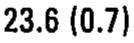 |
| r12_c04 | T7 | IFWs/IFWi | IFWs/IFWi | T7 | 0.94 | ratio 0.94 | 0.94 | 0.94 |  |
| r12_c05 | T7 | IFW/IFH | IFW/IFH | T7 | 0.91 | ratio 0.91 | 0.91 | 0.91 |  |
| r13_c00 | T8 | IFWs | IFWs | T8 | 21.8 (0.9) | mean 21.8 mm; sem 0.9 mm | 21.8 (0.9) | 21.8 (0.9) |  |
| r13_c01 | T8 | IFWi | IFWi | T8 | 23.4 (1.0) | mean 23.4 mm; sem 1.0 mm | 23.4 (1.0) | 23.4 (1.0) | 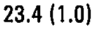 |
| r13_c02 | T8 | IFHr | IFHr | T8 | 24.0 (0.5) | mean 24.0 mm; sem 0.5 mm | 24.0 (0.5) | 24.0 (0.5) |  |
| r13_c03 | T8 | IFHl | IFHl | T8 | 25.2 (0.4) | mean 25.2 mm; sem 0.4 mm | 25.2 (0.4) | 25.2 (0.4) | 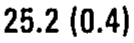 |
| r13_c04 | T8 | IFWs/IFWi | IFWs/IFWi | T8 | 0.93 | ratio 0.93 | 0.93 | 0.93 |  |
| r13_c05 | T8 | IFW/IFH | IFW/IFH | T8 | 0.92 | ratio 0.92 | 0.92 | 0.92 |  |
| r14_c00 | T9 | IFWs | IFWs | T9 | 23.0 (1.0) | mean 23.0 mm; sem 1.0 mm | 23.0 (1.0) | 23.0 (1.0) | 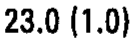 |
| r14_c01 | T9 | IFWi | IFWi | T9 | 24.6 (0.9) | mean 24.6 mm; sem 0.9 mm | 24.6 (0.9) | 24.6 (0.9) |  |
| r14_c02 | T9 | IFHr | IFHr | T9 | 25.7 (0.8) | mean 25.7 mm; sem 0.8 mm | 25.7 (0.8) | 25.7 (0.8) |  |
| r14_c03 | T9 | IFHl | IFHl | T9 | 25.9 (0.8) | mean 25.9 mm; sem 0.8 mm | 25.9 (0.8) | 25.9 (0.8) | 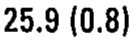 |
| r14_c04 | T9 | IFWs/IFWi | IFWs/IFWi | T9 | 0.93 | ratio 0.93 | 0.93 | 0.93 |  |
| r14_c05 | T9 | IFW/IFH | IFW/IFH | T9 | 0.92 | ratio 0.92 | 0.92 | 0.92 |  |
| r15_c00 | T10 | IFWs | IFWs | T10 | 24.2 (0.9) | mean 24.2 mm; sem 0.9 mm | 24.2 (0.9) | 24.2 (0.9) |  |
| r15_c01 | T10 | IFWi | IFWi | T10 | 24.6 (1.1) | mean 24.6 mm; sem 1.1 mm | 24.6 (1.1) | 24.6 (1.1) | 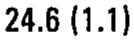 |
| r15_c02 | T10 | IFHr | IFHr | T10 | 26.1 (0.5) | mean 26.1 mm; sem 0.5 mm | 26.1 (0.5) | 26.1 (0.5) |  |
| r15_c03 | T10 | IFHl | IFHl | T10 | 25.8 (0.7) | mean 25.8 mm; sem 0.7 mm | 25.8 (0.7) | 25.8 (0.7) |  |
| r15_c04 | T10 | IFWs/IFWi | IFWs/IFWi | T10 | 0.99 | ratio 0.99 | 0.99 | 0.99 |  |
| r15_c05 | T10 | IFW/IFH | IFW/IFH | T10 | 0.94 | ratio 0.94 | 0.94 | 0.94 |  |
| r16_c00 | T11 | IFWs | IFWs | T11 | 25.2 (1.2) | mean 25.2 mm; sem 1.2 mm | 25.2 (1.2) | 25.2 (1.2) | 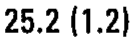 |
| r16_c01 | T11 | IFWi | IFWi | T11 | 24.6 (0.7) | mean 24.6 mm; sem 0.7 mm | 24.6 (0.7) | 24.6 (0.7) | 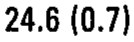 |
| r16_c02 | T11 | IFHr | IFHr | T11 | 29.9 (1.1) | mean 29.9 mm; sem 1.1 mm | 29.9 (1.1) | 29.9 (1.1) |  |
| r16_c03 | T11 | IFHl | IFHl | T11 | 29.8 (1.0) | mean 29.8 mm; sem 1.0 mm | 29.8 (1.0) | 29.8 (1.0) | 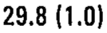 |
| r16_c04 | T11 | IFWs/IFWi | IFWs/IFWi | T11 | 1.02 | ratio 1.02 | 1.02 | 1.02 |  |
| r16_c05 | T11 | IFW/IFH | IFW/IFH | T11 | 0.83 | ratio 0.83 | 0.83 | 0.83 |  |
| r17_c00 | T12 | IFWs | IFWs | T12 | 25.9 (0.8) | mean 25.9 mm; sem 0.8 mm | 25.9 (0.8) | 25.9 (0.8) |  |
| r17_c01 | T12 | IFWi | IFWi | T12 | 24.9 (0.4) | mean 24.9 mm; sem 0.4 mm | 24.9 (0.4) | 24.9 (0.4) | 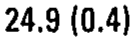 |
| r17_c02 | T12 | IFHr | IFHr | T12 | 31.6 (1.2) | mean 31.6 mm; sem 1.2 mm | 31.6 (1.2) | 31.6 (1.2) | 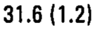 |
| r17_c03 | T12 | IFHl | IFHl | T12 | 31.1 (1.5) | mean 31.1 mm; sem 1.5 mm | 31.1 (1.5) | 31.1 (1.5) | 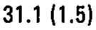 |
| r17_c04 | T12 | IFWs/IFWi | IFWs/IFWi | T12 | 1.04 | ratio 1.04 | 1.04 | 1.04 |  |
| r17_c05 | T12 | IFW/IFH | IFW/IFH | T12 | 0.81 | ratio 0.81 | 0.81 | 0.81 |  |
| r18_c00 | L1 | IFWs | IFWs | L1 | 26.2 (0.6) | mean 26.2 mm; sem 0.6 mm | 26.2 (0.6) | 26.2 (0.6) |  |
| r18_c01 | L1 | IFWi | IFWi | L1 | 24.8 (0.8) | mean 24.8 mm; sem 0.8 mm | 24.8 (0.8) | 24.8 (0.8) |  |
| r18_c02 | L1 | IFHr | IFHr | L1 | 32.5 (0.5) | mean 32.5 mm; sem 0.5 mm | 32.5 (0.5) | 32.5 (0.5) |  |
| r18_c03 | L1 | IFHl | IFHl | L1 | 31.8 (1.0) | mean 31.8 mm; sem 1.0 mm | 31.8 (1.0) | 31.8 (1.0) |  |
| r18_c04 | L1 | IFWs/IFWi | IFWs/IFWi | L1 | 1.06 | ratio 1.06 | 1.06 | 1.06 |  |
| r18_c05 | L1 | IFW/IFH | IFW/IFH | L1 | 0.79 | ratio 0.79 | 0.79 | 0.79 |  |
| r19_c00 | L2 | IFWs | IFWs | L2 | 26.4 (0.9) | mean 26.4 mm; sem 0.9 mm | 26.4 (0.9) | 26.4 (0.9) |  |
| r19_c01 | L2 | IFWi | IFWi | L2 | 26.6 (0.9) | mean 26.6 mm; sem 0.9 mm | 26.6 (0.9) | 26.6 (0.9) |  |
| r19_c02 | L2 | IFHr | IFHr | L2 | 33.0 (0.7) | mean 33.0 mm; sem 0.7 mm | 33.0 (0.7) | 33.0 (0.7) |  |
| r19_c03 | L2 | IFHl | IFHl | L2 | 32.4 (0.6) | mean 32.4 mm; sem 0.6 mm | 32.4 (0.6) | 32.4 (0.6) |  |
| r19_c04 | L2 | IFWs/IFWi | IFWs/IFWi | L2 | 0.99 | ratio 0.99 | 0.99 | 0.99 |  |
| r19_c05 | L2 | IFW/IFH | IFW/IFH | L2 | 0.81 | ratio 0.81 | 0.81 | 0.81 |  |
| r20_c00 | L3 | IFWs | IFWs | L3 | 28.6 (1.0) | mean 28.6 mm; sem 1.0 mm | 28.6 (1.0) | 28.6 (1.0) |  |
| r20_c01 | L3 | IFWi | IFWi | L3 | 29.1 (1.5) | mean 29.1 mm; sem 1.5 mm | 29.1 (1.5) | 29.1 (1.5) |  |
| r20_c02 | L3 | IFHr | IFHr | L3 | 32.4 (0.9) | mean 32.4 mm; sem 0.9 mm | 32.4 (0.9) | 32.4 (0.9) |  |
| r20_c03 | L3 | IFHl | IFHl | L3 | 31.6 (0.7) | mean 31.6 mm; sem 0.7 mm | 31.6 (0.7) | 31.6 (0.7) |  |
| r20_c04 | L3 | IFWs/IFWi | IFWs/IFWi | L3 | 0.98 | ratio 0.98 | 0.98 | 0.98 |  |
| r20_c05 | L3 | IFW/IFH | IFW/IFH | L3 | 0.90 | ratio 0.90 | 0.90 | 0.90 |  |
| r21_c00 | L4 | IFWs | IFWs | L4 | 31.4 (1.6) | mean 31.4 mm; sem 1.6 mm | 31.4 (1.6) | 31.4 (1.6) |  |
| r21_c01 | L4 | IFWi | IFWi | L4 | 34.8 (1.7) | mean 34.8 mm; sem 1.7 mm | 34.8 (1.7) | 34.8 (1.7) |  |
| r21_c02 | L4 | IFHr | IFHr | L4 | 28.5 (1.0) | mean 28.5 mm; sem 1.0 mm | 28.5 (1.0) | 28.5 (1.0) |  |
| r21_c03 | L4 | IFHl | IFHl | L4 | 28.3 (1.3) | mean 28.3 mm; sem 1.3 mm | 28.3 (1.3) | 28.3 (1.3) |  |
| r21_c04 | L4 | IFWs/IFWi | IFWs/IFWi | L4 | 0.90 | ratio 0.90 | 0.90 | 0.90 |  |
| r21_c05 | L4 | IFW/IFH | IFW/IFH | L4 | 1.16 | ratio 1.16 | 1.16 | 1.16 |  |
| r22_c00 | L5 | IFWs | IFWs | L5 | 35.0 (2.1) | mean 35.0 mm; sem 2.1 mm | 35.0 (2.1) | 35.0 (2.1) |  |
| r22_c01 | L5 | IFWi | IFWi | L5 | 40.6 (2.0) | mean 40.6 mm; sem 2.0 mm | 40.6 (2.0) | 40.6 (2.0) |  |
| r22_c02 | L5 | IFHr | IFHr | L5 | 26.1 (1.8) | mean 26.1 mm; sem 1.8 mm | 26.1 (1.8) | 26.1 (1.8) |  |
| r22_c03 | L5 | IFHl | IFHl | L5 | 26.4 (1.5) | mean 26.4 mm; sem 1.5 mm | 26.4 (1.5) | 26.4 (1.5) |  |
| r22_c04 | L5 | IFWs/IFWi | IFWs/IFWi | L5 | 0.86 | ratio 0.86 | 0.86 | 0.86 |  |
| r22_c05 | L5 | IFW/IFH | IFW/IFH | L5 | 1.44 | ratio 1.44 | 1.44 | 1.44 |  |
