# Table 6. Means (and Standard Errors of the Mean) of the Superior Articular Facet Orientations with Respect to the Anatomic Planes: Transverse and Sagittal

Facets, PDF page 6, printed page 1303; Panjabi_1993_Facets_Spine_18-10_1298-1310.pdf (sha256 2b22fe5e6c14d2289a4366f3c94879db1da0f79ae54e05a7f8e54a07e1c0279f), rendered at 300 dpi by render.py.

Every cell below is the box layout.py cut from the rendered page, and the two strings are what the two reading passes read in it (README.md). A dash is printed where the paper prints one. The value column is what provenance.csv carries.

| cell | row | column | measure | level | printed | value | pass 1 | pass 2 | image |
|---|---|---|---|---|---|---|---|---|---|
| r00_c00 | C2 | Tsr | Tsr | C2 | 40.7 (4.7) | mean 40.7 deg; sem 4.7 deg | 40.7 (4.7) | 40.7 (4.7) | 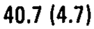 |
| r00_c01 | C2 | Ssr | Ssr | C2 | -114.1 (2.9) | mean -114.1 deg; sem 2.9 deg | -114.1 (2.9) | -114.1 (2.9) |  |
| r00_c02 | C2 | Tsl | Tsl | C2 | 33.5 (2.1) | mean 33.5 deg; sem 2.1 deg | 33.5 (2.1) | 33.5 (2.1) | 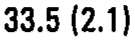 |
| r00_c03 | C2 | Ssl | Ssl | C2 | 118.5 (1.7) | mean 118.5 deg; sem 1.7 deg | 118.5 (1.7) | 118.5 (1.7) |  |
| r01_c00 | C3 | Tsr | Tsr | C3 | 48.8 (3.1) | mean 48.8 deg; sem 3.1 deg | 48.8 (3.1) | 48.8 (3.1) | 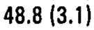 |
| r01_c01 | C3 | Ssr | Ssr | C3 | -76.8 (3.9) | mean -76.8 deg; sem 3.9 deg | -76.8 (3.9) | -76.8 (3.9) | 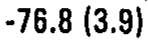 |
| r01_c02 | C3 | Tsl | Tsl | C3 | 55.2 (3.2) | mean 55.2 deg; sem 3.2 deg | 55.2 (3.2) | 55.2 (3.2) | 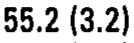 |
| r01_c03 | C3 | Ssl | Ssl | C3 | 71.6 (5.3) | mean 71.6 deg; sem 5.3 deg | 71.6 (5.3) | 71.6 (5.3) | 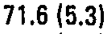 |
| r02_c00 | C4 | Tsr | Tsr | C4 | 47.0 (4.6) | mean 47.0 deg; sem 4.6 deg | 47.0 (4.6) | 47.0 (4.6) | 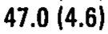 |
| r02_c01 | C4 | Ssr | Ssr | C4 | -83.9 (1.3) | mean -83.9 deg; sem 1.3 deg | -83.9 (1.3) | -83.9 (1.3) | 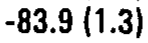 |
| r02_c02 | C4 | Tsl | Tsl | C4 | 49.7 (4.8) | mean 49.7 deg; sem 4.8 deg | 49.7 (4.8) | 49.7 (4.8) | 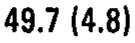 |
| r02_c03 | C4 | Ssl | Ssl | C4 | 85.2 (1.3) | mean 85.2 deg; sem 1.3 deg | 85.2 (1.3) | 85.2 (1.3) | 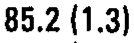 |
| r03_c00 | C5 | Tsr | Tsr | C5 | 45.8 (2.9) | mean 45.8 deg; sem 2.9 deg | 45.8 (2.9) | 45.8 (2.9) | 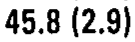 |
| r03_c01 | C5 | Ssr | Ssr | C5 | -83.4 (1.3) | mean -83.4 deg; sem 1.3 deg | -83.4 (1.3) | -83.4 (1.3) | 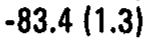 |
| r03_c02 | C5 | Tsl | Tsl | C5 | 45.3 (2.8) | mean 45.3 deg; sem 2.8 deg | 45.3 (2.8) | 45.3 (2.8) | 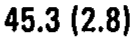 |
| r03_c03 | C5 | Ssl | Ssl | C5 | 83.7 (1.1) | mean 83.7 deg; sem 1.1 deg | 83.7 (1.1) | 83.7 (1.1) | 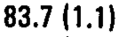 |
| r04_c00 | C6 | Tsr | Tsr | C6 | 47.2 (2.8) | mean 47.2 deg; sem 2.8 deg | 47.2 (2.8) | 47.2 (2.8) | 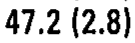 |
| r04_c01 | C6 | Ssr | Ssr | C6 | -81.2 (3.1) | mean -81.2 deg; sem 3.1 deg | -81.2 (3.1) | -81.2 (3.1) |  |
| r04_c02 | C6 | Tsl | Tsl | C6 | 48.0 (5.4) | mean 48.0 deg; sem 5.4 deg | 48.0 (5.4) | 48.0 (5.4) | 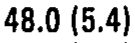 |
| r04_c03 | C6 | Ssl | Ssl | C6 | 76.8 (1.7) | mean 76.8 deg; sem 1.7 deg | 76.8 (1.7) | 76.8 (1.7) | 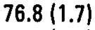 |
| r05_c00 | C7 | Tsr | Tsr | C7 | 59.4 (4.5) | mean 59.4 deg; sem 4.5 deg | 59.4 (4.5) | 59.4 (4.5) | 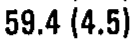 |
| r05_c01 | C7 | Ssr | Ssr | C7 | -80.2 (2.6) | mean -80.2 deg; sem 2.6 deg | -80.2 (2.6) | -80.2 (2.6) |  |
| r05_c02 | C7 | Tsl | Tsl | C7 | 51.6 (5.2) | mean 51.6 deg; sem 5.2 deg | 51.6 (5.2) | 51.6 (5.2) | 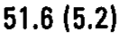 |
| r05_c03 | C7 | Ssl | Ssl | C7 | 85.5 (1.5) | mean 85.5 deg; sem 1.5 deg | 85.5 (1.5) | 85.5 (1.5) | 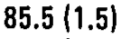 |
| r06_c00 | T1 | Tsr | Tsr | T1 | 62.2 (2.6) | mean 62.2 deg; sem 2.6 deg | 62.2 (2.6) | 62.2 (2.6) | 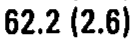 |
| r06_c01 | T1 | Ssr | Ssr | T1 | -86.4 (0.9) | mean -86.4 deg; sem 0.9 deg | -86.4 (0.9) | -86.4 (0.9) | 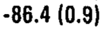 |
| r06_c02 | T1 | Tsl | Tsl | T1 | 57.7 (3.8) | mean 57.7 deg; sem 3.8 deg | 57.7 (3.8) | 57.7 (3.8) | 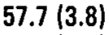 |
| r06_c03 | T1 | Ssl | Ssl | T1 | 85.3 (1.1) | mean 85.3 deg; sem 1.1 deg | 85.3 (1.1) | 85.3 (1.1) | 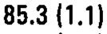 |
| r07_c00 | T2 | Tsr | Tsr | T2 | 66.5 (1.9) | mean 66.5 deg; sem 1.9 deg | 66.5 (1.9) | 66.5 (1.9) | 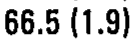 |
| r07_c01 | T2 | Ssr | Ssr | T2 | -75.5 (1.7) | mean -75.5 deg; sem 1.7 deg | -75.5 (1.7) | -75.5 (1.7) | 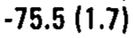 |
| r07_c02 | T2 | Tsl | Tsl | T2 | 66.6 (1.8) | mean 66.6 deg; sem 1.8 deg | 66.6 (1.8) | 66.6 (1.8) | 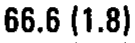 |
| r07_c03 | T2 | Ssl | Ssl | T2 | 74.4 (2.3) | mean 74.4 deg; sem 2.3 deg | 74.4 (2.3) | 74.4 (2.3) | 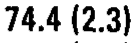 |
| r08_c00 | T3 | Tsr | Tsr | T3 | 69.4 (2.2) | mean 69.4 deg; sem 2.2 deg | 69.4 (2.2) | 69.4 (2.2) | 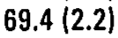 |
| r08_c01 | T3 | Ssr | Ssr | T3 | -74.7 (1.4) | mean -74.7 deg; sem 1.4 deg | -74.7 (1.4) | -74.7 (1.4) | 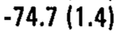 |
| r08_c02 | T3 | Tsl | Tsl | T3 | 69.4 (1.2) | mean 69.4 deg; sem 1.2 deg | 69.4 (1.2) | 69.4 (1.2) | 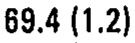 |
| r08_c03 | T3 | Ssl | Ssl | T3 | 74.3 (1.9) | mean 74.3 deg; sem 1.9 deg | 74.3 (1.9) | 74.3 (1.9) | 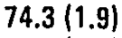 |
| r09_c00 | T4 | Tsr | Tsr | T4 | 72.8 (1.6) | mean 72.8 deg; sem 1.6 deg | 72.8 (1.6) | 72.8 (1.6) | 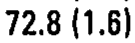 |
| r09_c01 | T4 | Ssr | Ssr | T4 | -77.2 (1.6) | mean -77.2 deg; sem 1.6 deg | -77.2 (1.6) | -77.2 (1.6) | 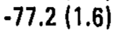 |
| r09_c02 | T4 | Tsl | Tsl | T4 | 73.2 (1.2) | mean 73.2 deg; sem 1.2 deg | 73.2 (1.2) | 73.2 (1.2) | 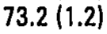 |
| r09_c03 | T4 | Ssl | Ssl | T4 | 74.6 (1.2) | mean 74.6 deg; sem 1.2 deg | 74.6 (1.2) | 74.6 (1.2) | 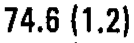 |
| r10_c00 | T5 | Tsr | Tsr | T5 | 73.2 (2.2) | mean 73.2 deg; sem 2.2 deg | 73.2 (2.2) | 73.2 (2.2) | 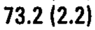 |
| r10_c01 | T5 | Ssr | Ssr | T5 | -73.4 (1.1) | mean -73.4 deg; sem 1.1 deg | -73.4 (1.1) | -73.4 (1.1) | 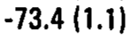 |
| r10_c02 | T5 | Tsl | Tsl | T5 | 74.5 (1.7) | mean 74.5 deg; sem 1.7 deg | 74.5 (1.7) | 74.5 (1.7) | 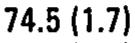 |
| r10_c03 | T5 | Ssl | Ssl | T5 | 75.3 (1.3) | mean 75.3 deg; sem 1.3 deg | 75.3 (1.3) | 75.3 (1.3) | 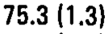 |
| r11_c00 | T6 | Tsr | Tsr | T6 | 73.5 (1.5) | mean 73.5 deg; sem 1.5 deg | 73.5 (1.5) | 73.5 (1.5) | 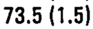 |
| r11_c01 | T6 | Ssr | Ssr | T6 | -72.5 (1.1) | mean -72.5 deg; sem 1.1 deg | -72.5 (1.1) | -72.5 (1.1) | 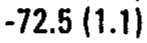 |
| r11_c02 | T6 | Tsl | Tsl | T6 | 74.6 (1.3) | mean 74.6 deg; sem 1.3 deg | 74.6 (1.3) | 74.6 (1.3) | 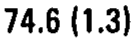 |
| r11_c03 | T6 | Ssl | Ssl | T6 | 72.9 (1.1) | mean 72.9 deg; sem 1.1 deg | 72.9 (1.1) | 72.9 (1.1) | 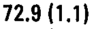 |
| r12_c00 | T7 | Tsr | Tsr | T7 | 74.7 (0.8) | mean 74.7 deg; sem 0.8 deg | 74.7 (0.8) | 74.7 (0.8) | 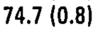 |
| r12_c01 | T7 | Ssr | Ssr | T7 | -73.5 (1.3) | mean -73.5 deg; sem 1.3 deg | -73.5 (1.3) | -73.5 (1.3) | 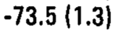 |
| r12_c02 | T7 | Tsl | Tsl | T7 | 72.7 (1.1) | mean 72.7 deg; sem 1.1 deg | 72.7 (1.1) | 72.7 (1.1) | 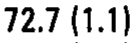 |
| r12_c03 | T7 | Ssl | Ssl | T7 | 74.1 (1.6) | mean 74.1 deg; sem 1.6 deg | 74.1 (1.6) | 74.1 (1.6) | 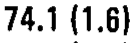 |
| r13_c00 | T8 | Tsr | Tsr | T8 | 74.5 (1.2) | mean 74.5 deg; sem 1.2 deg | 74.5 (1.2) | 74.5 (1.2) | 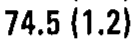 |
| r13_c01 | T8 | Ssr | Ssr | T8 | -72.2 (1.3) | mean -72.2 deg; sem 1.3 deg | -72.2 (1.3) | -72.2 (1.3) | 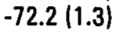 |
| r13_c02 | T8 | Tsl | Tsl | T8 | 73.0 (1.3) | mean 73.0 deg; sem 1.3 deg | 73.0 (1.3) | 73.0 (1.3) |  |
| r13_c03 | T8 | Ssl | Ssl | T8 | 74.4 (1.8) | mean 74.4 deg; sem 1.8 deg | 74.4 (1.8) | 74.4 (1.8) |  |
| r14_c00 | T9 | Tsr | Tsr | T9 | 77.7 (0.4) | mean 77.7 deg; sem 0.4 deg | 77.7 (0.4) | 77.7 (0.4) |  |
| r14_c01 | T9 | Ssr | Ssr | T9 | -74.0 (1.2) | mean -74.0 deg; sem 1.2 deg | -74.0 (1.2) | -74.0 (1.2) |  |
| r14_c02 | T9 | Tsl | Tsl | T9 | 78.2 (1.3) | mean 78.2 deg; sem 1.3 deg | 78.2 (1.3) | 78.2 (1.3) |  |
| r14_c03 | T9 | Ssl | Ssl | T9 | 73.3 (1.2) | mean 73.3 deg; sem 1.2 deg | 73.3 (1.2) | 73.3 (1.2) |  |
| r15_c00 | T10 | Tsr | Tsr | T10 | 78.1 (1.1) | mean 78.1 deg; sem 1.1 deg | 78.1 (1.1) | 78.1 (1.1) |  |
| r15_c01 | T10 | Ssr | Ssr | T10 | -76.2 (1.7) | mean -76.2 deg; sem 1.7 deg | -76.2 (1.7) | -76.2 (1.7) |  |
| r15_c02 | T10 | Tsl | Tsl | T10 | 78.1 (2.3) | mean 78.1 deg; sem 2.3 deg | 78.1 (2.3) | 78.1 (2.3) |  |
| r15_c03 | T10 | Ssl | Ssl | T10 | 74.0 (1.6) | mean 74.0 deg; sem 1.6 deg | 74.0 (1.6) | 74.0 (1.6) |  |
| r16_c00 | T11 | Tsr | Tsr | T11 | 75.6 (1.1) | mean 75.6 deg; sem 1.1 deg | 75.6 (1.1) | 75.6 (1.1) |  |
| r16_c01 | T11 | Ssr | Ssr | T11 | -77.0 (1.8) | mean -77.0 deg; sem 1.8 deg | -77.0 (1.8) | -77.0 (1.8) |  |
| r16_c02 | T11 | Tsl | Tsl | T11 | 76.0 (1.7) | mean 76.0 deg; sem 1.7 deg | 76.0 (1.7) | 76.0 (1.7) |  |
| r16_c03 | T11 | Ssl | Ssl | T11 | 71.6 (2.4) | mean 71.6 deg; sem 2.4 deg | 71.6 (2.4) | 71.6 (2.4) |  |
| r17_c00 | T12 | Tsr | Tsr | T12 | 77.1 (2.1) | mean 77.1 deg; sem 2.1 deg | 77.1 (2.1) | 77.1 (2.1) |  |
| r17_c01 | T12 | Ssr | Ssr | T12 | -72.5 (5.5) | mean -72.5 deg; sem 5.5 deg | -72.5 (5.5) | -72.5 (5.5) |  |
| r17_c02 | T12 | Tsl | Tsl | T12 | 78.2 (2.6) | mean 78.2 deg; sem 2.6 deg | 78.2 (2.6) | 78.2 (2.6) |  |
| r17_c03 | T12 | Ssl | Ssl | T12 | 67.4 (5.1) | mean 67.4 deg; sem 5.1 deg | 67.4 (5.1) | 67.4 (5.1) |  |
| r18_c00 | L1 | Tsr | Tsr | L1 | 82.9 (1.4) | mean 82.9 deg; sem 1.4 deg | 82.9 (1.4) | 82.9 (1.4) |  |
| r18_c01 | L1 | Ssr | Ssr | L1 | -139.1 (8.9) | mean -139.1 deg; sem 8.9 deg | -139.1 (8.9) | -139.1 (8.9) |  |
| r18_c02 | L1 | Tsl | Tsl | L1 | 81.3 (2.7) | mean 81.3 deg; sem 2.7 deg | 81.3 (2.7) | 81.3 (2.7) |  |
| r18_c03 | L1 | Ssl | Ssl | L1 | 134.2 (8.2) | mean 134.2 deg; sem 8.2 deg | 134.2 (8.2) | 134.2 (8.2) |  |
| r19_c00 | L2 | Tsr | Tsr | L2 | 85.7 (0.9) | mean 85.7 deg; sem 0.9 deg | 85.7 (0.9) | 85.7 (0.9) |  |
| r19_c01 | L2 | Ssr | Ssr | L2 | -135.4 (9.2) | mean -135.4 deg; sem 9.2 deg | -135.4 (9.2) | -135.4 (9.2) |  |
| r19_c02 | L2 | Tsl | Tsl | L2 | 83.8 (1.3) | mean 83.8 deg; sem 1.3 deg | 83.8 (1.3) | 83.8 (1.3) |  |
| r19_c03 | L2 | Ssl | Ssl | L2 | 139.7 (9.0) | mean 139.7 deg; sem 9.0 deg | 139.7 (9.0) | 139.7 (9.0) |  |
| r20_c00 | L3 | Tsr | Tsr | L3 | 81.9 (1.6) | mean 81.9 deg; sem 1.6 deg | 81.9 (1.6) | 81.9 (1.6) |  |
| r20_c01 | L3 | Ssr | Ssr | L3 | -131.5 (9.0) | mean -131.5 deg; sem 9.0 deg | -131.5 (9.0) | -131.5 (9.0) |  |
| r20_c02 | L3 | Tsl | Tsl | L3 | 84.1 (1.5) | mean 84.1 deg; sem 1.5 deg | 84.1 (1.5) | 84.1 (1.5) |  |
| r20_c03 | L3 | Ssl | Ssl | L3 | 133.1 (5.5) | mean 133.1 deg; sem 5.5 deg | 133.1 (5.5) | 133.1 (5.5) |  |
| r21_c00 | L4 | Tsr | Tsr | L4 | 81.2 (1.6) | mean 81.2 deg; sem 1.6 deg | 81.2 (1.6) | 81.2 (1.6) |  |
| r21_c01 | L4 | Ssr | Ssr | L4 | -120.8 (3.7) | mean -120.8 deg; sem 3.7 deg | -120.8 (3.7) | -120.8 (3.7) |  |
| r21_c02 | L4 | Tsl | Tsl | L4 | 81.3 (2.5) | mean 81.3 deg; sem 2.5 deg | 81.3 (2.5) | 81.3 (2.5) |  |
| r21_c03 | L4 | Ssl | Ssl | L4 | 123.6 (3.1) | mean 123.6 deg; sem 3.1 deg | 123.6 (3.1) | 123.6 (3.1) |  |
| r22_c00 | L5 | Tsr | Tsr | L5 | 86.0 (1.0) | mean 86.0 deg; sem 1.0 deg | 86.0 (1.0) | 86.0 (1.0) |  |
| r22_c01 | L5 | Ssr | Ssr | L5 | -117.6 (4.1) | mean -117.6 deg; sem 4.1 deg | -117.6 (4.1) | -117.6 (4.1) |  |
| r22_c02 | L5 | Tsl | Tsl | L5 | 85.1 (1.2) | mean 85.1 deg; sem 1.2 deg | 85.1 (1.2) | 85.1 (1.2) |  |
| r22_c03 | L5 | Ssl | Ssl | L5 | 119.8 (4.5) | mean 119.8 deg; sem 4.5 deg | 119.8 (4.5) | 119.8 (4.5) |  |
