# Table 7. Means (and Standard Errors of the Mean) of the Inferior Articular Facet Orientations with Respect to the Anatomic Planes: Transverse and Sagittal

Facets, PDF page 6, printed page 1303; Panjabi_1993_Facets_Spine_18-10_1298-1310.pdf (sha256 2b22fe5e6c14d2289a4366f3c94879db1da0f79ae54e05a7f8e54a07e1c0279f), rendered at 300 dpi by render.py.

Every cell below is the box layout.py cut from the rendered page, and the two strings are what the two reading passes read in it (README.md). A dash is printed where the paper prints one. The value column is what provenance.csv carries.

| cell | row | column | measure | level | printed | value | pass 1 | pass 2 | image |
|---|---|---|---|---|---|---|---|---|---|
| r00_c00 | C2 | Tir | Tir | C2 | 31.4 (5.2) | mean 31.4 deg; sem 5.2 deg | 31.4 (5.2) | 31.4 (5.2) | 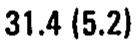 |
| r00_c01 | C2 | Sir | Sir | C2 | -74.3 (3.4) | mean -74.3 deg; sem 3.4 deg | -74.3 (3.4) | -74.3 (3.4) | 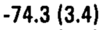 |
| r00_c02 | C2 | Til | Til | C2 | 36.1 (4.9) | mean 36.1 deg; sem 4.9 deg | 36.1 (4.9) | 36.1 (4.9) | 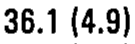 |
| r00_c03 | C2 | Sil | Sil | C2 | 70.8 (3.5) | mean 70.8 deg; sem 3.5 deg | 70.8 (3.5) | 70.8 (3.5) | 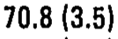 |
| r01_c00 | C3 | Tir | Tir | C3 | 44.2 (6.5) | mean 44.2 deg; sem 6.5 deg | 44.2 (6.5) | 44.2 (6.5) | 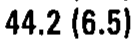 |
| r01_c01 | C3 | Sir | Sir | C3 | -75.2 (3.1) | mean -75.2 deg; sem 3.1 deg | -75.2 (3.1) | -75.2 (3.1) |  |
| r01_c02 | C3 | Til | Til | C3 | 41.0 (4.1) | mean 41.0 deg; sem 4.1 deg | 41.0 (4.1) | 41.0 (4.1) | 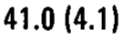 |
| r01_c03 | C3 | Sil | Sil | C3 | 79.4 (2.4) | mean 79.4 deg; sem 2.4 deg | 79.4 (2.4) | 79.4 (2.4) | 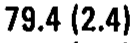 |
| r02_c00 | C4 | Tir | Tir | C4 | 44.9 (5.7) | mean 44.9 deg; sem 5.7 deg | 44.9 (5.7) | 44.9 (5.7) | 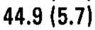 |
| r02_c01 | C4 | Sir | Sir | C4 | -74.3 (2.8) | mean -74.3 deg; sem 2.8 deg | -74.3 (2.8) | -74.3 (2.8) | 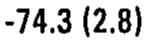 |
| r02_c02 | C4 | Til | Til | C4 | 47.7 (6.3) | mean 47.7 deg; sem 6.3 deg | 47.7 (6.3) | 47.7 (6.3) | 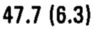 |
| r02_c03 | C4 | Sil | Sil | C4 | 75.0 (5.0) | mean 75.0 deg; sem 5.0 deg | 75.0 (5.0) | 75.0 (5.0) | 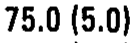 |
| r03_c00 | C5 | Tir | Tir | C5 | 49.1 (4.7) | mean 49.1 deg; sem 4.7 deg | 49.1 (4.7) | 49.1 (4.7) | 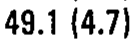 |
| r03_c01 | C5 | Sir | Sir | C5 | -75.1 (3.6) | mean -75.1 deg; sem 3.6 deg | -75.1 (3.6) | -75.1 (3.6) | 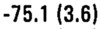 |
| r03_c02 | C5 | Til | Til | C5 | 54.3 (3.1) | mean 54.3 deg; sem 3.1 deg | 54.3 (3.1) | 54.3 (3.1) | 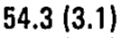 |
| r03_c03 | C5 | Sil | Sil | C5 | 72.0 (4.5) | mean 72.0 deg; sem 4.5 deg | 72.0 (4.5) | 72.0 (4.5) | 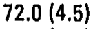 |
| r04_c00 | C6 | Tir | Tir | C6 | 55.0 (4.0) | mean 55.0 deg; sem 4.0 deg | 55.0 (4.0) | 55.0 (4.0) | 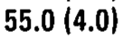 |
| r04_c01 | C6 | Sir | Sir | C6 | -81.6 (2.3) | mean -81.6 deg; sem 2.3 deg | -81.6 (2.3) | -81.6 (2.3) |  |
| r04_c02 | C6 | Til | Til | C6 | 54.7 (4.6) | mean 54.7 deg; sem 4.6 deg | 54.7 (4.6) | 54.7 (4.6) | 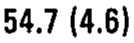 |
| r04_c03 | C6 | Sil | Sil | C6 | 83.1 (2.1) | mean 83.1 deg; sem 2.1 deg | 83.1 (2.1) | 83.1 (2.1) | 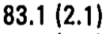 |
| r05_c00 | C7 | Tir | Tir | C7 | 49.8 (2.9) | mean 49.8 deg; sem 2.9 deg | 49.8 (2.9) | 49.8 (2.9) | 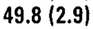 |
| r05_c01 | C7 | Sir | Sir | C7 | -82.4 (1.4) | mean -82.4 deg; sem 1.4 deg | -82.4 (1.4) | -82.4 (1.4) | 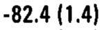 |
| r05_c02 | C7 | Til | Til | C7 | 49.1 (2.7) | mean 49.1 deg; sem 2.7 deg | 49.1 (2.7) | 49.1 (2.7) | 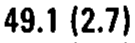 |
| r05_c03 | C7 | Sil | Sil | C7 | 80.1 (3.6) | mean 80.1 deg; sem 3.6 deg | 80.1 (3.6) | 80.1 (3.6) | 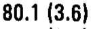 |
| r06_c00 | T1 | Tir | Tir | T1 | 66.3 (2.6) | mean 66.3 deg; sem 2.6 deg | 66.3 (2.6) | 66.3 (2.6) | 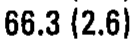 |
| r06_c01 | T1 | Sir | Sir | T1 | -75.5 (2.2) | mean -75.5 deg; sem 2.2 deg | -75.5 (2.2) | -75.5 (2.2) | 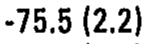 |
| r06_c02 | T1 | Til | Til | T1 | 62.2 (5.3) | mean 62.2 deg; sem 5.3 deg | 62.2 (5.3) | 62.2 (5.3) | 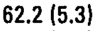 |
| r06_c03 | T1 | Sil | Sil | T1 | 75.4 (2.8) | mean 75.4 deg; sem 2.8 deg | 75.4 (2.8) | 75.4 (2.8) | 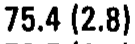 |
| r07_c00 | T2 | Tir | Tir | T2 | 69.6 (2.3) | mean 69.6 deg; sem 2.3 deg | 69.6 (2.3) | 69.6 (2.3) | 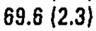 |
| r07_c01 | T2 | Sir | Sir | T2 | -75.8 (1.1) | mean -75.8 deg; sem 1.1 deg | -75.8 (1.1) | -75.8 (1.1) | 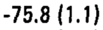 |
| r07_c02 | T2 | Til | Til | T2 | 70.0 (2.4) | mean 70.0 deg; sem 2.4 deg | 70.0 (2.4) | 70.0 (2.4) | 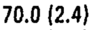 |
| r07_c03 | T2 | Sil | Sil | T2 | 76.5 (1.8) | mean 76.5 deg; sem 1.8 deg | 76.5 (1.8) | 76.5 (1.8) | 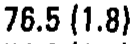 |
| r08_c00 | T3 | Tir | Tir | T3 | 73.8 (1.8) | mean 73.8 deg; sem 1.8 deg | 73.8 (1.8) | 73.8 (1.8) | 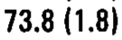 |
| r08_c01 | T3 | Sir | Sir | T3 | -75.1 (1.4) | mean -75.1 deg; sem 1.4 deg | -75.1 (1.4) | -75.1 (1.4) | 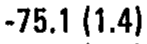 |
| r08_c02 | T3 | Til | Til | T3 | 75.4 (2.2) | mean 75.4 deg; sem 2.2 deg | 75.4 (2.2) | 75.4 (2.2) | 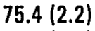 |
| r08_c03 | T3 | Sil | Sil | T3 | 74.9 (1.2) | mean 74.9 deg; sem 1.2 deg | 74.9 (1.2) | 74.9 (1.2) | 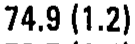 |
| r09_c00 | T4 | Tir | Tir | T4 | 72.7 (3.0) | mean 72.7 deg; sem 3.0 deg | 72.7 (3.0) | 72.7 (3.0) | 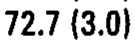 |
| r09_c01 | T4 | Sir | Sir | T4 | -75.3 (1.0) | mean -75.3 deg; sem 1.0 deg | -75.3 (1.0) | -75.3 (1.0) | 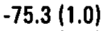 |
| r09_c02 | T4 | Til | Til | T4 | 74.4 (2.6) | mean 74.4 deg; sem 2.6 deg | 74.4 (2.6) | 74.4 (2.6) | 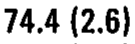 |
| r09_c03 | T4 | Sil | Sil | T4 | 73.7 (1.5) | mean 73.7 deg; sem 1.5 deg | 73.7 (1.5) | 73.7 (1.5) | 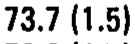 |
| r10_c00 | T5 | Tir | Tir | T5 | 76.8 (2.8) | mean 76.8 deg; sem 2.8 deg | 76.8 (2.8) | 76.8 (2.8) | 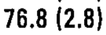 |
| r10_c01 | T5 | Sir | Sir | T5 | -72.2 (1.3) | mean -72.2 deg; sem 1.3 deg | -72.2 (1.3) | -72.2 (1.3) | 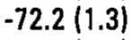 |
| r10_c02 | T5 | Til | Til | T5 | 76.4 (2.7) | mean 76.4 deg; sem 2.7 deg | 76.4 (2.7) | 76.4 (2.7) | 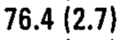 |
| r10_c03 | T5 | Sil | Sil | T5 | 73.6 (1.7) | mean 73.6 deg; sem 1.7 deg | 73.6 (1.7) | 73.6 (1.7) | 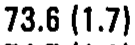 |
| r11_c00 | T6 | Tir | Tir | T6 | 77.8 (2.2) | mean 77.8 deg; sem 2.2 deg | 77.8 (2.2) | 77.8 (2.2) | 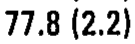 |
| r11_c01 | T6 | Sir | Sir | T6 | -73.5 (1.7) | mean -73.5 deg; sem 1.7 deg | -73.5 (1.7) | -73.5 (1.7) | 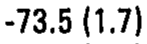 |
| r11_c02 | T6 | Til | Til | T6 | 76.7 (2.7) | mean 76.7 deg; sem 2.7 deg | 76.7 (2.7) | 76.7 (2.7) | 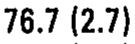 |
| r11_c03 | T6 | Sil | Sil | T6 | 74.7 (1.3) | mean 74.7 deg; sem 1.3 deg | 74.7 (1.3) | 74.7 (1.3) | 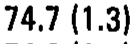 |
| r12_c00 | T7 | Tir | Tir | T7 | 77.6 (2.1) | mean 77.6 deg; sem 2.1 deg | 77.6 (2.1) | 77.6 (2.1) | 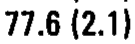 |
| r12_c01 | T7 | Sir | Sir | T7 | -73.8 (1.2) | mean -73.8 deg; sem 1.2 deg | -73.8 (1.2) | -73.8 (1.2) | 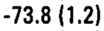 |
| r12_c02 | T7 | Til | Til | T7 | 77.0 (1.5) | mean 77.0 deg; sem 1.5 deg | 77.0 (1.5) | 77.0 (1.5) | 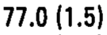 |
| r12_c03 | T7 | Sil | Sil | T7 | 74.6 (1.8) | mean 74.6 deg; sem 1.8 deg | 74.6 (1.8) | 74.6 (1.8) | 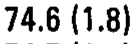 |
| r13_c00 | T8 | Tir | Tir | T8 | 74.3 (2.0) | mean 74.3 deg; sem 2.0 deg | 74.3 (2.0) | 74.3 (2.0) |  |
| r13_c01 | T8 | Sir | Sir | T8 | -75.0 (1.3) | mean -75.0 deg; sem 1.3 deg | -75.0 (1.3) | -75.0 (1.3) |  |
| r13_c02 | T8 | Til | Til | T8 | 77.1 (1.6) | mean 77.1 deg; sem 1.6 deg | 77.1 (1.6) | 77.1 (1.6) |  |
| r13_c03 | T8 | Sil | Sil | T8 | 74.7 (1.4) | mean 74.7 deg; sem 1.4 deg | 74.7 (1.4) | 74.7 (1.4) |  |
| r14_c00 | T9 | Tir | Tir | T9 | 77.9 (2.1) | mean 77.9 deg; sem 2.1 deg | 77.9 (2.1) | 77.9 (2.1) |  |
| r14_c01 | T9 | Sir | Sir | T9 | -75.7 (1.6) | mean -75.7 deg; sem 1.6 deg | -75.7 (1.6) | -75.7 (1.6) |  |
| r14_c02 | T9 | Til | Til | T9 | 77.5 (2.4) | mean 77.5 deg; sem 2.4 deg | 77.5 (2.4) | 77.5 (2.4) |  |
| r14_c03 | T9 | Sil | Sil | T9 | 75.4 (1.4) | mean 75.4 deg; sem 1.4 deg | 75.4 (1.4) | 75.4 (1.4) |  |
| r15_c00 | T10 | Tir | Tir | T10 | 77.9 (1.7) | mean 77.9 deg; sem 1.7 deg | 77.9 (1.7) | 77.9 (1.7) |  |
| r15_c01 | T10 | Sir | Sir | T10 | -76.8 (2.2) | mean -76.8 deg; sem 2.2 deg | -76.8 (2.2) | -76.8 (2.2) |  |
| r15_c02 | T10 | Til | Til | T10 | 76.7 (2.4) | mean 76.7 deg; sem 2.4 deg | 76.7 (2.4) | 76.7 (2.4) |  |
| r15_c03 | T10 | Sil | Sil | T10 | 74.0 (2.0) | mean 74.0 deg; sem 2.0 deg | 74.0 (2.0) | 74.0 (2.0) |  |
| r16_c00 | T11 | Tir | Tir | T11 | 75.5 (2.1) | mean 75.5 deg; sem 2.1 deg | 75.5 (2.1) | 75.5 (2.1) |  |
| r16_c01 | T11 | Sir | Sir | T11 | -72.2 (5.3) | mean -72.2 deg; sem 5.3 deg | -72.2 (5.3) | -72.2 (5.3) |  |
| r16_c02 | T11 | Til | Til | T11 | 76.1 (2.1) | mean 76.1 deg; sem 2.1 deg | 76.1 (2.1) | 76.1 (2.1) |  |
| r16_c03 | T11 | Sil | Sil | T11 | 70.5 (4.7) | mean 70.5 deg; sem 4.7 deg | 70.5 (4.7) | 70.5 (4.7) |  |
| r17_c00 | T12 | Tir | Tir | T12 | 75.4 (1.9) | mean 75.4 deg; sem 1.9 deg | 75.4 (1.9) | 75.4 (1.9) |  |
| r17_c01 | T12 | Sir | Sir | T12 | -139.7 (9.5) | mean -139.7 deg; sem 9.5 deg | -139.7 (9.5) | -139.7 (9.5) |  |
| r17_c02 | T12 | Til | Til | T12 | 78.4 (3.0) | mean 78.4 deg; sem 3.0 deg | 78.4 (3.0) | 78.4 (3.0) |  |
| r17_c03 | T12 | Sil | Sil | T12 | 138.8 (8.8) | mean 138.8 deg; sem 8.8 deg | 138.8 (8.8) | 138.8 (8.8) |  |
| r18_c00 | L1 | Tir | Tir | L1 | 81.4 (1.6) | mean 81.4 deg; sem 1.6 deg | 81.4 (1.6) | 81.4 (1.6) |  |
| r18_c01 | L1 | Sir | Sir | L1 | -152.1 (5.8) | mean -152.1 deg; sem 5.8 deg | -152.1 (5.8) | -152.1 (5.8) |  |
| r18_c02 | L1 | Til | Til | L1 | 81.8 (1.9) | mean 81.8 deg; sem 1.9 deg | 81.8 (1.9) | 81.8 (1.9) |  |
| r18_c03 | L1 | Sil | Sil | L1 | 154.8 (6.3) | mean 154.8 deg; sem 6.3 deg | 154.8 (6.3) | 154.8 (6.3) |  |
| r19_c00 | L2 | Tir | Tir | L2 | 82.8 (2.5) | mean 82.8 deg; sem 2.5 deg | 82.8 (2.5) | 82.8 (2.5) |  |
| r19_c01 | L2 | Sir | Sir | L2 | -142.5 (5.1) | mean -142.5 deg; sem 5.1 deg | -142.5 (5.1) | -142.5 (5.1) |  |
| r19_c02 | L2 | Til | Til | L2 | 78.7 (4.0) | mean 78.7 deg; sem 4.0 deg | 78.7 (4.0) | 78.7 (4.0) |  |
| r19_c03 | L2 | Sil | Sil | L2 | 136.7 (8.1) | mean 136.7 deg; sem 8.1 deg | 136.7 (8.1) | 136.7 (8.1) |  |
| r20_c00 | L3 | Tir | Tir | L3 | 75.6 (4.1) | mean 75.6 deg; sem 4.1 deg | 75.6 (4.1) | 75.6 (4.1) |  |
| r20_c01 | L3 | Sir | Sir | L3 | -130.6 (6.3) | mean -130.6 deg; sem 6.3 deg | -130.6 (6.3) | -130.6 (6.3) |  |
| r20_c02 | L3 | Til | Til | L3 | 77.8 (3.3) | mean 77.8 deg; sem 3.3 deg | 77.8 (3.3) | 77.8 (3.3) |  |
| r20_c03 | L3 | Sil | Sil | L3 | 123.3 (3.3) | mean 123.3 deg; sem 3.3 deg | 123.3 (3.3) | 123.3 (3.3) |  |
| r21_c00 | L4 | Tir | Tir | L4 | 70.5 (6.7) | mean 70.5 deg; sem 6.7 deg | 70.5 (6.7) | 70.5 (6.7) |  |
| r21_c01 | L4 | Sir | Sir | L4 | -112.7 (7.1) | mean -112.7 deg; sem 7.1 deg | -112.7 (7.1) | -112.7 (7.1) |  |
| r21_c02 | L4 | Til | Til | L4 | 80.3 (1.2) | mean 80.3 deg; sem 1.2 deg | 80.3 (1.2) | 80.3 (1.2) |  |
| r21_c03 | L4 | Sil | Sil | L4 | 114.7 (4.9) | mean 114.7 deg; sem 4.9 deg | 114.7 (4.9) | 114.7 (4.9) |  |
| r22_c00 | L5 | Tir | Tir | L5 | 71.0 (3.7) | mean 71.0 deg; sem 3.7 deg | 71.0 (3.7) | 71.0 (3.7) |  |
| r22_c01 | L5 | Sir | Sir | L5 | -127.6 (7.2) | mean -127.6 deg; sem 7.2 deg | -127.6 (7.2) | -127.6 (7.2) |  |
| r22_c02 | L5 | Til | Til | L5 | 81.6 (1.2) | mean 81.6 deg; sem 1.2 deg | 81.6 (1.2) | 81.6 (1.2) |  |
| r22_c03 | L5 | Sil | Sil | L5 | 125.1 (2.9) | mean 125.1 deg; sem 2.9 deg | 125.1 (2.9) | 125.1 (2.9) |  |
