# Table 8. Average Card Angles for the Superior and Inferior Articular Facets

Facets, PDF page 7, printed page 1304; Panjabi_1993_Facets_Spine_18-10_1298-1310.pdf (sha256 2b22fe5e6c14d2289a4366f3c94879db1da0f79ae54e05a7f8e54a07e1c0279f), rendered at 300 dpi by render.py.

Every cell below is the box layout.py cut from the rendered page, and the two strings are what the two reading passes read in it (README.md). A dash is printed where the paper prints one. The value column is what provenance.csv carries.

| cell | row | column | measure | level | printed | value | pass 1 | pass 2 | image |
|---|---|---|---|---|---|---|---|---|---|
| r00_c00 | C2 | CAXsr | CAXsr | C2 | -40.7 | mean -40.7 deg | -40.7 | -40.7 |  |
| r00_c01 | C2 | CAYsr | CAYsr | C2 | 38.9 | mean 38.9 deg | 38.9 | 38.9 |  |
| r00_c02 | C2 | CAXsl | CAXsl | C2 | -33.5 | mean -33.5 deg | -33.5 | -33.5 |  |
| r00_c03 | C2 | CAYsl | CAYsl | C2 | -59.9 | mean -59.9 deg | -59.9 | -59.9 |  |
| r00_c04 | C2 | CAXir | CAXir | C2 | -31.4 | mean -31.4 deg | -31.4 | -31.4 |  |
| r00_c05 | C2 | CAYir | CAYir | C2 | -31.3 | mean -31.3 deg | -31.3 | -31.3 |  |
| r00_c06 | C2 | CAXil | CAXil | C2 | -36.1 | mean -36.1 deg | -36.1 | -36.1 |  |
| r00_c07 | C2 | CAYil | CAYil | C2 | 33.9 | mean 33.9 deg | 33.9 | 33.9 |  |
| r01_c00 | C3 | CAXsr | CAXsr | C3 | -48.8 | mean -48.8 deg | -48.8 | -48.8 |  |
| r01_c01 | C3 | CAYsr | CAYsr | C3 | -17.6 | mean -17.6 deg | -17.6 | -17.6 |  |
| r01_c02 | C3 | CAXsl | CAXsl | C3 | -55.2 | mean -55.2 deg | -55.2 | -55.2 |  |
| r01_c03 | C3 | CAYsl | CAYsl | C3 | 22.6 | mean 22.6 deg | 22.6 | 22.6 |  |
| r01_c04 | C3 | CAXir | CAXir | C3 | -44.1 | mean -44.1 deg | -44.1 | -44.1 |  |
| r01_c05 | C3 | CAYir | CAYir | C3 | -21.5 | mean -21.5 deg | -21.5 | -21.5 |  |
| r01_c06 | C3 | CAXil | CAXil | C3 | -41.0 | mean -41.0 deg | -41.0 | -41.0 |  |
| r01_c07 | C3 | CAYil | CAYil | C3 | 16.3 | mean 16.3 deg | 16.3 | 16.3 |  |
| r02_c00 | C4 | CAXsr | CAXsr | C4 | -47.0 | mean -47.0 deg | -47.0 | -47.0 |  |
| r02_c01 | C4 | CAYsr | CAYsr | C4 | -8.4 | mean -8.4 deg | -8.4 | -8.4 |  |
| r02_c02 | C4 | CAXsl | CAXsl | C4 | -49.7 | mean -49.7 deg | -49.7 | -49.7 |  |
| r02_c03 | C4 | CAYsl | CAYsl | C4 | 6.4 | mean 6.4 deg | 6.4 | 6.4 |  |
| r02_c04 | C4 | CAXir | CAXir | C4 | -44.9 | mean -44.9 deg | -44.9 | -44.9 |  |
| r02_c05 | C4 | CAYir | CAYir | C4 | 22.5 | mean 22.5 deg | 22.5 | 22.5 |  |
| r02_c06 | C4 | CAXil | CAXil | C4 | -47.7 | mean -47.7 deg | -47.7 | -47.7 | 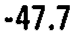 |
| r02_c07 | C4 | CAYil | CAYil | C4 | -20.6 | mean -20.6 deg | -20.6 | -20.6 |  |
| r03_c00 | C5 | CAXsr | CAXsr | C5 | -45.8 | mean -45.8 deg | -45.8 | -45.8 |  |
| r03_c01 | C5 | CAYsr | CAYsr | C5 | 9.2 | mean 9.2 deg | 9.2 | 9.2 |  |
| r03_c02 | C5 | CAXsl | CAXsl | C5 | -45.3 | mean -45.3 deg | -45.3 | -45.3 |  |
| r03_c03 | C5 | CAYsl | CAYsl | C5 | -8.9 | mean -8.9 deg | -8.9 | -8.9 |  |
| r03_c04 | C5 | CAXir | CAXir | C5 | -49.1 | mean -49.1 deg | -49.1 | -49.1 |  |
| r03_c05 | C5 | CAYir | CAYir | C5 | 19.9 | mean 19.9 deg | 19.9 | 19.9 |  |
| r03_c06 | C5 | CAXil | CAXil | C5 | -54.3 | mean -54.3 deg | -54.3 | -54.3 | 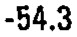 |
| r03_c07 | C5 | CAYil | CAYil | C5 | -22.3 | mean -22.3 deg | -22.3 | -22.3 | 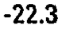 |
| r04_c00 | C6 | CAXsr | CAXsr | C6 | -47.2 | mean -47.2 deg | -47.2 | -47.2 | 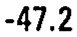 |
| r04_c01 | C6 | CAYsr | CAYsr | C6 | 12.1 | mean 12.1 deg | 12.1 | 12.1 |  |
| r04_c02 | C6 | CAXsl | CAXsl | C6 | -48.0 | mean -48.0 deg | -48.0 | -48.0 |  |
| r04_c03 | C6 | CAYsl | CAYsl | C6 | -17.9 | mean -17.9 deg | -17.9 | -17.9 |  |
| r04_c04 | C6 | CAXir | CAXir | C6 | -55.0 | mean -55.0 deg | -55.0 | -55.0 |  |
| r04_c05 | C6 | CAYir | CAYir | C6 | 10.3 | mean 10.3 deg | 10.3 | 10.3 |  |
| r04_c06 | C6 | CAXil | CAXil | C6 | -54.7 | mean -54.7 deg | -54.7 | -54.7 |  |
| r04_c07 | C6 | CAYil | CAYil | C6 | -8.5 | mean -8.5 deg | -8.5 | -8.5 |  |
| r05_c00 | C7 | CAXsr | CAXsr | C7 | -59.4 | mean -59.4 deg | -59.4 | -59.4 |  |
| r05_c01 | C7 | CAYsr | CAYsr | C7 | 11.4 | mean 11.4 deg | 11.4 | 11.4 |  |
| r05_c02 | C7 | CAXsl | CAXsl | C7 | -51.6 | mean -51.6 deg | -51.6 | -51.6 |  |
| r05_c03 | C7 | CAYsl | CAYsl | C7 | -5.8 | mean -5.8 deg | -5.8 | -5.8 |  |
| r05_c04 | C7 | CAXir | CAXir | C7 | -49.8 | mean -49.8 deg | -49.8 | -49.8 |  |
| r05_c05 | C7 | CAYir | CAYir | C7 | 9.9 | mean 9.9 deg | 9.9 | 9.9 |  |
| r05_c06 | C7 | CAXil | CAXil | C7 | -49.1 | mean -49.1 deg | -49.1 | -49.1 |  |
| r05_c07 | C7 | CAYil | CAYil | C7 | -13.1 | mean -13.1 deg | -13.1 | -13.1 |  |
| r06_c00 | T1 | CAXsr | CAXsr | T1 | -62.2 | mean -62.2 deg | -62.2 | -62.2 |  |
| r06_c01 | T1 | CAYsr | CAYsr | T1 | 4.1 | mean 4.1 deg | 4.1 | 4.1 |  |
| r06_c02 | T1 | CAXsl | CAXsl | T1 | -47.7 | mean -47.7 deg | -47.7 | -47.7 |  |
| r06_c03 | T1 | CAYsl | CAYsl | T1 | -5.6 | mean -5.6 deg | -5.6 | -5.6 |  |
| r06_c04 | T1 | CAXir | CAXir | T1 | -66.3 | mean -66.3 deg | -66.3 | -66.3 |  |
| r06_c05 | T1 | CAYir | CAYir | T1 | 15.9 | mean 15.9 deg | 15.9 | 15.9 |  |
| r06_c06 | T1 | CAXil | CAXil | T1 | -62.2 | mean -62.2 deg | -62.2 | -62.2 |  |
| r06_c07 | T1 | CAYil | CAYil | T1 | -16.5 | mean -16.5 deg | -16.5 | -16.5 |  |
| r07_c00 | T2 | CAXsr | CAXsr | T2 | -66.5 | mean -66.5 deg | -66.5 | -66.5 |  |
| r07_c01 | T2 | CAYsr | CAYsr | T2 | 15.8 | mean 15.8 deg | 15.8 | 15.8 |  |
| r07_c02 | T2 | CAXsl | CAXsl | T2 | -66.6 | mean -66.6 deg | -66.6 | -66.6 |  |
| r07_c03 | T2 | CAYsl | CAYsl | T2 | -17.0 | mean -17.0 deg | -17.0 | -17.0 |  |
| r07_c04 | T2 | CAXir | CAXir | T2 | -69.6 | mean -69.6 deg | -69.6 | -69.6 |  |
| r07_c05 | T2 | CAYir | CAYir | T2 | 15.1 | mean 15.1 deg | 15.1 | 15.1 |  |
| r07_c06 | T2 | CAXil | CAXil | T2 | -70.0 | mean -70.0 deg | -70.0 | -70.0 |  |
| r07_c07 | T2 | CAYil | CAYil | T2 | -14.4 | mean -14.4 deg | -14.4 | -14.4 | 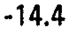 |
| r08_c00 | T3 | CAXsr | CAXsr | T3 | -69.4 | mean -69.4 deg | -69.4 | -69.4 |  |
| r08_c01 | T3 | CAYsr | CAYsr | T3 | 16.4 | mean 16.4 deg | 16.4 | 16.4 |  |
| r08_c02 | T3 | CAXsl | CAXsl | T3 | -69.4 | mean -69.4 deg | -69.4 | -69.4 |  |
| r08_c03 | T3 | CAYsl | CAYsl | T3 | -16.8 | mean -16.8 deg | -16.8 | -16.8 |  |
| r08_c04 | T3 | CAXir | CAXir | T3 | -73.8 | mean -73.8 deg | -73.8 | -73.8 |  |
| r08_c05 | T3 | CAYir | CAYir | T3 | 15.5 | mean 15.5 deg | 15.5 | 15.5 |  |
| r08_c06 | T3 | CAXil | CAXil | T3 | -75.4 | mean -75.4 deg | -75.4 | -75.4 |  |
| r08_c07 | T3 | CAYil | CAYil | T3 | -15.6 | mean -15.6 deg | -15.6 | -15.6 |  |
| r09_c00 | T4 | CAXsr | CAXsr | T4 | -72.8 | mean -72.8 deg | -72.8 | -72.8 |  |
| r09_c01 | T4 | CAYsr | CAYsr | T4 | 13.4 | mean 13.4 deg | 13.4 | 13.4 |  |
| r09_c02 | T4 | CAXsl | CAXsl | T4 | -73.2 | mean -73.2 deg | -73.2 | -73.2 |  |
| r09_c03 | T4 | CAYsl | CAYsl | T4 | -16.1 | mean -16.1 deg | -16.1 | -16.1 |  |
| r09_c04 | T4 | CAXir | CAXir | T4 | -72.7 | mean -72.7 deg | -72.7 | -72.7 |  |
| r09_c05 | T4 | CAYir | CAYir | T4 | 15.4 | mean 15.4 deg | 15.4 | 15.4 |  |
| r09_c06 | T4 | CAXil | CAXil | T4 | -74.4 | mean -74.4 deg | -74.4 | -74.4 |  |
| r09_c07 | T4 | CAYil | CAYil | T4 | -16.9 | mean -16.9 deg | -16.9 | -16.9 |  |
| r10_c00 | T5 | CAXsr | CAXsr | T5 | -73.2 | mean -73.2 deg | -73.2 | -73.2 |  |
| r10_c01 | T5 | CAYsr | CAYsr | T5 | 17.3 | mean 17.3 deg | 17.3 | 17.3 |  |
| r10_c02 | T5 | CAXsl | CAXsl | T5 | -74.5 | mean -74.5 deg | -74.5 | -74.5 |  |
| r10_c03 | T5 | CAYsl | CAYsl | T5 | -15.3 | mean -15.3 deg | -15.3 | -15.3 |  |
| r10_c04 | T5 | CAXir | CAXir | T5 | -76.8 | mean -76.8 deg | -76.8 | -76.8 |  |
| r10_c05 | T5 | CAYir | CAYir | T5 | 18.4 | mean 18.4 deg | 18.4 | 18.4 |  |
| r10_c06 | T5 | CAXil | CAXil | T5 | -76.4 | mean -76.4 deg | -76.4 | -76.4 |  |
| r10_c07 | T5 | CAYil | CAYil | T5 | -16.9 | mean -16.9 deg | -16.9 | -16.9 |  |
| r11_c00 | T6 | CAXsr | CAXsr | T6 | -73.5 | mean -73.5 deg | -73.5 | -73.5 |  |
| r11_c01 | T6 | CAYsr | CAYsr | T6 | 18.2 | mean 18.2 deg | 18.2 | 18.2 |  |
| r11_c02 | T6 | CAXsl | CAXsl | T6 | -74.6 | mean -74.6 deg | -74.6 | -74.6 |  |
| r11_c03 | T6 | CAYsl | CAYsl | T6 | -17.8 | mean -17.8 deg | -17.8 | -17.8 |  |
| r11_c04 | T6 | CAXir | CAXir | T6 | -77.8 | mean -77.8 deg | -77.8 | -77.8 | 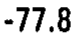 |
| r11_c05 | T6 | CAYir | CAYir | T6 | 18.4 | mean 18.4 deg | 18.4 | 18.4 |  |
| r11_c06 | T6 | CAXil | CAXil | T6 | -76.7 | mean -76.7 deg | -76.7 | -76.7 |  |
| r11_c07 | T6 | CAYil | CAYil | T6 | -15.8 | mean -15.8 deg | -15.8 | -15.8 |  |
| r12_c00 | T7 | CAXsr | CAXsr | T7 | -74.7 | mean -74.7 deg | -74.7 | -74.7 |  |
| r12_c01 | T7 | CAYsr | CAYsr | T7 | 17.2 | mean 17.2 deg | 17.2 | 17.2 |  |
| r12_c02 | T7 | CAXsl | CAXsl | T7 | -72.7 | mean -72.7 deg | -72.7 | -72.7 | 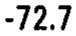 |
| r12_c03 | T7 | CAYsl | CAYsl | T7 | -16.7 | mean -16.7 deg | -16.7 | -16.7 |  |
| r12_c04 | T7 | CAXir | CAXir | T7 | -77.5 | mean -77.5 deg | -77.5 | -77.5 |  |
| r12_c05 | T7 | CAYir | CAYir | T7 | 16.6 | mean 16.6 deg | 16.6 | 16.6 |  |
| r12_c06 | T7 | CAXil | CAXil | T7 | -77.0 | mean -77.0 deg | -77.0 | -77.0 |  |
| r12_c07 | T7 | CAYil | CAYil | T7 | -15.8 | mean -15.8 deg | -15.8 | -15.8 |  |
| r13_c00 | T8 | CAXsr | CAXsr | T8 | -74.5 | mean -74.5 deg | -74.5 | -74.5 |  |
| r13_c01 | T8 | CAYsr | CAYsr | T8 | 18.5 | mean 18.5 deg | 18.5 | 18.5 |  |
| r13_c02 | T8 | CAXsl | CAXsl | T8 | -73.0 | mean -73.0 deg | -73.0 | -73.0 |  |
| r13_c03 | T8 | CAYsl | CAYsl | T8 | -16.3 | mean -16.3 deg | -16.3 | -16.3 |  |
| r13_c04 | T8 | CAXir | CAXir | T8 | -74.3 | mean -74.3 deg | -74.3 | -74.3 |  |
| r13_c05 | T8 | CAYir | CAYir | T8 | 15.6 | mean 15.6 deg | 15.6 | 15.6 |  |
| r13_c06 | T8 | CAXil | CAXil | T8 | -77.1 | mean -77.1 deg | -77.1 | -77.1 |  |
| r13_c07 | T8 | CAYil | CAYil | T8 | -15.7 | mean -15.7 deg | -15.7 | -15.7 |  |
| r14_c00 | T9 | CAXsr | CAXsr | T9 | -77.7 | mean -77.7 deg | -77.7 | -77.7 | 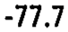 |
| r14_c01 | T9 | CAYsr | CAYsr | T9 | 16.4 | mean 16.4 deg | 16.4 | 16.4 |  |
| r14_c02 | T9 | CAXsl | CAXsl | T9 | -78.2 | mean -78.2 deg | -78.2 | -78.2 |  |
| r14_c03 | T9 | CAYsl | CAYsl | T9 | -17.1 | mean -17.1 deg | -17.1 | -17.1 |  |
| r14_c04 | T9 | CAXir | CAXir | T9 | -77.9 | mean -77.9 deg | -77.9 | -77.9 |  |
| r14_c05 | T9 | CAYir | CAYir | T9 | 14.7 | mean 14.7 deg | 14.7 | 14.7 |  |
| r14_c06 | T9 | CAXil | CAXil | T9 | -77.5 | mean -77.5 deg | -77.5 | -77.5 |  |
| r14_c07 | T9 | CAYil | CAYil | T9 | -15.0 | mean -15.0 deg | -15.0 | -15.0 |  |
| r15_c00 | T10 | CAXsr | CAXsr | T10 | -78.1 | mean -78.1 deg | -78.1 | -78.1 |  |
| r15_c01 | T10 | CAYsr | CAYsr | T10 | 14.1 | mean 14.1 deg | 14.1 | 14.1 |  |
| r15_c02 | T10 | CAXsl | CAXsl | T10 | -78.1 | mean -78.1 deg | -78.1 | -78.1 |  |
| r15_c03 | T10 | CAYsl | CAYsl | T10 | -16.4 | mean -16.4 deg | -16.4 | -16.4 |  |
| r15_c04 | T10 | CAXir | CAXir | T10 | -77.9 | mean -77.9 deg | -77.9 | -77.9 |  |
| r15_c05 | T10 | CAYir | CAYir | T10 | 13.5 | mean 13.5 deg | 13.5 | 13.5 |  |
| r15_c06 | T10 | CAXil | CAXil | T10 | -76.7 | mean -76.7 deg | -76.7 | -76.7 |  |
| r15_c07 | T10 | CAYil | CAYil | T10 | -16.5 | mean -16.5 deg | -16.5 | -16.5 |  |
| r16_c00 | T11 | CAXsr | CAXsr | T11 | -75.6 | mean -75.6 deg | -75.6 | -75.6 |  |
| r16_c01 | T11 | CAYsr | CAYsr | T11 | 13.5 | mean 13.5 deg | 13.5 | 13.5 |  |
| r16_c02 | T11 | CAXsl | CAXsl | T11 | -76.0 | mean -76.0 deg | -76.0 | -76.0 |  |
| r16_c03 | T11 | CAYsl | CAYsl | T11 | -19.0 | mean -19.0 deg | -19.0 | -19.0 |  |
| r16_c04 | T11 | CAXir | CAXir | T11 | -75.5 | mean -75.5 deg | -75.5 | -75.5 |  |
| r16_c05 | T11 | CAYir | CAYir | T11 | 18.4 | mean 18.4 deg | 18.4 | 18.4 |  |
| r16_c06 | T11 | CAXil | CAXil | T11 | -76.1 | mean -76.1 deg | -76.1 | -76.1 |  |
| r16_c07 | T11 | CAYil | CAYil | T11 | -20.1 | mean -20.1 deg | -20.1 | -20.1 |  |
| r17_c00 | T12 | CAXsr | CAXsr | T12 | -77.1 | mean -77.1 deg | -77.1 | -77.1 |  |
| r17_c01 | T12 | CAYsr | CAYsr | T12 | 18.0 | mean 18.0 deg | 18.0 | 18.0 |  |
| r17_c02 | T12 | CAXsl | CAXsl | T12 | -78.2 | mean -78.2 deg | -78.2 | -78.2 |  |
| r17_c03 | T12 | CAYsl | CAYsl | T12 | -23.1 | mean -23.1 deg | -23.1 | -23.1 |  |
| r17_c04 | T12 | CAXir | CAXir | T12 | -75.4 | mean -75.4 deg | -75.4 | -75.4 |  |
| r17_c05 | T12 | CAYir | CAYir | T12 | -52.0 | mean -52.0 deg | -52.0 | -52.0 |  |
| r17_c06 | T12 | CAXil | CAXil | T12 | -78.4 | mean -78.4 deg | -78.4 | -78.4 |  |
| r17_c07 | T12 | CAYil | CAYil | T12 | 50.2 | mean 50.2 deg | 50.2 | 50.2 |  |
| r18_c00 | L1 | CAXsr | CAXsr | L1 | -82.9 | mean -82.9 deg | -82.9 | -82.9 |  |
| r18_c01 | L1 | CAYsr | CAYsr | L1 | -50.5 | mean -50.5 deg | -50.5 | -50.5 |  |
| r18_c02 | L1 | CAXsl | CAXsl | L1 | -81.3 | mean -81.3 deg | -81.3 | -81.3 |  |
| r18_c03 | L1 | CAYsl | CAYsl | L1 | 44.9 | mean 44.9 deg | 44.9 | 44.9 |  |
| r18_c04 | L1 | CAXir | CAXir | L1 | -81.3 | mean -81.3 deg | -81.3 | -81.3 |  |
| r18_c05 | L1 | CAYir | CAYir | L1 | -63.4 | mean -63.4 deg | -63.4 | -63.4 |  |
| r18_c06 | L1 | CAXil | CAXil | L1 | -81.7 | mean -81.7 deg | -81.7 | -81.7 |  |
| r18_c07 | L1 | CAYil | CAYil | L1 | 66.1 | mean 66.1 deg | 66.1 | 66.1 |  |
| r19_c00 | L2 | CAXsr | CAXsr | L2 | -85.7 | mean -85.7 deg | -85.7 | -85.7 |  |
| r19_c01 | L2 | CAYsr | CAYsr | L2 | -45.6 | mean -45.6 deg | -45.6 | -45.6 |  |
| r19_c02 | L2 | CAXsl | CAXsl | L2 | -83.8 | mean -83.8 deg | -83.8 | -83.8 |  |
| r19_c03 | L2 | CAYsl | CAYsl | L2 | 50.1 | mean 50.1 deg | 50.1 | 50.1 |  |
| r19_c04 | L2 | CAXir | CAXir | L2 | -82.8 | mean -82.8 deg | -82.8 | -82.8 |  |
| r19_c05 | L2 | CAYir | CAYir | L2 | -53.1 | mean -53.1 deg | -53.1 | -53.1 |  |
| r19_c06 | L2 | CAXil | CAXil | L2 | -78.7 | mean -78.7 deg | -78.7 | -78.7 |  |
| r19_c07 | L2 | CAYil | CAYil | L2 | 47.9 | mean 47.9 deg | 47.9 | 47.9 |  |
| r20_c00 | L3 | CAXsr | CAXsr | L3 | -81.9 | mean -81.9 deg | -81.9 | -81.9 |  |
| r20_c01 | L3 | CAYsr | CAYsr | L3 | -42.0 | mean -42.0 deg | -42.0 | -42.0 |  |
| r20_c02 | L3 | CAXsl | CAXsl | L3 | -84.1 | mean -84.1 deg | -84.1 | -84.1 |  |
| r20_c03 | L3 | CAYsl | CAYsl | L3 | 43.4 | mean 43.4 deg | 43.4 | 43.4 |  |
| r20_c04 | L3 | CAXir | CAXir | L3 | -75.6 | mean -75.6 deg | -75.6 | -75.6 |  |
| r20_c05 | L3 | CAYir | CAYir | L3 | -42.2 | mean -42.2 deg | -42.2 | -42.2 |  |
| r20_c06 | L3 | CAXil | CAXil | L3 | -77.8 | mean -77.8 deg | -77.8 | -77.8 |  |
| r20_c07 | L3 | CAYil | CAYil | L3 | 34.2 | mean 34.2 deg | 34.2 | 34.2 |  |
| r21_c00 | L4 | CAXsr | CAXsr | L4 | -81.2 | mean -81.2 deg | -81.2 | -81.2 |  |
| r21_c01 | L4 | CAYsr | CAYsr | L4 | -31.2 | mean -31.2 deg | -31.2 | -31.2 | 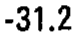 |
| r21_c02 | L4 | CAXsl | CAXsl | L4 | -81.3 | mean -81.3 deg | -81.3 | -81.3 |  |
| r21_c03 | L4 | CAYsl | CAYsl | L4 | 34.0 | mean 34.0 deg | 34.0 | 34.0 |  |
| r21_c04 | L4 | CAXir | CAXir | L4 | -70.5 | mean -70.5 deg | -70.5 | -70.5 |  |
| r21_c05 | L4 | CAYir | CAYir | L4 | -24.2 | mean -24.2 deg | -24.2 | -24.2 | 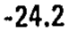 |
| r21_c06 | L4 | CAXil | CAXil | L4 | -80.3 | mean -80.3 deg | -80.3 | -80.3 |  |
| r21_c07 | L4 | CAYil | CAYil | L4 | 25.1 | mean 25.1 deg | 25.1 | 25.1 |  |
| r22_c00 | L5 | CAXsr | CAXsr | L5 | -86.0 | mean -86.0 deg | -86.0 | -86.0 |  |
| r22_c01 | L5 | CAYsr | CAYsr | L5 | -27.7 | mean -27.7 deg | -27.7 | -27.7 | 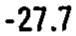 |
| r22_c02 | L5 | CAXsl | CAXsl | L5 | -85.1 | mean -85.1 deg | -85.1 | -85.1 |  |
| r22_c03 | L5 | CAYsl | CAYsl | L5 | 29.9 | mean 29.9 deg | 29.9 | 29.9 |  |
| r22_c04 | L5 | CAXir | CAXir | L5 | -71.0 | mean -71.0 deg | -71.0 | -71.0 |  |
| r22_c05 | L5 | CAYir | CAYir | L5 | -40.2 | mean -40.2 deg | -40.2 | -40.2 |  |
| r22_c06 | L5 | CAXil | CAXil | L5 | -81.6 | mean -81.6 deg | -81.6 | -81.6 |  |
| r22_c07 | L5 | CAYil | CAYil | L5 | 35.5 | mean 35.5 deg | 35.5 | 35.5 | 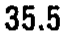 |
