# Table 9. Comparison with Previous Studies: Linear Dimensions, Facet and Interfacet Widths and Heights

Facets, PDF page 11, printed page 1308; Panjabi_1993_Facets_Spine_18-10_1298-1310.pdf (sha256 2b22fe5e6c14d2289a4366f3c94879db1da0f79ae54e05a7f8e54a07e1c0279f), rendered at 300 dpi by render.py.

Every cell below is the box layout.py cut from the rendered page, and the two strings are what the two reading passes read in it (README.md). A dash is printed where the paper prints one. The value column is what provenance.csv carries.

| cell | row | column | measure | level | printed | value | pass 1 | pass 2 | image |
|---|---|---|---|---|---|---|---|---|---|
| r00_c00 | FCHs | Level | FCHs | C2 | C2 | mean C2 | C2 | C2 | 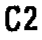 |
| r00_c01 | FCHs | Present Study | FCHs | C2 | 17.8 | mean 17.8 mm | 17.8 | 17.8 |  |
| r00_c02 | FCHs | Francis (1955) | FCHs | C2 | 18.8 | mean 18.8 mm | 18.8 | 18.8 |  |
| r00_c03 | FCHs | Cotterill (1986) | FCHs | C2 | - | (none) | - | - |  |
| r01_c00 | FCHs | Level | FCHs | C3 | C3 | mean C3 | C3 | C3 |  |
| r01_c01 | FCHs | Present Study | FCHs | C3 | 11.5 | mean 11.5 mm | 11.5 | 11.5 |  |
| r01_c02 | FCHs | Francis (1955) | FCHs | C3 | 11.3 | mean 11.3 mm | 11.3 | 11.3 |  |
| r01_c03 | FCHs | Cotterill (1986) | FCHs | C3 | - | (none) | - | - | 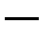 |
| r02_c00 | FCHs | Level | FCHs | C4 | C4 | mean C4 | C4 | C4 |  |
| r02_c01 | FCHs | Present Study | FCHs | C4 | 12.0 | mean 12.0 mm | 12.0 | 12.0 |  |
| r02_c02 | FCHs | Francis (1955) | FCHs | C4 | 11.5 | mean 11.5 mm | 11.5 | 11.5 |  |
| r02_c03 | FCHs | Cotterill (1986) | FCHs | C4 | - | (none) | - | - | 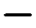 |
| r03_c00 | FCHs | Level | FCHs | C5 | C5 | mean C5 | C5 | C5 |  |
| r03_c01 | FCHs | Present Study | FCHs | C5 | 11.3 | mean 11.3 mm | 11.3 | 11.3 | 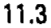 |
| r03_c02 | FCHs | Francis (1955) | FCHs | C5 | 11.1 | mean 11.1 mm | 11.1 | 11.1 |  |
| r03_c03 | FCHs | Cotterill (1986) | FCHs | C5 | - | (none) | - | - | 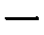 |
| r04_c00 | FCHs | Level | FCHs | C6 | C6 | mean C6 | C6 | C6 |  |
| r04_c01 | FCHs | Present Study | FCHs | C6 | 10.8 | mean 10.8 mm | 10.8 | 10.8 |  |
| r04_c02 | FCHs | Francis (1955) | FCHs | C6 | 10.6 | mean 10.6 mm | 10.6 | 10.6 |  |
| r04_c03 | FCHs | Cotterill (1986) | FCHs | C6 | - | (none) | - | - |  |
| r05_c00 | FCHs | Level | FCHs | C7 | C7 | mean C7 | C7 | C7 |  |
| r05_c01 | FCHs | Present Study | FCHs | C7 | 11.0 | mean 11.0 mm | 11.0 | 11.0 |  |
| r05_c02 | FCHs | Francis (1955) | FCHs | C7 | 10.2 | mean 10.2 mm | 10.2 | 10.2 |  |
| r05_c03 | FCHs | Cotterill (1986) | FCHs | C7 | - | (none) | - | - |  |
| r06_c00 | FCWs | Level | FCWs | C2 | C2 | mean C2 | C2 | C2 | 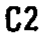 |
| r06_c01 | FCWs | Present Study | FCWs | C2 | 16.4 | mean 16.4 mm | 16.4 | 16.4 |  |
| r06_c02 | FCWs | Francis (1955) | FCWs | C2 | 17.5 | mean 17.5 mm | 17.5 | 17.5 |  |
| r06_c03 | FCWs | Cotterill (1986) | FCWs | C2 | - | (none) | - | - | 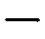 |
| r07_c00 | FCWs | Level | FCWs | C3 | C3 | mean C3 | C3 | C3 | 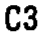 |
| r07_c01 | FCWs | Present Study | FCWs | C3 | 11.0 | mean 11.0 mm | 11.0 | 11.0 |  |
| r07_c02 | FCWs | Francis (1955) | FCWs | C3 | 12.0 | mean 12.0 mm | 12.0 | 12.0 |  |
| r07_c03 | FCWs | Cotterill (1986) | FCWs | C3 | - | (none) | - | - |  |
| r08_c00 | FCWs | Level | FCWs | C4 | C4 | mean C4 | C4 | C4 |  |
| r08_c01 | FCWs | Present Study | FCWs | C4 | 11.3 | mean 11.3 mm | 11.3 | 11.3 |  |
| r08_c02 | FCWs | Francis (1955) | FCWs | C4 | 12.4 | mean 12.4 mm | 12.4 | 12.4 | 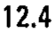 |
| r08_c03 | FCWs | Cotterill (1986) | FCWs | C4 | - | (none) | - | - |  |
| r09_c00 | FCWs | Level | FCWs | C5 | C5 | mean C5 | C5 | C5 |  |
| r09_c01 | FCWs | Present Study | FCWs | C5 | 12.0 | mean 12.0 mm | 12.0 | 12.0 |  |
| r09_c02 | FCWs | Francis (1955) | FCWs | C5 | 12.7 | mean 12.7 mm | 12.7 | 12.7 |  |
| r09_c03 | FCWs | Cotterill (1986) | FCWs | C5 | - | (none) | - | - |  |
| r10_c00 | FCWs | Level | FCWs | C6 | C6 | mean C6 | C6 | C6 |  |
| r10_c01 | FCWs | Present Study | FCWs | C6 | 12.3 | mean 12.3 mm | 12.3 | 12.3 |  |
| r10_c02 | FCWs | Francis (1955) | FCWs | C6 | 13.0 | mean 13.0 mm | 13.0 | 13.0 |  |
| r10_c03 | FCWs | Cotterill (1986) | FCWs | C6 | - | (none) | - | - | 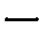 |
| r11_c00 | FCWs | Level | FCWs | C7 | C7 | mean C7 | C7 | C7 |  |
| r11_c01 | FCWs | Present Study | FCWs | C7 | 13.4 | mean 13.4 mm | 13.4 | 13.4 | 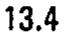 |
| r11_c02 | FCWs | Francis (1955) | FCWs | C7 | 13.6 | mean 13.6 mm | 13.6 | 13.6 |  |
| r11_c03 | FCWs | Cotterill (1986) | FCWs | C7 | - | (none) | - | - |  |
| r12_c00 | IFWs | Level | IFWs | T6 | T6 | mean T6 | T6 | T6 |  |
| r12_c01 | IFWs | Present Study | IFWs | T6 | 20.9 | mean 20.9 mm | 20.9 | 20.9 |  |
| r12_c02 | IFWs | Francis (1955) | IFWs | T6 | - | (none) | - | - |  |
| r12_c03 | IFWs | Cotterill (1986) | IFWs | T6 | 19.0 | mean 19.0 mm | 19.0 | 19.0 |  |
| r13_c00 | IFWs | Level | IFWs | T12 | T12 | mean T12 | T12 | T12 |  |
| r13_c01 | IFWs | Present Study | IFWs | T12 | 25.9 | mean 25.9 mm | 25.9 | 25.9 |  |
| r13_c02 | IFWs | Francis (1955) | IFWs | T12 | - | (none) | - | - |  |
| r13_c03 | IFWs | Cotterill (1986) | IFWs | T12 | 22.5 | mean 22.5 mm | 22.5 | 22.5 |  |
| r14_c00 | IFWs | Level | IFWs | L3 | L3 | mean L3 | L3 | L3 | 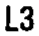 |
| r14_c01 | IFWs | Present Study | IFWs | L3 | 28.6 | mean 28.6 mm | 28.6 | 28.6 |  |
| r14_c02 | IFWs | Francis (1955) | IFWs | L3 | - | (none) | - | - | 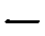 |
| r14_c03 | IFWs | Cotterill (1986) | IFWs | L3 | 26.6 | mean 26.6 mm | 26.6 | 26.6 | 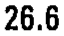 |
| r15_c00 | IFH | Level | IFH | T6 | T6 | mean T6 | T6 | T6 | 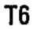 |
| r15_c01 | IFH | Present Study | IFH | T6 | 21.9 | mean 21.9 mm | 21.9 | 21.9 |  |
| r15_c02 | IFH | Francis (1955) | IFH | T6 | - | (none) | - | - | 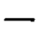 |
| r15_c03 | IFH | Cotterill (1986) | IFH | T6 | 20.4 | mean 20.4 mm | 20.4 | 20.4 |  |
| r16_c00 | IFH | Level | IFH | T12 | T12 | mean T12 | T12 | T12 |  |
| r16_c01 | IFH | Present Study | IFH | T12 | 31.4 | mean 31.4 mm | 31.4 | 31.4 |  |
| r16_c02 | IFH | Francis (1955) | IFH | T12 | - | (none) | - | - |  |
| r16_c03 | IFH | Cotterill (1986) | IFH | T12 | 29.4 | mean 29.4 mm | 29.4 | 29.4 |  |
| r17_c00 | IFH | Level | IFH | L3 | L3 | mean L3 | L3 | L3 | 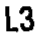 |
| r17_c01 | IFH | Present Study | IFH | L3 | 32.0 | mean 32.0 mm | 32.0 | 32.0 |  |
| r17_c02 | IFH | Francis (1955) | IFH | L3 | - | (none) | - | - | 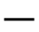 |
| r17_c03 | IFH | Cotterill (1986) | IFH | L3 | 29.9 | mean 29.9 mm | 29.9 | 29.9 |  |
