# Table 2. Vertebral Body Dimensions

Lumbar, PDF page 3, printed page 301; Panjabi_1992_Lumbar_Spine_17-3_299-306.pdf (sha256 842736d7102c0327c690af3605c5248ca4516253ac330157875bfb783d6b5eac), rendered at 300 dpi by render.py.

Every cell below is the box layout.py cut from the rendered page, and the two strings are what the two reading passes read in it (README.md). A dash is printed where the paper prints one. The value column is what provenance.csv carries.

| cell | row | column | measure | level | printed | value | pass 1 | pass 2 | image |
|---|---|---|---|---|---|---|---|---|---|
| r01_c00 | EPDu | L1 | EPDu | L1 | 34.1 +/- 1.34 | mean 34.1 mm; sem 1.34 mm | 34.1 +/- 1.34 | 34.1 +/- 1.34 | 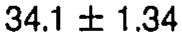 |
| r01_c01 | EPDu | L2 | EPDu | L2 | 34.6 +/- 1.10 | mean 34.6 mm; sem 1.10 mm | 34.6 +/- 1.10 | 34.6 +/- 1.10 | 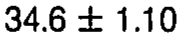 |
| r01_c02 | EPDu | L3 | EPDu | L3 | 35.2 +/- 1.10 | mean 35.2 mm; sem 1.10 mm | 35.2 +/- 1.10 | 35.2 +/- 1.10 |  |
| r01_c03 | EPDu | L4 | EPDu | L4 | 35.5 +/- 0.88 | mean 35.5 mm; sem 0.88 mm | 35.5 +/- 0.88 | 35.5 +/- 0.88 | 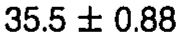 |
| r01_c04 | EPDu | L5 | EPDu | L5 | 34.7 +/- 1.17 | mean 34.7 mm; sem 1.17 mm | 34.7 +/- 1.17 | 34.7 +/- 1.17 | 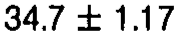 |
| r02_c00 | EPWu | L1 | EPWu | L1 | 41.2 +/- 1.03 | mean 41.2 mm; sem 1.03 mm | 41.2 +/- 1.03 | 41.2 +/- 1.03 | 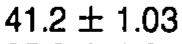 |
| r02_c01 | EPWu | L2 | EPWu | L2 | 42.6 +/- 0.74 | mean 42.6 mm; sem 0.74 mm | 42.6 +/- 0.74 | 42.6 +/- 0.74 | 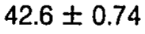 |
| r02_c02 | EPWu | L3 | EPWu | L3 | 44.1 +/- 0.88 | mean 44.1 mm; sem 0.88 mm | 44.1 +/- 0.88 | 44.1 +/- 0.88 | 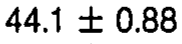 |
| r02_c03 | EPWu | L4 | EPWu | L4 | 46.6^ (L1) +/- 1.20 | mean 46.6 mm; sem 1.20 mm | 46.6^ (L1) +/- 1.20 | 46.6^ (L1) +/- 1.20 | 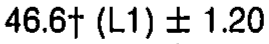 |
| r02_c04 | EPWu | L5 | EPWu | L5 | 47.3^ (L1) +/- 1.20 | mean 47.3 mm; sem 1.20 mm | 47.3^ (L1) +/- 1.20 | 47.3^ (L1) +/- 1.20 | 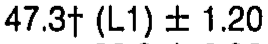 |
| r03_c00 | EPDl | L1 | EPDl | L1 | 35.3 +/- 1.27 | mean 35.3 mm; sem 1.27 mm | 35.3 +/- 1.27 | 35.3 +/- 1.27 | 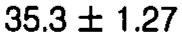 |
| r03_c01 | EPDl | L2 | EPDl | L2 | 34.9 +/- 0.74 | mean 34.9 mm; sem 0.74 mm | 34.9 +/- 0.74 | 34.9 +/- 0.74 | 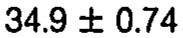 |
| r03_c02 | EPDl | L3 | EPDl | L3 | 34.8 +/- 1.24 | mean 34.8 mm; sem 1.24 mm | 34.8 +/- 1.24 | 34.8 +/- 1.24 | 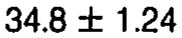 |
| r03_c03 | EPDl | L4 | EPDl | L4 | 33.9 +/- 0.85 | mean 33.9 mm; sem 0.85 mm | 33.9 +/- 0.85 | 33.9 +/- 0.85 | 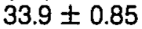 |
| r03_c04 | EPDl | L5 | EPDl | L5 | 33.2 +/- 0.92 | mean 33.2 mm; sem 0.92 mm | 33.2 +/- 0.92 | 33.2 +/- 0.92 | 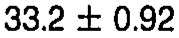 |
| r04_c00 | EPWl | L1 | EPWl | L1 | 43.3 +/- 0.78 | mean 43.3 mm; sem 0.78 mm | 43.3 +/- 0.78 | 43.3 +/- 0.78 | 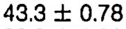 |
| r04_c01 | EPWl | L2 | EPWl | L2 | 45.5 +/- 1.10 | mean 45.5 mm; sem 1.10 mm | 45.5 +/- 1.10 | 45.5 +/- 1.10 | 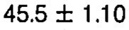 |
| r04_c02 | EPWl | L3 | EPWl | L3 | 48.0 +/- 1.24 | mean 48.0 mm; sem 1.24 mm | 48.0 +/- 1.24 | 48.0 +/- 1.24 | 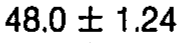 |
| r04_c03 | EPWl | L4 | EPWl | L4 | 49.5^ (L1) +/- 1.38 | mean 49.5 mm; sem 1.38 mm | 49.5^ (L1) +/- 1.38 | 49.5^ (L1) +/- 1.38 | 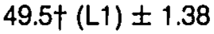 |
| r04_c04 | EPWl | L5 | EPWl | L5 | 49.4^ (L1) +/- 1.41 | mean 49.4 mm; sem 1.41 mm | 49.4^ (L1) +/- 1.41 | 49.4^ (L1) +/- 1.41 | 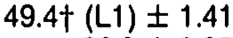 |
| r05_c00 | VBHp | L1 | VBHp | L1 | 23.8 +/- 1.03 | mean 23.8 mm; sem 1.03 mm | 23.8 +/- 1.03 | 23.8 +/- 1.03 | 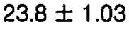 |
| r05_c01 | VBHp | L2 | VBHp | L2 | 24.3 +/- 0.95 | mean 24.3 mm; sem 0.95 mm | 24.3 +/- 0.95 | 24.3 +/- 0.95 | 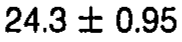 |
| r05_c02 | VBHp | L3 | VBHp | L3 | 23.8 +/- 1.10 | mean 23.8 mm; sem 1.10 mm | 23.8 +/- 1.10 | 23.8 +/- 1.10 | 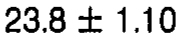 |
| r05_c03 | VBHp | L4 | VBHp | L4 | 24.1 +/- 1.10 | mean 24.1 mm; sem 1.10 mm | 24.1 +/- 1.10 | 24.1 +/- 1.10 | 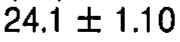 |
| r05_c04 | VBHp | L5 | VBHp | L5 | 22.9 +/- 0.95 | mean 22.9 mm; sem 0.95 mm | 22.9 +/- 0.95 | 22.9 +/- 0.95 | 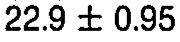 |
| r06_c00 | EPWu/EPDu | L1 | EPWu/EPDu | L1 | 1.21 | ratio 1.21 | 1.21 | 1.21 | 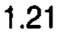 |
| r06_c01 | EPWu/EPDu | L2 | EPWu/EPDu | L2 | 1.23 | ratio 1.23 | 1.23 | 1.23 | 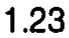 |
| r06_c02 | EPWu/EPDu | L3 | EPWu/EPDu | L3 | 1.25 | ratio 1.25 | 1.25 | 1.25 | 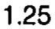 |
| r06_c03 | EPWu/EPDu | L4 | EPWu/EPDu | L4 | 1.31 | ratio 1.31 | 1.31 | 1.31 | 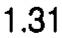 |
| r06_c04 | EPWu/EPDu | L5 | EPWu/EPDu | L5 | 1.36 | ratio 1.36 | 1.36 | 1.36 | 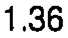 |
| r07_c00 | EPWl/EPDl | L1 | EPWl/EPDl | L1 | 1.23 | ratio 1.23 | 1.23 | 1.23 | 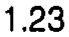 |
| r07_c01 | EPWl/EPDl | L2 | EPWl/EPDl | L2 | 1.30 | ratio 1.30 | 1.30 | 1.30 | 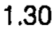 |
| r07_c02 | EPWl/EPDl | L3 | EPWl/EPDl | L3 | 1.38 | ratio 1.38 | 1.38 | 1.38 | 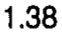 |
| r07_c03 | EPWl/EPDl | L4 | EPWl/EPDl | L4 | 1.46 | ratio 1.46 | 1.46 | 1.46 | 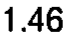 |
| r07_c04 | EPWl/EPDl | L5 | EPWl/EPDl | L5 | 1.49 | ratio 1.49 | 1.49 | 1.49 | 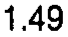 |
| r09_c00 | EPAu | L1 | EPAu | L1 | 1057 +/- 60.78 | mean 1057 mm2; sem 60.78 mm2 | 1057 +/- 60.78 | 1057 +/- 60.78 | 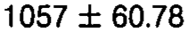 |
| r09_c01 | EPAu | L2 | EPAu | L2 | 1136 +/- 61.84 | mean 1136 mm2; sem 61.84 mm2 | 1136 +/- 61.84 | 1136 +/- 61.84 | 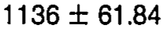 |
| r09_c02 | EPAu | L3 | EPAu | L3 | 1194 +/- 55.19 | mean 1194 mm2; sem 55.19 mm2 | 1194 +/- 55.19 | 1194 +/- 55.19 |  |
| r09_c03 | EPAu | L4 | EPAu | L4 | 1239 +/- 58.41 | mean 1239 mm2; sem 58.41 mm2 | 1239 +/- 58.41 | 1239 +/- 58.41 | 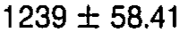 |
| r09_c04 | EPAu | L5 | EPAu | L5 | 1237 +/- 58.48 | mean 1237 mm2; sem 58.48 mm2 | 1237 +/- 58.48 | 1237 +/- 58.48 | 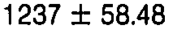 |
| r10_c00 | EPAl | L1 | EPAl | L1 | 1117 +/- 49.00 | mean 1117 mm2; sem 49.00 mm2 | 1117 +/- 49.00 | 1117 +/- 49.00 |  |
| r10_c01 | EPAl | L2 | EPAl | L2 | 1197 +/- 51.41 | mean 1197 mm2; sem 51.41 mm2 | 1197 +/- 51.41 | 1197 +/- 51.41 | 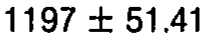 |
| r10_c02 | EPAl | L3 | EPAl | L3 | 1290 +/- 64.35 | mean 1290 mm2; sem 64.35 mm2 | 1290 +/- 64.35 | 1290 +/- 64.35 |  |
| r10_c03 | EPAl | L4 | EPAl | L4 | 1273 +/- 51.72 | mean 1273 mm2; sem 51.72 mm2 | 1273 +/- 51.72 | 1273 +/- 51.72 | 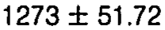 |
| r10_c04 | EPAl | L5 | EPAl | L5 | 1218 +/- 59.43 | mean 1218 mm2; sem 59.43 mm2 | 1218 +/- 59.43 | 1218 +/- 59.43 | 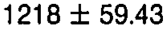 |
| r12_c00 | EPItu | L1 | EPItu | L1 | 2.7 +/- 0.77 | mean 2.7 deg; sem 0.77 deg | 2.7 +/- 0.77 | 2.7 +/- 0.77 | 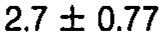 |
| r12_c01 | EPItu | L2 | EPItu | L2 | 3.5 +/- 1.5 | mean 3.5 deg; sem 1.5 deg | 3.5 +/- 1.5 | 3.5 +/- 1.5 | 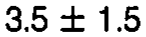 |
| r12_c02 | EPItu | L3 | EPItu | L3 | 1.7 +/- 0.43 | mean 1.7 deg; sem 0.43 deg | 1.7 +/- 0.43 | 1.7 +/- 0.43 | 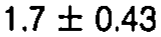 |
| r12_c03 | EPItu | L4 | EPItu | L4 | 4.7 +/- 1.1 | mean 4.7 deg; sem 1.1 deg | 4.7 +/- 1.1 | 4.7 +/- 1.1 |  |
| r12_c04 | EPItu | L5 | EPItu | L5 | 2.2 +/- 0.54 | mean 2.2 deg; sem 0.54 deg | 2.2 +/- 0.54 | 2.2 +/- 0.54 | 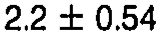 |
| r13_c00 | EPItl | L1 | EPItl | L1 | 4.0 +/- 0.84 | mean 4.0 deg; sem 0.84 deg | 4.0 +/- 0.84 | 4.0 +/- 0.84 | 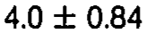 |
| r13_c01 | EPItl | L2 | EPItl | L2 | 2.1 +/- 0.4 | mean 2.1 deg; sem 0.4 deg | 2.1 +/- 0.4 | 2.1 +/- 0.4 | 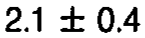 |
| r13_c02 | EPItl | L3 | EPItl | L3 | 2.7 +/- 1.1 | mean 2.7 deg; sem 1.1 deg | 2.7 +/- 1.1 | 2.7 +/- 1.1 | 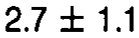 |
| r13_c03 | EPItl | L4 | EPItl | L4 | 2.7 +/- 0.69 | mean 2.7 deg; sem 0.69 deg | 2.7 +/- 0.69 | 2.7 +/- 0.69 | 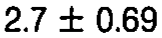 |
| r13_c04 | EPItl | L5 | EPItl | L5 | 1.8 +/- 0.42 | mean 1.8 deg; sem 0.42 deg | 1.8 +/- 0.42 | 1.8 +/- 0.42 | 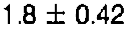 |
