# Table 3. Spinal Canal Dimensions

Lumbar, PDF page 4, printed page 302; Panjabi_1992_Lumbar_Spine_17-3_299-306.pdf (sha256 842736d7102c0327c690af3605c5248ca4516253ac330157875bfb783d6b5eac), rendered at 300 dpi by render.py.

Every cell below is the box layout.py cut from the rendered page, and the two strings are what the two reading passes read in it (README.md). A dash is printed where the paper prints one. The value column is what provenance.csv carries.

| cell | row | column | measure | level | printed | value | pass 1 | pass 2 | image |
|---|---|---|---|---|---|---|---|---|---|
| r01_c00 | SCW | L1 | SCW | L1 | 23.7 +/- 0.92* | mean 23.7 mm; sem 0.92 mm | 23.7 +/- 0.92* | 23.7 +/- 0.92* | 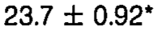 |
| r01_c01 | SCW | L2 | SCW | L2 | 23.8 +/- 0.71 | mean 23.8 mm; sem 0.71 mm | 23.8 +/- 0.71 | 23.8 +/- 0.71 | 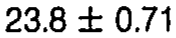 |
| r01_c02 | SCW | L3 | SCW | L3 | 24.3 +/- 0.64 | mean 24.3 mm; sem 0.64 mm | 24.3 +/- 0.64 | 24.3 +/- 0.64 | 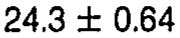 |
| r01_c03 | SCW | L4 | SCW | L4 | 25.4 +/- 0.49 | mean 25.4 mm; sem 0.49 mm | 25.4 +/- 0.49 | 25.4 +/- 0.49 | 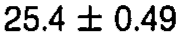 |
| r01_c04 | SCW | L5 | SCW | L5 | 27.1 +/- 0.88 | mean 27.1 mm; sem 0.88 mm | 27.1 +/- 0.88 | 27.1 +/- 0.88 | 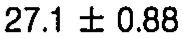 |
| r02_c00 | SCD | L1 | SCD | L1 | 19.0 +/- 0.67 | mean 19.0 mm; sem 0.67 mm | 19.0 +/- 0.67 | 19.0 +/- 0.67 | 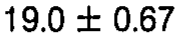 |
| r02_c01 | SCD | L2 | SCD | L2 | 18.2 +/- 0.53 | mean 18.2 mm; sem 0.53 mm | 18.2 +/- 0.53 | 18.2 +/- 0.53 | 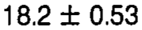 |
| r02_c02 | SCD | L3 | SCD | L3 | 17.5 +/- 0.53 | mean 17.5 mm; sem 0.53 mm | 17.5 +/- 0.53 | 17.5 +/- 0.53 | 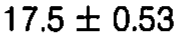 |
| r02_c03 | SCD | L4 | SCD | L4 | 18.6 +/- 0.71 | mean 18.6 mm; sem 0.71 mm | 18.6 +/- 0.71 | 18.6 +/- 0.71 | 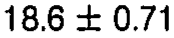 |
| r02_c04 | SCD | L5 | SCD | L5 | 19.7 +/- 0.49 | mean 19.7 mm; sem 0.49 mm | 19.7 +/- 0.49 | 19.7 +/- 0.49 | 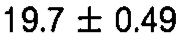 |
| r03_c00 | SCW/SCD | L1 | SCW/SCD | L1 | 1.25 | ratio 1.25 | 1.25 | 1.25 | 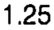 |
| r03_c01 | SCW/SCD | L2 | SCW/SCD | L2 | 1.31 | ratio 1.31 | 1.31 | 1.31 | 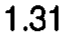 |
| r03_c02 | SCW/SCD | L3 | SCW/SCD | L3 | 1.39 | ratio 1.39 | 1.39 | 1.39 | 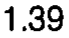 |
| r03_c03 | SCW/SCD | L4 | SCW/SCD | L4 | 1.37 | ratio 1.37 | 1.37 | 1.37 | 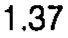 |
| r03_c04 | SCW/SCD | L5 | SCW/SCD | L5 | 1.38 | ratio 1.38 | 1.38 | 1.38 | 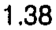 |
| r05_c00 | SCA | L1 | SCA | L1 | 320 +/- 18.10 | mean 320 mm2; sem 18.10 mm2 | 320 +/- 18.10 | 320 +/- 18.10 | 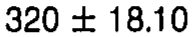 |
| r05_c01 | SCA | L2 | SCA | L2 | 281 +/- 15.38 | mean 281 mm2; sem 15.38 mm2 | 281 +/- 15.38 | 281 +/- 15.38 | 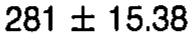 |
| r05_c02 | SCA | L3 | SCA | L3 | 280 +/- 14.64 | mean 280 mm2; sem 14.64 mm2 | 280 +/- 14.64 | 280 +/- 14.64 | 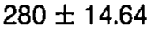 |
| r05_c03 | SCA | L4 | SCA | L4 | 290 +/- 15.17 | mean 290 mm2; sem 15.17 mm2 | 290 +/- 15.17 | 290 +/- 15.17 | 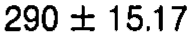 |
| r05_c04 | SCA | L5 | SCA | L5 | 330 +/- 21.21 | mean 330 mm2; sem 21.21 mm2 | 330 +/- 21.21 | 330 +/- 21.21 | 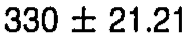 |
