# Table 4. Pedicle Dimensions

Lumbar, PDF page 4, printed page 302; Panjabi_1992_Lumbar_Spine_17-3_299-306.pdf (sha256 842736d7102c0327c690af3605c5248ca4516253ac330157875bfb783d6b5eac), rendered at 300 dpi by render.py.

Every cell below is the box layout.py cut from the rendered page, and the two strings are what the two reading passes read in it (README.md). A dash is printed where the paper prints one. The value column is what provenance.csv carries.

| cell | row | column | measure | level | printed | value | pass 1 | pass 2 | image |
|---|---|---|---|---|---|---|---|---|---|
| r01_c00 | PDWr | L1 | PDWr | L1 | 8.0 +/- 0.95* | mean 8.0 mm; sem 0.95 mm | 8.0 +/- 0.95* | 8.0 +/- 0.95* | 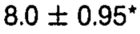 |
| r01_c01 | PDWr | L2 | PDWr | L2 | 7.8 +/- 0.57 | mean 7.8 mm; sem 0.57 mm | 7.8 +/- 0.57 | 7.8 +/- 0.57 | 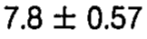 |
| r01_c02 | PDWr | L3 | PDWr | L3 | 10.2 +/- 0.67 | mean 10.2 mm; sem 0.67 mm | 10.2 +/- 0.67 | 10.2 +/- 0.67 | 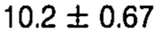 |
| r01_c03 | PDWr | L4 | PDWr | L4 | 13.4^ (L1-L2) +/- 0.18 | mean 13.4 mm; sem 0.18 mm | 13.4^ (L1-L2) +/- 0.18 | 13.4^ (L1-L2) +/- 0.18 | 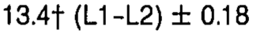 |
| r01_c04 | PDWr | L5 | PDWr | L5 | 18.0^ (L1-L4) +/- 1.03 | mean 18.0 mm; sem 1.03 mm | 18.0^ (L1-L4) +/- 1.03 | 18.0^ (L1-L4) +/- 1.03 | 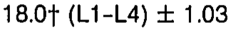 |
| r02_c00 | PDHr | L1 | PDHr | L1 | 15.9 +/- 0.81 | mean 15.9 mm; sem 0.81 mm | 15.9 +/- 0.81 | 15.9 +/- 0.81 | 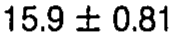 |
| r02_c01 | PDHr | L2 | PDHr | L2 | 15.0 +/- 0.53 | mean 15.0 mm; sem 0.53 mm | 15.0 +/- 0.53 | 15.0 +/- 0.53 | 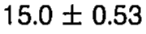 |
| r02_c02 | PDHr | L3 | PDHr | L3 | 14.2 +/- 0.64 | mean 14.2 mm; sem 0.64 mm | 14.2 +/- 0.64 | 14.2 +/- 0.64 | 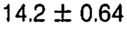 |
| r02_c03 | PDHr | L4 | PDHr | L4 | 15.7 +/- 0.57 | mean 15.7 mm; sem 0.57 mm | 15.7 +/- 0.57 | 15.7 +/- 0.57 | 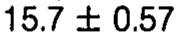 |
| r02_c04 | PDHr | L5 | PDHr | L5 | 19.6^ (L1-L4) +/- 0.74 | mean 19.6 mm; sem 0.74 mm | 19.6^ (L1-L4) +/- 0.74 | 19.6^ (L1-L4) +/- 0.74 | 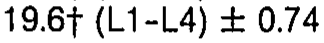 |
| r03_c00 | PDWl | L1 | PDWl | L1 | 9.2 +/- 0.88 | mean 9.2 mm; sem 0.88 mm | 9.2 +/- 0.88 | 9.2 +/- 0.88 | 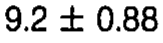 |
| r03_c01 | PDWl | L2 | PDWl | L2 | 8.7 +/- 0.78 | mean 8.7 mm; sem 0.78 mm | 8.7 +/- 0.78 | 8.7 +/- 0.78 | 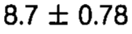 |
| r03_c02 | PDWl | L3 | PDWl | L3 | 10.1 +/- 0.53 | mean 10.1 mm; sem 0.53 mm | 10.1 +/- 0.53 | 10.1 +/- 0.53 | 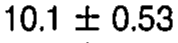 |
| r03_c03 | PDWl | L4 | PDWl | L4 | 14.7^ (L1-L3) +/- 0.46 | mean 14.7 mm; sem 0.46 mm | 14.7^ (L1-L3) +/- 0.46 | 14.7^ (L1-L3) +/- 0.46 | 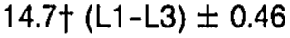 |
| r03_c04 | PDWl | L5 | PDWl | L5 | 19.2^ (L1-L4) +/- 1.03 | mean 19.2 mm; sem 1.03 mm | 19.2^ (L1-L4) +/- 1.03 | 19.2^ (L1-L4) +/- 1.03 | 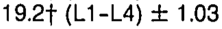 |
| r04_c00 | PDHl | L1 | PDHl | L1 | 15.8 +/- 0.74 | mean 15.8 mm; sem 0.74 mm | 15.8 +/- 0.74 | 15.8 +/- 0.74 | 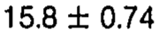 |
| r04_c01 | PDHl | L2 | PDHl | L2 | 14.9 +/- 0.53 | mean 14.9 mm; sem 0.53 mm | 14.9 +/- 0.53 | 14.9 +/- 0.53 | 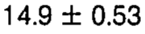 |
| r04_c02 | PDHl | L3 | PDHl | L3 | 14.6 +/- 0.60 | mean 14.6 mm; sem 0.60 mm | 14.6 +/- 0.60 | 14.6 +/- 0.60 | 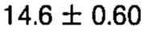 |
| r04_c03 | PDHl | L4 | PDHl | L4 | 15.2 +/- 0.46 | mean 15.2 mm; sem 0.46 mm | 15.2 +/- 0.46 | 15.2 +/- 0.46 | 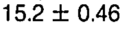 |
| r04_c04 | PDHl | L5 | PDHl | L5 | 19.5^ (L1-L4) +/- 0.99 | mean 19.5 mm; sem 0.99 mm | 19.5^ (L1-L4) +/- 0.99 | 19.5^ (L1-L4) +/- 0.99 | 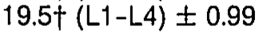 |
| r05_c00 | PDHr/PDWr | L1 | PDHr/PDWr | L1 | 2.00 | ratio 2.00 | 2.00 | 2.00 | 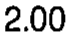 |
| r05_c01 | PDHr/PDWr | L2 | PDHr/PDWr | L2 | 1.91 | ratio 1.91 | 1.91 | 1.91 | 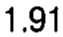 |
| r05_c02 | PDHr/PDWr | L3 | PDHr/PDWr | L3 | 1.39 | ratio 1.39 | 1.39 | 1.39 | 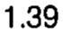 |
| r05_c03 | PDHr/PDWr | L4 | PDHr/PDWr | L4 | 1.17 | ratio 1.17 | 1.17 | 1.17 | 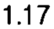 |
| r05_c04 | PDHr/PDWr | L5 | PDHr/PDWr | L5 | 1.09 | ratio 1.09 | 1.09 | 1.09 | 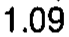 |
| r06_c00 | PDHl/PDWl | L1 | PDHl/PDWl | L1 | 1.72 | ratio 1.72 | 1.72 | 1.72 | 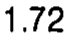 |
| r06_c01 | PDHl/PDWl | L2 | PDHl/PDWl | L2 | 1.71 | ratio 1.71 | 1.71 | 1.71 | 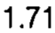 |
| r06_c02 | PDHl/PDWl | L3 | PDHl/PDWl | L3 | 1.44 | ratio 1.44 | 1.44 | 1.44 | 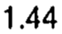 |
| r06_c03 | PDHl/PDWl | L4 | PDHl/PDWl | L4 | 1.03 | ratio 1.03 | 1.03 | 1.03 | 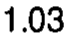 |
| r06_c04 | PDHl/PDWl | L5 | PDHl/PDWl | L5 | 1.02 | ratio 1.02 | 1.02 | 1.02 | 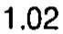 |
| r08_c00 | PDAr | L1 | PDAr | L1 | 86.4 +/- 11.42 | mean 86.4 mm2; sem 11.42 mm2 | 86.4 +/- 11.42 | 86.4 +/- 11.42 | 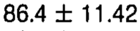 |
| r08_c01 | PDAr | L2 | PDAr | L2 | 83.3 +/- 8.94 | mean 83.3 mm2; sem 8.94 mm2 | 83.3 +/- 8.94 | 83.3 +/- 8.94 | 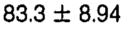 |
| r08_c02 | PDAr | L3 | PDAr | L3 | 92.9 +/- 7.71 | mean 92.9 mm2; sem 7.71 mm2 | 92.9 +/- 7.71 | 92.9 +/- 7.71 | 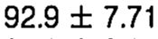 |
| r08_c03 | PDAr | L4 | PDAr | L4 | 102.8 +/- 6.65 | mean 102.8 mm2; sem 6.65 mm2 | 102.8 +/- 6.65 | 102.8 +/- 6.65 | 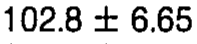 |
| r08_c04 | PDAr | L5 | PDAr | L5 | 143.9^ (L1-L3) +/- 9.55 | mean 143.9 mm2; sem 9.55 mm2 | 143.9^ (L1-L3) +/- 9.55 | 143.9^ (L1-L3) +/- 9.55 | 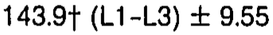 |
| r09_c00 | PDAl | L1 | PDAl | L1 | 88.5 +/- 11.74 | mean 88.5 mm2; sem 11.74 mm2 | 88.5 +/- 11.74 | 88.5 +/- 11.74 | 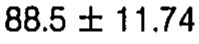 |
| r09_c01 | PDAl | L2 | PDAl | L2 | 83.6 +/- 8.87 | mean 83.6 mm2; sem 8.87 mm2 | 83.6 +/- 8.87 | 83.6 +/- 8.87 | 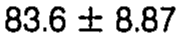 |
| r09_c02 | PDAl | L3 | PDAl | L3 | 95.3 +/- 9.37 | mean 95.3 mm2; sem 9.37 mm2 | 95.3 +/- 9.37 | 95.3 +/- 9.37 | 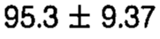 |
| r09_c03 | PDAl | L4 | PDAl | L4 | 112.3 +/- 7.53 | mean 112.3 mm2; sem 7.53 mm2 | 112.3 +/- 7.53 | 112.3 +/- 7.53 | 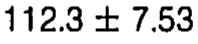 |
| r09_c04 | PDAl | L5 | PDAl | L5 | 158.7^ (L1-L4) +/- 10.82 | mean 158.7 mm2; sem 10.82 mm2 | 158.7^ (L1-L4) +/- 10.82 | 158.7^ (L1-L4) +/- 10.82 | 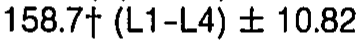 |
| r11_c00 | PDIsr | L1 | PDIsr | L1 | 16.5 +/- 5.02 | mean 16.5 deg; sem 5.02 deg | 16.5 +/- 5.02 | 16.5 +/- 5.02 | 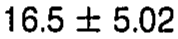 |
| r11_c01 | PDIsr | L2 | PDIsr | L2 | 17.1 +/- 3.75 | mean 17.1 deg; sem 3.75 deg | 17.1 +/- 3.75 | 17.1 +/- 3.75 | 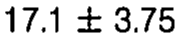 |
| r11_c02 | PDIsr | L3 | PDIsr | L3 | 19.8 +/- 2.33 | mean 19.8 deg; sem 2.33 deg | 19.8 +/- 2.33 | 19.8 +/- 2.33 | 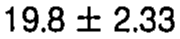 |
| r11_c03 | PDIsr | L4 | PDIsr | L4 | 18.4 +/- 1.66 | mean 18.4 deg; sem 1.66 deg | 18.4 +/- 1.66 | 18.4 +/- 1.66 | 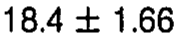 |
| r11_c04 | PDIsr | L5 | PDIsr | L5 | 25.9 +/- 1.73 | mean 25.9 deg; sem 1.73 deg | 25.9 +/- 1.73 | 25.9 +/- 1.73 | 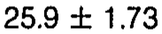 |
| r12_c00 | PDItr | L1 | PDItr | L1 | 2.2 +/- 0.67 | mean 2.2 deg; sem 0.67 deg | 2.2 +/- 0.67 | 2.2 +/- 0.67 | 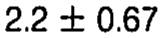 |
| r12_c01 | PDItr | L2 | PDItr | L2 | 3.3 +/- 0.67 | mean 3.3 deg; sem 0.67 deg | 3.3 +/- 0.67 | 3.3 +/- 0.67 | 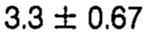 |
| r12_c02 | PDItr | L3 | PDItr | L3 | 2.9 +/- 1.06 | mean 2.9 deg; sem 1.06 deg | 2.9 +/- 1.06 | 2.9 +/- 1.06 | 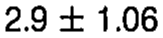 |
| r12_c03 | PDItr | L4 | PDItr | L4 | 4.8 +/- 1.06 | mean 4.8 deg; sem 1.06 deg | 4.8 +/- 1.06 | 4.8 +/- 1.06 | 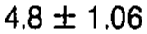 |
| r12_c04 | PDItr | L5 | PDItr | L5 | 5.2 +/- 1.80 | mean 5.2 deg; sem 1.80 deg | 5.2 +/- 1.80 | 5.2 +/- 1.80 | 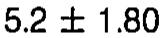 |
| r13_c00 | PDIsl | L1 | PDIsl | L1 | 12.4 +/- 1.87 | mean 12.4 deg; sem 1.87 deg | 12.4 +/- 1.87 | 12.4 +/- 1.87 |  |
| r13_c01 | PDIsl | L2 | PDIsl | L2 | 11.2 +/- 2.02 | mean 11.2 deg; sem 2.02 deg | 11.2 +/- 2.02 | 11.2 +/- 2.02 |  |
| r13_c02 | PDIsl | L3 | PDIsl | L3 | 17.1 +/- 1.56 | mean 17.1 deg; sem 1.56 deg | 17.1 +/- 1.56 | 17.1 +/- 1.56 |  |
| r13_c03 | PDIsl | L4 | PDIsl | L4 | 14.7 +/- 2.16 | mean 14.7 deg; sem 2.16 deg | 14.7 +/- 2.16 | 14.7 +/- 2.16 |  |
| r13_c04 | PDIsl | L5 | PDIsl | L5 | 23.2^ (L1-L2) +/- 2.51 | mean 23.2 deg; sem 2.51 deg | 23.2^ (L1-L2) +/- 2.51 | 23.2^ (L1-L2) +/- 2.51 |  |
| r14_c00 | PDItl | L1 | PDItl | L1 | 2.9 +/- 0.74 | mean 2.9 deg; sem 0.74 deg | 2.9 +/- 0.74 | 2.9 +/- 0.74 |  |
| r14_c01 | PDItl | L2 | PDItl | L2 | 2.1 +/- 0.64 | mean 2.1 deg; sem 0.64 deg | 2.1 +/- 0.64 | 2.1 +/- 0.64 |  |
| r14_c02 | PDItl | L3 | PDItl | L3 | 2.4 +/- 0.67 | mean 2.4 deg; sem 0.67 deg | 2.4 +/- 0.67 | 2.4 +/- 0.67 |  |
| r14_c03 | PDItl | L4 | PDItl | L4 | 3.0 +/- 1.17 | mean 3.0 deg; sem 1.17 deg | 3.0 +/- 1.17 | 3.0 +/- 1.17 |  |
| r14_c04 | PDItl | L5 | PDItl | L5 | 5.7 +/- 1.48 | mean 5.7 deg; sem 1.48 deg | 5.7 +/- 1.48 | 5.7 +/- 1.48 |  |
