# Table 5. Pars Interarticularis, Spinous Process, and Transverse Process

Lumbar, PDF page 6, printed page 304; Panjabi_1992_Lumbar_Spine_17-3_299-306.pdf (sha256 842736d7102c0327c690af3605c5248ca4516253ac330157875bfb783d6b5eac), rendered at 300 dpi by render.py.

Every cell below is the box layout.py cut from the rendered page, and the two strings are what the two reading passes read in it (README.md). A dash is printed where the paper prints one. The value column is what provenance.csv carries.

| cell | row | column | measure | level | printed | value | pass 1 | pass 2 | image |
|---|---|---|---|---|---|---|---|---|---|
| r01_c00 | PIAr | L1 | PIAr | L1 | 61.0 +/- 2.19* | mean 61.0 mm2; sem 2.19 mm2 | 61.0 +/- 2.19* | 61.0 +/- 2.19* | 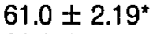 |
| r01_c01 | PIAr | L2 | PIAr | L2 | 75.2 +/- 6.58 | mean 75.2 mm2; sem 6.58 mm2 | 75.2 +/- 6.58 | 75.2 +/- 6.58 | 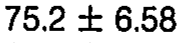 |
| r01_c02 | PIAr | L3 | PIAr | L3 | 70.0 +/- 6.86 | mean 70.0 mm2; sem 6.86 mm2 | 70.0 +/- 6.86 | 70.0 +/- 6.86 | 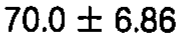 |
| r01_c03 | PIAr | L4 | PIAr | L4 | 86.2 +/- 7.39 | mean 86.2 mm2; sem 7.39 mm2 | 86.2 +/- 7.39 | 86.2 +/- 7.39 | 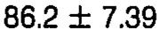 |
| r01_c04 | PIAr | L5 | PIAr | L5 | 92.9^ (L1) +/- 9.76 | mean 92.9 mm2; sem 9.76 mm2 | 92.9^ (L1) +/- 9.76 | 92.9^ (L1) +/- 9.76 | 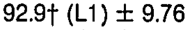 |
| r02_c00 | PIAl | L1 | PIAl | L1 | 63.2 +/- 1.17 | mean 63.2 mm2; sem 1.17 mm2 | 63.2 +/- 1.17 | 63.2 +/- 1.17 | 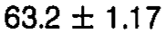 |
| r02_c01 | PIAl | L2 | PIAl | L2 | 64.4 +/- 5.90 | mean 64.4 mm2; sem 5.90 mm2 | 64.4 +/- 5.90 | 64.4 +/- 5.90 | 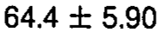 |
| r02_c02 | PIAl | L3 | PIAl | L3 | 75.1 +/- 8.91 | mean 75.1 mm2; sem 8.91 mm2 | 75.1 +/- 8.91 | 75.1 +/- 8.91 | 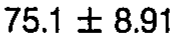 |
| r02_c03 | PIAl | L4 | PIAl | L4 | 77.5 +/- 8.91 | mean 77.5 mm2; sem 8.91 mm2 | 77.5 +/- 8.91 | 77.5 +/- 8.91 | 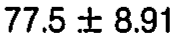 |
| r02_c04 | PIAl | L5 | PIAl | L5 | 71.7 +/- 9.69 | mean 71.7 mm2; sem 9.69 mm2 | 71.7 +/- 9.69 | 71.7 +/- 9.69 | 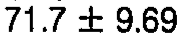 |
| r04_c00 | SPL | L1 | SPL | L1 | 67.7 +/- 1.24 | mean 67.7 mm; sem 1.24 mm | 67.7 +/- 1.24 | 67.7 +/- 1.24 | 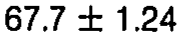 |
| r04_c01 | SPL | L2 | SPL | L2 | 71.7 +/- 1.70 | mean 71.7 mm; sem 1.70 mm | 71.7 +/- 1.70 | 71.7 +/- 1.70 | 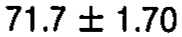 |
| r04_c02 | SPL | L3 | SPL | L3 | 71.7 +/- 1.77 | mean 71.7 mm; sem 1.77 mm | 71.7 +/- 1.77 | 71.7 +/- 1.77 | 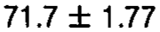 |
| r04_c03 | SPL | L4 | SPL | L4 | 70.1 +/- 1.17 | mean 70.1 mm; sem 1.17 mm | 70.1 +/- 1.17 | 70.1 +/- 1.17 | 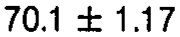 |
| r04_c04 | SPL | L5 | SPL | L5 | 68.3 +/- 1.63 | mean 68.3 mm; sem 1.63 mm | 68.3 +/- 1.63 | 68.3 +/- 1.63 | 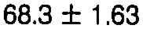 |
| r05_c00 | TPW | L1 | TPW | L1 | 71.2 +/- 1.66 | mean 71.2 mm; sem 1.66 mm | 71.2 +/- 1.66 | 71.2 +/- 1.66 | 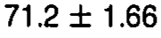 |
| r05_c01 | TPW | L2 | TPW | L2 | 76.1 +/- 1.48 | mean 76.1 mm; sem 1.48 mm | 76.1 +/- 1.48 | 76.1 +/- 1.48 | 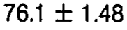 |
| r05_c02 | TPW | L3 | TPW | L3 | 85.7^ (L1) +/- 2.44 | mean 85.7 mm; sem 2.44 mm | 85.7^ (L1) +/- 2.44 | 85.7^ (L1) +/- 2.44 | 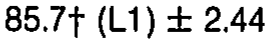 |
| r05_c03 | TPW | L4 | TPW | L4 | 79.4 +/- 3.78 | mean 79.4 mm; sem 3.78 mm | 79.4 +/- 3.78 | 79.4 +/- 3.78 | 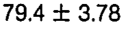 |
| r05_c04 | TPW | L5 | TPW | L5 | 92.5^ (L1,L2,L4) +/- 3.68 | mean 92.5 mm; sem 3.68 mm | 92.5^ (L1,L2,L4) +/- 3.68 | 92.5^ (L1,L2,L4) +/- 3.68 | 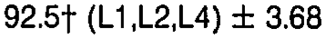 |
