# Table 6. Comparison of Results of Present Study to Those of Previous Studies

Lumbar, PDF page 7, printed page 305; Panjabi_1992_Lumbar_Spine_17-3_299-306.pdf (sha256 842736d7102c0327c690af3605c5248ca4516253ac330157875bfb783d6b5eac), rendered at 300 dpi by render.py.

Every cell below is the box layout.py cut from the rendered page, and the two strings are what the two reading passes read in it (README.md). A dash is printed where the paper prints one. The value column is what provenance.csv carries.

| cell | row | column | measure | level | printed | value | pass 1 | pass 2 | image |
|---|---|---|---|---|---|---|---|---|---|
| r01_c00 | EPDl | Level | EPDl | L1 | L1 | mean L1 | L1 | L1 | 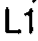 |
| r01_c01 | EPDl | Present Study | EPDl | L1 | 35.3 | mean 35.3 mm | 35.3 | 35.3 | 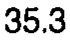 |
| r01_c02 | EPDl | Berry (1987) | EPDl | L1 | 32.3 | mean 32.3 mm | 32.3 | 32.3 | 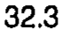 |
| r01_c03 | EPDl | Zindrick (1987) | EPDl | L1 | - | (none) | - | - |  |
| r01_c04 | EPDl | Scoles (1988) | EPDl | L1 | 29.5 | mean 29.5 mm | 29.5 | 29.5 | 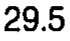 |
| r01_c05 | EPDl | Krag (1986, 1988) | EPDl | L1 | 31.0 | mean 31.0 mm | 31.0 | 31.0 | 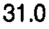 |
| r01_c06 | EPDl | Cotterill (1986) | EPDl | L1 | - | (none) | - | - |  |
| r01_c07 | EPDl | Gilad (1986) | EPDl | L1 | 34.1 | mean 34.1 mm | 34.1 | 34.1 | 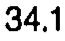 |
| r02_c00 | EPDl | Level | EPDl | L2 | L2 | mean L2 | L2 | L2 | 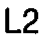 |
| r02_c01 | EPDl | Present Study | EPDl | L2 | 34.9 | mean 34.9 mm | 34.9 | 34.9 | 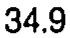 |
| r02_c02 | EPDl | Berry (1987) | EPDl | L2 | 33.4 | mean 33.4 mm | 33.4 | 33.4 | 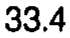 |
| r02_c03 | EPDl | Zindrick (1987) | EPDl | L2 | - | (none) | - | - | 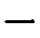 |
| r02_c04 | EPDl | Scoles (1988) | EPDl | L2 | - | (none) | - | - | 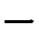 |
| r02_c05 | EPDl | Krag (1986, 1988) | EPDl | L2 | 32.5 | mean 32.5 mm | 32.5 | 32.5 | 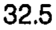 |
| r02_c06 | EPDl | Cotterill (1986) | EPDl | L2 | - | (none) | - | - |  |
| r02_c07 | EPDl | Gilad (1986) | EPDl | L2 | 34.7 | mean 34.7 mm | 34.7 | 34.7 | 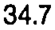 |
| r03_c00 | EPDl | Level | EPDl | L3 | L3 | mean L3 | L3 | L3 |  |
| r03_c01 | EPDl | Present Study | EPDl | L3 | 34.8 | mean 34.8 mm | 34.8 | 34.8 | 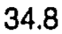 |
| r03_c02 | EPDl | Berry (1987) | EPDl | L3 | 34.2 | mean 34.2 mm | 34.2 | 34.2 | 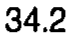 |
| r03_c03 | EPDl | Zindrick (1987) | EPDl | L3 | - | (none) | - | - |  |
| r03_c04 | EPDl | Scoles (1988) | EPDl | L3 | 32.6 | mean 32.6 mm | 32.6 | 32.6 | 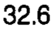 |
| r03_c05 | EPDl | Krag (1986, 1988) | EPDl | L3 | 30.5 | mean 30.5 mm | 30.5 | 30.5 | 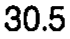 |
| r03_c06 | EPDl | Cotterill (1986) | EPDl | L3 | 32.7 | mean 32.7 mm | 32.7 | 32.7 | 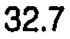 |
| r03_c07 | EPDl | Gilad (1986) | EPDl | L3 | 34.6 | mean 34.6 mm | 34.6 | 34.6 | 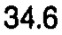 |
| r04_c00 | EPDl | Level | EPDl | L4 | L4 | mean L4 | L4 | L4 | 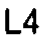 |
| r04_c01 | EPDl | Present Study | EPDl | L4 | 33.9 | mean 33.9 mm | 33.9 | 33.9 | 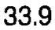 |
| r04_c02 | EPDl | Berry (1987) | EPDl | L4 | 35.6 | mean 35.6 mm | 35.6 | 35.6 | 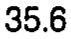 |
| r04_c03 | EPDl | Zindrick (1987) | EPDl | L4 | - | (none) | - | - | 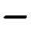 |
| r04_c04 | EPDl | Scoles (1988) | EPDl | L4 | - | (none) | - | - |  |
| r04_c05 | EPDl | Krag (1986, 1988) | EPDl | L4 | 32.0 | mean 32.0 mm | 32.0 | 32.0 | 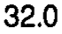 |
| r04_c06 | EPDl | Cotterill (1986) | EPDl | L4 | - | (none) | - | - | 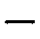 |
| r04_c07 | EPDl | Gilad (1986) | EPDl | L4 | 34.9 | mean 34.9 mm | 34.9 | 34.9 | 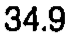 |
| r05_c00 | EPDl | Level | EPDl | L5 | L5 | mean L5 | L5 | L5 | 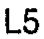 |
| r05_c01 | EPDl | Present Study | EPDl | L5 | 33.2 | mean 33.2 mm | 33.2 | 33.2 | 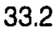 |
| r05_c02 | EPDl | Berry (1987) | EPDl | L5 | 34.5 | mean 34.5 mm | 34.5 | 34.5 | 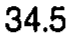 |
| r05_c03 | EPDl | Zindrick (1987) | EPDl | L5 | - | (none) | - | - | 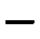 |
| r05_c04 | EPDl | Scoles (1988) | EPDl | L5 | 34.5 | mean 34.5 mm | 34.5 | 34.5 | 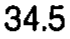 |
| r05_c05 | EPDl | Krag (1986, 1988) | EPDl | L5 | 33.0 | mean 33.0 mm | 33.0 | 33.0 | 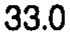 |
| r05_c06 | EPDl | Cotterill (1986) | EPDl | L5 | - | (none) | - | - | 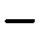 |
| r05_c07 | EPDl | Gilad (1986) | EPDl | L5 | 33.9 | mean 33.9 mm | 33.9 | 33.9 | 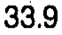 |
| r06_c00 | EPWl | Level | EPWl | L1 | L1 | mean L1 | L1 | L1 |  |
| r06_c01 | EPWl | Present Study | EPWl | L1 | 43.3 | mean 43.3 mm | 43.3 | 43.3 | 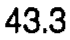 |
| r06_c02 | EPWl | Berry (1987) | EPWl | L1 | 49.1 | mean 49.1 mm | 49.1 | 49.1 | 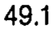 |
| r06_c03 | EPWl | Zindrick (1987) | EPWl | L1 | - | (none) | - | - | 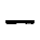 |
| r06_c04 | EPWl | Scoles (1988) | EPWl | L1 | 44.3 | mean 44.3 mm | 44.3 | 44.3 | 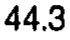 |
| r06_c05 | EPWl | Krag (1986, 1988) | EPWl | L1 | - | (none) | - | - | 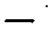 |
| r06_c06 | EPWl | Cotterill (1986) | EPWl | L1 | - | (none) | - | - |  |
| r06_c07 | EPWl | Gilad (1986) | EPWl | L1 | - | (none) | - | - |  |
| r07_c00 | EPWl | Level | EPWl | L2 | L2 | mean L2 | L2 | L2 | 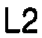 |
| r07_c01 | EPWl | Present Study | EPWl | L2 | 45.5 | mean 45.5 mm | 45.5 | 45.5 | 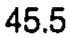 |
| r07_c02 | EPWl | Berry (1987) | EPWl | L2 | 54.8 | mean 54.8 mm | 54.8 | 54.8 | 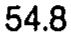 |
| r07_c03 | EPWl | Zindrick (1987) | EPWl | L2 | - | (none) | - | - | 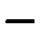 |
| r07_c04 | EPWl | Scoles (1988) | EPWl | L2 | - | (none) | - | - |  |
| r07_c05 | EPWl | Krag (1986, 1988) | EPWl | L2 | - | (none) | - | - |  |
| r07_c06 | EPWl | Cotterill (1986) | EPWl | L2 | - | (none) | - | - |  |
| r07_c07 | EPWl | Gilad (1986) | EPWl | L2 | - | (none) | - | - | 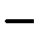 |
| r08_c00 | EPWl | Level | EPWl | L3 | L3 | mean L3 | L3 | L3 |  |
| r08_c01 | EPWl | Present Study | EPWl | L3 | 48.0 | mean 48.0 mm | 48.0 | 48.0 | 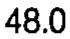 |
| r08_c02 | EPWl | Berry (1987) | EPWl | L3 | 53.8 | mean 53.8 mm | 53.8 | 53.8 | 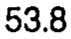 |
| r08_c03 | EPWl | Zindrick (1987) | EPWl | L3 | - | (none) | - | - | 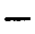 |
| r08_c04 | EPWl | Scoles (1988) | EPWl | L3 | 48.4 | mean 48.4 mm | 48.4 | 48.4 | 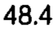 |
| r08_c05 | EPWl | Krag (1986, 1988) | EPWl | L3 | - | (none) | - | - |  |
| r08_c06 | EPWl | Cotterill (1986) | EPWl | L3 | 44.3 | mean 44.3 mm | 44.3 | 44.3 | 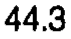 |
| r08_c07 | EPWl | Gilad (1986) | EPWl | L3 | - | (none) | - | - | 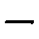 |
| r09_c00 | EPWl | Level | EPWl | L4 | L4 | mean L4 | L4 | L4 |  |
| r09_c01 | EPWl | Present Study | EPWl | L4 | 49.5 | mean 49.5 mm | 49.5 | 49.5 |  |
| r09_c02 | EPWl | Berry (1987) | EPWl | L4 | 50.9 | mean 50.9 mm | 50.9 | 50.9 |  |
| r09_c03 | EPWl | Zindrick (1987) | EPWl | L4 | - | (none) | - | - |  |
| r09_c04 | EPWl | Scoles (1988) | EPWl | L4 | - | (none) | - | - |  |
| r09_c05 | EPWl | Krag (1986, 1988) | EPWl | L4 | - | (none) | - | - |  |
| r09_c06 | EPWl | Cotterill (1986) | EPWl | L4 | - | (none) | - | - |  |
| r09_c07 | EPWl | Gilad (1986) | EPWl | L4 | - | (none) | - | - |  |
| r10_c00 | EPWl | Level | EPWl | L5 | L5 | mean L5 | L5 | L5 |  |
| r10_c01 | EPWl | Present Study | EPWl | L5 | 49.4 | mean 49.4 mm | 49.4 | 49.4 |  |
| r10_c02 | EPWl | Berry (1987) | EPWl | L5 | 52.7 | mean 52.7 mm | 52.7 | 52.7 |  |
| r10_c03 | EPWl | Zindrick (1987) | EPWl | L5 | - | (none) | - | - |  |
| r10_c04 | EPWl | Scoles (1988) | EPWl | L5 | 52.9 | mean 52.9 mm | 52.9 | 52.9 |  |
| r10_c05 | EPWl | Krag (1986, 1988) | EPWl | L5 | - | (none) | - | - |  |
| r10_c06 | EPWl | Cotterill (1986) | EPWl | L5 | - | (none) | - | - |  |
| r10_c07 | EPWl | Gilad (1986) | EPWl | L5 | - | (none) | - | - |  |
| r11_c00 | VBHp | Level | VBHp | L1 | L1 | mean L1 | L1 | L1 |  |
| r11_c01 | VBHp | Present Study | VBHp | L1 | 23.8 | mean 23.8 mm | 23.8 | 23.8 |  |
| r11_c02 | VBHp | Berry (1987) | VBHp | L1 | 25.8 | mean 25.8 mm | 25.8 | 25.8 |  |
| r11_c03 | VBHp | Zindrick (1987) | VBHp | L1 | - | (none) | - | - |  |
| r11_c04 | VBHp | Scoles (1988) | VBHp | L1 | 27.4 | mean 27.4 mm | 27.4 | 27.4 |  |
| r11_c05 | VBHp | Krag (1986, 1988) | VBHp | L1 | - | (none) | - | - |  |
| r11_c06 | VBHp | Cotterill (1986) | VBHp | L1 | - | (none) | - | - |  |
| r11_c07 | VBHp | Gilad (1986) | VBHp | L1 | 27.1 | mean 27.1 mm | 27.1 | 27.1 |  |
| r12_c00 | VBHp | Level | VBHp | L2 | L2 | mean L2 | L2 | L2 |  |
| r12_c01 | VBHp | Present Study | VBHp | L2 | 24.3 | mean 24.3 mm | 24.3 | 24.3 |  |
| r12_c02 | VBHp | Berry (1987) | VBHp | L2 | 25.2 | mean 25.2 mm | 25.2 | 25.2 |  |
| r12_c03 | VBHp | Zindrick (1987) | VBHp | L2 | - | (none) | - | - |  |
| r12_c04 | VBHp | Scoles (1988) | VBHp | L2 | - | (none) | - | - |  |
| r12_c05 | VBHp | Krag (1986, 1988) | VBHp | L2 | - | (none) | - | - |  |
| r12_c06 | VBHp | Cotterill (1986) | VBHp | L2 | - | (none) | - | - |  |
| r12_c07 | VBHp | Gilad (1986) | VBHp | L2 | 28.0 | mean 28.0 mm | 28.0 | 28.0 |  |
| r13_c00 | VBHp | Level | VBHp | L3 | L3 | mean L3 | L3 | L3 |  |
| r13_c01 | VBHp | Present Study | VBHp | L3 | 23.8 | mean 23.8 mm | 23.8 | 23.8 |  |
| r13_c02 | VBHp | Berry (1987) | VBHp | L3 | 26.0 | mean 26.0 mm | 26.0 | 26.0 |  |
| r13_c03 | VBHp | Zindrick (1987) | VBHp | L3 | - | (none) | - | - |  |
| r13_c04 | VBHp | Scoles (1988) | VBHp | L3 | 27.4 | mean 27.4 mm | 27.4 | 27.4 |  |
| r13_c05 | VBHp | Krag (1986, 1988) | VBHp | L3 | - | (none) | - | - |  |
| r13_c06 | VBHp | Cotterill (1986) | VBHp | L3 | 23.0 | mean 23.0 mm | 23.0 | 23.0 |  |
| r13_c07 | VBHp | Gilad (1986) | VBHp | L3 | 27.9 | mean 27.9 mm | 27.9 | 27.9 |  |
| r14_c00 | VBHp | Level | VBHp | L4 | L4 | mean L4 | L4 | L4 |  |
| r14_c01 | VBHp | Present Study | VBHp | L4 | 24.1 | mean 24.1 mm | 24.1 | 24.1 |  |
| r14_c02 | VBHp | Berry (1987) | VBHp | L4 | 26.4 | mean 26.4 mm | 26.4 | 26.4 |  |
| r14_c03 | VBHp | Zindrick (1987) | VBHp | L4 | - | (none) | - | - |  |
| r14_c04 | VBHp | Scoles (1988) | VBHp | L4 | - | (none) | - | - |  |
| r14_c05 | VBHp | Krag (1986, 1988) | VBHp | L4 | - | (none) | - | - |  |
| r14_c06 | VBHp | Cotterill (1986) | VBHp | L4 | - | (none) | - | - |  |
| r14_c07 | VBHp | Gilad (1986) | VBHp | L4 | 27.1 | mean 27.1 mm | 27.1 | 27.1 |  |
| r15_c00 | VBHp | Level | VBHp | L5 | L5 | mean L5 | L5 | L5 |  |
| r15_c01 | VBHp | Present Study | VBHp | L5 | 22.9 | mean 22.9 mm | 22.9 | 22.9 |  |
| r15_c02 | VBHp | Berry (1987) | VBHp | L5 | 23.1 | mean 23.1 mm | 23.1 | 23.1 |  |
| r15_c03 | VBHp | Zindrick (1987) | VBHp | L5 | - | (none) | - | - |  |
| r15_c04 | VBHp | Scoles (1988) | VBHp | L5 | 27.6 | mean 27.6 mm | 27.6 | 27.6 |  |
| r15_c05 | VBHp | Krag (1986, 1988) | VBHp | L5 | - | (none) | - | - |  |
| r15_c06 | VBHp | Cotterill (1986) | VBHp | L5 | - | (none) | - | - |  |
| r15_c07 | VBHp | Gilad (1986) | VBHp | L5 | 25.7 | mean 25.7 mm | 25.7 | 25.7 |  |
| r16_c00 | SCD | Level | SCD | L1 | L1 | mean L1 | L1 | L1 |  |
| r16_c01 | SCD | Present Study | SCD | L1 | 19.0 | mean 19.0 mm | 19.0 | 19.0 |  |
| r16_c02 | SCD | Berry (1987) | SCD | L1 | 17.2 | mean 17.2 mm | 17.2 | 17.2 |  |
| r16_c03 | SCD | Zindrick (1987) | SCD | L1 | - | (none) | - | - |  |
| r16_c04 | SCD | Scoles (1988) | SCD | L1 | 17.6 | mean 17.6 mm | 17.6 | 17.6 |  |
| r16_c05 | SCD | Krag (1986, 1988) | SCD | L1 | - | (none) | - | - |  |
| r16_c06 | SCD | Cotterill (1986) | SCD | L1 | - | (none) | - | - |  |
| r16_c07 | SCD | Gilad (1986) | SCD | L1 | - | (none) | - | - |  |
| r17_c00 | SCD | Level | SCD | L2 | L2 | mean L2 | L2 | L2 |  |
| r17_c01 | SCD | Present Study | SCD | L2 | 18.2 | mean 18.2 mm | 18.2 | 18.2 |  |
| r17_c02 | SCD | Berry (1987) | SCD | L2 | 16.0 | mean 16.0 mm | 16.0 | 16.0 |  |
| r17_c03 | SCD | Zindrick (1987) | SCD | L2 | - | (none) | - | - |  |
| r17_c04 | SCD | Scoles (1988) | SCD | L2 | - | (none) | - | - |  |
| r17_c05 | SCD | Krag (1986, 1988) | SCD | L2 | - | (none) | - | - |  |
| r17_c06 | SCD | Cotterill (1986) | SCD | L2 | - | (none) | - | - |  |
| r17_c07 | SCD | Gilad (1986) | SCD | L2 | - | (none) | - | - |  |
| r18_c00 | SCD | Level | SCD | L3 | L3 | mean L3 | L3 | L3 |  |
| r18_c01 | SCD | Present Study | SCD | L3 | 17.5 | mean 17.5 mm | 17.5 | 17.5 |  |
| r18_c02 | SCD | Berry (1987) | SCD | L3 | 16.2 | mean 16.2 mm | 16.2 | 16.2 |  |
| r18_c03 | SCD | Zindrick (1987) | SCD | L3 | - | (none) | - | - |  |
| r18_c04 | SCD | Scoles (1988) | SCD | L3 | 16.0 | mean 16.0 mm | 16.0 | 16.0 |  |
| r18_c05 | SCD | Krag (1986, 1988) | SCD | L3 | - | (none) | - | - |  |
| r18_c06 | SCD | Cotterill (1986) | SCD | L3 | 12.1 | mean 12.1 mm | 12.1 | 12.1 |  |
| r18_c07 | SCD | Gilad (1986) | SCD | L3 | - | (none) | - | - |  |
| r19_c00 | SCD | Level | SCD | L4 | L4 | mean L4 | L4 | L4 |  |
| r19_c01 | SCD | Present Study | SCD | L4 | 18.6 | mean 18.6 mm | 18.6 | 18.6 |  |
| r19_c02 | SCD | Berry (1987) | SCD | L4 | 16.1 | mean 16.1 mm | 16.1 | 16.1 |  |
| r19_c03 | SCD | Zindrick (1987) | SCD | L4 | - | (none) | - | - |  |
| r19_c04 | SCD | Scoles (1988) | SCD | L4 | - | (none) | - | - |  |
| r19_c05 | SCD | Krag (1986, 1988) | SCD | L4 | - | (none) | - | - |  |
| r19_c06 | SCD | Cotterill (1986) | SCD | L4 | - | (none) | - | - |  |
| r19_c07 | SCD | Gilad (1986) | SCD | L4 | - | (none) | - | - |  |
| r20_c00 | SCD | Level | SCD | L5 | L5 | mean L5 | L5 | L5 |  |
| r20_c01 | SCD | Present Study | SCD | L5 | 19.7 | mean 19.7 mm | 19.7 | 19.7 |  |
| r20_c02 | SCD | Berry (1987) | SCD | L5 | 17.3 | mean 17.3 mm | 17.3 | 17.3 |  |
| r20_c03 | SCD | Zindrick (1987) | SCD | L5 | - | (none) | - | - |  |
| r20_c04 | SCD | Scoles (1988) | SCD | L5 | 17.6 | mean 17.6 mm | 17.6 | 17.6 |  |
| r20_c05 | SCD | Krag (1986, 1988) | SCD | L5 | - | (none) | - | - |  |
| r20_c06 | SCD | Cotterill (1986) | SCD | L5 | - | (none) | - | - |  |
| r20_c07 | SCD | Gilad (1986) | SCD | L5 | - | (none) | - | - |  |
| r21_c00 | SCW | Level | SCW | L1 | L1 | mean L1 | L1 | L1 |  |
| r21_c01 | SCW | Present Study | SCW | L1 | 23.7 | mean 23.7 mm | 23.7 | 23.7 |  |
| r21_c02 | SCW | Berry (1987) | SCW | L1 | 22.1 | mean 22.1 mm | 22.1 | 22.1 |  |
| r21_c03 | SCW | Zindrick (1987) | SCW | L1 | - | (none) | - | - |  |
| r21_c04 | SCW | Scoles (1988) | SCW | L1 | 22.2 | mean 22.2 mm | 22.2 | 22.2 |  |
| r21_c05 | SCW | Krag (1986, 1988) | SCW | L1 | - | (none) | - | - |  |
| r21_c06 | SCW | Cotterill (1986) | SCW | L1 | - | (none) | - | - |  |
| r21_c07 | SCW | Gilad (1986) | SCW | L1 | - | (none) | - | - |  |
| r22_c00 | SCW | Level | SCW | L2 | L2 | mean L2 | L2 | L2 |  |
| r22_c01 | SCW | Present Study | SCW | L2 | 23.8 | mean 23.8 mm | 23.8 | 23.8 |  |
| r22_c02 | SCW | Berry (1987) | SCW | L2 | 23.0 | mean 23.0 mm | 23.0 | 23.0 |  |
| r22_c03 | SCW | Zindrick (1987) | SCW | L2 | - | (none) | - | - |  |
| r22_c04 | SCW | Scoles (1988) | SCW | L2 | - | (none) | - | - |  |
| r22_c05 | SCW | Krag (1986, 1988) | SCW | L2 | - | (none) | - | - |  |
| r22_c06 | SCW | Cotterill (1986) | SCW | L2 | - | (none) | - | - |  |
| r22_c07 | SCW | Gilad (1986) | SCW | L2 | - | (none) | - | - |  |
| r23_c00 | SCW | Level | SCW | L3 | L3 | mean L3 | L3 | L3 |  |
| r23_c01 | SCW | Present Study | SCW | L3 | 24.3 | mean 24.3 mm | 24.3 | 24.3 |  |
| r23_c02 | SCW | Berry (1987) | SCW | L3 | 22.7 | mean 22.7 mm | 22.7 | 22.7 |  |
| r23_c03 | SCW | Zindrick (1987) | SCW | L3 | - | (none) | - | - |  |
| r23_c04 | SCW | Scoles (1988) | SCW | L3 | 22.8 | mean 22.8 mm | 22.8 | 22.8 |  |
| r23_c05 | SCW | Krag (1986, 1988) | SCW | L3 | - | (none) | - | - |  |
| r23_c06 | SCW | Cotterill (1986) | SCW | L3 | 21.5 | mean 21.5 mm | 21.5 | 21.5 |  |
| r23_c07 | SCW | Gilad (1986) | SCW | L3 | - | (none) | - | - |  |
| r24_c00 | SCW | Level | SCW | L4 | L4 | mean L4 | L4 | L4 |  |
| r24_c01 | SCW | Present Study | SCW | L4 | 25.4 | mean 25.4 mm | 25.4 | 25.4 |  |
| r24_c02 | SCW | Berry (1987) | SCW | L4 | 22.0 | mean 22.0 mm | 22.0 | 22.0 |  |
| r24_c03 | SCW | Zindrick (1987) | SCW | L4 | - | (none) | - | - |  |
| r24_c04 | SCW | Scoles (1988) | SCW | L4 | - | (none) | - | - |  |
| r24_c05 | SCW | Krag (1986, 1988) | SCW | L4 | - | (none) | - | - |  |
| r24_c06 | SCW | Cotterill (1986) | SCW | L4 | - | (none) | - | - |  |
| r24_c07 | SCW | Gilad (1986) | SCW | L4 | - | (none) | - | - |  |
| r25_c00 | SCW | Level | SCW | L5 | L5 | mean L5 | L5 | L5 |  |
| r25_c01 | SCW | Present Study | SCW | L5 | 27.1 | mean 27.1 mm | 27.1 | 27.1 |  |
| r25_c02 | SCW | Berry (1987) | SCW | L5 | 26.0 | mean 26.0 mm | 26.0 | 26.0 |  |
| r25_c03 | SCW | Zindrick (1987) | SCW | L5 | - | (none) | - | - |  |
| r25_c04 | SCW | Scoles (1988) | SCW | L5 | 25.9 | mean 25.9 mm | 25.9 | 25.9 |  |
| r25_c05 | SCW | Krag (1986, 1988) | SCW | L5 | - | (none) | - | - |  |
| r25_c06 | SCW | Cotterill (1986) | SCW | L5 | - | (none) | - | - |  |
| r25_c07 | SCW | Gilad (1986) | SCW | L5 | - | (none) | - | - |  |
| r26_c00 | PDH | Level | PDH | L1 | L1 | mean L1 | L1 | L1 |  |
| r26_c01 | PDH | Present Study | PDH | L1 | 15.9 | mean 15.9 mm | 15.9 | 15.9 |  |
| r26_c02 | PDH | Berry (1987) | PDH | L1 | 15.6 | mean 15.6 mm | 15.6 | 15.6 |  |
| r26_c03 | PDH | Zindrick (1987) | PDH | L1 | 15.4 | mean 15.4 mm | 15.4 | 15.4 |  |
| r26_c04 | PDH | Scoles (1988) | PDH | L1 | 15.3 | mean 15.3 mm | 15.3 | 15.3 |  |
| r26_c05 | PDH | Krag (1986, 1988) | PDH | L1 | - | (none) | - | - |  |
| r26_c06 | PDH | Cotterill (1986) | PDH | L1 | - | (none) | - | - |  |
| r26_c07 | PDH | Gilad (1986) | PDH | L1 | - | (none) | - | - |  |
| r27_c00 | PDH | Level | PDH | L2 | L2 | mean L2 | L2 | L2 |  |
| r27_c01 | PDH | Present Study | PDH | L2 | 14.9 | mean 14.9 mm | 14.9 | 14.9 |  |
| r27_c02 | PDH | Berry (1987) | PDH | L2 | 15.3 | mean 15.3 mm | 15.3 | 15.3 |  |
| r27_c03 | PDH | Zindrick (1987) | PDH | L2 | 15.0 | mean 15.0 mm | 15.0 | 15.0 |  |
| r27_c04 | PDH | Scoles (1988) | PDH | L2 | - | (none) | - | - |  |
| r27_c05 | PDH | Krag (1986, 1988) | PDH | L2 | - | (none) | - | - |  |
| r27_c06 | PDH | Cotterill (1986) | PDH | L2 | - | (none) | - | - |  |
| r27_c07 | PDH | Gilad (1986) | PDH | L2 | - | (none) | - | - |  |
| r28_c00 | PDH | Level | PDH | L3 | L3 | mean L3 | L3 | L3 |  |
| r28_c01 | PDH | Present Study | PDH | L3 | 14.4 | mean 14.4 mm | 14.4 | 14.4 |  |
| r28_c02 | PDH | Berry (1987) | PDH | L3 | 14.5 | mean 14.5 mm | 14.5 | 14.5 |  |
| r28_c03 | PDH | Zindrick (1987) | PDH | L3 | 14.9 | mean 14.9 mm | 14.9 | 14.9 |  |
| r28_c04 | PDH | Scoles (1988) | PDH | L3 | 14.1 | mean 14.1 mm | 14.1 | 14.1 |  |
| r28_c05 | PDH | Krag (1986, 1988) | PDH | L3 | - | (none) | - | - |  |
| r28_c06 | PDH | Cotterill (1986) | PDH | L3 | - | (none) | - | - |  |
| r28_c07 | PDH | Gilad (1986) | PDH | L3 | - | (none) | - | - |  |
| r29_c00 | PDH | Level | PDH | L4 | L4 | mean L4 | L4 | L4 |  |
| r29_c01 | PDH | Present Study | PDH | L4 | 15.4 | mean 15.4 mm | 15.4 | 15.4 |  |
| r29_c02 | PDH | Berry (1987) | PDH | L4 | 13.1 | mean 13.1 mm | 13.1 | 13.1 |  |
| r29_c03 | PDH | Zindrick (1987) | PDH | L4 | 14.8 | mean 14.8 mm | 14.8 | 14.8 |  |
| r29_c04 | PDH | Scoles (1988) | PDH | L4 | - | (none) | - | - |  |
| r29_c05 | PDH | Krag (1986, 1988) | PDH | L4 | - | (none) | - | - |  |
| r29_c06 | PDH | Cotterill (1986) | PDH | L4 | - | (none) | - | - |  |
| r29_c07 | PDH | Gilad (1986) | PDH | L4 | - | (none) | - | - |  |
| r30_c00 | PDH | Level | PDH | L5 | L5 | mean L5 | L5 | L5 |  |
| r30_c01 | PDH | Present Study | PDH | L5 | 19.6 | mean 19.6 mm | 19.6 | 19.6 |  |
| r30_c02 | PDH | Berry (1987) | PDH | L5 | 13.7 | mean 13.7 mm | 13.7 | 13.7 |  |
| r30_c03 | PDH | Zindrick (1987) | PDH | L5 | 14.0 | mean 14.0 mm | 14.0 | 14.0 |  |
| r30_c04 | PDH | Scoles (1988) | PDH | L5 | 16.2 | mean 16.2 mm | 16.2 | 16.2 |  |
| r30_c05 | PDH | Krag (1986, 1988) | PDH | L5 | - | (none) | - | - |  |
| r30_c06 | PDH | Cotterill (1986) | PDH | L5 | - | (none) | - | - |  |
| r30_c07 | PDH | Gilad (1986) | PDH | L5 | - | (none) | - | - |  |
| r31_c00 | PDW | Level | PDW | L1 | L1 | mean L1 | L1 | L1 |  |
| r31_c01 | PDW | Present Study | PDW | L1 | 8.6 | mean 8.6 mm | 8.6 | 8.6 |  |
| r31_c02 | PDW | Berry (1987) | PDW | L1 | 7.0 | mean 7.0 mm | 7.0 | 7.0 |  |
| r31_c03 | PDW | Zindrick (1987) | PDW | L1 | 8.7 | mean 8.7 mm | 8.7 | 8.7 |  |
| r31_c04 | PDW | Scoles (1988) | PDW | L1 | 8.3 | mean 8.3 mm | 8.3 | 8.3 |  |
| r31_c05 | PDW | Krag (1986, 1988) | PDW | L1 | 7.0 | mean 7.0 mm | 7.0 | 7.0 |  |
| r31_c06 | PDW | Cotterill (1986) | PDW | L1 | - | (none) | - | - |  |
| r31_c07 | PDW | Gilad (1986) | PDW | L1 | - | (none) | - | - |  |
| r32_c00 | PDW | Level | PDW | L2 | L2 | mean L2 | L2 | L2 |  |
| r32_c01 | PDW | Present Study | PDW | L2 | 8.3 | mean 8.3 mm | 8.3 | 8.3 |  |
| r32_c02 | PDW | Berry (1987) | PDW | L2 | 7.5 | mean 7.5 mm | 7.5 | 7.5 |  |
| r32_c03 | PDW | Zindrick (1987) | PDW | L2 | 8.9 | mean 8.9 mm | 8.9 | 8.9 |  |
| r32_c04 | PDW | Scoles (1988) | PDW | L2 | - | (none) | - | - |  |
| r32_c05 | PDW | Krag (1986, 1988) | PDW | L2 | 8.4 | mean 8.4 mm | 8.4 | 8.4 |  |
| r32_c06 | PDW | Cotterill (1986) | PDW | L2 | - | (none) | - | - |  |
| r32_c07 | PDW | Gilad (1986) | PDW | L2 | - | (none) | - | - |  |
| r33_c00 | PDW | Level | PDW | L3 | L3 | mean L3 | L3 | L3 |  |
| r33_c01 | PDW | Present Study | PDW | L3 | 10.2 | mean 10.2 mm | 10.2 | 10.2 |  |
| r33_c02 | PDW | Berry (1987) | PDW | L3 | 9.2 | mean 9.2 mm | 9.2 | 9.2 |  |
| r33_c03 | PDW | Zindrick (1987) | PDW | L3 | 10.3 | mean 10.3 mm | 10.3 | 10.3 |  |
| r33_c04 | PDW | Scoles (1988) | PDW | L3 | 9.1 | mean 9.1 mm | 9.1 | 9.1 |  |
| r33_c05 | PDW | Krag (1986, 1988) | PDW | L3 | 9.1 | mean 9.1 mm | 9.1 | 9.1 |  |
| r33_c06 | PDW | Cotterill (1986) | PDW | L3 | 8.4 | mean 8.4 mm | 8.4 | 8.4 |  |
| r33_c07 | PDW | Gilad (1986) | PDW | L3 | - | (none) | - | - |  |
| r34_c00 | PDW | Level | PDW | L4 | L4 | mean L4 | L4 | L4 |  |
| r34_c01 | PDW | Present Study | PDW | L4 | 14.1 | mean 14.1 mm | 14.1 | 14.1 |  |
| r34_c02 | PDW | Berry (1987) | PDW | L4 | 10.4 | mean 10.4 mm | 10.4 | 10.4 |  |
| r34_c03 | PDW | Zindrick (1987) | PDW | L4 | 12.9 | mean 12.9 mm | 12.9 | 12.9 |  |
| r34_c04 | PDW | Scoles (1988) | PDW | L4 | - | (none) | - | - |  |
| r34_c05 | PDW | Krag (1986, 1988) | PDW | L4 | 10.8 | mean 10.8 mm | 10.8 | 10.8 |  |
| r34_c06 | PDW | Cotterill (1986) | PDW | L4 | - | (none) | - | - |  |
| r34_c07 | PDW | Gilad (1986) | PDW | L4 | - | (none) | - | - |  |
| r35_c00 | PDW | Level | PDW | L5 | L5 | mean L5 | L5 | L5 |  |
| r35_c01 | PDW | Present Study | PDW | L5 | 18.6 | mean 18.6 mm | 18.6 | 18.6 |  |
| r35_c02 | PDW | Berry (1987) | PDW | L5 | 10.7 | mean 10.7 mm | 10.7 | 10.7 |  |
| r35_c03 | PDW | Zindrick (1987) | PDW | L5 | 18.0 | mean 18.0 mm | 18.0 | 18.0 |  |
| r35_c04 | PDW | Scoles (1988) | PDW | L5 | 9.7 | mean 9.7 mm | 9.7 | 9.7 |  |
| r35_c05 | PDW | Krag (1986, 1988) | PDW | L5 | 13.8 | mean 13.8 mm | 13.8 | 13.8 |  |
| r35_c06 | PDW | Cotterill (1986) | PDW | L5 | - | (none) | - | - |  |
| r35_c07 | PDW | Gilad (1986) | PDW | L5 | - | (none) | - | - |  |
| r37_c00 | PDIs | Level | PDIs | L1 | L1 | mean L1 | L1 | L1 |  |
| r37_c01 | PDIs | Present Study | PDIs | L1 | 14.5 | mean 14.5 deg | 14.5 | 14.5 |  |
| r37_c02 | PDIs | Berry (1987) | PDIs | L1 | 7.5 | mean 7.5 deg | 7.5 | 7.5 |  |
| r37_c03 | PDIs | Zindrick (1987) | PDIs | L1 | 10.9 | mean 10.9 deg | 10.9 | 10.9 |  |
| r37_c04 | PDIs | Scoles (1988) | PDIs | L1 | 11.6 | mean 11.6 deg | 11.6 | 11.6 |  |
| r37_c05 | PDIs | Krag (1986, 1988) | PDIs | L1 | 11.0 | mean 11.0 deg | 11.0 | 11.0 |  |
| r37_c06 | PDIs | Cotterill (1986) | PDIs | L1 | - | (none) | - | - |  |
| r37_c07 | PDIs | Gilad (1986) | PDIs | L1 | - | (none) | - | - |  |
| r38_c00 | PDIs | Level | PDIs | L2 | L2 | mean L2 | L2 | L2 |  |
| r38_c01 | PDIs | Present Study | PDIs | L2 | 14.1 | mean 14.1 deg | 14.1 | 14.1 |  |
| r38_c02 | PDIs | Berry (1987) | PDIs | L2 | 11.5 | mean 11.5 deg | 11.5 | 11.5 |  |
| r38_c03 | PDIs | Zindrick (1987) | PDIs | L2 | 12.0 | mean 12.0 deg | 12.0 | 12.0 |  |
| r38_c04 | PDIs | Scoles (1988) | PDIs | L2 | - | (none) | - | - |  |
| r38_c05 | PDIs | Krag (1986, 1988) | PDIs | L2 | 12.0 | mean 12.0 deg | 12.0 | 12.0 |  |
| r38_c06 | PDIs | Cotterill (1986) | PDIs | L2 | - | (none) | - | - |  |
| r38_c07 | PDIs | Gilad (1986) | PDIs | L2 | - | (none) | - | - |  |
| r39_c00 | PDIs | Level | PDIs | L3 | L3 | mean L3 | L3 | L3 |  |
| r39_c01 | PDIs | Present Study | PDIs | L3 | 18.5 | mean 18.5 deg | 18.5 | 18.5 |  |
| r39_c02 | PDIs | Berry (1987) | PDIs | L3 | 14.0 | mean 14.0 deg | 14.0 | 14.0 |  |
| r39_c03 | PDIs | Zindrick (1987) | PDIs | L3 | 14.4 | mean 14.4 deg | 14.4 | 14.4 |  |
| r39_c04 | PDIs | Scoles (1988) | PDIs | L3 | 14.7 | mean 14.7 deg | 14.7 | 14.7 |  |
| r39_c05 | PDIs | Krag (1986, 1988) | PDIs | L3 | 16.0 | mean 16.0 deg | 16.0 | 16.0 |  |
| r39_c06 | PDIs | Cotterill (1986) | PDIs | L3 | - | (none) | - | - |  |
| r39_c07 | PDIs | Gilad (1986) | PDIs | L3 | - | (none) | - | - |  |
| r40_c00 | PDIs | Level | PDIs | L4 | L4 | mean L4 | L4 | L4 |  |
| r40_c01 | PDIs | Present Study | PDIs | L4 | 16.0 | mean 16.0 deg | 16.0 | 16.0 |  |
| r40_c02 | PDIs | Berry (1987) | PDIs | L4 | 20.0 | mean 20.0 deg | 20.0 | 20.0 |  |
| r40_c03 | PDIs | Zindrick (1987) | PDIs | L4 | 17.7 | mean 17.7 deg | 17.7 | 17.7 |  |
| r40_c04 | PDIs | Scoles (1988) | PDIs | L4 | - | (none) | - | - |  |
| r40_c05 | PDIs | Krag (1986, 1988) | PDIs | L4 | 18.0 | mean 18.0 deg | 18.0 | 18.0 |  |
| r40_c06 | PDIs | Cotterill (1986) | PDIs | L4 | - | (none) | - | - |  |
| r40_c07 | PDIs | Gilad (1986) | PDIs | L4 | - | (none) | - | - |  |
| r41_c00 | PDIs | Level | PDIs | L5 | L5 | mean L5 | L5 | L5 |  |
| r41_c01 | PDIs | Present Study | PDIs | L5 | 24.6 | mean 24.6 deg | 24.6 | 24.6 |  |
| r41_c02 | PDIs | Berry (1987) | PDIs | L5 | 31.5 | mean 31.5 deg | 31.5 | 31.5 |  |
| r41_c03 | PDIs | Zindrick (1987) | PDIs | L5 | 29.8 | mean 29.8 deg | 29.8 | 29.8 |  |
| r41_c04 | PDIs | Scoles (1988) | PDIs | L5 | 23.1 | mean 23.1 deg | 23.1 | 23.1 |  |
| r41_c05 | PDIs | Krag (1986, 1988) | PDIs | L5 | 27.0 | mean 27.0 deg | 27.0 | 27.0 |  |
| r41_c06 | PDIs | Cotterill (1986) | PDIs | L5 | - | (none) | - | - |  |
| r41_c07 | PDIs | Gilad (1986) | PDIs | L5 | - | (none) | - | - |  |
| r42_c00 | PDIt | Level | PDIt | L1 | L1 | mean L1 | L1 | L1 |  |
| r42_c01 | PDIt | Present Study | PDIt | L1 | 2.6 | mean 2.6 deg | 2.6 | 2.6 |  |
| r42_c02 | PDIt | Berry (1987) | PDIt | L1 | - | (none) | - | - |  |
| r42_c03 | PDIt | Zindrick (1987) | PDIt | L1 | 2.4 | mean 2.4 deg | 2.4 | 2.4 |  |
| r42_c04 | PDIt | Scoles (1988) | PDIt | L1 | - | (none) | - | - |  |
| r42_c05 | PDIt | Krag (1986, 1988) | PDIt | L1 | - | (none) | - | - |  |
| r42_c06 | PDIt | Cotterill (1986) | PDIt | L1 | - | (none) | - | - |  |
| r42_c07 | PDIt | Gilad (1986) | PDIt | L1 | - | (none) | - | - |  |
| r43_c00 | PDIt | Level | PDIt | L2 | L2 | mean L2 | L2 | L2 |  |
| r43_c01 | PDIt | Present Study | PDIt | L2 | 2.7 | mean 2.7 deg | 2.7 | 2.7 |  |
| r43_c02 | PDIt | Berry (1987) | PDIt | L2 | - | (none) | - | - |  |
| r43_c03 | PDIt | Zindrick (1987) | PDIt | L2 | 1.8 | mean 1.8 deg | 1.8 | 1.8 |  |
| r43_c04 | PDIt | Scoles (1988) | PDIt | L2 | - | (none) | - | - |  |
| r43_c05 | PDIt | Krag (1986, 1988) | PDIt | L2 | - | (none) | - | - |  |
| r43_c06 | PDIt | Cotterill (1986) | PDIt | L2 | - | (none) | - | - |  |
| r43_c07 | PDIt | Gilad (1986) | PDIt | L2 | - | (none) | - | - |  |
| r44_c00 | PDIt | Level | PDIt | L3 | L3 | mean L3 | L3 | L3 |  |
| r44_c01 | PDIt | Present Study | PDIt | L3 | 2.7 | mean 2.7 deg | 2.7 | 2.7 |  |
| r44_c02 | PDIt | Berry (1987) | PDIt | L3 | - | (none) | - | - |  |
| r44_c03 | PDIt | Zindrick (1987) | PDIt | L3 | 0.2 | mean 0.2 deg | 0.2 | 0.2 |  |
| r44_c04 | PDIt | Scoles (1988) | PDIt | L3 | - | (none) | - | - |  |
| r44_c05 | PDIt | Krag (1986, 1988) | PDIt | L3 | - | (none) | - | - |  |
| r44_c06 | PDIt | Cotterill (1986) | PDIt | L3 | - | (none) | - | - |  |
| r44_c07 | PDIt | Gilad (1986) | PDIt | L3 | - | (none) | - | - |  |
| r45_c00 | PDIt | Level | PDIt | L4 | L4 | mean L4 | L4 | L4 |  |
| r45_c01 | PDIt | Present Study | PDIt | L4 | 3.9 | mean 3.9 deg | 3.9 | 3.9 |  |
| r45_c02 | PDIt | Berry (1987) | PDIt | L4 | - | (none) | - | - |  |
| r45_c03 | PDIt | Zindrick (1987) | PDIt | L4 | 0.2 | mean 0.2 deg | 0.2 | 0.2 |  |
| r45_c04 | PDIt | Scoles (1988) | PDIt | L4 | - | (none) | - | - |  |
| r45_c05 | PDIt | Krag (1986, 1988) | PDIt | L4 | - | (none) | - | - |  |
| r45_c06 | PDIt | Cotterill (1986) | PDIt | L4 | - | (none) | - | - |  |
| r45_c07 | PDIt | Gilad (1986) | PDIt | L4 | - | (none) | - | - |  |
| r46_c00 | PDIt | Level | PDIt | L5 | L5 | mean L5 | L5 | L5 |  |
| r46_c01 | PDIt | Present Study | PDIt | L5 | 5.5 | mean 5.5 deg | 5.5 | 5.5 |  |
| r46_c02 | PDIt | Berry (1987) | PDIt | L5 | - | (none) | - | - |  |
| r46_c03 | PDIt | Zindrick (1987) | PDIt | L5 | -1.8 | mean -1.8 deg | -1.8 | -1.8 |  |
| r46_c04 | PDIt | Scoles (1988) | PDIt | L5 | - | (none) | - | - |  |
| r46_c05 | PDIt | Krag (1986, 1988) | PDIt | L5 | - | (none) | - | - |  |
| r46_c06 | PDIt | Cotterill (1986) | PDIt | L5 | - | (none) | - | - |  |
| r46_c07 | PDIt | Gilad (1986) | PDIt | L5 | - | (none) | - | - |  |
