# Table 1. Spine Specimen Data

Thoracic, PDF page 2, printed page 889; Panjabi_1991_Thoracic_Spine_16-8_888-901.pdf (sha256 f4078fa2cd2cf2c140fcee7f018917e055d2ca825c42e9b01d84cf1f4b7c1e2c), rendered at 300 dpi by render.py.

Every cell below is the box layout.py cut from the rendered page, and the two strings are what the two reading passes read in it (README.md). A dash is printed where the paper prints one. The value column is what provenance.csv carries.

| cell | row | column | measure | level | printed | value | pass 1 | pass 2 | image |
|---|---|---|---|---|---|---|---|---|---|
| r00_c00 | S3 | Specimen No. | Specimen No. |  | S3 | label S3 | S3 | S3 | 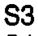 |
| r00_c01 | S3 | Age | Age |  | 48 | value 48 years | 48 | 48 | 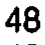 |
| r00_c02 | S3 | Sex | Sex |  | M | text M | M | M |  |
| r00_c03 | S3 | Weight (kg) | Weight (kg) |  | 70 | value 70 kg | 70 | 70 | 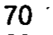 |
| r00_c04 | S3 | Height (cm) | Height (cm) |  | 178 | value 178 cm | 178 | 178 | 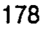 |
| r00_c05 | S3 | Cause of death | Cause of death |  | Coronary artery disease | text Coronary artery disease | Coronary artery disease | Coronary artery disease |  |
| r01_c00 | S4 | Specimen No. | Specimen No. |  | S4 | label S4 | S4 | S4 | 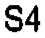 |
| r01_c01 | S4 | Age | Age |  | 42 | value 42 years | 42 | 42 | 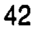 |
| r01_c02 | S4 | Sex | Sex |  | F | text F | F | F | 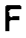 |
| r01_c03 | S4 | Weight (kg) | Weight (kg) |  | 60 | value 60 kg | 60 | 60 | 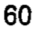 |
| r01_c04 | S4 | Height (cm) | Height (cm) |  | 167 | value 167 cm | 167 | 167 | 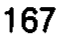 |
| r01_c05 | S4 | Cause of death | Cause of death |  | Breast carcinoma | text Breast carcinoma | Breast carcinoma | Breast carcinoma |  |
| r02_c00 | S7 | Specimen No. | Specimen No. |  | S7 | label S7 | S7 | S7 | 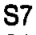 |
| r02_c01 | S7 | Age | Age |  | 53 | value 53 years | 53 | 53 | 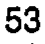 |
| r02_c02 | S7 | Sex | Sex |  | M | text M | M | M | 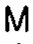 |
| r02_c03 | S7 | Weight (kg) | Weight (kg) |  | 54 | value 54 kg | 54 | 54 | 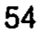 |
| r02_c04 | S7 | Height (cm) | Height (cm) |  | 167 | value 167 cm | 167 | 167 | 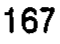 |
| r02_c05 | S7 | Cause of death | Cause of death |  | Esophageal carcinoma | text Esophageal carcinoma | Esophageal carcinoma | Esophageal carcinoma |  |
| r03_c00 | S9 | Specimen No. | Specimen No. |  | S9 | label S9 | S9 | S9 | 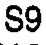 |
| r03_c01 | S9 | Age | Age |  | 19 | value 19 years | 19 | 19 | 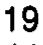 |
| r03_c02 | S9 | Sex | Sex |  | F | text F | F | F | 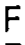 |
| r03_c03 | S9 | Weight (kg) | Weight (kg) |  | 68 | value 68 kg | 68 | 68 | 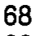 |
| r03_c04 | S9 | Height (cm) | Height (cm) |  | 166 | value 166 cm | 166 | 166 | 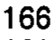 |
| r03_c05 | S9 | Cause of death | Cause of death |  | Acute lymphocytic leukemia | text Acute lymphocytic leukemia | Acute lymphocytic leukemia | Acute lymphocytic leukemia | 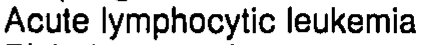 |
| r04_c00 | S10 | Specimen No. | Specimen No. |  | S10 | label S10 | S10 | S10 | 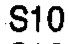 |
| r04_c01 | S10 | Age | Age |  | 44 | value 44 years | 44 | 44 | 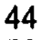 |
| r04_c02 | S10 | Sex | Sex |  | F | text F | F | F | 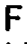 |
| r04_c03 | S10 | Weight (kg) | Weight (kg) |  | 66 | value 66 kg | 66 | 66 | 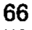 |
| r04_c04 | S10 | Height (cm) | Height (cm) |  | 161 | value 161 cm | 161 | 161 | 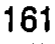 |
| r04_c05 | S10 | Cause of death | Cause of death |  | Right lung carcinoma | text Right lung carcinoma | Right lung carcinoma | Right lung carcinoma |  |
| r05_c00 | S13 | Specimen No. | Specimen No. |  | S13 | label S13 | S13 | S13 | 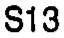 |
| r05_c01 | S13 | Age | Age |  | 56 | value 56 years | 56 | 56 | 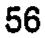 |
| r05_c02 | S13 | Sex | Sex |  | M | text M | M | M |  |
| r05_c03 | S13 | Weight (kg) | Weight (kg) |  | 70 | value 70 kg | 70 | 70 | 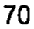 |
| r05_c04 | S13 | Height (cm) | Height (cm) |  | 157 | value 157 cm | 157 | 157 | 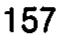 |
| r05_c05 | S13 | Cause of death | Cause of death |  | Renal failure | text Renal failure | Renal failure | Renal failure |  |
| r06_c00 | S14 | Specimen No. | Specimen No. |  | S14 | label S14 | S14 | S14 | 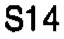 |
| r06_c01 | S14 | Age | Age |  | 56 | value 56 years | 56 | 56 | 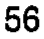 |
| r06_c02 | S14 | Sex | Sex |  | M | text M | M | M |  |
| r06_c03 | S14 | Weight (kg) | Weight (kg) |  | 74 | value 74 kg | 74 | 74 | 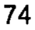 |
| r06_c04 | S14 | Height (cm) | Height (cm) |  | 177 | value 177 cm | 177 | 177 | 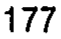 |
| r06_c05 | S14 | Cause of death | Cause of death |  | Pancreatic carcinoma | text Pancreatic carcinoma | Pancreatic carcinoma | Pancreatic carcinoma |  |
| r07_c00 | S15 | Specimen No. | Specimen No. |  | S15 | label S15 | S15 | S15 | 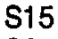 |
| r07_c01 | S15 | Age | Age |  | 59 | value 59 years | 59 | 59 | 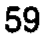 |
| r07_c02 | S15 | Sex | Sex |  | M | text M | M | M | 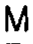 |
| r07_c03 | S15 | Weight (kg) | Weight (kg) |  | 84 | value 84 kg | 84 | 84 | 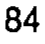 |
| r07_c04 | S15 | Height (cm) | Height (cm) |  | 171 | value 171 cm | 171 | 171 | 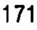 |
| r07_c05 | S15 | Cause of death | Cause of death |  | Myocardial infarction | text Myocardial infarction | Myocardial infarction | Myocardial infarction |  |
| r08_c00 | S20 | Specimen No. | Specimen No. |  | S20 | label S20 | S20 | S20 | 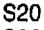 |
| r08_c01 | S20 | Age | Age |  | 49 | value 49 years | 49 | 49 | 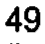 |
| r08_c02 | S20 | Sex | Sex |  | F | text F | F | F | 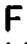 |
| r08_c03 | S20 | Weight (kg) | Weight (kg) |  | 57 | value 57 kg | 57 | 57 | 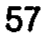 |
| r08_c04 | S20 | Height (cm) | Height (cm) |  | 157 | value 157 cm | 157 | 157 | 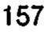 |
| r08_c05 | S20 | Cause of death | Cause of death |  | Third degree burns | text Third degree burns | Third degree burns | Third degree burns |  |
| r09_c00 | S22 | Specimen No. | Specimen No. |  | S22 | label S22 | S22 | S22 | 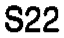 |
| r09_c01 | S22 | Age | Age |  | 53 | value 53 years | 53 | 53 | 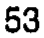 |
| r09_c02 | S22 | Sex | Sex |  | M | text M | M | M |  |
| r09_c03 | S22 | Weight (kg) | Weight (kg) |  | 68 | value 68 kg | 68 | 68 | 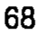 |
| r09_c04 | S22 | Height (cm) | Height (cm) |  | 172 | value 172 cm | 172 | 172 | 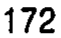 |
| r09_c05 | S22 | Cause of death | Cause of death |  | Carcinomatosis | text Carcinomatosis | Carcinomatosis | Carcinomatosis |  |
| r10_c00 | S23 | Specimen No. | Specimen No. |  | S23 | label S23 | S23 | S23 | 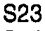 |
| r10_c01 | S23 | Age | Age |  | 57 | value 57 years | 57 | 57 | 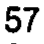 |
| r10_c02 | S23 | Sex | Sex |  | M | text M | M | M |  |
| r10_c03 | S23 | Weight (kg) | Weight (kg) |  | 75 | value 75 kg | 75 | 75 | 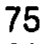 |
| r10_c04 | S23 | Height (cm) | Height (cm) |  | 170 | value 170 cm | 170 | 170 |  |
| r10_c05 | S23 | Cause of death | Cause of death |  | Myocardial infarction | text Myocardial infarction | Myocardial infarction | Myocardial infarction |  |
| r11_c00 | S24 | Specimen No. | Specimen No. |  | S24 | label S24 | S24 | S24 |  |
| r11_c01 | S24 | Age | Age |  | 20 | value 20 years | 20 | 20 |  |
| r11_c02 | S24 | Sex | Sex |  | M | text M | M | M |  |
| r11_c03 | S24 | Weight (kg) | Weight (kg) |  | 68 | value 68 kg | 68 | 68 |  |
| r11_c04 | S24 | Height (cm) | Height (cm) |  | 170 | value 170 cm | 170 | 170 |  |
| r11_c05 | S24 | Cause of death | Cause of death |  | Subdural hemorrhage | text Subdural hemorrhage | Subdural hemorrhage | Subdural hemorrhage |  |
