# Table 3. Vertebral Body Dimensions (See Figure 3 and Table 2 for Nomenclature)

Thoracic, PDF page 1, printed page 892; Panjabi_1991_Thoracic_Spine_16-8_888-901_p892.pdf (sha256 a1a43be91d80a5d5735bcd61fa0f07fee5b5bf73f8aeb6f3652e6dae00541a6a), rendered at 300 dpi by render.py.

Printed page 892 is not in the thoracic scan the other tables were read from (its page 4 is 891 and its page 5 is 893); this table is read from the one-page file the owner supplied on 27 October 2026, a landscape scan whose table reads upright with no turn and prints its lightest digits paler than the other scans (two ratio cells, T7 and T12 of EPWu/EPDu, reach grey 140 in four pixels or fewer), so ink on this page is grey below 170. Its last row, EPIt, prints one line, a mean with no standard error.

Every cell below is the box layout.py cut from the rendered page, and the two strings are what the two reading passes read in it (README.md). A dash is printed where the paper prints one. The value column is what provenance.csv carries.

| cell | row | column | measure | level | printed | value | pass 1 | pass 2 | image |
|---|---|---|---|---|---|---|---|---|---|
| r01_c00 | EPWu | T1 | EPWu | T1 | 24.5 | mean 24.5 mm | 24.5 | 24.5 |  |
| r01_c01 | EPWu | T2 | EPWu | T2 | 24.9 | mean 24.9 mm | 24.9 | 24.9 | 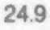 |
| r01_c02 | EPWu | T3 | EPWu | T3 | 24.6 | mean 24.6 mm | 24.6 | 24.6 | 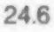 |
| r01_c03 | EPWu | T4 | EPWu | T4 | 24.5 | mean 24.5 mm | 24.5 | 24.5 | 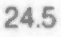 |
| r01_c04 | EPWu | T5 | EPWu | T5 | 24.9 | mean 24.9 mm | 24.9 | 24.9 | 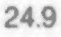 |
| r01_c05 | EPWu | T6 | EPWu | T6 | 26.2 | mean 26.2 mm | 26.2 | 26.2 | 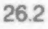 |
| r01_c06 | EPWu | T7 | EPWu | T7 | 27.8 | mean 27.8 mm | 27.8 | 27.8 | 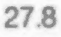 |
| r01_c07 | EPWu | T8 | EPWu | T8 | 29.5 (T1,T3,T4) | mean 29.5 mm | 29.5 (T1,T3,T4) | 29.5 (T1,T3,T4) | 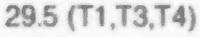 |
| r01_c08 | EPWu | T9 | EPWu | T9 | 30.6 (T1-5) | mean 30.6 mm | 30.6 (T1-5) | 30.6 (T1-5) | 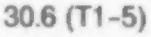 |
| r01_c09 | EPWu | T10 | EPWu | T10 | 31.9 (T1-6) | mean 31.9 mm | 31.9 (T1-6) | 31.9 (T1-6) | 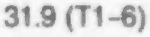 |
| r01_c10 | EPWu | T11 | EPWu | T11 | 34.9 (T1-3) | mean 34.9 mm | 34.9 (T1-3) | 34.9 (T1-3) | 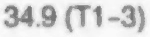 |
| r01_c11 | EPWu | T12 | EPWu | T12 | 39.0 (T1-10) | mean 39.0 mm | 39.0 (T1-10) | 39.0 (T1-10) |  |
| r02_c00 | EPWu | T1 | EPWu | T1 | 0.85 | sem 0.85 mm | 0.85 | 0.85 | 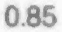 |
| r02_c01 | EPWu | T2 | EPWu | T2 | 0.59 | sem 0.59 mm | 0.59 | 0.59 | 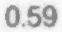 |
| r02_c02 | EPWu | T3 | EPWu | T3 | 0.43 | sem 0.43 mm | 0.43 | 0.43 | 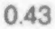 |
| r02_c03 | EPWu | T4 | EPWu | T4 | 0.58 | sem 0.58 mm | 0.58 | 0.58 | 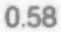 |
| r02_c04 | EPWu | T5 | EPWu | T5 | 0.77 | sem 0.77 mm | 0.77 | 0.77 | 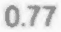 |
| r02_c05 | EPWu | T6 | EPWu | T6 | 0.79 | sem 0.79 mm | 0.79 | 0.79 | 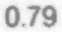 |
| r02_c06 | EPWu | T7 | EPWu | T7 | 0.70 | sem 0.70 mm | 0.70 | 0.70 | 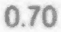 |
| r02_c07 | EPWu | T8 | EPWu | T8 | 0.71 | sem 0.71 mm | 0.71 | 0.71 | 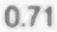 |
| r02_c08 | EPWu | T9 | EPWu | T9 | 1.06 | sem 1.06 mm | 1.06 | 1.06 | 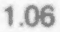 |
| r02_c09 | EPWu | T10 | EPWu | T10 | 0.67 | sem 0.67 mm | 0.67 | 0.67 | 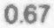 |
| r02_c10 | EPWu | T11 | EPWu | T11 | 0.97 | sem 0.97 mm | 0.97 | 0.97 | 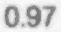 |
| r02_c11 | EPWu | T12 | EPWu | T12 | 0.58 | sem 0.58 mm | 0.58 | 0.58 | 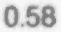 |
| r03_c00 | EPDu | T1 | EPDu | T1 | 18.5 | mean 18.5 mm | 18.5 | 18.5 |  |
| r03_c01 | EPDu | T2 | EPDu | T2 | 19.6 | mean 19.6 mm | 19.6 | 19.6 | 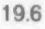 |
| r03_c02 | EPDu | T3 | EPDu | T3 | 22.7 | mean 22.7 mm | 22.7 | 22.7 | 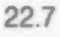 |
| r03_c03 | EPDu | T4 | EPDu | T4 | 23.3 | mean 23.3 mm | 23.3 | 23.3 | 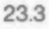 |
| r03_c04 | EPDu | T5 | EPDu | T5 | 24.3 (T1) | mean 24.3 mm | 24.3 (T1) | 24.3 (T1) | 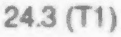 |
| r03_c05 | EPDu | T6 | EPDu | T6 | 26.0 (T1-2) | mean 26.0 mm | 26.0 (T1-2) | 26.0 (T1-2) | 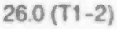 |
| r03_c06 | EPDu | T7 | EPDu | T7 | 27.4 (T1-2) | mean 27.4 mm | 27.4 (T1-2) | 27.4 (T1-2) | 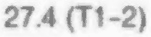 |
| r03_c07 | EPDu | T8 | EPDu | T8 | 27.9 (T1-3) | mean 27.9 mm | 27.9 (T1-3) | 27.9 (T1-3) | 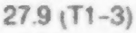 |
| r03_c08 | EPDu | T9 | EPDu | T9 | 29.3 (T1-4) | mean 29.3 mm | 29.3 (T1-4) | 29.3 (T1-4) | 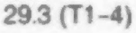 |
| r03_c09 | EPDu | T10 | EPDu | T10 | 30.5 (T1-5) | mean 30.5 mm | 30.5 (T1-5) | 30.5 (T1-5) | 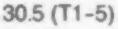 |
| r03_c10 | EPDu | T11 | EPDu | T11 | 31.9 (T1-6) | mean 31.9 mm | 31.9 (T1-6) | 31.9 (T1-6) | 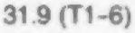 |
| r03_c11 | EPDu | T12 | EPDu | T12 | 32.8 (T1-7) | mean 32.8 mm | 32.8 (T1-7) | 32.8 (T1-7) | 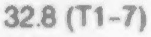 |
| r04_c00 | EPDu | T1 | EPDu | T1 | 0.75 | sem 0.75 mm | 0.75 | 0.75 | 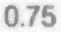 |
| r04_c01 | EPDu | T2 | EPDu | T2 | 0.41 | sem 0.41 mm | 0.41 | 0.41 | 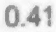 |
| r04_c02 | EPDu | T3 | EPDu | T3 | 0.75 | sem 0.75 mm | 0.75 | 0.75 | 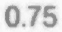 |
| r04_c03 | EPDu | T4 | EPDu | T4 | 0.58 | sem 0.58 mm | 0.58 | 0.58 | 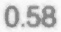 |
| r04_c04 | EPDu | T5 | EPDu | T5 | 0.79 | sem 0.79 mm | 0.79 | 0.79 | 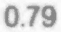 |
| r04_c05 | EPDu | T6 | EPDu | T6 | 0.80 | sem 0.80 mm | 0.80 | 0.80 | 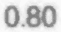 |
| r04_c06 | EPDu | T7 | EPDu | T7 | 0.54 | sem 0.54 mm | 0.54 | 0.54 | 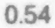 |
| r04_c07 | EPDu | T8 | EPDu | T8 | 0.52 | sem 0.52 mm | 0.52 | 0.52 | 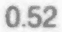 |
| r04_c08 | EPDu | T9 | EPDu | T9 | 1.03 | sem 1.03 mm | 1.03 | 1.03 | 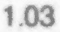 |
| r04_c09 | EPDu | T10 | EPDu | T10 | 0.85 | sem 0.85 mm | 0.85 | 0.85 | 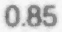 |
| r04_c10 | EPDu | T11 | EPDu | T11 | 0.71 | sem 0.71 mm | 0.71 | 0.71 | 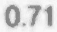 |
| r04_c11 | EPDu | T12 | EPDu | T12 | 1.21 | sem 1.21 mm | 1.21 | 1.21 | 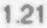 |
| r05_c00 | EPWl | T1 | EPWl | T1 | 27.8 | mean 27.8 mm | 27.8 | 27.8 |  |
| r05_c01 | EPWl | T2 | EPWl | T2 | 27.4 | mean 27.4 mm | 27.4 | 27.4 |  |
| r05_c02 | EPWl | T3 | EPWl | T3 | 25.9 | mean 25.9 mm | 25.9 | 25.9 |  |
| r05_c03 | EPWl | T4 | EPWl | T4 | 26.0 | mean 26.0 mm | 26.0 | 26.0 |  |
| r05_c04 | EPWl | T5 | EPWl | T5 | 27.0 | mean 27.0 mm | 27.0 | 27.0 | 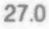 |
| r05_c05 | EPWl | T6 | EPWl | T6 | 28.2 | mean 28.2 mm | 28.2 | 28.2 | 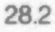 |
| r05_c06 | EPWl | T7 | EPWl | T7 | 29.1 | mean 29.1 mm | 29.1 | 29.1 | 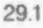 |
| r05_c07 | EPWl | T8 | EPWl | T8 | 30.5 | mean 30.5 mm | 30.5 | 30.5 | 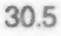 |
| r05_c08 | EPWl | T9 | EPWl | T9 | 33.0 (T2-5) | mean 33.0 mm | 33.0 (T2-5) | 33.0 (T2-5) | 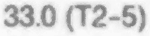 |
| r05_c09 | EPWl | T10 | EPWl | T10 | 35.4 (T1-7) | mean 35.4 mm | 35.4 (T1-7) | 35.4 (T1-7) |  |
| r05_c10 | EPWl | T11 | EPWl | T11 | 39.1 (T1-9) | mean 39.1 mm | 39.1 (T1-9) | 39.1 (T1-9) |  |
| r05_c11 | EPWl | T12 | EPWl | T12 | 42.1 (T1-10) | mean 42.1 mm | 42.1 (T1-10) | 42.1 (T1-10) |  |
| r06_c00 | EPWl | T1 | EPWl | T1 | 0.64 | sem 0.64 mm | 0.64 | 0.64 |  |
| r06_c01 | EPWl | T2 | EPWl | T2 | 0.65 | sem 0.65 mm | 0.65 | 0.65 |  |
| r06_c02 | EPWl | T3 | EPWl | T3 | 0.87 | sem 0.87 mm | 0.87 | 0.87 |  |
| r06_c03 | EPWl | T4 | EPWl | T4 | 0.92 | sem 0.92 mm | 0.92 | 0.92 |  |
| r06_c04 | EPWl | T5 | EPWl | T5 | 0.96 | sem 0.96 mm | 0.96 | 0.96 |  |
| r06_c05 | EPWl | T6 | EPWl | T6 | 0.82 | sem 0.82 mm | 0.82 | 0.82 |  |
| r06_c06 | EPWl | T7 | EPWl | T7 | 0.69 | sem 0.69 mm | 0.69 | 0.69 |  |
| r06_c07 | EPWl | T8 | EPWl | T8 | 0.70 | sem 0.70 mm | 0.70 | 0.70 |  |
| r06_c08 | EPWl | T9 | EPWl | T9 | 1.10 | sem 1.10 mm | 1.10 | 1.10 |  |
| r06_c09 | EPWl | T10 | EPWl | T10 | 0.98 | sem 0.98 mm | 0.98 | 0.98 |  |
| r06_c10 | EPWl | T11 | EPWl | T11 | 0.71 | sem 0.71 mm | 0.71 | 0.71 |  |
| r06_c11 | EPWl | T12 | EPWl | T12 | 0.91 | sem 0.91 mm | 0.91 | 0.91 |  |
| r07_c00 | EPDl | T1 | EPDl | T1 | 19.7 | mean 19.7 mm | 19.7 | 19.7 |  |
| r07_c01 | EPDl | T2 | EPDl | T2 | 21.6 | mean 21.6 mm | 21.6 | 21.6 |  |
| r07_c02 | EPDl | T3 | EPDl | T3 | 23.3 | mean 23.3 mm | 23.3 | 23.3 |  |
| r07_c03 | EPDl | T4 | EPDl | T4 | 24.5 | mean 24.5 mm | 24.5 | 24.5 |  |
| r07_c04 | EPDl | T5 | EPDl | T5 | 25.8 (T1) | mean 25.8 mm | 25.8 (T1) | 25.8 (T1) |  |
| r07_c05 | EPDl | T6 | EPDl | T6 | 26.9 (T1-2) | mean 26.9 mm | 26.9 (T1-2) | 26.9 (T1-2) |  |
| r07_c06 | EPDl | T7 | EPDl | T7 | 28.5 (T1-3) | mean 28.5 mm | 28.5 (T1-3) | 28.5 (T1-3) |  |
| r07_c07 | EPDl | T8 | EPDl | T8 | 29.4 (T1-3) | mean 29.4 mm | 29.4 (T1-3) | 29.4 (T1-3) |  |
| r07_c08 | EPDl | T9 | EPDl | T9 | 31.0 (T1-5) | mean 31.0 mm | 31.0 (T1-5) | 31.0 (T1-5) |  |
| r07_c09 | EPDl | T10 | EPDl | T10 | 31.6 (T1-5) | mean 31.6 mm | 31.6 (T1-5) | 31.6 (T1-5) |  |
| r07_c10 | EPDl | T11 | EPDl | T11 | 31.8 (T1-5) | mean 31.8 mm | 31.8 (T1-5) | 31.8 (T1-5) |  |
| r07_c11 | EPDl | T12 | EPDl | T12 | 33.4 (T1-6) | mean 33.4 mm | 33.4 (T1-6) | 33.4 (T1-6) |  |
| r08_c00 | EPDl | T1 | EPDl | T1 | 0.52 | sem 0.52 mm | 0.52 | 0.52 |  |
| r08_c01 | EPDl | T2 | EPDl | T2 | 0.64 | sem 0.64 mm | 0.64 | 0.64 |  |
| r08_c02 | EPDl | T3 | EPDl | T3 | 0.75 | sem 0.75 mm | 0.75 | 0.75 |  |
| r08_c03 | EPDl | T4 | EPDl | T4 | 0.78 | sem 0.78 mm | 0.78 | 0.78 |  |
| r08_c04 | EPDl | T5 | EPDl | T5 | 0.77 | sem 0.77 mm | 0.77 | 0.77 |  |
| r08_c05 | EPDl | T6 | EPDl | T6 | 0.67 | sem 0.67 mm | 0.67 | 0.67 |  |
| r08_c06 | EPDl | T7 | EPDl | T7 | 0.87 | sem 0.87 mm | 0.87 | 0.87 |  |
| r08_c07 | EPDl | T8 | EPDl | T8 | 0.71 | sem 0.71 mm | 0.71 | 0.71 |  |
| r08_c08 | EPDl | T9 | EPDl | T9 | 0.89 | sem 0.89 mm | 0.89 | 0.89 |  |
| r08_c09 | EPDl | T10 | EPDl | T10 | 1.11 | sem 1.11 mm | 1.11 | 1.11 |  |
| r08_c10 | EPDl | T11 | EPDl | T11 | 0.78 | sem 0.78 mm | 0.78 | 0.78 |  |
| r08_c11 | EPDl | T12 | EPDl | T12 | 0.78 | sem 0.78 mm | 0.78 | 0.78 |  |
| r09_c00 | VBHp | T1 | VBHp | T1 | 14.1 | mean 14.1 mm | 14.1 | 14.1 |  |
| r09_c01 | VBHp | T2 | VBHp | T2 | 15.6 | mean 15.6 mm | 15.6 | 15.6 |  |
| r09_c02 | VBHp | T3 | VBHp | T3 | 15.7 | mean 15.7 mm | 15.7 | 15.7 |  |
| r09_c03 | VBHp | T4 | VBHp | T4 | 16.2 | mean 16.2 mm | 16.2 | 16.2 |  |
| r09_c04 | VBHp | T5 | VBHp | T5 | 16.2 | mean 16.2 mm | 16.2 | 16.2 |  |
| r09_c05 | VBHp | T6 | VBHp | T6 | 17.4 | mean 17.4 mm | 17.4 | 17.4 |  |
| r09_c06 | VBHp | T7 | VBHp | T7 | 18.2 | mean 18.2 mm | 18.2 | 18.2 |  |
| r09_c07 | VBHp | T8 | VBHp | T8 | 18.7 (T1) | mean 18.7 mm | 18.7 (T1) | 18.7 (T1) |  |
| r09_c08 | VBHp | T9 | VBHp | T9 | 19.3 (T1) | mean 19.3 mm | 19.3 (T1) | 19.3 (T1) |  |
| r09_c09 | VBHp | T10 | VBHp | T10 | 20.2 (T1-3) | mean 20.2 mm | 20.2 (T1-3) | 20.2 (T1-3) |  |
| r09_c10 | VBHp | T11 | VBHp | T11 | 21.3 (T1-5) | mean 21.3 mm | 21.3 (T1-5) | 21.3 (T1-5) |  |
| r09_c11 | VBHp | T12 | VBHp | T12 | 22.7 (T1-7) | mean 22.7 mm | 22.7 (T1-7) | 22.7 (T1-7) |  |
| r10_c00 | VBHp | T1 | VBHp | T1 | 0.41 | sem 0.41 mm | 0.41 | 0.41 |  |
| r10_c01 | VBHp | T2 | VBHp | T2 | 0.58 | sem 0.58 mm | 0.58 | 0.58 |  |
| r10_c02 | VBHp | T3 | VBHp | T3 | 0.57 | sem 0.57 mm | 0.57 | 0.57 |  |
| r10_c03 | VBHp | T4 | VBHp | T4 | 0.48 | sem 0.48 mm | 0.48 | 0.48 |  |
| r10_c04 | VBHp | T5 | VBHp | T5 | 0.60 | sem 0.60 mm | 0.60 | 0.60 |  |
| r10_c05 | VBHp | T6 | VBHp | T6 | 0.54 | sem 0.54 mm | 0.54 | 0.54 |  |
| r10_c06 | VBHp | T7 | VBHp | T7 | 0.70 | sem 0.70 mm | 0.70 | 0.70 |  |
| r10_c07 | VBHp | T8 | VBHp | T8 | 0.69 | sem 0.69 mm | 0.69 | 0.69 |  |
| r10_c08 | VBHp | T9 | VBHp | T9 | 0.59 | sem 0.59 mm | 0.59 | 0.59 |  |
| r10_c09 | VBHp | T10 | VBHp | T10 | 0.44 | sem 0.44 mm | 0.44 | 0.44 |  |
| r10_c10 | VBHp | T11 | VBHp | T11 | 0.71 | sem 0.71 mm | 0.71 | 0.71 |  |
| r10_c11 | VBHp | T12 | VBHp | T12 | 1.04 | sem 1.04 mm | 1.04 | 1.04 |  |
| r11_c00 | EPWu/EPDu | T1 | EPWu/EPDu | T1 | 1.3 | ratio 1.3 | 1.3 | 1.3 |  |
| r11_c01 | EPWu/EPDu | T2 | EPWu/EPDu | T2 | 1.3 | ratio 1.3 | 1.3 | 1.3 |  |
| r11_c02 | EPWu/EPDu | T3 | EPWu/EPDu | T3 | 1.1 | ratio 1.1 | 1.1 | 1.1 |  |
| r11_c03 | EPWu/EPDu | T4 | EPWu/EPDu | T4 | 1.0 | ratio 1.0 | 1.0 | 1.0 |  |
| r11_c04 | EPWu/EPDu | T5 | EPWu/EPDu | T5 | 1.0 | ratio 1.0 | 1.0 | 1.0 |  |
| r11_c05 | EPWu/EPDu | T6 | EPWu/EPDu | T6 | 1.0 | ratio 1.0 | 1.0 | 1.0 |  |
| r11_c06 | EPWu/EPDu | T7 | EPWu/EPDu | T7 | 1.0 | ratio 1.0 | 1.0 | 1.0 |  |
| r11_c07 | EPWu/EPDu | T8 | EPWu/EPDu | T8 | 1.0 | ratio 1.0 | 1.0 | 1.0 |  |
| r11_c08 | EPWu/EPDu | T9 | EPWu/EPDu | T9 | 1.0 | ratio 1.0 | 1.0 | 1.0 |  |
| r11_c09 | EPWu/EPDu | T10 | EPWu/EPDu | T10 | 1.0 | ratio 1.0 | 1.0 | 1.0 |  |
| r11_c10 | EPWu/EPDu | T11 | EPWu/EPDu | T11 | 1.1 | ratio 1.1 | 1.1 | 1.1 |  |
| r11_c11 | EPWu/EPDu | T12 | EPWu/EPDu | T12 | 1.2 | ratio 1.2 | 1.2 | 1.2 |  |
| r12_c00 | EPWl/EPDl | T1 | EPWl/EPDl | T1 | 1.4 | ratio 1.4 | 1.4 | 1.4 |  |
| r12_c01 | EPWl/EPDl | T2 | EPWl/EPDl | T2 | 1.3 | ratio 1.3 | 1.3 | 1.3 |  |
| r12_c02 | EPWl/EPDl | T3 | EPWl/EPDl | T3 | 1.1 | ratio 1.1 | 1.1 | 1.1 |  |
| r12_c03 | EPWl/EPDl | T4 | EPWl/EPDl | T4 | 1.1 | ratio 1.1 | 1.1 | 1.1 |  |
| r12_c04 | EPWl/EPDl | T5 | EPWl/EPDl | T5 | 1.0 | ratio 1.0 | 1.0 | 1.0 |  |
| r12_c05 | EPWl/EPDl | T6 | EPWl/EPDl | T6 | 1.0 | ratio 1.0 | 1.0 | 1.0 |  |
| r12_c06 | EPWl/EPDl | T7 | EPWl/EPDl | T7 | 1.0 | ratio 1.0 | 1.0 | 1.0 |  |
| r12_c07 | EPWl/EPDl | T8 | EPWl/EPDl | T8 | 1.0 | ratio 1.0 | 1.0 | 1.0 |  |
| r12_c08 | EPWl/EPDl | T9 | EPWl/EPDl | T9 | 1.1 | ratio 1.1 | 1.1 | 1.1 |  |
| r12_c09 | EPWl/EPDl | T10 | EPWl/EPDl | T10 | 1.1 | ratio 1.1 | 1.1 | 1.1 |  |
| r12_c10 | EPWl/EPDl | T11 | EPWl/EPDl | T11 | 1.2 | ratio 1.2 | 1.2 | 1.2 |  |
| r12_c11 | EPWl/EPDl | T12 | EPWl/EPDl | T12 | 1.3 | ratio 1.3 | 1.3 | 1.3 |  |
| r14_c00 | EPAu | T1 | EPAu | T1 | 300.0 | mean 300.0 mm2 | 300.0 | 300.0 |  |
| r14_c01 | EPAu | T2 | EPAu | T2 | 333.0 | mean 333.0 mm2 | 333.0 | 333.0 |  |
| r14_c02 | EPAu | T3 | EPAu | T3 | 373.0 | mean 373.0 mm2 | 373.0 | 373.0 |  |
| r14_c03 | EPAu | T4 | EPAu | T4 | 381.0 | mean 381.0 mm2 | 381.0 | 381.0 |  |
| r14_c04 | EPAu | T5 | EPAu | T5 | 426.0 | mean 426.0 mm2 | 426.0 | 426.0 |  |
| r14_c05 | EPAu | T6 | EPAu | T6 | 483.0 | mean 483.0 mm2 | 483.0 | 483.0 |  |
| r14_c06 | EPAu | T7 | EPAu | T7 | 547.0 (T1-2) | mean 547.0 mm2 | 547.0 (T1-2) | 547.0 (T1-2) |  |
| r14_c07 | EPAu | T8 | EPAu | T8 | 605.0 (T1-4) | mean 605.0 mm2 | 605.0 (T1-4) | 605.0 (T1-4) |  |
| r14_c08 | EPAu | T9 | EPAu | T9 | 678.0 (T1-6) | mean 678.0 mm2 | 678.0 (T1-6) | 678.0 (T1-6) |  |
| r14_c09 | EPAu | T10 | EPAu | T10 | 727.0 (T1-6) | mean 727.0 mm2 | 727.0 (T1-6) | 727.0 (T1-6) |  |
| r14_c10 | EPAu | T11 | EPAu | T11 | 842.0 (T1-8) | mean 842.0 mm2 | 842.0 (T1-8) | 842.0 (T1-8) |  |
| r14_c11 | EPAu | T12 | EPAu | T12 | 954.0 (T1-10) | mean 954.0 mm2 | 954.0 (T1-10) | 954.0 (T1-10) |  |
| r15_c00 | EPAu | T1 | EPAu | T1 | 14.3 | sem 14.3 mm2 | 14.3 | 14.3 |  |
| r15_c01 | EPAu | T2 | EPAu | T2 | 11.5 | sem 11.5 mm2 | 11.5 | 11.5 |  |
| r15_c02 | EPAu | T3 | EPAu | T3 | 16.5 | sem 16.5 mm2 | 16.5 | 16.5 |  |
| r15_c03 | EPAu | T4 | EPAu | T4 | 17.3 | sem 17.3 mm2 | 17.3 | 17.3 |  |
| r15_c04 | EPAu | T5 | EPAu | T5 | 17.9 | sem 17.9 mm2 | 17.9 | 17.9 |  |
| r15_c05 | EPAu | T6 | EPAu | T6 | 23.9 | sem 23.9 mm2 | 23.9 | 23.9 |  |
| r15_c06 | EPAu | T7 | EPAu | T7 | 25.6 | sem 25.6 mm2 | 25.6 | 25.6 |  |
| r15_c07 | EPAu | T8 | EPAu | T8 | 26.0 | sem 26.0 mm2 | 26.0 | 26.0 |  |
| r15_c08 | EPAu | T9 | EPAu | T9 | 47.0 | sem 47.0 mm2 | 47.0 | 47.0 |  |
| r15_c09 | EPAu | T10 | EPAu | T10 | 35.5 | sem 35.5 mm2 | 35.5 | 35.5 |  |
| r15_c10 | EPAu | T11 | EPAu | T11 | 41.4 | sem 41.4 mm2 | 41.4 | 41.4 |  |
| r15_c11 | EPAu | T12 | EPAu | T12 | 44.0 | sem 44.0 mm2 | 44.0 | 44.0 |  |
| r16_c00 | EPAl | T1 | EPAl | T1 | 376.0 | mean 376.0 mm2 | 376.0 | 376.0 |  |
| r16_c01 | EPAl | T2 | EPAl | T2 | 398.0 | mean 398.0 mm2 | 398.0 | 398.0 |  |
| r16_c02 | EPAl | T3 | EPAl | T3 | 412.0 | mean 412.0 mm2 | 412.0 | 412.0 |  |
| r16_c03 | EPAl | T4 | EPAl | T4 | 444.0 | mean 444.0 mm2 | 444.0 | 444.0 |  |
| r16_c04 | EPAl | T5 | EPAl | T5 | 495.0 | mean 495.0 mm2 | 495.0 | 495.0 |  |
| r16_c05 | EPAl | T6 | EPAl | T6 | 552.0 | mean 552.0 mm2 | 552.0 | 552.0 |  |
| r16_c06 | EPAl | T7 | EPAl | T7 | 603.0 (T1-2) | mean 603.0 mm2 | 603.0 (T1-2) | 603.0 (T1-2) |  |
| r16_c07 | EPAl | T8 | EPAl | T8 | 664.0 (T1-4) | mean 664.0 mm2 | 664.0 (T1-4) | 664.0 (T1-4) |  |
| r16_c08 | EPAl | T9 | EPAl | T9 | 755.0 (T1-5) | mean 755.0 mm2 | 755.0 (T1-5) | 755.0 (T1-5) |  |
| r16_c09 | EPAl | T10 | EPAl | T10 | 834.0 (T1-7) | mean 834.0 mm2 | 834.0 (T1-7) | 834.0 (T1-7) |  |
| r16_c10 | EPAl | T11 | EPAl | T11 | 945.0 (T1-8) | mean 945.0 mm2 | 945.0 (T1-8) | 945.0 (T1-8) |  |
| r16_c11 | EPAl | T12 | EPAl | T12 | 1024.0 (T1-9) | mean 1024.0 mm2 | 1024.0 (T1-9) | 1024.0 (T1-9) |  |
| r17_c00 | EPAl | T1 | EPAl | T1 | 14.5 | sem 14.5 mm2 | 14.5 | 14.5 |  |
| r17_c01 | EPAl | T2 | EPAl | T2 | 10.9 | sem 10.9 mm2 | 10.9 | 10.9 |  |
| r17_c02 | EPAl | T3 | EPAl | T3 | 18.1 | sem 18.1 mm2 | 18.1 | 18.1 |  |
| r17_c03 | EPAl | T4 | EPAl | T4 | 20.8 | sem 20.8 mm2 | 20.8 | 20.8 |  |
| r17_c04 | EPAl | T5 | EPAl | T5 | 24.5 | sem 24.5 mm2 | 24.5 | 24.5 |  |
| r17_c05 | EPAl | T6 | EPAl | T6 | 21.1 | sem 21.1 mm2 | 21.1 | 21.1 |  |
| r17_c06 | EPAl | T7 | EPAl | T7 | 24.5 | sem 24.5 mm2 | 24.5 | 24.5 |  |
| r17_c07 | EPAl | T8 | EPAl | T8 | 28.6 | sem 28.6 mm2 | 28.6 | 28.6 |  |
| r17_c08 | EPAl | T9 | EPAl | T9 | 44.5 | sem 44.5 mm2 | 44.5 | 44.5 |  |
| r17_c09 | EPAl | T10 | EPAl | T10 | 43.2 | sem 43.2 mm2 | 43.2 | 43.2 |  |
| r17_c10 | EPAl | T11 | EPAl | T11 | 44.3 | sem 44.3 mm2 | 44.3 | 44.3 |  |
| r17_c11 | EPAl | T12 | EPAl | T12 | 49.8 | sem 49.8 mm2 | 49.8 | 49.8 |  |
| r19_c00 | EPItu | T1 | EPItu | T1 | 1.8 | mean 1.8 deg | 1.8 | 1.8 |  |
| r19_c01 | EPItu | T2 | EPItu | T2 | 1.7 | mean 1.7 deg | 1.7 | 1.7 |  |
| r19_c02 | EPItu | T3 | EPItu | T3 | 2.4 | mean 2.4 deg | 2.4 | 2.4 |  |
| r19_c03 | EPItu | T4 | EPItu | T4 | 1.5 | mean 1.5 deg | 1.5 | 1.5 |  |
| r19_c04 | EPItu | T5 | EPItu | T5 | 2.1 | mean 2.1 deg | 2.1 | 2.1 |  |
| r19_c05 | EPItu | T6 | EPItu | T6 | 2.1 | mean 2.1 deg | 2.1 | 2.1 |  |
| r19_c06 | EPItu | T7 | EPItu | T7 | 1.6 | mean 1.6 deg | 1.6 | 1.6 |  |
| r19_c07 | EPItu | T8 | EPItu | T8 | 1.3 | mean 1.3 deg | 1.3 | 1.3 |  |
| r19_c08 | EPItu | T9 | EPItu | T9 | 0.9 | mean 0.9 deg | 0.9 | 0.9 |  |
| r19_c09 | EPItu | T10 | EPItu | T10 | 0.5 | mean 0.5 deg | 0.5 | 0.5 |  |
| r19_c10 | EPItu | T11 | EPItu | T11 | 2.3 | mean 2.3 deg | 2.3 | 2.3 |  |
| r19_c11 | EPItu | T12 | EPItu | T12 | 2.2 | mean 2.2 deg | 2.2 | 2.2 |  |
| r20_c00 | EPItu | T1 | EPItu | T1 | 0.65 | sem 0.65 deg | 0.65 | 0.65 |  |
| r20_c01 | EPItu | T2 | EPItu | T2 | 0.32 | sem 0.32 deg | 0.32 | 0.32 |  |
| r20_c02 | EPItu | T3 | EPItu | T3 | 0.87 | sem 0.87 deg | 0.87 | 0.87 |  |
| r20_c03 | EPItu | T4 | EPItu | T4 | 0.36 | sem 0.36 deg | 0.36 | 0.36 |  |
| r20_c04 | EPItu | T5 | EPItu | T5 | 0.47 | sem 0.47 deg | 0.47 | 0.47 |  |
| r20_c05 | EPItu | T6 | EPItu | T6 | 0.81 | sem 0.81 deg | 0.81 | 0.81 |  |
| r20_c06 | EPItu | T7 | EPItu | T7 | 0.65 | sem 0.65 deg | 0.65 | 0.65 |  |
| r20_c07 | EPItu | T8 | EPItu | T8 | 0.34 | sem 0.34 deg | 0.34 | 0.34 |  |
| r20_c08 | EPItu | T9 | EPItu | T9 | 0.45 | sem 0.45 deg | 0.45 | 0.45 |  |
| r20_c09 | EPItu | T10 | EPItu | T10 | 0.14 | sem 0.14 deg | 0.14 | 0.14 |  |
| r20_c10 | EPItu | T11 | EPItu | T11 | 0.65 | sem 0.65 deg | 0.65 | 0.65 |  |
| r20_c11 | EPItu | T12 | EPItu | T12 | 0.79 | sem 0.79 deg | 0.79 | 0.79 |  |
| r21_c00 | EPItl | T1 | EPItl | T1 | 3.9 | mean 3.9 deg | 3.9 | 3.9 |  |
| r21_c01 | EPItl | T2 | EPItl | T2 | 1.9 | mean 1.9 deg | 1.9 | 1.9 |  |
| r21_c02 | EPItl | T3 | EPItl | T3 | 2.1 | mean 2.1 deg | 2.1 | 2.1 |  |
| r21_c03 | EPItl | T4 | EPItl | T4 | 2.3 | mean 2.3 deg | 2.3 | 2.3 |  |
| r21_c04 | EPItl | T5 | EPItl | T5 | 2.0 | mean 2.0 deg | 2.0 | 2.0 |  |
| r21_c05 | EPItl | T6 | EPItl | T6 | 1.8 | mean 1.8 deg | 1.8 | 1.8 |  |
| r21_c06 | EPItl | T7 | EPItl | T7 | 2.2 | mean 2.2 deg | 2.2 | 2.2 |  |
| r21_c07 | EPItl | T8 | EPItl | T8 | 2.3 | mean 2.3 deg | 2.3 | 2.3 |  |
| r21_c08 | EPItl | T9 | EPItl | T9 | 1.2 | mean 1.2 deg | 1.2 | 1.2 |  |
| r21_c09 | EPItl | T10 | EPItl | T10 | 1.2 | mean 1.2 deg | 1.2 | 1.2 |  |
| r21_c10 | EPItl | T11 | EPItl | T11 | 2.2 | mean 2.2 deg | 2.2 | 2.2 |  |
| r21_c11 | EPItl | T12 | EPItl | T12 | 1.8 | mean 1.8 deg | 1.8 | 1.8 |  |
| r22_c00 | EPItl | T1 | EPItl | T1 | 0.61 | sem 0.61 deg | 0.61 | 0.61 |  |
| r22_c01 | EPItl | T2 | EPItl | T2 | 0.67 | sem 0.67 deg | 0.67 | 0.67 |  |
| r22_c02 | EPItl | T3 | EPItl | T3 | 0.61 | sem 0.61 deg | 0.61 | 0.61 |  |
| r22_c03 | EPItl | T4 | EPItl | T4 | 0.54 | sem 0.54 deg | 0.54 | 0.54 |  |
| r22_c04 | EPItl | T5 | EPItl | T5 | 0.45 | sem 0.45 deg | 0.45 | 0.45 |  |
| r22_c05 | EPItl | T6 | EPItl | T6 | 0.68 | sem 0.68 deg | 0.68 | 0.68 |  |
| r22_c06 | EPItl | T7 | EPItl | T7 | 0.59 | sem 0.59 deg | 0.59 | 0.59 |  |
| r22_c07 | EPItl | T8 | EPItl | T8 | 0.52 | sem 0.52 deg | 0.52 | 0.52 |  |
| r22_c08 | EPItl | T9 | EPItl | T9 | 0.39 | sem 0.39 deg | 0.39 | 0.39 |  |
| r22_c09 | EPItl | T10 | EPItl | T10 | 0.27 | sem 0.27 deg | 0.27 | 0.27 |  |
| r22_c10 | EPItl | T11 | EPItl | T11 | 0.60 | sem 0.60 deg | 0.60 | 0.60 |  |
| r22_c11 | EPItl | T12 | EPItl | T12 | 0.32 | sem 0.32 deg | 0.32 | 0.32 |  |
| r23_c00 | EPIt | T1 | EPIt | T1 | 5.7 | mean 5.7 deg | 5.7 | 5.7 |  |
| r23_c01 | EPIt | T2 | EPIt | T2 | 3.6 | mean 3.6 deg | 3.6 | 3.6 |  |
| r23_c02 | EPIt | T3 | EPIt | T3 | 4.5 | mean 4.5 deg | 4.5 | 4.5 |  |
| r23_c03 | EPIt | T4 | EPIt | T4 | 3.8 | mean 3.8 deg | 3.8 | 3.8 |  |
| r23_c04 | EPIt | T5 | EPIt | T5 | 4.1 | mean 4.1 deg | 4.1 | 4.1 |  |
| r23_c05 | EPIt | T6 | EPIt | T6 | 3.9 | mean 3.9 deg | 3.9 | 3.9 |  |
| r23_c06 | EPIt | T7 | EPIt | T7 | 3.8 | mean 3.8 deg | 3.8 | 3.8 |  |
| r23_c07 | EPIt | T8 | EPIt | T8 | 3.6 | mean 3.6 deg | 3.6 | 3.6 |  |
| r23_c08 | EPIt | T9 | EPIt | T9 | 2.1 | mean 2.1 deg | 2.1 | 2.1 |  |
| r23_c09 | EPIt | T10 | EPIt | T10 | 1.7 | mean 1.7 deg | 1.7 | 1.7 |  |
| r23_c10 | EPIt | T11 | EPIt | T11 | 4.5 | mean 4.5 deg | 4.5 | 4.5 |  |
| r23_c11 | EPIt | T12 | EPIt | T12 | 4.0 | mean 4.0 deg | 4.0 | 4.0 |  |
