# Table 4. Spinal Canal Dimensions

Thoracic, PDF page 5, printed page 893; Panjabi_1991_Thoracic_Spine_16-8_888-901.pdf (sha256 f4078fa2cd2cf2c140fcee7f018917e055d2ca825c42e9b01d84cf1f4b7c1e2c), rendered at 300 dpi by render.py.

Every cell below is the box layout.py cut from the rendered page, and the two strings are what the two reading passes read in it (README.md). A dash is printed where the paper prints one. The value column is what provenance.csv carries.

| cell | row | column | measure | level | printed | value | pass 1 | pass 2 | image |
|---|---|---|---|---|---|---|---|---|---|
| r01_c00 | SCW | T1 | SCW | T1 | 21.8 | mean 21.8 mm | 21.8 | 21.8 | 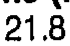 |
| r01_c01 | SCW | T2 | SCW | T2 | 19.5 | mean 19.5 mm | 19.5 | 19.5 | 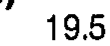 |
| r01_c02 | SCW | T3 | SCW | T3 | 18.3 | mean 18.3 mm | 18.3 | 18.3 | 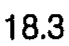 |
| r01_c03 | SCW | T4 | SCW | T4 | 17.0 | mean 17.0 mm | 17.0 | 17.0 | 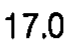 |
| r01_c04 | SCW | T5 | SCW | T5 | 17.1 | mean 17.1 mm | 17.1 | 17.1 |  |
| r01_c05 | SCW | T6 | SCW | T6 | 17.3 | mean 17.3 mm | 17.3 | 17.3 | 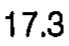 |
| r01_c06 | SCW | T7 | SCW | T7 | 17.3 | mean 17.3 mm | 17.3 | 17.3 | 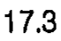 |
| r01_c07 | SCW | T8 | SCW | T8 | 17.7 | mean 17.7 mm | 17.7 | 17.7 | 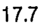 |
| r01_c08 | SCW | T9 | SCW | T9 | 17.9 | mean 17.9 mm | 17.9 | 17.9 | 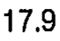 |
| r01_c09 | SCW | T10 | SCW | T10 | 18.2 | mean 18.2 mm | 18.2 | 18.2 | 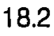 |
| r01_c10 | SCW | T11 | SCW | T11 | 19.4 | mean 19.4 mm | 19.4 | 19.4 | 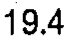 |
| r01_c11 | SCW | T12 | SCW | T12 | 22.2 (T4) | mean 22.2 mm | 22.2 (T4) | 22.2 (T4) | 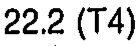 |
| r02_c00 | SCW | T1 | SCW | T1 | 0.71 | sem 0.71 mm | 0.71 | 0.71 | 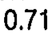 |
| r02_c01 | SCW | T2 | SCW | T2 | 0.34 | sem 0.34 mm | 0.34 | 0.34 | 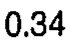 |
| r02_c02 | SCW | T3 | SCW | T3 | 0.54 | sem 0.54 mm | 0.54 | 0.54 | 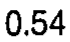 |
| r02_c03 | SCW | T4 | SCW | T4 | 0.57 | sem 0.57 mm | 0.57 | 0.57 | 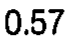 |
| r02_c04 | SCW | T5 | SCW | T5 | 0.68 | sem 0.68 mm | 0.68 | 0.68 | 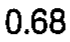 |
| r02_c05 | SCW | T6 | SCW | T6 | 0.74 | sem 0.74 mm | 0.74 | 0.74 | 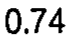 |
| r02_c06 | SCW | T7 | SCW | T7 | 0.83 | sem 0.83 mm | 0.83 | 0.83 | 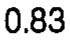 |
| r02_c07 | SCW | T8 | SCW | T8 | 0.63 | sem 0.63 mm | 0.63 | 0.63 | 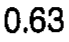 |
| r02_c08 | SCW | T9 | SCW | T9 | 1.19 | sem 1.19 mm | 1.19 | 1.19 | 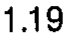 |
| r02_c09 | SCW | T10 | SCW | T10 | 0.78 | sem 0.78 mm | 0.78 | 0.78 | 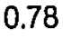 |
| r02_c10 | SCW | T11 | SCW | T11 | 0.95 | sem 0.95 mm | 0.95 | 0.95 | 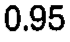 |
| r02_c11 | SCW | T12 | SCW | T12 | 1.12 | sem 1.12 mm | 1.12 | 1.12 |  |
| r03_c00 | SCD | T1 | SCD | T1 | 16.4 | mean 16.4 mm | 16.4 | 16.4 | 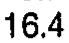 |
| r03_c01 | SCD | T2 | SCD | T2 | 15.3 | mean 15.3 mm | 15.3 | 15.3 | 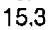 |
| r03_c02 | SCD | T3 | SCD | T3 | 15.9 | mean 15.9 mm | 15.9 | 15.9 | 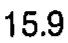 |
| r03_c03 | SCD | T4 | SCD | T4 | 16.2 | mean 16.2 mm | 16.2 | 16.2 | 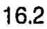 |
| r03_c04 | SCD | T5 | SCD | T5 | 16.3 | mean 16.3 mm | 16.3 | 16.3 | 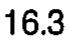 |
| r03_c05 | SCD | T6 | SCD | T6 | 16.5 | mean 16.5 mm | 16.5 | 16.5 | 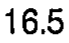 |
| r03_c06 | SCD | T7 | SCD | T7 | 16.1 | mean 16.1 mm | 16.1 | 16.1 | 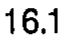 |
| r03_c07 | SCD | T8 | SCD | T8 | 15.9 | mean 15.9 mm | 15.9 | 15.9 | 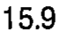 |
| r03_c08 | SCD | T9 | SCD | T9 | 15.7 | mean 15.7 mm | 15.7 | 15.7 | 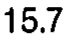 |
| r03_c09 | SCD | T10 | SCD | T10 | 15.5 | mean 15.5 mm | 15.5 | 15.5 | 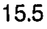 |
| r03_c10 | SCD | T11 | SCD | T11 | 16.0 | mean 16.0 mm | 16.0 | 16.0 | 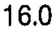 |
| r03_c11 | SCD | T12 | SCD | T12 | 18.1 | mean 18.1 mm | 18.1 | 18.1 | 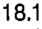 |
| r04_c00 | SCD | T1 | SCD | T1 | 0.42 | sem 0.42 mm | 0.42 | 0.42 | 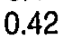 |
| r04_c01 | SCD | T2 | SCD | T2 | 1.25 | sem 1.25 mm | 1.25 | 1.25 | 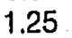 |
| r04_c02 | SCD | T3 | SCD | T3 | 1.09 | sem 1.09 mm | 1.09 | 1.09 | 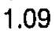 |
| r04_c03 | SCD | T4 | SCD | T4 | 0.89 | sem 0.89 mm | 0.89 | 0.89 | 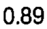 |
| r04_c04 | SCD | T5 | SCD | T5 | 0.72 | sem 0.72 mm | 0.72 | 0.72 | 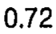 |
| r04_c05 | SCD | T6 | SCD | T6 | 0.62 | sem 0.62 mm | 0.62 | 0.62 | 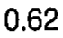 |
| r04_c06 | SCD | T7 | SCD | T7 | 0.69 | sem 0.69 mm | 0.69 | 0.69 | 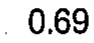 |
| r04_c07 | SCD | T8 | SCD | T8 | 0.76 | sem 0.76 mm | 0.76 | 0.76 | 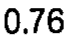 |
| r04_c08 | SCD | T9 | SCD | T9 | 0.82 | sem 0.82 mm | 0.82 | 0.82 | 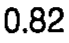 |
| r04_c09 | SCD | T10 | SCD | T10 | 0.70 | sem 0.70 mm | 0.70 | 0.70 | 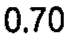 |
| r04_c10 | SCD | T11 | SCD | T11 | 0.46 | sem 0.46 mm | 0.46 | 0.46 | 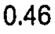 |
| r04_c11 | SCD | T12 | SCD | T12 | 0.62 | sem 0.62 mm | 0.62 | 0.62 | 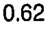 |
| r05_c00 | SCW/SCD | T1 | SCW/SCD | T1 | 1.3 | ratio 1.3 | 1.3 | 1.3 | 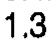 |
| r05_c01 | SCW/SCD | T2 | SCW/SCD | T2 | 1.3 | ratio 1.3 | 1.3 | 1.3 | 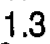 |
| r05_c02 | SCW/SCD | T3 | SCW/SCD | T3 | 1.2 | ratio 1.2 | 1.2 | 1.2 | 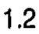 |
| r05_c03 | SCW/SCD | T4 | SCW/SCD | T4 | 1.0 | ratio 1.0 | 1.0 | 1.0 | 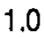 |
| r05_c04 | SCW/SCD | T5 | SCW/SCD | T5 | 1.0 | ratio 1.0 | 1.0 | 1.0 |  |
| r05_c05 | SCW/SCD | T6 | SCW/SCD | T6 | 1.0 | ratio 1.0 | 1.0 | 1.0 |  |
| r05_c06 | SCW/SCD | T7 | SCW/SCD | T7 | 1.1 | ratio 1.1 | 1.1 | 1.1 |  |
| r05_c07 | SCW/SCD | T8 | SCW/SCD | T8 | 1.1 | ratio 1.1 | 1.1 | 1.1 |  |
| r05_c08 | SCW/SCD | T9 | SCW/SCD | T9 | 1.1 | ratio 1.1 | 1.1 | 1.1 |  |
| r05_c09 | SCW/SCD | T10 | SCW/SCD | T10 | 1.2 | ratio 1.2 | 1.2 | 1.2 |  |
| r05_c10 | SCW/SCD | T11 | SCW/SCD | T11 | 1.2 | ratio 1.2 | 1.2 | 1.2 |  |
| r05_c11 | SCW/SCD | T12 | SCW/SCD | T12 | 1.2 | ratio 1.2 | 1.2 | 1.2 |  |
| r07_c00 | SCA | T1 | SCA | T1 | 213.0 | mean 213.0 mm2 | 213.0 | 213.0 |  |
| r07_c01 | SCA | T2 | SCA | T2 | 200.0 | mean 200.0 mm2 | 200.0 | 200.0 |  |
| r07_c02 | SCA | T3 | SCA | T3 | 180.0 | mean 180.0 mm2 | 180.0 | 180.0 |  |
| r07_c03 | SCA | T4 | SCA | T4 | 192.0 | mean 192.0 mm2 | 192.0 | 192.0 |  |
| r07_c04 | SCA | T5 | SCA | T5 | 201.0 | mean 201.0 mm2 | 201.0 | 201.0 |  |
| r07_c05 | SCA | T6 | SCA | T6 | 206.0 | mean 206.0 mm2 | 206.0 | 206.0 |  |
| r07_c06 | SCA | T7 | SCA | T7 | 199.0 | mean 199.0 mm2 | 199.0 | 199.0 |  |
| r07_c07 | SCA | T8 | SCA | T8 | 194.0 | mean 194.0 mm2 | 194.0 | 194.0 |  |
| r07_c08 | SCA | T9 | SCA | T9 | 200.0 | mean 200.0 mm2 | 200.0 | 200.0 |  |
| r07_c09 | SCA | T10 | SCA | T10 | 202.0 | mean 202.0 mm2 | 202.0 | 202.0 |  |
| r07_c10 | SCA | T11 | SCA | T11 | 220.0 | mean 220.0 mm2 | 220.0 | 220.0 |  |
| r07_c11 | SCA | T12 | SCA | T12 | 280.0 | mean 280.0 mm2 | 280.0 | 280.0 |  |
| r08_c00 | SCA | T1 | SCA | T1 | 30.6 | sem 30.6 mm2 | 30.6 | 30.6 |  |
| r08_c01 | SCA | T2 | SCA | T2 | 27.6 | sem 27.6 mm2 | 27.6 | 27.6 |  |
| r08_c02 | SCA | T3 | SCA | T3 | 25.7 | sem 25.7 mm2 | 25.7 | 25.7 |  |
| r08_c03 | SCA | T4 | SCA | T4 | 25.9 | sem 25.9 mm2 | 25.9 | 25.9 |  |
| r08_c04 | SCA | T5 | SCA | T5 | 15.7 | sem 15.7 mm2 | 15.7 | 15.7 |  |
| r08_c05 | SCA | T6 | SCA | T6 | 14.3 | sem 14.3 mm2 | 14.3 | 14.3 |  |
| r08_c06 | SCA | T7 | SCA | T7 | 17.0 | sem 17.0 mm2 | 17.0 | 17.0 |  |
| r08_c07 | SCA | T8 | SCA | T8 | 15.9 | sem 15.9 mm2 | 15.9 | 15.9 |  |
| r08_c08 | SCA | T9 | SCA | T9 | 16.2 | sem 16.2 mm2 | 16.2 | 16.2 |  |
| r08_c09 | SCA | T10 | SCA | T10 | 14.7 | sem 14.7 mm2 | 14.7 | 14.7 |  |
| r08_c10 | SCA | T11 | SCA | T11 | 15.7 | sem 15.7 mm2 | 15.7 | 15.7 |  |
| r08_c11 | SCA | T12 | SCA | T12 | 16.3 | sem 16.3 mm2 | 16.3 | 16.3 |  |
