# Table 5. Pedicle Dimensions

Thoracic, PDF page 6, printed page 894; Panjabi_1991_Thoracic_Spine_16-8_888-901.pdf (sha256 f4078fa2cd2cf2c140fcee7f018917e055d2ca825c42e9b01d84cf1f4b7c1e2c), rendered at 300 dpi by render.py.

Every cell below is the box layout.py cut from the rendered page, and the two strings are what the two reading passes read in it (README.md). A dash is printed where the paper prints one. The value column is what provenance.csv carries.

| cell | row | column | measure | level | printed | value | pass 1 | pass 2 | image |
|---|---|---|---|---|---|---|---|---|---|
| r01_c00 | PDWr | T1 | PDWr | T1 | 8.2 | mean 8.2 mm | 8.2 | 8.2 | 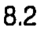 |
| r01_c01 | PDWr | T2 | PDWr | T2 | 8.4 | mean 8.4 mm | 8.4 | 8.4 | 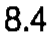 |
| r01_c02 | PDWr | T3 | PDWr | T3 | 7.0 | mean 7.0 mm | 7.0 | 7.0 | 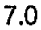 |
| r01_c03 | PDWr | T4 | PDWr | T4 | 5.5 | mean 5.5 mm | 5.5 | 5.5 | 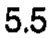 |
| r01_c04 | PDWr | T5 | PDWr | T5 | 6.2 | mean 6.2 mm | 6.2 | 6.2 | 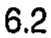 |
| r01_c05 | PDWr | T6 | PDWr | T6 | 6.0 | mean 6.0 mm | 6.0 | 6.0 | 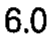 |
| r01_c06 | PDWr | T7 | PDWr | T7 | 6.5 | mean 6.5 mm | 6.5 | 6.5 | 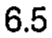 |
| r01_c07 | PDWr | T8 | PDWr | T8 | 6.7 | mean 6.7 mm | 6.7 | 6.7 | 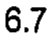 |
| r01_c08 | PDWr | T9 | PDWr | T9 | 7.6 | mean 7.6 mm | 7.6 | 7.6 | 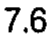 |
| r01_c09 | PDWr | T10 | PDWr | T10 | 8.3 | mean 8.3 mm | 8.3 | 8.3 | 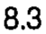 |
| r01_c10 | PDWr | T11 | PDWr | T11 | 8.8 | mean 8.8 mm | 8.8 | 8.8 | 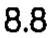 |
| r01_c11 | PDWr | T12 | PDWr | T12 | 8.8 | mean 8.8 mm | 8.8 | 8.8 | 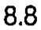 |
| r02_c00 | PDWr | T1 | PDWr | T1 | 0.44 | sem 0.44 mm | 0.44 | 0.44 | 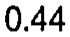 |
| r02_c01 | PDWr | T2 | PDWr | T2 | 1.06 | sem 1.06 mm | 1.06 | 1.06 | 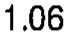 |
| r02_c02 | PDWr | T3 | PDWr | T3 | 0.78 | sem 0.78 mm | 0.78 | 0.78 | 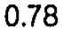 |
| r02_c03 | PDWr | T4 | PDWr | T4 | 0.71 | sem 0.71 mm | 0.71 | 0.71 | 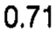 |
| r02_c04 | PDWr | T5 | PDWr | T5 | 0.53 | sem 0.53 mm | 0.53 | 0.53 | 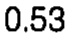 |
| r02_c05 | PDWr | T6 | PDWr | T6 | 0.78 | sem 0.78 mm | 0.78 | 0.78 | 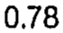 |
| r02_c06 | PDWr | T7 | PDWr | T7 | 0.80 | sem 0.80 mm | 0.80 | 0.80 | 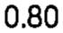 |
| r02_c07 | PDWr | T8 | PDWr | T8 | 0.35 | sem 0.35 mm | 0.35 | 0.35 | 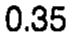 |
| r02_c08 | PDWr | T9 | PDWr | T9 | 0.54 | sem 0.54 mm | 0.54 | 0.54 | 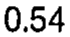 |
| r02_c09 | PDWr | T10 | PDWr | T10 | 0.70 | sem 0.70 mm | 0.70 | 0.70 | 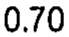 |
| r02_c10 | PDWr | T11 | PDWr | T11 | 0.43 | sem 0.43 mm | 0.43 | 0.43 | 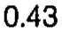 |
| r02_c11 | PDWr | T12 | PDWr | T12 | 0.81 | sem 0.81 mm | 0.81 | 0.81 | 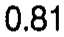 |
| r03_c00 | PDWl | T1 | PDWl | T1 | 8.7 | mean 8.7 mm | 8.7 | 8.7 | 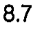 |
| r03_c01 | PDWl | T2 | PDWl | T2 | 7.9 | mean 7.9 mm | 7.9 | 7.9 |  |
| r03_c02 | PDWl | T3 | PDWl | T3 | 6.5 | mean 6.5 mm | 6.5 | 6.5 |  |
| r03_c03 | PDWl | T4 | PDWl | T4 | 7.0 | mean 7.0 mm | 7.0 | 7.0 |  |
| r03_c04 | PDWl | T5 | PDWl | T5 | 5.7 | mean 5.7 mm | 5.7 | 5.7 |  |
| r03_c05 | PDWl | T6 | PDWl | T6 | 6.0 | mean 6.0 mm | 6.0 | 6.0 |  |
| r03_c06 | PDWl | T7 | PDWl | T7 | 5.2 | mean 5.2 mm | 5.2 | 5.2 | 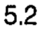 |
| r03_c07 | PDWl | T8 | PDWl | T8 | 6.7 | mean 6.7 mm | 6.7 | 6.7 | 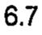 |
| r03_c08 | PDWl | T9 | PDWl | T9 | 7.7 | mean 7.7 mm | 7.7 | 7.7 | 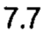 |
| r03_c09 | PDWl | T10 | PDWl | T10 | 9.7 (T1) | mean 9.7 mm | 9.7 (T1) | 9.7 (T1) | 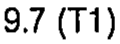 |
| r03_c10 | PDWl | T11 | PDWl | T11 | 10.7 (T5-7) | mean 10.7 mm | 10.7 (T5-7) | 10.7 (T5-7) | 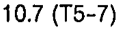 |
| r03_c11 | PDWl | T12 | PDWl | T12 | 8.6 | mean 8.6 mm | 8.6 | 8.6 | 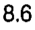 |
| r04_c00 | PDWl | T1 | PDWl | T1 | 0.53 | sem 0.53 mm | 0.53 | 0.53 | 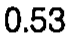 |
| r04_c01 | PDWl | T2 | PDWl | T2 | 0.97 | sem 0.97 mm | 0.97 | 0.97 | 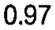 |
| r04_c02 | PDWl | T3 | PDWl | T3 | 0.55 | sem 0.55 mm | 0.55 | 0.55 | 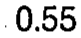 |
| r04_c03 | PDWl | T4 | PDWl | T4 | 0.49 | sem 0.49 mm | 0.49 | 0.49 | 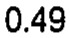 |
| r04_c04 | PDWl | T5 | PDWl | T5 | 0.38 | sem 0.38 mm | 0.38 | 0.38 | 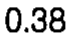 |
| r04_c05 | PDWl | T6 | PDWl | T6 | 0.87 | sem 0.87 mm | 0.87 | 0.87 | 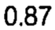 |
| r04_c06 | PDWl | T7 | PDWl | T7 | 0.45 | sem 0.45 mm | 0.45 | 0.45 | 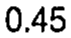 |
| r04_c07 | PDWl | T8 | PDWl | T8 | 0.63 | sem 0.63 mm | 0.63 | 0.63 | 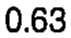 |
| r04_c08 | PDWl | T9 | PDWl | T9 | 0.65 | sem 0.65 mm | 0.65 | 0.65 | 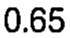 |
| r04_c09 | PDWl | T10 | PDWl | T10 | 0.78 | sem 0.78 mm | 0.78 | 0.78 | 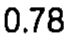 |
| r04_c10 | PDWl | T11 | PDWl | T11 | 0.84 | sem 0.84 mm | 0.84 | 0.84 | 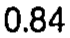 |
| r04_c11 | PDWl | T12 | PDWl | T12 | 0.68 | sem 0.68 mm | 0.68 | 0.68 | 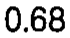 |
| r05_c00 | PDHr | T1 | PDHr | T1 | 9.3 | mean 9.3 mm | 9.3 | 9.3 | 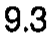 |
| r05_c01 | PDHr | T2 | PDHr | T2 | 11.1 | mean 11.1 mm | 11.1 | 11.1 | 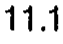 |
| r05_c02 | PDHr | T3 | PDHr | T3 | 11.8 | mean 11.8 mm | 11.8 | 11.8 | 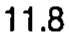 |
| r05_c03 | PDHr | T4 | PDHr | T4 | 11.9 | mean 11.9 mm | 11.9 | 11.9 | 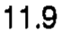 |
| r05_c04 | PDHr | T5 | PDHr | T5 | 11.2 | mean 11.2 mm | 11.2 | 11.2 | 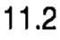 |
| r05_c05 | PDHr | T6 | PDHr | T6 | 12.0 | mean 12.0 mm | 12.0 | 12.0 | 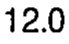 |
| r05_c06 | PDHr | T7 | PDHr | T7 | 11.8 | mean 11.8 mm | 11.8 | 11.8 | 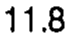 |
| r05_c07 | PDHr | T8 | PDHr | T8 | 12.5 | mean 12.5 mm | 12.5 | 12.5 |  |
| r05_c08 | PDHr | T9 | PDHr | T9 | 13.9 (T1) | mean 13.9 mm | 13.9 (T1) | 13.9 (T1) |  |
| r05_c09 | PDHr | T10 | PDHr | T10 | 14.7 (T1-2, T5) | mean 14.7 mm | 14.7 (T1-2, T5) | 14.7 (T1-2, T5) |  |
| r05_c10 | PDHr | T11 | PDHr | T11 | 16.9 (T1-8) | mean 16.9 mm | 16.9 (T1-8) | 16.9 (T1-8) |  |
| r05_c11 | PDHr | T12 | PDHr | T12 | 16.5 (T1-8) | mean 16.5 mm | 16.5 (T1-8) | 16.5 (T1-8) |  |
| r06_c00 | PDHr | T1 | PDHr | T1 | 0.53 | sem 0.53 mm | 0.53 | 0.53 |  |
| r06_c01 | PDHr | T2 | PDHr | T2 | 0.44 | sem 0.44 mm | 0.44 | 0.44 |  |
| r06_c02 | PDHr | T3 | PDHr | T3 | 0.23 | sem 0.23 mm | 0.23 | 0.23 |  |
| r06_c03 | PDHr | T4 | PDHr | T4 | 0.46 | sem 0.46 mm | 0.46 | 0.46 |  |
| r06_c04 | PDHr | T5 | PDHr | T5 | 0.51 | sem 0.51 mm | 0.51 | 0.51 |  |
| r06_c05 | PDHr | T6 | PDHr | T6 | 0.44 | sem 0.44 mm | 0.44 | 0.44 |  |
| r06_c06 | PDHr | T7 | PDHr | T7 | 0.30 | sem 0.30 mm | 0.30 | 0.30 |  |
| r06_c07 | PDHr | T8 | PDHr | T8 | 0.52 | sem 0.52 mm | 0.52 | 0.52 |  |
| r06_c08 | PDHr | T9 | PDHr | T9 | 0.79 | sem 0.79 mm | 0.79 | 0.79 |  |
| r06_c09 | PDHr | T10 | PDHr | T10 | 0.49 | sem 0.49 mm | 0.49 | 0.49 |  |
| r06_c10 | PDHr | T11 | PDHr | T11 | 0.49 | sem 0.49 mm | 0.49 | 0.49 |  |
| r06_c11 | PDHr | T12 | PDHr | T12 | 0.71 | sem 0.71 mm | 0.71 | 0.71 |  |
| r07_c00 | PDHl | T1 | PDHl | T1 | 9.9 | mean 9.9 mm | 9.9 | 9.9 |  |
| r07_c01 | PDHl | T2 | PDHl | T2 | 11.6 | mean 11.6 mm | 11.6 | 11.6 |  |
| r07_c02 | PDHl | T3 | PDHl | T3 | 12.0 | mean 12.0 mm | 12.0 | 12.0 |  |
| r07_c03 | PDHl | T4 | PDHl | T4 | 12.2 | mean 12.2 mm | 12.2 | 12.2 |  |
| r07_c04 | PDHl | T5 | PDHl | T5 | 11.4 | mean 11.4 mm | 11.4 | 11.4 |  |
| r07_c05 | PDHl | T6 | PDHl | T6 | 11.6 | mean 11.6 mm | 11.6 | 11.6 |  |
| r07_c06 | PDHl | T7 | PDHl | T7 | 12.2 | mean 12.2 mm | 12.2 | 12.2 |  |
| r07_c07 | PDHl | T8 | PDHl | T8 | 12.5 | mean 12.5 mm | 12.5 | 12.5 |  |
| r07_c08 | PDHl | T9 | PDHl | T9 | 13.8 (T1) | mean 13.8 mm | 13.8 (T1) | 13.8 (T1) |  |
| r07_c09 | PDHl | T10 | PDHl | T10 | 15.0 (T1-2, T5-6) | mean 15.0 mm | 15.0 (T1-2, T5-6) | 15.0 (T1-2, T5-6) |  |
| r07_c10 | PDHl | T11 | PDHl | T11 | 17.8 (T1-9) | mean 17.8 mm | 17.8 (T1-9) | 17.8 (T1-9) |  |
| r07_c11 | PDHl | T12 | PDHl | T12 | 16.8 (T1-8) | mean 16.8 mm | 16.8 (T1-8) | 16.8 (T1-8) |  |
| r08_c00 | PDHl | T1 | PDHl | T1 | 0.41 | sem 0.41 mm | 0.41 | 0.41 |  |
| r08_c01 | PDHl | T2 | PDHl | T2 | 0.30 | sem 0.30 mm | 0.30 | 0.30 |  |
| r08_c02 | PDHl | T3 | PDHl | T3 | 0.32 | sem 0.32 mm | 0.32 | 0.32 |  |
| r08_c03 | PDHl | T4 | PDHl | T4 | 0.50 | sem 0.50 mm | 0.50 | 0.50 |  |
| r08_c04 | PDHl | T5 | PDHl | T5 | 0.36 | sem 0.36 mm | 0.36 | 0.36 |  |
| r08_c05 | PDHl | T6 | PDHl | T6 | 0.47 | sem 0.47 mm | 0.47 | 0.47 |  |
| r08_c06 | PDHl | T7 | PDHl | T7 | 0.27 | sem 0.27 mm | 0.27 | 0.27 |  |
| r08_c07 | PDHl | T8 | PDHl | T8 | 0.41 | sem 0.41 mm | 0.41 | 0.41 |  |
| r08_c08 | PDHl | T9 | PDHl | T9 | 0.55 | sem 0.55 mm | 0.55 | 0.55 |  |
| r08_c09 | PDHl | T10 | PDHl | T10 | 0.24 | sem 0.24 mm | 0.24 | 0.24 |  |
| r08_c10 | PDHl | T11 | PDHl | T11 | 0.29 | sem 0.29 mm | 0.29 | 0.29 |  |
| r08_c11 | PDHl | T12 | PDHl | T12 | 0.94 | sem 0.94 mm | 0.94 | 0.94 |  |
| r09_c00 | PDH/PDWr | T1 | PDH/PDWr | T1 | 1.1 | ratio 1.1 | 1.1 | 1.1 |  |
| r09_c01 | PDH/PDWr | T2 | PDH/PDWr | T2 | 1.3 | ratio 1.3 | 1.3 | 1.3 |  |
| r09_c02 | PDH/PDWr | T3 | PDH/PDWr | T3 | 1.7 | ratio 1.7 | 1.7 | 1.7 |  |
| r09_c03 | PDH/PDWr | T4 | PDH/PDWr | T4 | 2.2 | ratio 2.2 | 2.2 | 2.2 |  |
| r09_c04 | PDH/PDWr | T5 | PDH/PDWr | T5 | 1.8 | ratio 1.8 | 1.8 | 1.8 |  |
| r09_c05 | PDH/PDWr | T6 | PDH/PDWr | T6 | 2.0 | ratio 2.0 | 2.0 | 2.0 |  |
| r09_c06 | PDH/PDWr | T7 | PDH/PDWr | T7 | 1.8 | ratio 1.8 | 1.8 | 1.8 |  |
| r09_c07 | PDH/PDWr | T8 | PDH/PDWr | T8 | 1.9 | ratio 1.9 | 1.9 | 1.9 |  |
| r09_c08 | PDH/PDWr | T9 | PDH/PDWr | T9 | 1.8 | ratio 1.8 | 1.8 | 1.8 |  |
| r09_c09 | PDH/PDWr | T10 | PDH/PDWr | T10 | 1.8 | ratio 1.8 | 1.8 | 1.8 |  |
| r09_c10 | PDH/PDWr | T11 | PDH/PDWr | T11 | 1.9 | ratio 1.9 | 1.9 | 1.9 |  |
| r09_c11 | PDH/PDWr | T12 | PDH/PDWr | T12 | 1.9 | ratio 1.9 | 1.9 | 1.9 |  |
| r10_c00 | PDH/PDWl | T1 | PDH/PDWl | T1 | 1.1 | ratio 1.1 | 1.1 | 1.1 |  |
| r10_c01 | PDH/PDWl | T2 | PDH/PDWl | T2 | 1.5 | ratio 1.5 | 1.5 | 1.5 |  |
| r10_c02 | PDH/PDWl | T3 | PDH/PDWl | T3 | 1.4 | ratio 1.4 | 1.4 | 1.4 |  |
| r10_c03 | PDH/PDWl | T4 | PDH/PDWl | T4 | 1.4 | ratio 1.4 | 1.4 | 1.4 |  |
| r10_c04 | PDH/PDWl | T5 | PDH/PDWl | T5 | 2.0 | ratio 2.0 | 2.0 | 2.0 |  |
| r10_c05 | PDH/PDWl | T6 | PDH/PDWl | T6 | 1.9 | ratio 1.9 | 1.9 | 1.9 |  |
| r10_c06 | PDH/PDWl | T7 | PDH/PDWl | T7 | 2.3 | ratio 2.3 | 2.3 | 2.3 |  |
| r10_c07 | PDH/PDWl | T8 | PDH/PDWl | T8 | 1.9 | ratio 1.9 | 1.9 | 1.9 |  |
| r10_c08 | PDH/PDWl | T9 | PDH/PDWl | T9 | 1.8 | ratio 1.8 | 1.8 | 1.8 |  |
| r10_c09 | PDH/PDWl | T10 | PDH/PDWl | T10 | 1.6 | ratio 1.6 | 1.6 | 1.6 |  |
| r10_c10 | PDH/PDWl | T11 | PDH/PDWl | T11 | 1.7 | ratio 1.7 | 1.7 | 1.7 |  |
| r10_c11 | PDH/PDWl | T12 | PDH/PDWl | T12 | 1.9 | ratio 1.9 | 1.9 | 1.9 |  |
| r12_c00 | PDAr | T1 | PDAr | T1 | 52.2 | mean 52.2 mm2 | 52.2 | 52.2 |  |
| r12_c01 | PDAr | T2 | PDAr | T2 | 46.3 | mean 46.3 mm2 | 46.3 | 46.3 |  |
| r12_c02 | PDAr | T3 | PDAr | T3 | 38.1 | mean 38.1 mm2 | 38.1 | 38.1 |  |
| r12_c03 | PDAr | T4 | PDAr | T4 | 32.5 | mean 32.5 mm2 | 32.5 | 32.5 |  |
| r12_c04 | PDAr | T5 | PDAr | T5 | 31.6 | mean 31.6 mm2 | 31.6 | 31.6 |  |
| r12_c05 | PDAr | T6 | PDAr | T6 | 33.5 | mean 33.5 mm2 | 33.5 | 33.5 |  |
| r12_c06 | PDAr | T7 | PDAr | T7 | 36.8 | mean 36.8 mm2 | 36.8 | 36.8 |  |
| r12_c07 | PDAr | T8 | PDAr | T8 | 43.8 | mean 43.8 mm2 | 43.8 | 43.8 |  |
| r12_c08 | PDAr | T9 | PDAr | T9 | 52.3 | mean 52.3 mm2 | 52.3 | 52.3 |  |
| r12_c09 | PDAr | T10 | PDAr | T10 | 64.8 | mean 64.8 mm2 | 64.8 | 64.8 |  |
| r12_c10 | PDAr | T11 | PDAr | T11 | 88.4 (T2-8) | mean 88.4 mm2 | 88.4 (T2-8) | 88.4 (T2-8) |  |
| r12_c11 | PDAr | T12 | PDAr | T12 | 90.9 (T1-9) | mean 90.9 mm2 | 90.9 (T1-9) | 90.9 (T1-9) |  |
| r13_c00 | PDAr | T1 | PDAr | T1 | 6.14 | sem 6.14 mm2 | 6.14 | 6.14 |  |
| r13_c01 | PDAr | T2 | PDAr | T2 | 3.98 | sem 3.98 mm2 | 3.98 | 3.98 |  |
| r13_c02 | PDAr | T3 | PDAr | T3 | 3.0 | sem 3.0 mm2 | 3.0 | 3.0 |  |
| r13_c03 | PDAr | T4 | PDAr | T4 | 4.08 | sem 4.08 mm2 | 4.08 | 4.08 |  |
| r13_c04 | PDAr | T5 | PDAr | T5 | 1.72 | sem 1.72 mm2 | 1.72 | 1.72 |  |
| r13_c05 | PDAr | T6 | PDAr | T6 | 2.27 | sem 2.27 mm2 | 2.27 | 2.27 |  |
| r13_c06 | PDAr | T7 | PDAr | T7 | 3.75 | sem 3.75 mm2 | 3.75 | 3.75 |  |
| r13_c07 | PDAr | T8 | PDAr | T8 | 4.67 | sem 4.67 mm2 | 4.67 | 4.67 |  |
| r13_c08 | PDAr | T9 | PDAr | T9 | 5.17 | sem 5.17 mm2 | 5.17 | 5.17 |  |
| r13_c09 | PDAr | T10 | PDAr | T10 | 4.68 | sem 4.68 mm2 | 4.68 | 4.68 |  |
| r13_c10 | PDAr | T11 | PDAr | T11 | 7.5 | sem 7.5 mm2 | 7.5 | 7.5 |  |
| r13_c11 | PDAr | T12 | PDAr | T12 | 13.00 | sem 13.00 mm2 | 13.00 | 13.00 |  |
| r14_c00 | PDAl | T1 | PDAl | T1 | 54.4 | mean 54.4 mm2 | 54.4 | 54.4 |  |
| r14_c01 | PDAl | T2 | PDAl | T2 | 45.5 | mean 45.5 mm2 | 45.5 | 45.5 |  |
| r14_c02 | PDAl | T3 | PDAl | T3 | 41.9 | mean 41.9 mm2 | 41.9 | 41.9 |  |
| r14_c03 | PDAl | T4 | PDAl | T4 | 38.4 | mean 38.4 mm2 | 38.4 | 38.4 |  |
| r14_c04 | PDAl | T5 | PDAl | T5 | 33.1 | mean 33.1 mm2 | 33.1 | 33.1 |  |
| r14_c05 | PDAl | T6 | PDAl | T6 | 34.6 | mean 34.6 mm2 | 34.6 | 34.6 |  |
| r14_c06 | PDAl | T7 | PDAl | T7 | 34.5 | mean 34.5 mm2 | 34.5 | 34.5 |  |
| r14_c07 | PDAl | T8 | PDAl | T8 | 42.0 | mean 42.0 mm2 | 42.0 | 42.0 |  |
| r14_c08 | PDAl | T9 | PDAl | T9 | 51.6 | mean 51.6 mm2 | 51.6 | 51.6 |  |
| r14_c09 | PDAl | T10 | PDAl | T10 | 61.6 | mean 61.6 mm2 | 61.6 | 61.6 |  |
| r14_c10 | PDAl | T11 | PDAl | T11 | 98.3 (T1-10) | mean 98.3 mm2 | 98.3 (T1-10) | 98.3 (T1-10) |  |
| r14_c11 | PDAl | T12 | PDAl | T12 | 97.0 (T1-10) | mean 97.0 mm2 | 97.0 (T1-10) | 97.0 (T1-10) |  |
| r15_c00 | PDAl | T1 | PDAl | T1 | 4.60 | sem 4.60 mm2 | 4.60 | 4.60 |  |
| r15_c01 | PDAl | T2 | PDAl | T2 | 4.95 | sem 4.95 mm2 | 4.95 | 4.95 |  |
| r15_c02 | PDAl | T3 | PDAl | T3 | 2.29 | sem 2.29 mm2 | 2.29 | 2.29 |  |
| r15_c03 | PDAl | T4 | PDAl | T4 | 3.19 | sem 3.19 mm2 | 3.19 | 3.19 |  |
| r15_c04 | PDAl | T5 | PDAl | T5 | 3.13 | sem 3.13 mm2 | 3.13 | 3.13 |  |
| r15_c05 | PDAl | T6 | PDAl | T6 | 3.78 | sem 3.78 mm2 | 3.78 | 3.78 |  |
| r15_c06 | PDAl | T7 | PDAl | T7 | 3.40 | sem 3.40 mm2 | 3.40 | 3.40 |  |
| r15_c07 | PDAl | T8 | PDAl | T8 | 3.78 | sem 3.78 mm2 | 3.78 | 3.78 |  |
| r15_c08 | PDAl | T9 | PDAl | T9 | 4.90 | sem 4.90 mm2 | 4.90 | 4.90 |  |
| r15_c09 | PDAl | T10 | PDAl | T10 | 5.26 | sem 5.26 mm2 | 5.26 | 5.26 |  |
| r15_c10 | PDAl | T11 | PDAl | T11 | 5.93 | sem 5.93 mm2 | 5.93 | 5.93 |  |
| r15_c11 | PDAl | T12 | PDAl | T12 | 12.30 | sem 12.30 mm2 | 12.30 | 12.30 |  |
| r17_c00 | PDIsr | T1 | PDIsr | T1 | 28.1 | mean 28.1 deg | 28.1 | 28.1 |  |
| r17_c01 | PDIsr | T2 | PDIsr | T2 | 28.9 | mean 28.9 deg | 28.9 | 28.9 |  |
| r17_c02 | PDIsr | T3 | PDIsr | T3 | 22.5 | mean 22.5 deg | 22.5 | 22.5 |  |
| r17_c03 | PDIsr | T4 | PDIsr | T4 | 21.8 | mean 21.8 deg | 21.8 | 21.8 |  |
| r17_c04 | PDIsr | T5 | PDIsr | T5 | 20.2 | mean 20.2 deg | 20.2 | 20.2 |  |
| r17_c05 | PDIsr | T6 | PDIsr | T6 | 19.4 | mean 19.4 deg | 19.4 | 19.4 |  |
| r17_c06 | PDIsr | T7 | PDIsr | T7 | 23.4 | mean 23.4 deg | 23.4 | 23.4 |  |
| r17_c07 | PDIsr | T8 | PDIsr | T8 | 22.5 | mean 22.5 deg | 22.5 | 22.5 |  |
| r17_c08 | PDIsr | T9 | PDIsr | T9 | 19.3 | mean 19.3 deg | 19.3 | 19.3 |  |
| r17_c09 | PDIsr | T10 | PDIsr | T10 | 14.4 | mean 14.4 deg | 14.4 | 14.4 |  |
| r17_c10 | PDIsr | T11 | PDIsr | T11 | 12.9 | mean 12.9 deg | 12.9 | 12.9 |  |
| r17_c11 | PDIsr | T12 | PDIsr | T12 | 8.0 | mean 8.0 deg | 8.0 | 8.0 |  |
| r18_c00 | PDIsr | T1 | PDIsr | T1 | 1.72 | sem 1.72 deg | 1.72 | 1.72 |  |
| r18_c01 | PDIsr | T2 | PDIsr | T2 | 6.17 | sem 6.17 deg | 6.17 | 6.17 |  |
| r18_c02 | PDIsr | T3 | PDIsr | T3 | 3.21 | sem 3.21 deg | 3.21 | 3.21 |  |
| r18_c03 | PDIsr | T4 | PDIsr | T4 | 4.37 | sem 4.37 deg | 4.37 | 4.37 |  |
| r18_c04 | PDIsr | T5 | PDIsr | T5 | 3.56 | sem 3.56 deg | 3.56 | 3.56 |  |
| r18_c05 | PDIsr | T6 | PDIsr | T6 | 3.96 | sem 3.96 deg | 3.96 | 3.96 |  |
| r18_c06 | PDIsr | T7 | PDIsr | T7 | 4.32 | sem 4.32 deg | 4.32 | 4.32 |  |
| r18_c07 | PDIsr | T8 | PDIsr | T8 | 4.70 | sem 4.70 deg | 4.70 | 4.70 |  |
| r18_c08 | PDIsr | T9 | PDIsr | T9 | 5.00 | sem 5.00 deg | 5.00 | 5.00 |  |
| r18_c09 | PDIsr | T10 | PDIsr | T10 | 1.94 | sem 1.94 deg | 1.94 | 1.94 |  |
| r18_c10 | PDIsr | T11 | PDIsr | T11 | 1.32 | sem 1.32 deg | 1.32 | 1.32 |  |
| r18_c11 | PDIsr | T12 | PDIsr | T12 | 1.10 | sem 1.10 deg | 1.10 | 1.10 |  |
| r19_c00 | PDIsl | T1 | PDIsl | T1 | 26.0 | mean 26.0 deg | 26.0 | 26.0 |  |
| r19_c01 | PDIsl | T2 | PDIsl | T2 | 28.3 | mean 28.3 deg | 28.3 | 28.3 |  |
| r19_c02 | PDIsl | T3 | PDIsl | T3 | 16.2 | mean 16.2 deg | 16.2 | 16.2 |  |
| r19_c03 | PDIsl | T4 | PDIsl | T4 | 17.2 | mean 17.2 deg | 17.2 | 17.2 |  |
| r19_c04 | PDIsl | T5 | PDIsl | T5 | 11.0 | mean 11.0 deg | 11.0 | 11.0 |  |
| r19_c05 | PDIsl | T6 | PDIsl | T6 | 13.4 | mean 13.4 deg | 13.4 | 13.4 |  |
| r19_c06 | PDIsl | T7 | PDIsl | T7 | 18.0 | mean 18.0 deg | 18.0 | 18.0 |  |
| r19_c07 | PDIsl | T8 | PDIsl | T8 | 16.7 | mean 16.7 deg | 16.7 | 16.7 |  |
| r19_c08 | PDIsl | T9 | PDIsl | T9 | 10.2 | mean 10.2 deg | 10.2 | 10.2 |  |
| r19_c09 | PDIsl | T10 | PDIsl | T10 | 10.4 | mean 10.4 deg | 10.4 | 10.4 |  |
| r19_c10 | PDIsl | T11 | PDIsl | T11 | 13.2 | mean 13.2 deg | 13.2 | 13.2 |  |
| r19_c11 | PDIsl | T12 | PDIsl | T12 | 11.5 | mean 11.5 deg | 11.5 | 11.5 |  |
| r20_c00 | PDIsl | T1 | PDIsl | T1 | 2.52 | sem 2.52 deg | 2.52 | 2.52 |  |
| r20_c01 | PDIsl | T2 | PDIsl | T2 | 8.58 | sem 8.58 deg | 8.58 | 8.58 |  |
| r20_c02 | PDIsl | T3 | PDIsl | T3 | 2.21 | sem 2.21 deg | 2.21 | 2.21 |  |
| r20_c03 | PDIsl | T4 | PDIsl | T4 | 1.97 | sem 1.97 deg | 1.97 | 1.97 |  |
| r20_c04 | PDIsl | T5 | PDIsl | T5 | 2.01 | sem 2.01 deg | 2.01 | 2.01 |  |
| r20_c05 | PDIsl | T6 | PDIsl | T6 | 2.58 | sem 2.58 deg | 2.58 | 2.58 |  |
| r20_c06 | PDIsl | T7 | PDIsl | T7 | 3.60 | sem 3.60 deg | 3.60 | 3.60 |  |
| r20_c07 | PDIsl | T8 | PDIsl | T8 | 3.27 | sem 3.27 deg | 3.27 | 3.27 |  |
| r20_c08 | PDIsl | T9 | PDIsl | T9 | 1.99 | sem 1.99 deg | 1.99 | 1.99 |  |
| r20_c09 | PDIsl | T10 | PDIsl | T10 | 2.29 | sem 2.29 deg | 2.29 | 2.29 |  |
| r20_c10 | PDIsl | T11 | PDIsl | T11 | 2.02 | sem 2.02 deg | 2.02 | 2.02 |  |
| r20_c11 | PDIsl | T12 | PDIsl | T12 | 2.70 | sem 2.70 deg | 2.70 | 2.70 |  |
| r21_c00 | PDItr | T1 | PDItr | T1 | 4.6 | mean 4.6 deg | 4.6 | 4.6 |  |
| r21_c01 | PDItr | T2 | PDItr | T2 | 16.5 | mean 16.5 deg | 16.5 | 16.5 |  |
| r21_c02 | PDItr | T3 | PDItr | T3 | 8.1 | mean 8.1 deg | 8.1 | 8.1 |  |
| r21_c03 | PDItr | T4 | PDItr | T4 | 6.4 | mean 6.4 deg | 6.4 | 6.4 |  |
| r21_c04 | PDItr | T5 | PDItr | T5 | 8.6 | mean 8.6 deg | 8.6 | 8.6 |  |
| r21_c05 | PDItr | T6 | PDItr | T6 | 7.0 | mean 7.0 deg | 7.0 | 7.0 |  |
| r21_c06 | PDItr | T7 | PDItr | T7 | 10.9 | mean 10.9 deg | 10.9 | 10.9 |  |
| r21_c07 | PDItr | T8 | PDItr | T8 | 12.1 | mean 12.1 deg | 12.1 | 12.1 |  |
| r21_c08 | PDItr | T9 | PDItr | T9 | 8.3 | mean 8.3 deg | 8.3 | 8.3 |  |
| r21_c09 | PDItr | T10 | PDItr | T10 | 6.8 | mean 6.8 deg | 6.8 | 6.8 |  |
| r21_c10 | PDItr | T11 | PDItr | T11 | 8.9 | mean 8.9 deg | 8.9 | 8.9 |  |
| r21_c11 | PDItr | T12 | PDItr | T12 | 4.8 | mean 4.8 deg | 4.8 | 4.8 |  |
| r22_c00 | PDItr | T1 | PDItr | T1 | 1.3 | sem 1.3 deg | 1.3 | 1.3 |  |
| r22_c01 | PDItr | T2 | PDItr | T2 | 7.93 | sem 7.93 deg | 7.93 | 7.93 |  |
| r22_c02 | PDItr | T3 | PDItr | T3 | 1.23 | sem 1.23 deg | 1.23 | 1.23 |  |
| r22_c03 | PDItr | T4 | PDItr | T4 | 1.48 | sem 1.48 deg | 1.48 | 1.48 |  |
| r22_c04 | PDItr | T5 | PDItr | T5 | 1.81 | sem 1.81 deg | 1.81 | 1.81 |  |
| r22_c05 | PDItr | T6 | PDItr | T6 | 1.44 | sem 1.44 deg | 1.44 | 1.44 |  |
| r22_c06 | PDItr | T7 | PDItr | T7 | 1.92 | sem 1.92 deg | 1.92 | 1.92 |  |
| r22_c07 | PDItr | T8 | PDItr | T8 | 1.82 | sem 1.82 deg | 1.82 | 1.82 |  |
| r22_c08 | PDItr | T9 | PDItr | T9 | 1.64 | sem 1.64 deg | 1.64 | 1.64 |  |
| r22_c09 | PDItr | T10 | PDItr | T10 | 0.84 | sem 0.84 deg | 0.84 | 0.84 |  |
| r22_c10 | PDItr | T11 | PDItr | T11 | 0.89 | sem 0.89 deg | 0.89 | 0.89 |  |
| r22_c11 | PDItr | T12 | PDItr | T12 | 1.00 | sem 1.00 deg | 1.00 | 1.00 |  |
| r23_c00 | PDItl | T1 | PDItl | T1 | 10.5 | mean 10.5 deg | 10.5 | 10.5 |  |
| r23_c01 | PDItl | T2 | PDItl | T2 | 19.2 | mean 19.2 deg | 19.2 | 19.2 |  |
| r23_c02 | PDItl | T3 | PDItl | T3 | 9.4 | mean 9.4 deg | 9.4 | 9.4 |  |
| r23_c03 | PDItl | T4 | PDItl | T4 | 10.5 | mean 10.5 deg | 10.5 | 10.5 |  |
| r23_c04 | PDItl | T5 | PDItl | T5 | 7.6 | mean 7.6 deg | 7.6 | 7.6 |  |
| r23_c05 | PDItl | T6 | PDItl | T6 | 9.6 | mean 9.6 deg | 9.6 | 9.6 |  |
| r23_c06 | PDItl | T7 | PDItl | T7 | 12.1 | mean 12.1 deg | 12.1 | 12.1 |  |
| r23_c07 | PDItl | T8 | PDItl | T8 | 11.1 | mean 11.1 deg | 11.1 | 11.1 |  |
| r23_c08 | PDItl | T9 | PDItl | T9 | 8.5 | mean 8.5 deg | 8.5 | 8.5 |  |
| r23_c09 | PDItl | T10 | PDItl | T10 | 7.3 | mean 7.3 deg | 7.3 | 7.3 |  |
| r23_c10 | PDItl | T11 | PDItl | T11 | 8.4 | mean 8.4 deg | 8.4 | 8.4 |  |
| r23_c11 | PDItl | T12 | PDItl | T12 | 5.3 | mean 5.3 deg | 5.3 | 5.3 |  |
| r24_c00 | PDItl | T1 | PDItl | T1 | 1.5 | sem 1.5 deg | 1.5 | 1.5 |  |
| r24_c01 | PDItl | T2 | PDItl | T2 | 9.77 | sem 9.77 deg | 9.77 | 9.77 |  |
| r24_c02 | PDItl | T3 | PDItl | T3 | 1.28 | sem 1.28 deg | 1.28 | 1.28 |  |
| r24_c03 | PDItl | T4 | PDItl | T4 | 1.41 | sem 1.41 deg | 1.41 | 1.41 |  |
| r24_c04 | PDItl | T5 | PDItl | T5 | 1.99 | sem 1.99 deg | 1.99 | 1.99 |  |
| r24_c05 | PDItl | T6 | PDItl | T6 | 1.52 | sem 1.52 deg | 1.52 | 1.52 |  |
| r24_c06 | PDItl | T7 | PDItl | T7 | 1.92 | sem 1.92 deg | 1.92 | 1.92 |  |
| r24_c07 | PDItl | T8 | PDItl | T8 | 1.70 | sem 1.70 deg | 1.70 | 1.70 |  |
| r24_c08 | PDItl | T9 | PDItl | T9 | 1.71 | sem 1.71 deg | 1.71 | 1.71 |  |
| r24_c09 | PDItl | T10 | PDItl | T10 | 1.88 | sem 1.88 deg | 1.88 | 1.88 |  |
| r24_c10 | PDItl | T11 | PDItl | T11 | 1.12 | sem 1.12 deg | 1.12 | 1.12 |  |
| r24_c11 | PDItl | T12 | PDItl | T12 | 1.12 | sem 1.12 deg | 1.12 | 1.12 |  |
