# Table 6. Rib and Processes Dimensions

Thoracic, PDF page 7, printed page 895; Panjabi_1991_Thoracic_Spine_16-8_888-901.pdf (sha256 f4078fa2cd2cf2c140fcee7f018917e055d2ca825c42e9b01d84cf1f4b7c1e2c), rendered at 300 dpi by render.py.

The T11 column is set left of its heading and the T12 entries of CTAr and CTAl stand on the lower line; the label of the last row, CVA + CTA, runs past x=300, so the labels' edge is 400 here.

Every cell below is the box layout.py cut from the rendered page, and the two strings are what the two reading passes read in it (README.md). A dash is printed where the paper prints one. The value column is what provenance.csv carries.

| cell | row | column | measure | level | printed | value | pass 1 | pass 2 | image |
|---|---|---|---|---|---|---|---|---|---|
| r01_c00 | CVAur | T1 | CVAur | T1 | 45.3 | mean 45.3 mm2 | 45.3 | 45.3 | 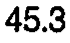 |
| r01_c01 | CVAur | T2 | CVAur | T2 | 29.0 | mean 29.0 mm2 | 29.0 | 29.0 | 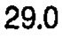 |
| r01_c02 | CVAur | T3 | CVAur | T3 | 26.7 | mean 26.7 mm2 | 26.7 | 26.7 | 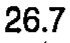 |
| r01_c03 | CVAur | T4 | CVAur | T4 | 31.3 | mean 31.3 mm2 | 31.3 | 31.3 | 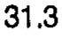 |
| r01_c04 | CVAur | T5 | CVAur | T5 | 42.6 | mean 42.6 mm2 | 42.6 | 42.6 | 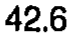 |
| r01_c05 | CVAur | T6 | CVAur | T6 | 53.4 | mean 53.4 mm2 | 53.4 | 53.4 | 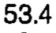 |
| r01_c06 | CVAur | T7 | CVAur | T7 | 47.8 | mean 47.8 mm2 | 47.8 | 47.8 | 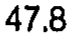 |
| r01_c07 | CVAur | T8 | CVAur | T8 | 39.5 | mean 39.5 mm2 | 39.5 | 39.5 | 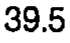 |
| r01_c08 | CVAur | T9 | CVAur | T9 | 45.1 | mean 45.1 mm2 | 45.1 | 45.1 | 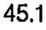 |
| r01_c09 | CVAur | T10 | CVAur | T10 | 56.3 | mean 56.3 mm2 | 56.3 | 56.3 | 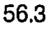 |
| r01_c10 | CVAur | T11 | CVAur | T11 | 71.9 (T2-4) | mean 71.9 mm2 | 71.9 (T2-4) | 71.9 (T2-4) | 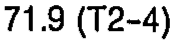 |
| r01_c11 | CVAur | T12 | CVAur | T12 | 61.0 | mean 61.0 mm2 | 61.0 | 61.0 | 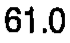 |
| r02_c00 | CVAur | T1 | CVAur | T1 | 5.54 | sem 5.54 mm2 | 5.54 | 5.54 | 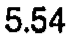 |
| r02_c01 | CVAur | T2 | CVAur | T2 | 2.42 | sem 2.42 mm2 | 2.42 | 2.42 | 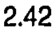 |
| r02_c02 | CVAur | T3 | CVAur | T3 | 2.20 | sem 2.20 mm2 | 2.20 | 2.20 |  |
| r02_c03 | CVAur | T4 | CVAur | T4 | 3.71 | sem 3.71 mm2 | 3.71 | 3.71 | 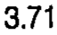 |
| r02_c04 | CVAur | T5 | CVAur | T5 | 5.51 | sem 5.51 mm2 | 5.51 | 5.51 | 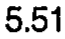 |
| r02_c05 | CVAur | T6 | CVAur | T6 | 6.08 | sem 6.08 mm2 | 6.08 | 6.08 | 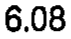 |
| r02_c06 | CVAur | T7 | CVAur | T7 | 4.04 | sem 4.04 mm2 | 4.04 | 4.04 | 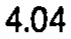 |
| r02_c07 | CVAur | T8 | CVAur | T8 | 6.83 | sem 6.83 mm2 | 6.83 | 6.83 | 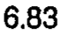 |
| r02_c08 | CVAur | T9 | CVAur | T9 | 4.35 | sem 4.35 mm2 | 4.35 | 4.35 | 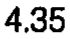 |
| r02_c09 | CVAur | T10 | CVAur | T10 | 5.69 | sem 5.69 mm2 | 5.69 | 5.69 | 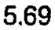 |
| r02_c10 | CVAur | T11 | CVAur | T11 | 5.38 | sem 5.38 mm2 | 5.38 | 5.38 | 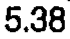 |
| r02_c11 | CVAur | T12 | CVAur | T12 | 8.77 | sem 8.77 mm2 | 8.77 | 8.77 | 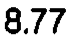 |
| r03_c00 | CVAul | T1 | CVAul | T1 | 56.6 | mean 56.6 mm2 | 56.6 | 56.6 | 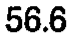 |
| r03_c01 | CVAul | T2 | CVAul | T2 | 29.5 | mean 29.5 mm2 | 29.5 | 29.5 | 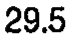 |
| r03_c02 | CVAul | T3 | CVAul | T3 | 34.2 | mean 34.2 mm2 | 34.2 | 34.2 | 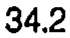 |
| r03_c03 | CVAul | T4 | CVAul | T4 | 36.9 | mean 36.9 mm2 | 36.9 | 36.9 | 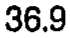 |
| r03_c04 | CVAul | T5 | CVAul | T5 | 41.3 | mean 41.3 mm2 | 41.3 | 41.3 | 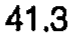 |
| r03_c05 | CVAul | T6 | CVAul | T6 | 51.4 | mean 51.4 mm2 | 51.4 | 51.4 | 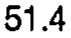 |
| r03_c06 | CVAul | T7 | CVAul | T7 | 53.4 | mean 53.4 mm2 | 53.4 | 53.4 | 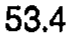 |
| r03_c07 | CVAul | T8 | CVAul | T8 | 44.1 | mean 44.1 mm2 | 44.1 | 44.1 | 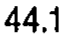 |
| r03_c08 | CVAul | T9 | CVAul | T9 | 40.7 | mean 40.7 mm2 | 40.7 | 40.7 | 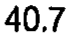 |
| r03_c09 | CVAul | T10 | CVAul | T10 | 51.9 | mean 51.9 mm2 | 51.9 | 51.9 | 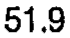 |
| r03_c10 | CVAul | T11 | CVAul | T11 | 60.0 | mean 60.0 mm2 | 60.0 | 60.0 |  |
| r03_c11 | CVAul | T12 | CVAul | T12 | 47.9 | mean 47.9 mm2 | 47.9 | 47.9 | 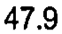 |
| r04_c00 | CVAul | T1 | CVAul | T1 | 7.44 | sem 7.44 mm2 | 7.44 | 7.44 | 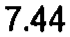 |
| r04_c01 | CVAul | T2 | CVAul | T2 | 2.14 | sem 2.14 mm2 | 2.14 | 2.14 | 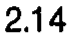 |
| r04_c02 | CVAul | T3 | CVAul | T3 | 3.29 | sem 3.29 mm2 | 3.29 | 3.29 | 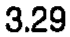 |
| r04_c03 | CVAul | T4 | CVAul | T4 | 5.72 | sem 5.72 mm2 | 5.72 | 5.72 | 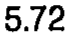 |
| r04_c04 | CVAul | T5 | CVAul | T5 | 3.38 | sem 3.38 mm2 | 3.38 | 3.38 | 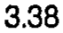 |
| r04_c05 | CVAul | T6 | CVAul | T6 | 5.65 | sem 5.65 mm2 | 5.65 | 5.65 | 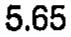 |
| r04_c06 | CVAul | T7 | CVAul | T7 | 7.85 | sem 7.85 mm2 | 7.85 | 7.85 | 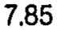 |
| r04_c07 | CVAul | T8 | CVAul | T8 | 7.14 | sem 7.14 mm2 | 7.14 | 7.14 | 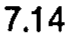 |
| r04_c08 | CVAul | T9 | CVAul | T9 | 3.65 | sem 3.65 mm2 | 3.65 | 3.65 | 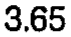 |
| r04_c09 | CVAul | T10 | CVAul | T10 | 6.23 | sem 6.23 mm2 | 6.23 | 6.23 | 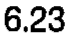 |
| r04_c10 | CVAul | T11 | CVAul | T11 | 7.48 | sem 7.48 mm2 | 7.48 | 7.48 | 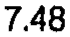 |
| r04_c11 | CVAul | T12 | CVAul | T12 | 4.20 | sem 4.20 mm2 | 4.20 | 4.20 |  |
| r05_c00 | CVAlr | T1 | CVAlr | T1 | 27.9 | mean 27.9 mm2 | 27.9 | 27.9 | 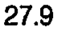 |
| r05_c01 | CVAlr | T2 | CVAlr | T2 | 21.0 | mean 21.0 mm2 | 21.0 | 21.0 | 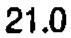 |
| r05_c02 | CVAlr | T3 | CVAlr | T3 | 22.5 | mean 22.5 mm2 | 22.5 | 22.5 | 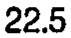 |
| r05_c03 | CVAlr | T4 | CVAlr | T4 | 22.7 | mean 22.7 mm2 | 22.7 | 22.7 | 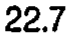 |
| r05_c04 | CVAlr | T5 | CVAlr | T5 | 25.2 | mean 25.2 mm2 | 25.2 | 25.2 | 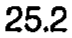 |
| r05_c05 | CVAlr | T6 | CVAlr | T6 | 39.4 | mean 39.4 mm2 | 39.4 | 39.4 |  |
| r05_c06 | CVAlr | T7 | CVAlr | T7 | 40.7 | mean 40.7 mm2 | 40.7 | 40.7 |  |
| r05_c07 | CVAlr | T8 | CVAlr | T8 | 44.5 | mean 44.5 mm2 | 44.5 | 44.5 |  |
| r05_c08 | CVAlr | T9 | CVAlr | T9 | 38.7 | mean 38.7 mm2 | 38.7 | 38.7 |  |
| r05_c09 | CVAlr | T10 | CVAlr | T10 | 30.0 | mean 30.0 mm2 | 30.0 | 30.0 |  |
| r05_c10 | CVAlr | T11 | CVAlr | T11 | - | (none) | - | - |  |
| r05_c11 | CVAlr | T12 | CVAlr | T12 | - | (none) | - | - |  |
| r06_c00 | CVAlr | T1 | CVAlr | T1 | 2.22 | sem 2.22 mm2 | 2.22 | 2.22 |  |
| r06_c01 | CVAlr | T2 | CVAlr | T2 | 2.67 | sem 2.67 mm2 | 2.67 | 2.67 |  |
| r06_c02 | CVAlr | T3 | CVAlr | T3 | 2.85 | sem 2.85 mm2 | 2.85 | 2.85 |  |
| r06_c03 | CVAlr | T4 | CVAlr | T4 | 3.41 | sem 3.41 mm2 | 3.41 | 3.41 |  |
| r06_c04 | CVAlr | T5 | CVAlr | T5 | 4.15 | sem 4.15 mm2 | 4.15 | 4.15 |  |
| r06_c05 | CVAlr | T6 | CVAlr | T6 | 6.66 | sem 6.66 mm2 | 6.66 | 6.66 |  |
| r06_c06 | CVAlr | T7 | CVAlr | T7 | 4.61 | sem 4.61 mm2 | 4.61 | 4.61 |  |
| r06_c07 | CVAlr | T8 | CVAlr | T8 | 6.33 | sem 6.33 mm2 | 6.33 | 6.33 |  |
| r06_c08 | CVAlr | T9 | CVAlr | T9 | 6.45 | sem 6.45 mm2 | 6.45 | 6.45 |  |
| r06_c09 | CVAlr | T10 | CVAlr | T10 | 6.39 | sem 6.39 mm2 | 6.39 | 6.39 |  |
| r06_c10 | CVAlr | T11 | CVAlr | T11 | - | (none) | - | - |  |
| r06_c11 | CVAlr | T12 | CVAlr | T12 | - | (none) | - | - |  |
| r07_c00 | CVAll | T1 | CVAll | T1 | 19.5 | mean 19.5 mm2 | 19.5 | 19.5 |  |
| r07_c01 | CVAll | T2 | CVAll | T2 | 12.1 | mean 12.1 mm2 | 12.1 | 12.1 |  |
| r07_c02 | CVAll | T3 | CVAll | T3 | 19.9 | mean 19.9 mm2 | 19.9 | 19.9 |  |
| r07_c03 | CVAll | T4 | CVAll | T4 | 20.0 | mean 20.0 mm2 | 20.0 | 20.0 |  |
| r07_c04 | CVAll | T5 | CVAll | T5 | 25.7 | mean 25.7 mm2 | 25.7 | 25.7 |  |
| r07_c05 | CVAll | T6 | CVAll | T6 | 33.4 | mean 33.4 mm2 | 33.4 | 33.4 |  |
| r07_c06 | CVAll | T7 | CVAll | T7 | 30.7 | mean 30.7 mm2 | 30.7 | 30.7 |  |
| r07_c07 | CVAll | T8 | CVAll | T8 | 25.5 | mean 25.5 mm2 | 25.5 | 25.5 |  |
| r07_c08 | CVAll | T9 | CVAll | T9 | 26.2 | mean 26.2 mm2 | 26.2 | 26.2 |  |
| r07_c09 | CVAll | T10 | CVAll | T10 | 26.9 | mean 26.9 mm2 | 26.9 | 26.9 |  |
| r07_c10 | CVAll | T11 | CVAll | T11 | - | (none) | - | - |  |
| r07_c11 | CVAll | T12 | CVAll | T12 | - | (none) | - | - |  |
| r08_c00 | CVAll | T1 | CVAll | T1 | 1.52 | sem 1.52 mm2 | 1.52 | 1.52 |  |
| r08_c01 | CVAll | T2 | CVAll | T2 | 1.58 | sem 1.58 mm2 | 1.58 | 1.58 |  |
| r08_c02 | CVAll | T3 | CVAll | T3 | 4.12 | sem 4.12 mm2 | 4.12 | 4.12 |  |
| r08_c03 | CVAll | T4 | CVAll | T4 | 2.09 | sem 2.09 mm2 | 2.09 | 2.09 |  |
| r08_c04 | CVAll | T5 | CVAll | T5 | 4.97 | sem 4.97 mm2 | 4.97 | 4.97 |  |
| r08_c05 | CVAll | T6 | CVAll | T6 | 4.70 | sem 4.70 mm2 | 4.70 | 4.70 |  |
| r08_c06 | CVAll | T7 | CVAll | T7 | 3.80 | sem 3.80 mm2 | 3.80 | 3.80 |  |
| r08_c07 | CVAll | T8 | CVAll | T8 | 4.09 | sem 4.09 mm2 | 4.09 | 4.09 |  |
| r08_c08 | CVAll | T9 | CVAll | T9 | 1.40 | sem 1.40 mm2 | 1.40 | 1.40 |  |
| r08_c09 | CVAll | T10 | CVAll | T10 | 2.52 | sem 2.52 mm2 | 2.52 | 2.52 |  |
| r08_c10 | CVAll | T11 | CVAll | T11 | - | (none) | - | - |  |
| r08_c11 | CVAll | T12 | CVAll | T12 | - | (none) | - | - |  |
| r09_c00 | CVA | T1 | CVA | T1 | 74.7 | mean 74.7 mm2 | 74.7 | 74.7 |  |
| r09_c01 | CVA | T2 | CVA | T2 | 45.8 | mean 45.8 mm2 | 45.8 | 45.8 |  |
| r09_c02 | CVA | T3 | CVA | T3 | 51.7 | mean 51.7 mm2 | 51.7 | 51.7 |  |
| r09_c03 | CVA | T4 | CVA | T4 | 55.5 | mean 55.5 mm2 | 55.5 | 55.5 |  |
| r09_c04 | CVA | T5 | CVA | T5 | 67.4 | mean 67.4 mm2 | 67.4 | 67.4 |  |
| r09_c05 | CVA | T6 | CVA | T6 | 88.8 | mean 88.8 mm2 | 88.8 | 88.8 |  |
| r09_c06 | CVA | T7 | CVA | T7 | 86.3 | mean 86.3 mm2 | 86.3 | 86.3 |  |
| r09_c07 | CVA | T8 | CVA | T8 | 76.8 | mean 76.8 mm2 | 76.8 | 76.8 |  |
| r09_c08 | CVA | T9 | CVA | T9 | 75.4 | mean 75.4 mm2 | 75.4 | 75.4 |  |
| r09_c09 | CVA | T10 | CVA | T10 | 82.6 | mean 82.6 mm2 | 82.6 | 82.6 |  |
| r09_c10 | CVA | T11 | CVA | T11 | 66.0 | mean 66.0 mm2 | 66.0 | 66.0 |  |
| r09_c11 | CVA | T12 | CVA | T12 | 54.5 | mean 54.5 mm2 | 54.5 | 54.5 |  |
| r11_c00 | CTAr | T1 | CTAr | T1 | 49.7 | mean 49.7 mm2 | 49.7 | 49.7 |  |
| r11_c01 | CTAr | T2 | CTAr | T2 | 49.4 | mean 49.4 mm2 | 49.4 | 49.4 |  |
| r11_c02 | CTAr | T3 | CTAr | T3 | 61.5 | mean 61.5 mm2 | 61.5 | 61.5 |  |
| r11_c03 | CTAr | T4 | CTAr | T4 | 61.2 | mean 61.2 mm2 | 61.2 | 61.2 |  |
| r11_c04 | CTAr | T5 | CTAr | T5 | 51.3 | mean 51.3 mm2 | 51.3 | 51.3 |  |
| r11_c05 | CTAr | T6 | CTAr | T6 | 48.2 | mean 48.2 mm2 | 48.2 | 48.2 |  |
| r11_c06 | CTAr | T7 | CTAr | T7 | 50.5 | mean 50.5 mm2 | 50.5 | 50.5 |  |
| r11_c07 | CTAr | T8 | CTAr | T8 | 63.8 | mean 63.8 mm2 | 63.8 | 63.8 |  |
| r11_c08 | CTAr | T9 | CTAr | T9 | 60.9 | mean 60.9 mm2 | 60.9 | 60.9 |  |
| r11_c09 | CTAr | T10 | CTAr | T10 | 62.3 | mean 62.3 mm2 | 62.3 | 62.3 |  |
| r11_c10 | CTAr | T11 | CTAr | T11 | 16.7 (T3-4, T8-10) | mean 16.7 mm2 | 16.7 (T3-4, T8-10) | 16.7 (T3-4, T8-10) |  |
| r12_c00 | CTAr | T1 | CTAr | T1 | 4.92 | sem 4.92 mm2 | 4.92 | 4.92 |  |
| r12_c01 | CTAr | T2 | CTAr | T2 | 5.24 | sem 5.24 mm2 | 5.24 | 5.24 |  |
| r12_c02 | CTAr | T3 | CTAr | T3 | 4.40 | sem 4.40 mm2 | 4.40 | 4.40 |  |
| r12_c03 | CTAr | T4 | CTAr | T4 | 3.90 | sem 3.90 mm2 | 3.90 | 3.90 |  |
| r12_c04 | CTAr | T5 | CTAr | T5 | 2.79 | sem 2.79 mm2 | 2.79 | 2.79 |  |
| r12_c05 | CTAr | T6 | CTAr | T6 | 4.35 | sem 4.35 mm2 | 4.35 | 4.35 |  |
| r12_c06 | CTAr | T7 | CTAr | T7 | 4.42 | sem 4.42 mm2 | 4.42 | 4.42 |  |
| r12_c07 | CTAr | T8 | CTAr | T8 | 26.7 | sem 26.7 mm2 | 26.7 | 26.7 |  |
| r12_c08 | CTAr | T9 | CTAr | T9 | 4.97 | sem 4.97 mm2 | 4.97 | 4.97 |  |
| r12_c09 | CTAr | T10 | CTAr | T10 | 17.3 | sem 17.3 mm2 | 17.3 | 17.3 |  |
| r12_c10 | CTAr | T11 | CTAr | T11 | 1.61 | sem 1.61 mm2 | 1.61 | 1.61 |  |
| r12_c11 | CTAr | T12 | CTAr | T12 | - | (none) | - | - |  |
| r13_c00 | CTAl | T1 | CTAl | T1 | 65.0 | mean 65.0 mm2 | 65.0 | 65.0 |  |
| r13_c01 | CTAl | T2 | CTAl | T2 | 50.8 | mean 50.8 mm2 | 50.8 | 50.8 |  |
| r13_c02 | CTAl | T3 | CTAl | T3 | 55.9 | mean 55.9 mm2 | 55.9 | 55.9 |  |
| r13_c03 | CTAl | T4 | CTAl | T4 | 59.2 | mean 59.2 mm2 | 59.2 | 59.2 |  |
| r13_c04 | CTAl | T5 | CTAl | T5 | 51.3 | mean 51.3 mm2 | 51.3 | 51.3 |  |
| r13_c05 | CTAl | T6 | CTAl | T6 | 48.7 | mean 48.7 mm2 | 48.7 | 48.7 |  |
| r13_c06 | CTAl | T7 | CTAl | T7 | 42.3 | mean 42.3 mm2 | 42.3 | 42.3 |  |
| r13_c07 | CTAl | T8 | CTAl | T8 | 40.0 | mean 40.0 mm2 | 40.0 | 40.0 |  |
| r13_c08 | CTAl | T9 | CTAl | T9 | 48.6 | mean 48.6 mm2 | 48.6 | 48.6 |  |
| r13_c09 | CTAl | T10 | CTAl | T10 | 49.3 | mean 49.3 mm2 | 49.3 | 49.3 |  |
| r13_c10 | CTAl | T11 | CTAl | T11 | 11.7 (T1-6, T9-10) | mean 11.7 mm2 | 11.7 (T1-6, T9-10) | 11.7 (T1-6, T9-10) |  |
| r14_c00 | CTAl | T1 | CTAl | T1 | 4.20 | sem 4.20 mm2 | 4.20 | 4.20 |  |
| r14_c01 | CTAl | T2 | CTAl | T2 | 2.40 | sem 2.40 mm2 | 2.40 | 2.40 |  |
| r14_c02 | CTAl | T3 | CTAl | T3 | 8.01 | sem 8.01 mm2 | 8.01 | 8.01 |  |
| r14_c03 | CTAl | T4 | CTAl | T4 | 2.78 | sem 2.78 mm2 | 2.78 | 2.78 |  |
| r14_c04 | CTAl | T5 | CTAl | T5 | 3.39 | sem 3.39 mm2 | 3.39 | 3.39 |  |
| r14_c05 | CTAl | T6 | CTAl | T6 | 6.07 | sem 6.07 mm2 | 6.07 | 6.07 |  |
| r14_c06 | CTAl | T7 | CTAl | T7 | 3.50 | sem 3.50 mm2 | 3.50 | 3.50 |  |
| r14_c07 | CTAl | T8 | CTAl | T8 | 6.00 | sem 6.00 mm2 | 6.00 | 6.00 |  |
| r14_c08 | CTAl | T9 | CTAl | T9 | 6.18 | sem 6.18 mm2 | 6.18 | 6.18 |  |
| r14_c09 | CTAl | T10 | CTAl | T10 | 8.67 | sem 8.67 mm2 | 8.67 | 8.67 |  |
| r14_c10 | CTAl | T11 | CTAl | T11 | 0.35 | sem 0.35 mm2 | 0.35 | 0.35 |  |
| r14_c11 | CTAl | T12 | CTAl | T12 | - | (none) | - | - |  |
| r15_c00 | CVA + CTA | T1 | CVA + CTA | T1 | 132.0 | mean 132.0 mm2 | 132.0 | 132.0 |  |
| r15_c01 | CVA + CTA | T2 | CVA + CTA | T2 | 95.9 | mean 95.9 mm2 | 95.9 | 95.9 |  |
| r15_c02 | CVA + CTA | T3 | CVA + CTA | T3 | 110.4 | mean 110.4 mm2 | 110.4 | 110.4 |  |
| r15_c03 | CVA + CTA | T4 | CVA + CTA | T4 | 115.7 | mean 115.7 mm2 | 115.7 | 115.7 |  |
| r15_c04 | CVA + CTA | T5 | CVA + CTA | T5 | 118.7 | mean 118.7 mm2 | 118.7 | 118.7 |  |
| r15_c05 | CVA + CTA | T6 | CVA + CTA | T6 | 137.3 | mean 137.3 mm2 | 137.3 | 137.3 |  |
| r15_c06 | CVA + CTA | T7 | CVA + CTA | T7 | 132.7 | mean 132.7 mm2 | 132.7 | 132.7 |  |
| r15_c07 | CVA + CTA | T8 | CVA + CTA | T8 | 128.7 | mean 128.7 mm2 | 128.7 | 128.7 |  |
| r15_c08 | CVA + CTA | T9 | CVA + CTA | T9 | 130.1 | mean 130.1 mm2 | 130.1 | 130.1 |  |
| r15_c09 | CVA + CTA | T10 | CVA + CTA | T10 | 138.4 | mean 138.4 mm2 | 138.4 | 138.4 |  |
| r15_c10 | CVA + CTA | T11 | CVA + CTA | T11 | 80.2 | mean 80.2 mm2 | 80.2 | 80.2 |  |
| r15_c11 | CVA + CTA | T12 | CVA + CTA | T12 | 54.5 | mean 54.5 mm2 | 54.5 | 54.5 |  |
