# Table 7. Pars Intra-Articularis, Spinous, and Transverse Processes

Thoracic, PDF page 7, printed page 895; Panjabi_1991_Thoracic_Spine_16-8_888-901.pdf (sha256 f4078fa2cd2cf2c140fcee7f018917e055d2ca825c42e9b01d84cf1f4b7c1e2c), rendered at 300 dpi by render.py.

The PIAr means take two lines of print: the dashes of T1 and T2 on the first, the values of T3 to T12 on the second.

Every cell below is the box layout.py cut from the rendered page, and the two strings are what the two reading passes read in it (README.md). A dash is printed where the paper prints one. The value column is what provenance.csv carries.

| cell | row | column | measure | level | printed | value | pass 1 | pass 2 | image |
|---|---|---|---|---|---|---|---|---|---|
| r01_c00 | PIAr | T1 | PIAr | T1 | - | (none) | - | - |  |
| r01_c01 | PIAr | T2 | PIAr | T2 | - | (none) | - | - |  |
| r01_c02 | PIAr | T3 | PIAr | T3 | 118.0 | mean 118.0 mm2 | 118.0 | 118.0 | 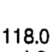 |
| r01_c03 | PIAr | T4 | PIAr | T4 | 75.0 | mean 75.0 mm2 | 75.0 | 75.0 | 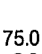 |
| r01_c04 | PIAr | T5 | PIAr | T5 | 89.0 | mean 89.0 mm2 | 89.0 | 89.0 | 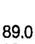 |
| r01_c05 | PIAr | T6 | PIAr | T6 | 58.0 (T9, T11) | mean 58.0 mm2 | 58.0 (T9, T11) | 58.0 (T9, T11) | 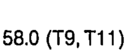 |
| r01_c06 | PIAr | T7 | PIAr | T7 | 113.0 | mean 113.0 mm2 | 113.0 | 113.0 | 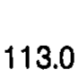 |
| r01_c07 | PIAr | T8 | PIAr | T8 | 113.0 | mean 113.0 mm2 | 113.0 | 113.0 | 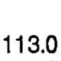 |
| r01_c08 | PIAr | T9 | PIAr | T9 | 140.0 | mean 140.0 mm2 | 140.0 | 140.0 | 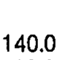 |
| r01_c09 | PIAr | T10 | PIAr | T10 | 131.0 | mean 131.0 mm2 | 131.0 | 131.0 | 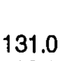 |
| r01_c10 | PIAr | T11 | PIAr | T11 | 145.0 | mean 145.0 mm2 | 145.0 | 145.0 | 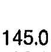 |
| r01_c11 | PIAr | T12 | PIAr | T12 | 86.0 | mean 86.0 mm2 | 86.0 | 86.0 | 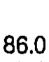 |
| r02_c00 | PIAr | T1 | PIAr | T1 | - | (none) | - | - | 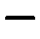 |
| r02_c01 | PIAr | T2 | PIAr | T2 | - | (none) | - | - | 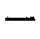 |
| r02_c02 | PIAr | T3 | PIAr | T3 | 1.3 | sem 1.3 mm2 | 1.3 | 1.3 | 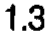 |
| r02_c03 | PIAr | T4 | PIAr | T4 | 2.8 | sem 2.8 mm2 | 2.8 | 2.8 | 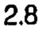 |
| r02_c04 | PIAr | T5 | PIAr | T5 | 10.8 | sem 10.8 mm2 | 10.8 | 10.8 | 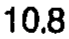 |
| r02_c05 | PIAr | T6 | PIAr | T6 | 9.6 | sem 9.6 mm2 | 9.6 | 9.6 | 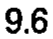 |
| r02_c06 | PIAr | T7 | PIAr | T7 | 4.1 | sem 4.1 mm2 | 4.1 | 4.1 | 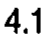 |
| r02_c07 | PIAr | T8 | PIAr | T8 | 4.5 | sem 4.5 mm2 | 4.5 | 4.5 | 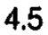 |
| r02_c08 | PIAr | T9 | PIAr | T9 | 19.0 | sem 19.0 mm2 | 19.0 | 19.0 | 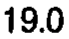 |
| r02_c09 | PIAr | T10 | PIAr | T10 | 13.2 | sem 13.2 mm2 | 13.2 | 13.2 | 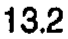 |
| r02_c10 | PIAr | T11 | PIAr | T11 | 32.4 | sem 32.4 mm2 | 32.4 | 32.4 | 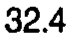 |
| r02_c11 | PIAr | T12 | PIAr | T12 | 3.4 | sem 3.4 mm2 | 3.4 | 3.4 | 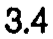 |
| r03_c00 | PIAl | T1 | PIAl | T1 | - | (none) | - | - |  |
| r03_c01 | PIAl | T2 | PIAl | T2 | - | (none) | - | - |  |
| r03_c02 | PIAl | T3 | PIAl | T3 | 73.0 | mean 73.0 mm2 | 73.0 | 73.0 | 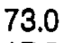 |
| r03_c03 | PIAl | T4 | PIAl | T4 | 66.0 (T11) | mean 66.0 mm2 | 66.0 (T11) | 66.0 (T11) | 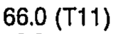 |
| r03_c04 | PIAl | T5 | PIAl | T5 | 81.0 | mean 81.0 mm2 | 81.0 | 81.0 | 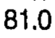 |
| r03_c05 | PIAl | T6 | PIAl | T6 | 98.0 | mean 98.0 mm2 | 98.0 | 98.0 | 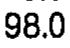 |
| r03_c06 | PIAl | T7 | PIAl | T7 | 98.0 | mean 98.0 mm2 | 98.0 | 98.0 | 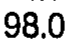 |
| r03_c07 | PIAl | T8 | PIAl | T8 | 121.0 | mean 121.0 mm2 | 121.0 | 121.0 | 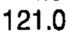 |
| r03_c08 | PIAl | T9 | PIAl | T9 | 124.0 | mean 124.0 mm2 | 124.0 | 124.0 | 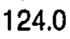 |
| r03_c09 | PIAl | T10 | PIAl | T10 | 148.0 | mean 148.0 mm2 | 148.0 | 148.0 | 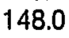 |
| r03_c10 | PIAl | T11 | PIAl | T11 | 179.0 | mean 179.0 mm2 | 179.0 | 179.0 | 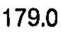 |
| r03_c11 | PIAl | T12 | PIAl | T12 | 98.0 | mean 98.0 mm2 | 98.0 | 98.0 | 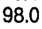 |
| r04_c00 | PIAl | T1 | PIAl | T1 | - | (none) | - | - | 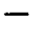 |
| r04_c01 | PIAl | T2 | PIAl | T2 | - | (none) | - | - | 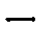 |
| r04_c02 | PIAl | T3 | PIAl | T3 | 17.6 | sem 17.6 mm2 | 17.6 | 17.6 | 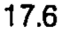 |
| r04_c03 | PIAl | T4 | PIAl | T4 | 6.3 | sem 6.3 mm2 | 6.3 | 6.3 | 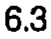 |
| r04_c04 | PIAl | T5 | PIAl | T5 | 5.4 | sem 5.4 mm2 | 5.4 | 5.4 | 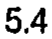 |
| r04_c05 | PIAl | T6 | PIAl | T6 | 19.7 | sem 19.7 mm2 | 19.7 | 19.7 | 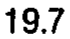 |
| r04_c06 | PIAl | T7 | PIAl | T7 | 7.1 | sem 7.1 mm2 | 7.1 | 7.1 | 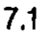 |
| r04_c07 | PIAl | T8 | PIAl | T8 | 15.3 | sem 15.3 mm2 | 15.3 | 15.3 | 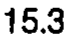 |
| r04_c08 | PIAl | T9 | PIAl | T9 | 7.3 | sem 7.3 mm2 | 7.3 | 7.3 | 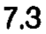 |
| r04_c09 | PIAl | T10 | PIAl | T10 | 12.9 | sem 12.9 mm2 | 12.9 | 12.9 | 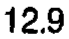 |
| r04_c10 | PIAl | T11 | PIAl | T11 | 45.6 | sem 45.6 mm2 | 45.6 | 45.6 | 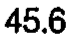 |
| r04_c11 | PIAl | T12 | PIAl | T12 | 9.9 | sem 9.9 mm2 | 9.9 | 9.9 |  |
| r06_c00 | SPL | T1 | SPL | T1 | 50.1 | mean 50.1 mm | 50.1 | 50.1 | 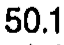 |
| r06_c01 | SPL | T2 | SPL | T2 | 52.1 | mean 52.1 mm | 52.1 | 52.1 | 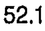 |
| r06_c02 | SPL | T3 | SPL | T3 | 51.7 | mean 51.7 mm | 51.7 | 51.7 | 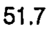 |
| r06_c03 | SPL | T4 | SPL | T4 | 51.1 | mean 51.1 mm | 51.1 | 51.1 | 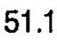 |
| r06_c04 | SPL | T5 | SPL | T5 | 52.1 | mean 52.1 mm | 52.1 | 52.1 | 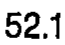 |
| r06_c05 | SPL | T6 | SPL | T6 | 53.8 | mean 53.8 mm | 53.8 | 53.8 | 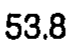 |
| r06_c06 | SPL | T7 | SPL | T7 | 50.5 | mean 50.5 mm | 50.5 | 50.5 | 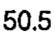 |
| r06_c07 | SPL | T8 | SPL | T8 | 52.8 | mean 52.8 mm | 52.8 | 52.8 |  |
| r06_c08 | SPL | T9 | SPL | T9 | 51.3 | mean 51.3 mm | 51.3 | 51.3 |  |
| r06_c09 | SPL | T10 | SPL | T10 | 49.3 | mean 49.3 mm | 49.3 | 49.3 |  |
| r06_c10 | SPL | T11 | SPL | T11 | 45.6 | mean 45.6 mm | 45.6 | 45.6 |  |
| r06_c11 | SPL | T12 | SPL | T12 | 47.4 | mean 47.4 mm | 47.4 | 47.4 |  |
| r07_c00 | SPL | T1 | SPL | T1 | 1.45 | sem 1.45 mm | 1.45 | 1.45 |  |
| r07_c01 | SPL | T2 | SPL | T2 | 1.46 | sem 1.46 mm | 1.46 | 1.46 |  |
| r07_c02 | SPL | T3 | SPL | T3 | 1.53 | sem 1.53 mm | 1.53 | 1.53 |  |
| r07_c03 | SPL | T4 | SPL | T4 | 2.00 | sem 2.00 mm | 2.00 | 2.00 |  |
| r07_c04 | SPL | T5 | SPL | T5 | 1.90 | sem 1.90 mm | 1.90 | 1.90 |  |
| r07_c05 | SPL | T6 | SPL | T6 | 1.31 | sem 1.31 mm | 1.31 | 1.31 |  |
| r07_c06 | SPL | T7 | SPL | T7 | 1.79 | sem 1.79 mm | 1.79 | 1.79 |  |
| r07_c07 | SPL | T8 | SPL | T8 | 1.22 | sem 1.22 mm | 1.22 | 1.22 |  |
| r07_c08 | SPL | T9 | SPL | T9 | 1.09 | sem 1.09 mm | 1.09 | 1.09 |  |
| r07_c09 | SPL | T10 | SPL | T10 | 1.02 | sem 1.02 mm | 1.02 | 1.02 |  |
| r07_c10 | SPL | T11 | SPL | T11 | 1.15 | sem 1.15 mm | 1.15 | 1.15 |  |
| r07_c11 | SPL | T12 | SPL | T12 | 1.70 | sem 1.70 mm | 1.70 | 1.70 |  |
| r08_c00 | TPW | T1 | TPW | T1 | 75.3 (T3-12) | mean 75.3 mm | 75.3 (T3-12) | 75.3 (T3-12) |  |
| r08_c01 | TPW | T2 | TPW | T2 | 69.4 (T11-12) | mean 69.4 mm | 69.4 (T11-12) | 69.4 (T11-12) |  |
| r08_c02 | TPW | T3 | TPW | T3 | 60.8 | mean 60.8 mm | 60.8 | 60.8 |  |
| r08_c03 | TPW | T4 | TPW | T4 | 56.9 | mean 56.9 mm | 56.9 | 56.9 |  |
| r08_c04 | TPW | T5 | TPW | T5 | 61.1 | mean 61.1 mm | 61.1 | 61.1 |  |
| r08_c05 | TPW | T6 | TPW | T6 | 61.3 | mean 61.3 mm | 61.3 | 61.3 |  |
| r08_c06 | TPW | T7 | TPW | T7 | 60.4 | mean 60.4 mm | 60.4 | 60.4 |  |
| r08_c07 | TPW | T8 | TPW | T8 | 59.9 | mean 59.9 mm | 59.9 | 59.9 |  |
| r08_c08 | TPW | T9 | TPW | T9 | 59.3 | mean 59.3 mm | 59.3 | 59.3 |  |
| r08_c09 | TPW | T10 | TPW | T10 | 58.4 | mean 58.4 mm | 58.4 | 58.4 |  |
| r08_c10 | TPW | T11 | TPW | T11 | 52.2 | mean 52.2 mm | 52.2 | 52.2 |  |
| r08_c11 | TPW | T12 | TPW | T12 | 46.9 (T1-3, T5) | mean 46.9 mm | 46.9 (T1-3, T5) | 46.9 (T1-3, T5) |  |
| r09_c00 | TPW | T1 | TPW | T1 | 1.74 | sem 1.74 mm | 1.74 | 1.74 |  |
| r09_c01 | TPW | T2 | TPW | T2 | 0.90 | sem 0.90 mm | 0.90 | 0.90 |  |
| r09_c02 | TPW | T3 | TPW | T3 | 1.54 | sem 1.54 mm | 1.54 | 1.54 |  |
| r09_c03 | TPW | T4 | TPW | T4 | 3.77 | sem 3.77 mm | 3.77 | 3.77 |  |
| r09_c04 | TPW | T5 | TPW | T5 | 1.90 | sem 1.90 mm | 1.90 | 1.90 |  |
| r09_c05 | TPW | T6 | TPW | T6 | 1.75 | sem 1.75 mm | 1.75 | 1.75 |  |
| r09_c06 | TPW | T7 | TPW | T7 | 2.34 | sem 2.34 mm | 2.34 | 2.34 |  |
| r09_c07 | TPW | T8 | TPW | T8 | 1.92 | sem 1.92 mm | 1.92 | 1.92 |  |
| r09_c08 | TPW | T9 | TPW | T9 | 1.46 | sem 1.46 mm | 1.46 | 1.46 |  |
| r09_c09 | TPW | T10 | TPW | T10 | 1.48 | sem 1.48 mm | 1.48 | 1.48 |  |
| r09_c10 | TPW | T11 | TPW | T11 | 1.28 | sem 1.28 mm | 1.28 | 1.28 |  |
| r09_c11 | TPW | T12 | TPW | T12 | 1.84 | sem 1.84 mm | 1.84 | 1.84 |  |
