# Table 8. Comparison of Our Results with Those of Previous Studies

Thoracic, PDF page 11, printed page 899; Panjabi_1991_Thoracic_Spine_16-8_888-901.pdf (sha256 f4078fa2cd2cf2c140fcee7f018917e055d2ca825c42e9b01d84cf1f4b7c1e2c), rendered at 300 dpi by render.py.

Every cell below is the box layout.py cut from the rendered page, and the two strings are what the two reading passes read in it (README.md). A dash is printed where the paper prints one. The value column is what provenance.csv carries.

| cell | row | column | measure | level | printed | value | pass 1 | pass 2 | image |
|---|---|---|---|---|---|---|---|---|---|
| r01_c00 | EPDl | Level | EPDl | T1 | T1 | mean T1 | T1 | T1 |  |
| r01_c01 | EPDl | Present Study | EPDl | T1 | 19.7 | mean 19.7 mm | 19.7 | 19.7 |  |
| r01_c02 | EPDl | Berry (1987) | EPDl | T1 | - | (none) | - | - |  |
| r01_c03 | EPDl | Zindrick (1987) | EPDl | T1 | - | (none) | - | - |  |
| r01_c04 | EPDl | Scoles (1988) | EPDl | T1 | 15.5 | mean 15.5 mm | 15.5 | 15.5 | 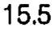 |
| r01_c05 | EPDl | Krag (1986, 1988) | EPDl | T1 | - | (none) | - | - |  |
| r01_c06 | EPDl | Cotterill (1986) | EPDl | T1 | - | (none) | - | - | 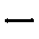 |
| r02_c00 | EPDl | Level | EPDl | T2 | T2 | mean T2 | T2 | T2 | 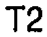 |
| r02_c01 | EPDl | Present Study | EPDl | T2 | 21.6 | mean 21.6 mm | 21.6 | 21.6 | 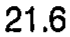 |
| r02_c02 | EPDl | Berry (1987) | EPDl | T2 | 19.0 | mean 19.0 mm | 19.0 | 19.0 |  |
| r02_c03 | EPDl | Zindrick (1987) | EPDl | T2 | - | (none) | - | - |  |
| r02_c04 | EPDl | Scoles (1988) | EPDl | T2 | - | (none) | - | - |  |
| r02_c05 | EPDl | Krag (1986, 1988) | EPDl | T2 | - | (none) | - | - | 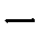 |
| r02_c06 | EPDl | Cotterill (1986) | EPDl | T2 | - | (none) | - | - | 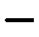 |
| r03_c00 | EPDl | Level | EPDl | T3 | T3 | mean T3 | T3 | T3 |  |
| r03_c01 | EPDl | Present Study | EPDl | T3 | 23.2 | mean 23.2 mm | 23.2 | 23.2 | 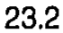 |
| r03_c02 | EPDl | Berry (1987) | EPDl | T3 | - | (none) | - | - |  |
| r03_c03 | EPDl | Zindrick (1987) | EPDl | T3 | - | (none) | - | - |  |
| r03_c04 | EPDl | Scoles (1988) | EPDl | T3 | 18.7 | mean 18.7 mm | 18.7 | 18.7 | 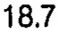 |
| r03_c05 | EPDl | Krag (1986, 1988) | EPDl | T3 | - | (none) | - | - | 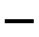 |
| r03_c06 | EPDl | Cotterill (1986) | EPDl | T3 | - | (none) | - | - |  |
| r04_c00 | EPDl | Level | EPDl | T4 | T4 | mean T4 | T4 | T4 | 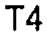 |
| r04_c01 | EPDl | Present Study | EPDl | T4 | 24.5 | mean 24.5 mm | 24.5 | 24.5 | 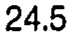 |
| r04_c02 | EPDl | Berry (1987) | EPDl | T4 | - | (none) | - | - |  |
| r04_c03 | EPDl | Zindrick (1987) | EPDl | T4 | - | (none) | - | - |  |
| r04_c04 | EPDl | Scoles (1988) | EPDl | T4 | - | (none) | - | - | 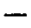 |
| r04_c05 | EPDl | Krag (1986, 1988) | EPDl | T4 | - | (none) | - | - | 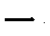 |
| r04_c06 | EPDl | Cotterill (1986) | EPDl | T4 | - | (none) | - | - |  |
| r05_c00 | EPDl | Level | EPDl | T5 | T5 | mean T5 | T5 | T5 |  |
| r05_c01 | EPDl | Present Study | EPDl | T5 | 25.8 | mean 25.8 mm | 25.8 | 25.8 | 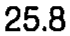 |
| r05_c02 | EPDl | Berry (1987) | EPDl | T5 | - | (none) | - | - |  |
| r05_c03 | EPDl | Zindrick (1987) | EPDl | T5 | - | (none) | - | - | 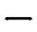 |
| r05_c04 | EPDl | Scoles (1988) | EPDl | T5 | - | (none) | - | - |  |
| r05_c05 | EPDl | Krag (1986, 1988) | EPDl | T5 | - | (none) | - | - | 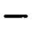 |
| r05_c06 | EPDl | Cotterill (1986) | EPDl | T5 | - | (none) | - | - |  |
| r06_c00 | EPDl | Level | EPDl | T6 | T6 | mean T6 | T6 | T6 |  |
| r06_c01 | EPDl | Present Study | EPDl | T6 | 26.9 | mean 26.9 mm | 26.9 | 26.9 | 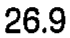 |
| r06_c02 | EPDl | Berry (1987) | EPDl | T6 | - | (none) | - | - | 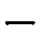 |
| r06_c03 | EPDl | Zindrick (1987) | EPDl | T6 | - | (none) | - | - | 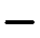 |
| r06_c04 | EPDl | Scoles (1988) | EPDl | T6 | 23.7 | mean 23.7 mm | 23.7 | 23.7 | 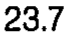 |
| r06_c05 | EPDl | Krag (1986, 1988) | EPDl | T6 | - | (none) | - | - |  |
| r06_c06 | EPDl | Cotterill (1986) | EPDl | T6 | 21.8 | mean 21.8 mm | 21.8 | 21.8 | 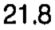 |
| r07_c00 | EPDl | Level | EPDl | T7 | T7 | mean T7 | T7 | T7 |  |
| r07_c01 | EPDl | Present Study | EPDl | T7 | 28.5 | mean 28.5 mm | 28.5 | 28.5 | 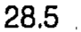 |
| r07_c02 | EPDl | Berry (1987) | EPDl | T7 | 28.0 | mean 28.0 mm | 28.0 | 28.0 | 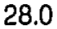 |
| r07_c03 | EPDl | Zindrick (1987) | EPDl | T7 | - | (none) | - | - |  |
| r07_c04 | EPDl | Scoles (1988) | EPDl | T7 | - | (none) | - | - | 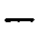 |
| r07_c05 | EPDl | Krag (1986, 1988) | EPDl | T7 | - | (none) | - | - |  |
| r07_c06 | EPDl | Cotterill (1986) | EPDl | T7 | - | (none) | - | - |  |
| r08_c00 | EPDl | Level | EPDl | T8 | T8 | mean T8 | T8 | T8 |  |
| r08_c01 | EPDl | Present Study | EPDl | T8 | 29.4 | mean 29.4 mm | 29.4 | 29.4 | 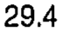 |
| r08_c02 | EPDl | Berry (1987) | EPDl | T8 | - | (none) | - | - | 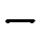 |
| r08_c03 | EPDl | Zindrick (1987) | EPDl | T8 | - | (none) | - | - | 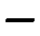 |
| r08_c04 | EPDl | Scoles (1988) | EPDl | T8 | - | (none) | - | - | 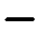 |
| r08_c05 | EPDl | Krag (1986, 1988) | EPDl | T8 | - | (none) | - | - |  |
| r08_c06 | EPDl | Cotterill (1986) | EPDl | T8 | - | (none) | - | - |  |
| r09_c00 | EPDl | Level | EPDl | T9 | T9 | mean T9 | T9 | T9 |  |
| r09_c01 | EPDl | Present Study | EPDl | T9 | 31.0 | mean 31.0 mm | 31.0 | 31.0 |  |
| r09_c02 | EPDl | Berry (1987) | EPDl | T9 | - | (none) | - | - |  |
| r09_c03 | EPDl | Zindrick (1987) | EPDl | T9 | - | (none) | - | - | 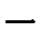 |
| r09_c04 | EPDl | Scoles (1988) | EPDl | T9 | 27.4 | mean 27.4 mm | 27.4 | 27.4 | 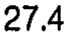 |
| r09_c05 | EPDl | Krag (1986, 1988) | EPDl | T9 | 32.5 | mean 32.5 mm | 32.5 | 32.5 | 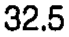 |
| r09_c06 | EPDl | Cotterill (1986) | EPDl | T9 | - | (none) | - | - |  |
| r10_c00 | EPDl | Level | EPDl | T10 | T10 | mean T10 | T10 | T10 |  |
| r10_c01 | EPDl | Present Study | EPDl | T10 | 31.6 | mean 31.6 mm | 31.6 | 31.6 | 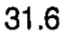 |
| r10_c02 | EPDl | Berry (1987) | EPDl | T10 | - | (none) | - | - | 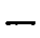 |
| r10_c03 | EPDl | Zindrick (1987) | EPDl | T10 | - | (none) | - | - | 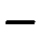 |
| r10_c04 | EPDl | Scoles (1988) | EPDl | T10 | - | (none) | - | - |  |
| r10_c05 | EPDl | Krag (1986, 1988) | EPDl | T10 | 32.0 | mean 32.0 mm | 32.0 | 32.0 | 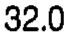 |
| r10_c06 | EPDl | Cotterill (1986) | EPDl | T10 | - | (none) | - | - |  |
| r11_c00 | EPDl | Level | EPDl | T11 | T11 | mean T11 | T11 | T11 |  |
| r11_c01 | EPDl | Present Study | EPDl | T11 | 31.8 | mean 31.8 mm | 31.8 | 31.8 | 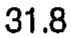 |
| r11_c02 | EPDl | Berry (1987) | EPDl | T11 | - | (none) | - | - | 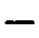 |
| r11_c03 | EPDl | Zindrick (1987) | EPDl | T11 | - | (none) | - | - | 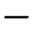 |
| r11_c04 | EPDl | Scoles (1988) | EPDl | T11 | - | (none) | - | - | 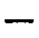 |
| r11_c05 | EPDl | Krag (1986, 1988) | EPDl | T11 | 31.0 | mean 31.0 mm | 31.0 | 31.0 | 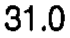 |
| r11_c06 | EPDl | Cotterill (1986) | EPDl | T11 | - | (none) | - | - | 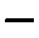 |
| r12_c00 | EPDl | Level | EPDl | T12 | T12 | mean T12 | T12 | T12 |  |
| r12_c01 | EPDl | Present Study | EPDl | T12 | 33.4 | mean 33.4 mm | 33.4 | 33.4 | 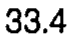 |
| r12_c02 | EPDl | Berry (1987) | EPDl | T12 | 31.2 | mean 31.2 mm | 31.2 | 31.2 | 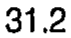 |
| r12_c03 | EPDl | Zindrick (1987) | EPDl | T12 | - | (none) | - | - |  |
| r12_c04 | EPDl | Scoles (1988) | EPDl | T12 | 28.8 | mean 28.8 mm | 28.8 | 28.8 | 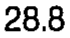 |
| r12_c05 | EPDl | Krag (1986, 1988) | EPDl | T12 | 32.0 | mean 32.0 mm | 32.0 | 32.0 | 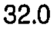 |
| r12_c06 | EPDl | Cotterill (1986) | EPDl | T12 | 27.5 | mean 27.5 mm | 27.5 | 27.5 | 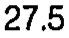 |
| r13_c00 | EPWl | Level | EPWl | T1 | T1 | mean T1 | T1 | T1 | 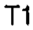 |
| r13_c01 | EPWl | Present Study | EPWl | T1 | 27.8 | mean 27.8 mm | 27.8 | 27.8 | 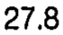 |
| r13_c02 | EPWl | Berry (1987) | EPWl | T1 | - | (none) | - | - |  |
| r13_c03 | EPWl | Zindrick (1987) | EPWl | T1 | - | (none) | - | - | 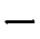 |
| r13_c04 | EPWl | Scoles (1988) | EPWl | T1 | 26.4 | mean 26.4 mm | 26.4 | 26.4 | 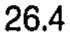 |
| r13_c05 | EPWl | Krag (1986, 1988) | EPWl | T1 | - | (none) | - | - |  |
| r13_c06 | EPWl | Cotterill (1986) | EPWl | T1 | - | (none) | - | - |  |
| r14_c00 | EPWl | Level | EPWl | T2 | T2 | mean T2 | T2 | T2 |  |
| r14_c01 | EPWl | Present Study | EPWl | T2 | 27.4 | mean 27.4 mm | 27.4 | 27.4 |  |
| r14_c02 | EPWl | Berry (1987) | EPWl | T2 | 33.5 | mean 33.5 mm | 33.5 | 33.5 |  |
| r14_c03 | EPWl | Zindrick (1987) | EPWl | T2 | - | (none) | - | - |  |
| r14_c04 | EPWl | Scoles (1988) | EPWl | T2 | - | (none) | - | - |  |
| r14_c05 | EPWl | Krag (1986, 1988) | EPWl | T2 | - | (none) | - | - |  |
| r14_c06 | EPWl | Cotterill (1986) | EPWl | T2 | - | (none) | - | - |  |
| r15_c00 | EPWl | Level | EPWl | T3 | T3 | mean T3 | T3 | T3 |  |
| r15_c01 | EPWl | Present Study | EPWl | T3 | 25.9 | mean 25.9 mm | 25.9 | 25.9 |  |
| r15_c02 | EPWl | Berry (1987) | EPWl | T3 | - | (none) | - | - |  |
| r15_c03 | EPWl | Zindrick (1987) | EPWl | T3 | - | (none) | - | - |  |
| r15_c04 | EPWl | Scoles (1988) | EPWl | T3 | 27.6 | mean 27.6 mm | 27.6 | 27.6 |  |
| r15_c05 | EPWl | Krag (1986, 1988) | EPWl | T3 | - | (none) | - | - |  |
| r15_c06 | EPWl | Cotterill (1986) | EPWl | T3 | - | (none) | - | - |  |
| r16_c00 | EPWl | Level | EPWl | T4 | T4 | mean T4 | T4 | T4 |  |
| r16_c01 | EPWl | Present Study | EPWl | T4 | 26.0 | mean 26.0 mm | 26.0 | 26.0 |  |
| r16_c02 | EPWl | Berry (1987) | EPWl | T4 | - | (none) | - | - |  |
| r16_c03 | EPWl | Zindrick (1987) | EPWl | T4 | - | (none) | - | - |  |
| r16_c04 | EPWl | Scoles (1988) | EPWl | T4 | - | (none) | - | - |  |
| r16_c05 | EPWl | Krag (1986, 1988) | EPWl | T4 | - | (none) | - | - |  |
| r16_c06 | EPWl | Cotterill (1986) | EPWl | T4 | - | (none) | - | - |  |
| r17_c00 | EPWl | Level | EPWl | T5 | T5 | mean T5 | T5 | T5 |  |
| r17_c01 | EPWl | Present Study | EPWl | T5 | 27.0 | mean 27.0 mm | 27.0 | 27.0 |  |
| r17_c02 | EPWl | Berry (1987) | EPWl | T5 | - | (none) | - | - |  |
| r17_c03 | EPWl | Zindrick (1987) | EPWl | T5 | - | (none) | - | - |  |
| r17_c04 | EPWl | Scoles (1988) | EPWl | T5 | - | (none) | - | - |  |
| r17_c05 | EPWl | Krag (1986, 1988) | EPWl | T5 | - | (none) | - | - |  |
| r17_c06 | EPWl | Cotterill (1986) | EPWl | T5 | - | (none) | - | - |  |
| r18_c00 | EPWl | Level | EPWl | T6 | T6 | mean T6 | T6 | T6 |  |
| r18_c01 | EPWl | Present Study | EPWl | T6 | 28.2 | mean 28.2 mm | 28.2 | 28.2 |  |
| r18_c02 | EPWl | Berry (1987) | EPWl | T6 | - | (none) | - | - |  |
| r18_c03 | EPWl | Zindrick (1987) | EPWl | T6 | - | (none) | - | - |  |
| r18_c04 | EPWl | Scoles (1988) | EPWl | T6 | 28.7 | mean 28.7 mm | 28.7 | 28.7 |  |
| r18_c05 | EPWl | Krag (1986, 1988) | EPWl | T6 | - | (none) | - | - |  |
| r18_c06 | EPWl | Cotterill (1986) | EPWl | T6 | 25.1 | mean 25.1 mm | 25.1 | 25.1 |  |
| r19_c00 | EPWl | Level | EPWl | T7 | T7 | mean T7 | T7 | T7 |  |
| r19_c01 | EPWl | Present Study | EPWl | T7 | 29.1 | mean 29.1 mm | 29.1 | 29.1 |  |
| r19_c02 | EPWl | Berry (1987) | EPWl | T7 | 33.2 | mean 33.2 mm | 33.2 | 33.2 |  |
| r19_c03 | EPWl | Zindrick (1987) | EPWl | T7 | - | (none) | - | - |  |
| r19_c04 | EPWl | Scoles (1988) | EPWl | T7 | - | (none) | - | - |  |
| r19_c05 | EPWl | Krag (1986, 1988) | EPWl | T7 | - | (none) | - | - |  |
| r19_c06 | EPWl | Cotterill (1986) | EPWl | T7 | - | (none) | - | - |  |
| r20_c00 | EPWl | Level | EPWl | T8 | T8 | mean T8 | T8 | T8 |  |
| r20_c01 | EPWl | Present Study | EPWl | T8 | 30.5 | mean 30.5 mm | 30.5 | 30.5 |  |
| r20_c02 | EPWl | Berry (1987) | EPWl | T8 | - | (none) | - | - |  |
| r20_c03 | EPWl | Zindrick (1987) | EPWl | T8 | - | (none) | - | - |  |
| r20_c04 | EPWl | Scoles (1988) | EPWl | T8 | - | (none) | - | - |  |
| r20_c05 | EPWl | Krag (1986, 1988) | EPWl | T8 | - | (none) | - | - |  |
| r20_c06 | EPWl | Cotterill (1986) | EPWl | T8 | - | (none) | - | - |  |
| r21_c00 | EPWl | Level | EPWl | T9 | T9 | mean T9 | T9 | T9 |  |
| r21_c01 | EPWl | Present Study | EPWl | T9 | 33.0 | mean 33.0 mm | 33.0 | 33.0 |  |
| r21_c02 | EPWl | Berry (1987) | EPWl | T9 | 32.5 | mean 32.5 mm | 32.5 | 32.5 |  |
| r21_c03 | EPWl | Zindrick (1987) | EPWl | T9 | - | (none) | - | - |  |
| r21_c04 | EPWl | Scoles (1988) | EPWl | T9 | - | (none) | - | - |  |
| r21_c05 | EPWl | Krag (1986, 1988) | EPWl | T9 | - | (none) | - | - |  |
| r21_c06 | EPWl | Cotterill (1986) | EPWl | T9 | - | (none) | - | - |  |
| r22_c00 | EPWl | Level | EPWl | T10 | T10 | mean T10 | T10 | T10 |  |
| r22_c01 | EPWl | Present Study | EPWl | T10 | 35.4 | mean 35.4 mm | 35.4 | 35.4 |  |
| r22_c02 | EPWl | Berry (1987) | EPWl | T10 | - | (none) | - | - |  |
| r22_c03 | EPWl | Zindrick (1987) | EPWl | T10 | - | (none) | - | - |  |
| r22_c04 | EPWl | Scoles (1988) | EPWl | T10 | - | (none) | - | - |  |
| r22_c05 | EPWl | Krag (1986, 1988) | EPWl | T10 | - | (none) | - | - |  |
| r22_c06 | EPWl | Cotterill (1986) | EPWl | T10 | - | (none) | - | - |  |
| r23_c00 | EPWl | Level | EPWl | T11 | T11 | mean T11 | T11 | T11 |  |
| r23_c01 | EPWl | Present Study | EPWl | T11 | 39.1 | mean 39.1 mm | 39.1 | 39.1 |  |
| r23_c02 | EPWl | Berry (1987) | EPWl | T11 | - | (none) | - | - |  |
| r23_c03 | EPWl | Zindrick (1987) | EPWl | T11 | - | (none) | - | - |  |
| r23_c04 | EPWl | Scoles (1988) | EPWl | T11 | - | (none) | - | - |  |
| r23_c05 | EPWl | Krag (1986, 1988) | EPWl | T11 | - | (none) | - | - |  |
| r23_c06 | EPWl | Cotterill (1986) | EPWl | T11 | - | (none) | - | - |  |
| r24_c00 | EPWl | Level | EPWl | T12 | T12 | mean T12 | T12 | T12 |  |
| r24_c01 | EPWl | Present Study | EPWl | T12 | 42.1 | mean 42.1 mm | 42.1 | 42.1 |  |
| r24_c02 | EPWl | Berry (1987) | EPWl | T12 | 46.8 | mean 46.8 mm | 46.8 | 46.8 |  |
| r24_c03 | EPWl | Zindrick (1987) | EPWl | T12 | - | (none) | - | - |  |
| r24_c04 | EPWl | Scoles (1988) | EPWl | T12 | 41.7 | mean 41.7 mm | 41.7 | 41.7 |  |
| r24_c05 | EPWl | Krag (1986, 1988) | EPWl | T12 | - | (none) | - | - |  |
| r24_c06 | EPWl | Cotterill (1986) | EPWl | T12 | 37.3 | mean 37.3 mm | 37.3 | 37.3 |  |
| r25_c00 | VBHp | Level | VBHp | T1 | T1 | mean T1 | T1 | T1 |  |
| r25_c01 | VBHp | Present Study | VBHp | T1 | 14.1 | mean 14.1 mm | 14.1 | 14.1 |  |
| r25_c02 | VBHp | Berry (1987) | VBHp | T1 | - | (none) | - | - |  |
| r25_c03 | VBHp | Zindrick (1987) | VBHp | T1 | - | (none) | - | - |  |
| r25_c04 | VBHp | Scoles (1988) | VBHp | T1 | 16.8 | mean 16.8 mm | 16.8 | 16.8 |  |
| r25_c05 | VBHp | Krag (1986, 1988) | VBHp | T1 | - | (none) | - | - |  |
| r25_c06 | VBHp | Cotterill (1986) | VBHp | T1 | - | (none) | - | - |  |
| r26_c00 | VBHp | Level | VBHp | T2 | T2 | mean T2 | T2 | T2 |  |
| r26_c01 | VBHp | Present Study | VBHp | T2 | 15.6 | mean 15.6 mm | 15.6 | 15.6 |  |
| r26_c02 | VBHp | Berry (1987) | VBHp | T2 | 16.5 | mean 16.5 mm | 16.5 | 16.5 |  |
| r26_c03 | VBHp | Zindrick (1987) | VBHp | T2 | - | (none) | - | - |  |
| r26_c04 | VBHp | Scoles (1988) | VBHp | T2 | - | (none) | - | - |  |
| r26_c05 | VBHp | Krag (1986, 1988) | VBHp | T2 | - | (none) | - | - |  |
| r26_c06 | VBHp | Cotterill (1986) | VBHp | T2 | - | (none) | - | - |  |
| r27_c00 | VBHp | Level | VBHp | T3 | T3 | mean T3 | T3 | T3 |  |
| r27_c01 | VBHp | Present Study | VBHp | T3 | 15.7 | mean 15.7 mm | 15.7 | 15.7 |  |
| r27_c02 | VBHp | Berry (1987) | VBHp | T3 | - | (none) | - | - |  |
| r27_c03 | VBHp | Zindrick (1987) | VBHp | T3 | - | (none) | - | - |  |
| r27_c04 | VBHp | Scoles (1988) | VBHp | T3 | 18.6 | mean 18.6 mm | 18.6 | 18.6 |  |
| r27_c05 | VBHp | Krag (1986, 1988) | VBHp | T3 | - | (none) | - | - |  |
| r27_c06 | VBHp | Cotterill (1986) | VBHp | T3 | - | (none) | - | - |  |
| r28_c00 | VBHp | Level | VBHp | T4 | T4 | mean T4 | T4 | T4 |  |
| r28_c01 | VBHp | Present Study | VBHp | T4 | 16.2 | mean 16.2 mm | 16.2 | 16.2 |  |
| r28_c02 | VBHp | Berry (1987) | VBHp | T4 | - | (none) | - | - |  |
| r28_c03 | VBHp | Zindrick (1987) | VBHp | T4 | - | (none) | - | - |  |
| r28_c04 | VBHp | Scoles (1988) | VBHp | T4 | - | (none) | - | - |  |
| r28_c05 | VBHp | Krag (1986, 1988) | VBHp | T4 | - | (none) | - | - |  |
| r28_c06 | VBHp | Cotterill (1986) | VBHp | T4 | - | (none) | - | - |  |
| r29_c00 | VBHp | Level | VBHp | T5 | T5 | mean T5 | T5 | T5 |  |
| r29_c01 | VBHp | Present Study | VBHp | T5 | 16.2 | mean 16.2 mm | 16.2 | 16.2 |  |
| r29_c02 | VBHp | Berry (1987) | VBHp | T5 | - | (none) | - | - |  |
| r29_c03 | VBHp | Zindrick (1987) | VBHp | T5 | - | (none) | - | - |  |
| r29_c04 | VBHp | Scoles (1988) | VBHp | T5 | - | (none) | - | - |  |
| r29_c05 | VBHp | Krag (1986, 1988) | VBHp | T5 | - | (none) | - | - |  |
| r29_c06 | VBHp | Cotterill (1986) | VBHp | T5 | - | (none) | - | - |  |
| r30_c00 | VBHp | Level | VBHp | T6 | T6 | mean T6 | T6 | T6 |  |
| r30_c01 | VBHp | Present Study | VBHp | T6 | 17.4 | mean 17.4 mm | 17.4 | 17.4 |  |
| r30_c02 | VBHp | Berry (1987) | VBHp | T6 | - | (none) | - | - |  |
| r30_c03 | VBHp | Zindrick (1987) | VBHp | T6 | - | (none) | - | - |  |
| r30_c04 | VBHp | Scoles (1988) | VBHp | T6 | 19.8 | mean 19.8 mm | 19.8 | 19.8 |  |
| r30_c05 | VBHp | Krag (1986, 1988) | VBHp | T6 | - | (none) | - | - |  |
| r30_c06 | VBHp | Cotterill (1986) | VBHp | T6 | 17.5 | mean 17.5 mm | 17.5 | 17.5 |  |
| r31_c00 | VBHp | Level | VBHp | T7 | T7 | mean T7 | T7 | T7 |  |
| r31_c01 | VBHp | Present Study | VBHp | T7 | 18.2 | mean 18.2 mm | 18.2 | 18.2 |  |
| r31_c02 | VBHp | Berry (1987) | VBHp | T7 | 19.1 | mean 19.1 mm | 19.1 | 19.1 |  |
| r31_c03 | VBHp | Zindrick (1987) | VBHp | T7 | - | (none) | - | - |  |
| r31_c04 | VBHp | Scoles (1988) | VBHp | T7 | - | (none) | - | - |  |
| r31_c05 | VBHp | Krag (1986, 1988) | VBHp | T7 | - | (none) | - | - |  |
| r31_c06 | VBHp | Cotterill (1986) | VBHp | T7 | - | (none) | - | - |  |
| r32_c00 | VBHp | Level | VBHp | T8 | T8 | mean T8 | T8 | T8 |  |
| r32_c01 | VBHp | Present Study | VBHp | T8 | 18.7 | mean 18.7 mm | 18.7 | 18.7 |  |
| r32_c02 | VBHp | Berry (1987) | VBHp | T8 | - | (none) | - | - |  |
| r32_c03 | VBHp | Zindrick (1987) | VBHp | T8 | - | (none) | - | - |  |
| r32_c04 | VBHp | Scoles (1988) | VBHp | T8 | - | (none) | - | - |  |
| r32_c05 | VBHp | Krag (1986, 1988) | VBHp | T8 | - | (none) | - | - |  |
| r32_c06 | VBHp | Cotterill (1986) | VBHp | T8 | - | (none) | - | - |  |
| r33_c00 | VBHp | Level | VBHp | T9 | T9 | mean T9 | T9 | T9 |  |
| r33_c01 | VBHp | Present Study | VBHp | T9 | 19.3 | mean 19.3 mm | 19.3 | 19.3 |  |
| r33_c02 | VBHp | Berry (1987) | VBHp | T9 | - | (none) | - | - |  |
| r33_c03 | VBHp | Zindrick (1987) | VBHp | T9 | - | (none) | - | - |  |
| r33_c04 | VBHp | Scoles (1988) | VBHp | T9 | 21.8 | mean 21.8 mm | 21.8 | 21.8 |  |
| r33_c05 | VBHp | Krag (1986, 1988) | VBHp | T9 | - | (none) | - | - |  |
| r33_c06 | VBHp | Cotterill (1986) | VBHp | T9 | - | (none) | - | - |  |
| r34_c00 | VBHp | Level | VBHp | T10 | T10 | mean T10 | T10 | T10 |  |
| r34_c01 | VBHp | Present Study | VBHp | T10 | 20.2 | mean 20.2 mm | 20.2 | 20.2 |  |
| r34_c02 | VBHp | Berry (1987) | VBHp | T10 | - | (none) | - | - |  |
| r34_c03 | VBHp | Zindrick (1987) | VBHp | T10 | - | (none) | - | - |  |
| r34_c04 | VBHp | Scoles (1988) | VBHp | T10 | - | (none) | - | - |  |
| r34_c05 | VBHp | Krag (1986, 1988) | VBHp | T10 | - | (none) | - | - |  |
| r34_c06 | VBHp | Cotterill (1986) | VBHp | T10 | - | (none) | - | - |  |
| r35_c00 | VBHp | Level | VBHp | T11 | T11 | mean T11 | T11 | T11 |  |
| r35_c01 | VBHp | Present Study | VBHp | T11 | 21.3 | mean 21.3 mm | 21.3 | 21.3 |  |
| r35_c02 | VBHp | Berry (1987) | VBHp | T11 | - | (none) | - | - |  |
| r35_c03 | VBHp | Zindrick (1987) | VBHp | T11 | - | (none) | - | - |  |
| r35_c04 | VBHp | Scoles (1988) | VBHp | T11 | - | (none) | - | - |  |
| r35_c05 | VBHp | Krag (1986, 1988) | VBHp | T11 | - | (none) | - | - |  |
| r35_c06 | VBHp | Cotterill (1986) | VBHp | T11 | - | (none) | - | - |  |
| r36_c00 | VBHp | Level | VBHp | T12 | T12 | mean T12 | T12 | T12 |  |
| r36_c01 | VBHp | Present Study | VBHp | T12 | 22.7 | mean 22.7 mm | 22.7 | 22.7 |  |
| r36_c02 | VBHp | Berry (1987) | VBHp | T12 | 24.8 | mean 24.8 mm | 24.8 | 24.8 |  |
| r36_c03 | VBHp | Zindrick (1987) | VBHp | T12 | - | (none) | - | - |  |
| r36_c04 | VBHp | Scoles (1988) | VBHp | T12 | 25.9 | mean 25.9 mm | 25.9 | 25.9 |  |
| r36_c05 | VBHp | Krag (1986, 1988) | VBHp | T12 | - | (none) | - | - |  |
| r36_c06 | VBHp | Cotterill (1986) | VBHp | T12 | 23.6 | mean 23.6 mm | 23.6 | 23.6 |  |
| r37_c00 | SCD | Level | SCD | T1 | T1 | mean T1 | T1 | T1 |  |
| r37_c01 | SCD | Present Study | SCD | T1 | 16.4 | mean 16.4 mm | 16.4 | 16.4 |  |
| r37_c02 | SCD | Berry (1987) | SCD | T1 | - | (none) | - | - |  |
| r37_c03 | SCD | Zindrick (1987) | SCD | T1 | - | (none) | - | - |  |
| r37_c04 | SCD | Scoles (1988) | SCD | T1 | 15.2 | mean 15.2 mm | 15.2 | 15.2 |  |
| r37_c05 | SCD | Krag (1986, 1988) | SCD | T1 | - | (none) | - | - |  |
| r37_c06 | SCD | Cotterill (1986) | SCD | T1 | - | (none) | - | - |  |
| r38_c00 | SCD | Level | SCD | T2 | T2 | mean T2 | T2 | T2 |  |
| r38_c01 | SCD | Present Study | SCD | T2 | 15.3 | mean 15.3 mm | 15.3 | 15.3 |  |
| r38_c02 | SCD | Berry (1987) | SCD | T2 | 15.0 | mean 15.0 mm | 15.0 | 15.0 |  |
| r38_c03 | SCD | Zindrick (1987) | SCD | T2 | - | (none) | - | - |  |
| r38_c04 | SCD | Scoles (1988) | SCD | T2 | - | (none) | - | - |  |
| r38_c05 | SCD | Krag (1986, 1988) | SCD | T2 | - | (none) | - | - |  |
| r38_c06 | SCD | Cotterill (1986) | SCD | T2 | - | (none) | - | - |  |
| r39_c00 | SCD | Level | SCD | T3 | T3 | mean T3 | T3 | T3 |  |
| r39_c01 | SCD | Present Study | SCD | T3 | 15.9 | mean 15.9 mm | 15.9 | 15.9 |  |
| r39_c02 | SCD | Berry (1987) | SCD | T3 | - | (none) | - | - |  |
| r39_c03 | SCD | Zindrick (1987) | SCD | T3 | - | (none) | - | - |  |
| r39_c04 | SCD | Scoles (1988) | SCD | T3 | 15.6 | mean 15.6 mm | 15.6 | 15.6 |  |
| r39_c05 | SCD | Krag (1986, 1988) | SCD | T3 | - | (none) | - | - |  |
| r39_c06 | SCD | Cotterill (1986) | SCD | T3 | - | (none) | - | - |  |
| r40_c00 | SCD | Level | SCD | T4 | T4 | mean T4 | T4 | T4 |  |
| r40_c01 | SCD | Present Study | SCD | T4 | 16.2 | mean 16.2 mm | 16.2 | 16.2 |  |
| r40_c02 | SCD | Berry (1987) | SCD | T4 | - | (none) | - | - |  |
| r40_c03 | SCD | Zindrick (1987) | SCD | T4 | - | (none) | - | - |  |
| r40_c04 | SCD | Scoles (1988) | SCD | T4 | - | (none) | - | - |  |
| r40_c05 | SCD | Krag (1986, 1988) | SCD | T4 | - | (none) | - | - |  |
| r40_c06 | SCD | Cotterill (1986) | SCD | T4 | - | (none) | - | - |  |
| r41_c00 | SCD | Level | SCD | T5 | T5 | mean T5 | T5 | T5 |  |
| r41_c01 | SCD | Present Study | SCD | T5 | 16.3 | mean 16.3 mm | 16.3 | 16.3 |  |
| r41_c02 | SCD | Berry (1987) | SCD | T5 | - | (none) | - | - |  |
| r41_c03 | SCD | Zindrick (1987) | SCD | T5 | - | (none) | - | - |  |
| r41_c04 | SCD | Scoles (1988) | SCD | T5 | - | (none) | - | - |  |
| r41_c05 | SCD | Krag (1986, 1988) | SCD | T5 | - | (none) | - | - |  |
| r41_c06 | SCD | Cotterill (1986) | SCD | T5 | - | (none) | - | - |  |
| r42_c00 | SCD | Level | SCD | T6 | T6 | mean T6 | T6 | T6 |  |
| r42_c01 | SCD | Present Study | SCD | T6 | 16.5 | mean 16.5 mm | 16.5 | 16.5 |  |
| r42_c02 | SCD | Berry (1987) | SCD | T6 | - | (none) | - | - |  |
| r42_c03 | SCD | Zindrick (1987) | SCD | T6 | - | (none) | - | - |  |
| r42_c04 | SCD | Scoles (1988) | SCD | T6 | 15.7 | mean 15.7 mm | 15.7 | 15.7 |  |
| r42_c05 | SCD | Krag (1986, 1988) | SCD | T6 | - | (none) | - | - |  |
| r42_c06 | SCD | Cotterill (1986) | SCD | T6 | 14.5 | mean 14.5 mm | 14.5 | 14.5 |  |
| r43_c00 | SCD | Level | SCD | T7 | T7 | mean T7 | T7 | T7 |  |
| r43_c01 | SCD | Present Study | SCD | T7 | 16.1 | mean 16.1 mm | 16.1 | 16.1 |  |
| r43_c02 | SCD | Berry (1987) | SCD | T7 | 16.6 | mean 16.6 mm | 16.6 | 16.6 |  |
| r43_c03 | SCD | Zindrick (1987) | SCD | T7 | - | (none) | - | - |  |
| r43_c04 | SCD | Scoles (1988) | SCD | T7 | - | (none) | - | - |  |
| r43_c05 | SCD | Krag (1986, 1988) | SCD | T7 | - | (none) | - | - |  |
| r43_c06 | SCD | Cotterill (1986) | SCD | T7 | - | (none) | - | - |  |
| r44_c00 | SCD | Level | SCD | T8 | T8 | mean T8 | T8 | T8 |  |
| r44_c01 | SCD | Present Study | SCD | T8 | 15.9 | mean 15.9 mm | 15.9 | 15.9 |  |
| r44_c02 | SCD | Berry (1987) | SCD | T8 | - | (none) | - | - |  |
| r44_c03 | SCD | Zindrick (1987) | SCD | T8 | - | (none) | - | - |  |
| r44_c04 | SCD | Scoles (1988) | SCD | T8 | - | (none) | - | - |  |
| r44_c05 | SCD | Krag (1986, 1988) | SCD | T8 | - | (none) | - | - |  |
| r44_c06 | SCD | Cotterill (1986) | SCD | T8 | - | (none) | - | - |  |
| r45_c00 | SCD | Level | SCD | T9 | T9 | mean T9 | T9 | T9 |  |
| r45_c01 | SCD | Present Study | SCD | T9 | 15.7 | mean 15.7 mm | 15.7 | 15.7 |  |
| r45_c02 | SCD | Berry (1987) | SCD | T9 | - | (none) | - | - |  |
| r45_c03 | SCD | Zindrick (1987) | SCD | T9 | - | (none) | - | - |  |
| r45_c04 | SCD | Scoles (1988) | SCD | T9 | 15.4 | mean 15.4 mm | 15.4 | 15.4 |  |
| r45_c05 | SCD | Krag (1986, 1988) | SCD | T9 | - | (none) | - | - |  |
| r45_c06 | SCD | Cotterill (1986) | SCD | T9 | - | (none) | - | - |  |
| r46_c00 | SCD | Level | SCD | T10 | T10 | mean T10 | T10 | T10 |  |
| r46_c01 | SCD | Present Study | SCD | T10 | 15.5 | mean 15.5 mm | 15.5 | 15.5 |  |
| r46_c02 | SCD | Berry (1987) | SCD | T10 | - | (none) | - | - |  |
| r46_c03 | SCD | Zindrick (1987) | SCD | T10 | - | (none) | - | - |  |
| r46_c04 | SCD | Scoles (1988) | SCD | T10 | - | (none) | - | - |  |
| r46_c05 | SCD | Krag (1986, 1988) | SCD | T10 | - | (none) | - | - |  |
| r46_c06 | SCD | Cotterill (1986) | SCD | T10 | - | (none) | - | - |  |
| r47_c00 | SCD | Level | SCD | T11 | T11 | mean T11 | T11 | T11 |  |
| r47_c01 | SCD | Present Study | SCD | T11 | 16.0 | mean 16.0 mm | 16.0 | 16.0 |  |
| r47_c02 | SCD | Berry (1987) | SCD | T11 | - | (none) | - | - |  |
| r47_c03 | SCD | Zindrick (1987) | SCD | T11 | - | (none) | - | - |  |
| r47_c04 | SCD | Scoles (1988) | SCD | T11 | - | (none) | - | - |  |
| r47_c05 | SCD | Krag (1986, 1988) | SCD | T11 | - | (none) | - | - |  |
| r47_c06 | SCD | Cotterill (1986) | SCD | T11 | - | (none) | - | - |  |
| r48_c00 | SCD | Level | SCD | T12 | T12 | mean T12 | T12 | T12 |  |
| r48_c01 | SCD | Present Study | SCD | T12 | 18.1 | mean 18.1 mm | 18.1 | 18.1 |  |
| r48_c02 | SCD | Berry (1987) | SCD | T12 | 17.2 | mean 17.2 mm | 17.2 | 17.2 |  |
| r48_c03 | SCD | Zindrick (1987) | SCD | T12 | - | (none) | - | - |  |
| r48_c04 | SCD | Scoles (1988) | SCD | T12 | 17.9 | mean 17.9 mm | 17.9 | 17.9 |  |
| r48_c05 | SCD | Krag (1986, 1988) | SCD | T12 | - | (none) | - | - |  |
| r48_c06 | SCD | Cotterill (1986) | SCD | T12 | 14.6 | mean 14.6 mm | 14.6 | 14.6 |  |
| r49_c00 | SCW | Level | SCW | T1 | T1 | mean T1 | T1 | T1 |  |
| r49_c01 | SCW | Present Study | SCW | T1 | 21.8 | mean 21.8 mm | 21.8 | 21.8 |  |
| r49_c02 | SCW | Berry (1987) | SCW | T1 | - | (none) | - | - |  |
| r49_c03 | SCW | Zindrick (1987) | SCW | T1 | - | (none) | - | - |  |
| r49_c04 | SCW | Scoles (1988) | SCW | T1 | 21.2 | mean 21.2 mm | 21.2 | 21.2 |  |
| r49_c05 | SCW | Krag (1986, 1988) | SCW | T1 | - | (none) | - | - |  |
| r49_c06 | SCW | Cotterill (1986) | SCW | T1 | - | (none) | - | - |  |
| r50_c00 | SCW | Level | SCW | T2 | T2 | mean T2 | T2 | T2 |  |
| r50_c01 | SCW | Present Study | SCW | T2 | 19.5 | mean 19.5 mm | 19.5 | 19.5 |  |
| r50_c02 | SCW | Berry (1987) | SCW | T2 | 18.3 | mean 18.3 mm | 18.3 | 18.3 |  |
| r50_c03 | SCW | Zindrick (1987) | SCW | T2 | - | (none) | - | - |  |
| r50_c04 | SCW | Scoles (1988) | SCW | T2 | - | (none) | - | - |  |
| r50_c05 | SCW | Krag (1986, 1988) | SCW | T2 | - | (none) | - | - |  |
| r50_c06 | SCW | Cotterill (1986) | SCW | T2 | - | (none) | - | - |  |
| r51_c00 | SCW | Level | SCW | T3 | T3 | mean T3 | T3 | T3 |  |
| r51_c01 | SCW | Present Study | SCW | T3 | 18.3 | mean 18.3 mm | 18.3 | 18.3 |  |
| r51_c02 | SCW | Berry (1987) | SCW | T3 | - | (none) | - | - |  |
| r51_c03 | SCW | Zindrick (1987) | SCW | T3 | - | (none) | - | - |  |
| r51_c04 | SCW | Scoles (1988) | SCW | T3 | 17.4 | mean 17.4 mm | 17.4 | 17.4 |  |
| r51_c05 | SCW | Krag (1986, 1988) | SCW | T3 | - | (none) | - | - |  |
| r51_c06 | SCW | Cotterill (1986) | SCW | T3 | - | (none) | - | - |  |
| r52_c00 | SCW | Level | SCW | T4 | T4 | mean T4 | T4 | T4 |  |
| r52_c01 | SCW | Present Study | SCW | T4 | 17.0 | mean 17.0 mm | 17.0 | 17.0 |  |
| r52_c02 | SCW | Berry (1987) | SCW | T4 | - | (none) | - | - |  |
| r52_c03 | SCW | Zindrick (1987) | SCW | T4 | - | (none) | - | - |  |
| r52_c04 | SCW | Scoles (1988) | SCW | T4 | - | (none) | - | - |  |
| r52_c05 | SCW | Krag (1986, 1988) | SCW | T4 | - | (none) | - | - |  |
| r52_c06 | SCW | Cotterill (1986) | SCW | T4 | - | (none) | - | - |  |
| r53_c00 | SCW | Level | SCW | T5 | T5 | mean T5 | T5 | T5 |  |
| r53_c01 | SCW | Present Study | SCW | T5 | 17.1 | mean 17.1 mm | 17.1 | 17.1 |  |
| r53_c02 | SCW | Berry (1987) | SCW | T5 | - | (none) | - | - |  |
| r53_c03 | SCW | Zindrick (1987) | SCW | T5 | - | (none) | - | - |  |
| r53_c04 | SCW | Scoles (1988) | SCW | T5 | - | (none) | - | - |  |
| r53_c05 | SCW | Krag (1986, 1988) | SCW | T5 | - | (none) | - | - |  |
| r53_c06 | SCW | Cotterill (1986) | SCW | T5 | - | (none) | - | - |  |
| r54_c00 | SCW | Level | SCW | T6 | T6 | mean T6 | T6 | T6 |  |
| r54_c01 | SCW | Present Study | SCW | T6 | 17.3 | mean 17.3 mm | 17.3 | 17.3 |  |
| r54_c02 | SCW | Berry (1987) | SCW | T6 | - | (none) | - | - |  |
| r54_c03 | SCW | Zindrick (1987) | SCW | T6 | - | (none) | - | - |  |
| r54_c04 | SCW | Scoles (1988) | SCW | T6 | 16.5 | mean 16.5 mm | 16.5 | 16.5 |  |
| r54_c05 | SCW | Krag (1986, 1988) | SCW | T6 | - | (none) | - | - |  |
| r54_c06 | SCW | Cotterill (1986) | SCW | T6 | 15.1 | mean 15.1 mm | 15.1 | 15.1 |  |
| r55_c00 | SCW | Level | SCW | T7 | T7 | mean T7 | T7 | T7 |  |
| r55_c01 | SCW | Present Study | SCW | T7 | 17.3 | mean 17.3 mm | 17.3 | 17.3 |  |
| r55_c02 | SCW | Berry (1987) | SCW | T7 | 17.1 | mean 17.1 mm | 17.1 | 17.1 |  |
| r55_c03 | SCW | Zindrick (1987) | SCW | T7 | - | (none) | - | - |  |
| r55_c04 | SCW | Scoles (1988) | SCW | T7 | - | (none) | - | - |  |
| r55_c05 | SCW | Krag (1986, 1988) | SCW | T7 | - | (none) | - | - |  |
| r55_c06 | SCW | Cotterill (1986) | SCW | T7 | - | (none) | - | - |  |
| r56_c00 | SCW | Level | SCW | T8 | T8 | mean T8 | T8 | T8 |  |
| r56_c01 | SCW | Present Study | SCW | T8 | 17.7 | mean 17.7 mm | 17.7 | 17.7 |  |
| r56_c02 | SCW | Berry (1987) | SCW | T8 | - | (none) | - | - |  |
| r56_c03 | SCW | Zindrick (1987) | SCW | T8 | - | (none) | - | - |  |
| r56_c04 | SCW | Scoles (1988) | SCW | T8 | - | (none) | - | - |  |
| r56_c05 | SCW | Krag (1986, 1988) | SCW | T8 | - | (none) | - | - |  |
| r56_c06 | SCW | Cotterill (1986) | SCW | T8 | - | (none) | - | - |  |
| r57_c00 | SCW | Level | SCW | T9 | T9 | mean T9 | T9 | T9 |  |
| r57_c01 | SCW | Present Study | SCW | T9 | 17.9 | mean 17.9 mm | 17.9 | 17.9 |  |
| r57_c02 | SCW | Berry (1987) | SCW | T9 | - | (none) | - | - |  |
| r57_c03 | SCW | Zindrick (1987) | SCW | T9 | - | (none) | - | - |  |
| r57_c04 | SCW | Scoles (1988) | SCW | T9 | 16.8 | mean 16.8 mm | 16.8 | 16.8 |  |
| r57_c05 | SCW | Krag (1986, 1988) | SCW | T9 | - | (none) | - | - |  |
| r57_c06 | SCW | Cotterill (1986) | SCW | T9 | - | (none) | - | - |  |
| r58_c00 | SCW | Level | SCW | T10 | T10 | mean T10 | T10 | T10 |  |
| r58_c01 | SCW | Present Study | SCW | T10 | 18.2 | mean 18.2 mm | 18.2 | 18.2 |  |
| r58_c02 | SCW | Berry (1987) | SCW | T10 | - | (none) | - | - |  |
| r58_c03 | SCW | Zindrick (1987) | SCW | T10 | - | (none) | - | - |  |
| r58_c04 | SCW | Scoles (1988) | SCW | T10 | - | (none) | - | - |  |
| r58_c05 | SCW | Krag (1986, 1988) | SCW | T10 | - | (none) | - | - |  |
| r58_c06 | SCW | Cotterill (1986) | SCW | T10 | - | (none) | - | - |  |
| r59_c00 | SCW | Level | SCW | T11 | T11 | mean T11 | T11 | T11 |  |
| r59_c01 | SCW | Present Study | SCW | T11 | 19.4 | mean 19.4 mm | 19.4 | 19.4 |  |
| r59_c02 | SCW | Berry (1987) | SCW | T11 | - | (none) | - | - |  |
| r59_c03 | SCW | Zindrick (1987) | SCW | T11 | - | (none) | - | - |  |
| r59_c04 | SCW | Scoles (1988) | SCW | T11 | - | (none) | - | - |  |
| r59_c05 | SCW | Krag (1986, 1988) | SCW | T11 | - | (none) | - | - |  |
| r59_c06 | SCW | Cotterill (1986) | SCW | T11 | - | (none) | - | - |  |
| r60_c00 | SCW | Level | SCW | T12 | T12 | mean T12 | T12 | T12 |  |
| r60_c01 | SCW | Present Study | SCW | T12 | 22.2 | mean 22.2 mm | 22.2 | 22.2 |  |
| r60_c02 | SCW | Berry (1987) | SCW | T12 | 20.2 | mean 20.2 mm | 20.2 | 20.2 |  |
| r60_c03 | SCW | Zindrick (1987) | SCW | T12 | - | (none) | - | - |  |
| r60_c04 | SCW | Scoles (1988) | SCW | T12 | 19.9 | mean 19.9 mm | 19.9 | 19.9 |  |
| r60_c05 | SCW | Krag (1986, 1988) | SCW | T12 | - | (none) | - | - |  |
| r60_c06 | SCW | Cotterill (1986) | SCW | T12 | 19.5 | mean 19.5 mm | 19.5 | 19.5 |  |
| r61_c00 | PDH | Level | PDH | T1 | T1 | mean T1 | T1 | T1 |  |
| r61_c01 | PDH | Present Study | PDH | T1 | 9.6 | mean 9.6 mm | 9.6 | 9.6 |  |
| r61_c02 | PDH | Berry (1987) | PDH | T1 | - | (none) | - | - |  |
| r61_c03 | PDH | Zindrick (1987) | PDH | T1 | 9.9 | mean 9.9 mm | 9.9 | 9.9 |  |
| r61_c04 | PDH | Scoles (1988) | PDH | T1 | 9.2 | mean 9.2 mm | 9.2 | 9.2 |  |
| r61_c05 | PDH | Krag (1986, 1988) | PDH | T1 | - | (none) | - | - |  |
| r61_c06 | PDH | Cotterill (1986) | PDH | T1 | - | (none) | - | - |  |
| r62_c00 | PDH | Level | PDH | T2 | T2 | mean T2 | T2 | T2 |  |
| r62_c01 | PDH | Present Study | PDH | T2 | 11.4 | mean 11.4 mm | 11.4 | 11.4 |  |
| r62_c02 | PDH | Berry (1987) | PDH | T2 | 11.8 | mean 11.8 mm | 11.8 | 11.8 |  |
| r62_c03 | PDH | Zindrick (1987) | PDH | T2 | 12.0 | mean 12.0 mm | 12.0 | 12.0 |  |
| r62_c04 | PDH | Scoles (1988) | PDH | T2 | - | (none) | - | - |  |
| r63_c00 | PDH | Level | PDH | T3 | T3 | mean T3 | T3 | T3 |  |
| r63_c01 | PDH | Present Study | PDH | T3 | 11.9 | mean 11.9 mm | 11.9 | 11.9 |  |
| r63_c02 | PDH | Berry (1987) | PDH | T3 | - | (none) | - | - |  |
| r63_c03 | PDH | Zindrick (1987) | PDH | T3 | 12.4 | mean 12.4 mm | 12.4 | 12.4 |  |
| r63_c04 | PDH | Scoles (1988) | PDH | T3 | 11.8 | mean 11.8 mm | 11.8 | 11.8 |  |
| r63_c05 | PDH | Krag (1986, 1988) | PDH | T3 | - | (none) | - | - |  |
| r63_c06 | PDH | Cotterill (1986) | PDH | T3 | - | (none) | - | - |  |
| r64_c00 | PDH | Level | PDH | T4 | T4 | mean T4 | T4 | T4 |  |
| r64_c01 | PDH | Present Study | PDH | T4 | 12.1 | mean 12.1 mm | 12.1 | 12.1 |  |
| r64_c02 | PDH | Berry (1987) | PDH | T4 | - | (none) | - | - |  |
| r64_c03 | PDH | Zindrick (1987) | PDH | T4 | 12.1 | mean 12.1 mm | 12.1 | 12.1 |  |
| r64_c04 | PDH | Scoles (1988) | PDH | T4 | - | (none) | - | - |  |
| r64_c05 | PDH | Krag (1986, 1988) | PDH | T4 | - | (none) | - | - |  |
| r64_c06 | PDH | Cotterill (1986) | PDH | T4 | - | (none) | - | - |  |
| r65_c00 | PDH | Level | PDH | T5 | T5 | mean T5 | T5 | T5 |  |
| r65_c01 | PDH | Present Study | PDH | T5 | 11.3 | mean 11.3 mm | 11.3 | 11.3 |  |
| r65_c02 | PDH | Berry (1987) | PDH | T5 | - | (none) | - | - |  |
| r65_c03 | PDH | Zindrick (1987) | PDH | T5 | 11.9 | mean 11.9 mm | 11.9 | 11.9 |  |
| r65_c04 | PDH | Scoles (1988) | PDH | T5 | - | (none) | - | - |  |
| r65_c05 | PDH | Krag (1986, 1988) | PDH | T5 | - | (none) | - | - |  |
| r65_c06 | PDH | Cotterill (1986) | PDH | T5 | - | (none) | - | - |  |
| r66_c00 | PDH | Level | PDH | T6 | T6 | mean T6 | T6 | T6 |  |
| r66_c01 | PDH | Present Study | PDH | T6 | 11.8 | mean 11.8 mm | 11.8 | 11.8 |  |
| r66_c02 | PDH | Berry (1987) | PDH | T6 | - | (none) | - | - |  |
| r66_c03 | PDH | Zindrick (1987) | PDH | T6 | 12.2 | mean 12.2 mm | 12.2 | 12.2 |  |
| r66_c04 | PDH | Scoles (1988) | PDH | T6 | 11.5 | mean 11.5 mm | 11.5 | 11.5 |  |
| r66_c05 | PDH | Krag (1986, 1988) | PDH | T6 | - | (none) | - | - |  |
| r66_c06 | PDH | Cotterill (1986) | PDH | T6 | - | (none) | - | - |  |
| r67_c00 | PDH | Level | PDH | T7 | T7 | mean T7 | T7 | T7 |  |
| r67_c01 | PDH | Present Study | PDH | T7 | 12.0 | mean 12.0 mm | 12.0 | 12.0 |  |
| r67_c02 | PDH | Berry (1987) | PDH | T7 | 12.0 | mean 12.0 mm | 12.0 | 12.0 |  |
| r67_c03 | PDH | Zindrick (1987) | PDH | T7 | 12.1 | mean 12.1 mm | 12.1 | 12.1 |  |
| r67_c04 | PDH | Scoles (1988) | PDH | T7 | - | (none) | - | - |  |
| r67_c05 | PDH | Krag (1986, 1988) | PDH | T7 | - | (none) | - | - |  |
| r67_c06 | PDH | Cotterill (1986) | PDH | T7 | - | (none) | - | - |  |
| r68_c00 | PDH | Level | PDH | T8 | T8 | mean T8 | T8 | T8 |  |
| r68_c01 | PDH | Present Study | PDH | T8 | 12.5 | mean 12.5 mm | 12.5 | 12.5 |  |
| r68_c02 | PDH | Berry (1987) | PDH | T8 | - | (none) | - | - |  |
| r68_c03 | PDH | Zindrick (1987) | PDH | T8 | 12.8 | mean 12.8 mm | 12.8 | 12.8 |  |
| r68_c04 | PDH | Scoles (1988) | PDH | T8 | - | (none) | - | - |  |
| r68_c05 | PDH | Krag (1986, 1988) | PDH | T8 | - | (none) | - | - |  |
| r68_c06 | PDH | Cotterill (1986) | PDH | T8 | - | (none) | - | - |  |
| r69_c00 | PDH | Level | PDH | T9 | T9 | mean T9 | T9 | T9 |  |
| r69_c01 | PDH | Present Study | PDH | T9 | 13.9 | mean 13.9 mm | 13.9 | 13.9 |  |
| r69_c02 | PDH | Berry (1987) | PDH | T9 | - | (none) | - | - |  |
| r69_c03 | PDH | Zindrick (1987) | PDH | T9 | 13.8 | mean 13.8 mm | 13.8 | 13.8 |  |
| r69_c04 | PDH | Scoles (1988) | PDH | T9 | 12.9 | mean 12.9 mm | 12.9 | 12.9 |  |
| r69_c05 | PDH | Krag (1986, 1988) | PDH | T9 | - | (none) | - | - |  |
| r69_c06 | PDH | Cotterill (1986) | PDH | T9 | - | (none) | - | - |  |
| r70_c00 | PDH | Level | PDH | T10 | T10 | mean T10 | T10 | T10 |  |
| r70_c01 | PDH | Present Study | PDH | T10 | 14.9 | mean 14.9 mm | 14.9 | 14.9 |  |
| r70_c02 | PDH | Berry (1987) | PDH | T10 | - | (none) | - | - |  |
| r70_c03 | PDH | Zindrick (1987) | PDH | T10 | 15.2 | mean 15.2 mm | 15.2 | 15.2 |  |
| r70_c04 | PDH | Scoles (1988) | PDH | T10 | - | (none) | - | - |  |
| r70_c05 | PDH | Krag (1986, 1988) | PDH | T10 | - | (none) | - | - |  |
| r70_c06 | PDH | Cotterill (1986) | PDH | T10 | - | (none) | - | - |  |
