# Table 8 (Continued)

Thoracic, PDF page 12, printed page 900; Panjabi_1991_Thoracic_Spine_16-8_888-901.pdf (sha256 f4078fa2cd2cf2c140fcee7f018917e055d2ca825c42e9b01d84cf1f4b7c1e2c), rendered at 300 dpi by render.py.

Every cell below is the box layout.py cut from the rendered page, and the two strings are what the two reading passes read in it (README.md). A dash is printed where the paper prints one. The value column is what provenance.csv carries.

| cell | row | column | measure | level | printed | value | pass 1 | pass 2 | image |
|---|---|---|---|---|---|---|---|---|---|
| r00_c00 | PDH | Level | PDH | T11 | T11 | mean T11 | T11 | T11 |  |
| r00_c01 | PDH | Present Study | PDH | T11 | 17.4 | mean 17.4 mm | 17.4 | 17.4 | 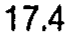 |
| r00_c02 | PDH | Berry (1987) | PDH | T11 | - | (none) | - | - | 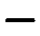 |
| r00_c03 | PDH | Zindrick (1987) | PDH | T11 | 17.4 | mean 17.4 mm | 17.4 | 17.4 | 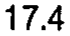 |
| r00_c04 | PDH | Scoles (1988) | PDH | T11 | - | (none) | - | - | 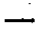 |
| r00_c05 | PDH | Krag (1986, 1988) | PDH | T11 | - | (none) | - | - |  |
| r00_c06 | PDH | Cotterill (1986) | PDH | T11 | - | (none) | - | - |  |
| r01_c00 | PDH | Level | PDH | T12 | T12 | mean T12 | T12 | T12 |  |
| r01_c01 | PDH | Present Study | PDH | T12 | 16.7 | mean 16.7 mm | 16.7 | 16.7 | 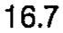 |
| r01_c02 | PDH | Berry (1987) | PDH | T12 | 17.1 | mean 17.1 mm | 17.1 | 17.1 | 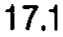 |
| r01_c03 | PDH | Zindrick (1987) | PDH | T12 | 15.8 | mean 15.8 mm | 15.8 | 15.8 | 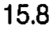 |
| r01_c04 | PDH | Scoles (1988) | PDH | T12 | 16.0 | mean 16.0 mm | 16.0 | 16.0 |  |
| r01_c05 | PDH | Krag (1986, 1988) | PDH | T12 | - | (none) | - | - | 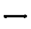 |
| r01_c06 | PDH | Cotterill (1986) | PDH | T12 | - | (none) | - | - | 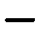 |
| r02_c00 | PDW | Level | PDW | T1 | T1 | mean T1 | T1 | T1 |  |
| r02_c01 | PDW | Present Study | PDW | T1 | 8.5 | mean 8.5 mm | 8.5 | 8.5 | 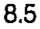 |
| r02_c02 | PDW | Berry (1987) | PDW | T1 | - | (none) | - | - |  |
| r02_c03 | PDW | Zindrick (1987) | PDW | T1 | 7.9 | mean 7.9 mm | 7.9 | 7.9 | 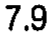 |
| r02_c04 | PDW | Scoles (1988) | PDW | T1 | 7.3 | mean 7.3 mm | 7.3 | 7.3 | 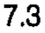 |
| r02_c05 | PDW | Krag (1986, 1988) | PDW | T1 | - | (none) | - | - |  |
| r02_c06 | PDW | Cotterill (1986) | PDW | T1 | - | (none) | - | - |  |
| r03_c00 | PDW | Level | PDW | T2 | T2 | mean T2 | T2 | T2 | 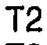 |
| r03_c01 | PDW | Present Study | PDW | T2 | 8.2 | mean 8.2 mm | 8.2 | 8.2 | 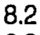 |
| r03_c02 | PDW | Berry (1987) | PDW | T2 | 6.2 | mean 6.2 mm | 6.2 | 6.2 | 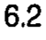 |
| r03_c03 | PDW | Zindrick (1987) | PDW | T2 | 7.0 | mean 7.0 mm | 7.0 | 7.0 | 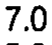 |
| r03_c04 | PDW | Scoles (1988) | PDW | T2 | - | (none) | - | - | 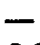 |
| r03_c05 | PDW | Krag (1986, 1988) | PDW | T2 | - | (none) | - | - | 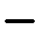 |
| r03_c06 | PDW | Cotterill (1986) | PDW | T2 | - | (none) | - | - | 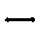 |
| r04_c00 | PDW | Level | PDW | T3 | T3 | mean T3 | T3 | T3 | 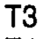 |
| r04_c01 | PDW | Present Study | PDW | T3 | 6.8 | mean 6.8 mm | 6.8 | 6.8 | 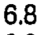 |
| r04_c02 | PDW | Berry (1987) | PDW | T3 | - | (none) | - | - | 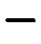 |
| r04_c03 | PDW | Zindrick (1987) | PDW | T3 | 5.6 | mean 5.6 mm | 5.6 | 5.6 | 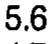 |
| r04_c04 | PDW | Scoles (1988) | PDW | T3 | 3.9 | mean 3.9 mm | 3.9 | 3.9 | 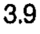 |
| r04_c05 | PDW | Krag (1986, 1988) | PDW | T3 | - | (none) | - | - |  |
| r04_c06 | PDW | Cotterill (1986) | PDW | T3 | - | (none) | - | - | 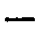 |
| r05_c00 | PDW | Level | PDW | T4 | T4 | mean T4 | T4 | T4 | 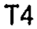 |
| r05_c01 | PDW | Present Study | PDW | T4 | 6.3 | mean 6.3 mm | 6.3 | 6.3 | 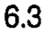 |
| r05_c02 | PDW | Berry (1987) | PDW | T4 | - | (none) | - | - | 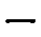 |
| r05_c03 | PDW | Zindrick (1987) | PDW | T4 | 4.7 | mean 4.7 mm | 4.7 | 4.7 | 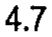 |
| r05_c04 | PDW | Scoles (1988) | PDW | T4 | - | (none) | - | - | 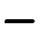 |
| r05_c05 | PDW | Krag (1986, 1988) | PDW | T4 | - | (none) | - | - |  |
| r05_c06 | PDW | Cotterill (1986) | PDW | T4 | - | (none) | - | - | 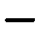 |
| r06_c00 | PDW | Level | PDW | T5 | T5 | mean T5 | T5 | T5 |  |
| r06_c01 | PDW | Present Study | PDW | T5 | 6.0 | mean 6.0 mm | 6.0 | 6.0 | 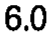 |
| r06_c02 | PDW | Berry (1987) | PDW | T5 | - | (none) | - | - |  |
| r06_c03 | PDW | Zindrick (1987) | PDW | T5 | 4.5 | mean 4.5 mm | 4.5 | 4.5 | 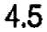 |
| r06_c04 | PDW | Scoles (1988) | PDW | T5 | - | (none) | - | - | 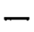 |
| r06_c05 | PDW | Krag (1986, 1988) | PDW | T5 | - | (none) | - | - | 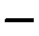 |
| r06_c06 | PDW | Cotterill (1986) | PDW | T5 | - | (none) | - | - | 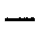 |
| r07_c00 | PDW | Level | PDW | T6 | T6 | mean T6 | T6 | T6 | 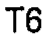 |
| r07_c01 | PDW | Present Study | PDW | T6 | 6.0 | mean 6.0 mm | 6.0 | 6.0 |  |
| r07_c02 | PDW | Berry (1987) | PDW | T6 | - | (none) | - | - | 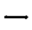 |
| r07_c03 | PDW | Zindrick (1987) | PDW | T6 | 5.2 | mean 5.2 mm | 5.2 | 5.2 | 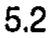 |
| r07_c04 | PDW | Scoles (1988) | PDW | T6 | 3.5 | mean 3.5 mm | 3.5 | 3.5 | 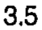 |
| r07_c05 | PDW | Krag (1986, 1988) | PDW | T6 | - | (none) | - | - | 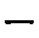 |
| r07_c06 | PDW | Cotterill (1986) | PDW | T6 | 4.1 | mean 4.1 mm | 4.1 | 4.1 | 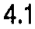 |
| r08_c00 | PDW | Level | PDW | T7 | T7 | mean T7 | T7 | T7 |  |
| r08_c01 | PDW | Present Study | PDW | T7 | 5.9 | mean 5.9 mm | 5.9 | 5.9 | 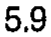 |
| r08_c02 | PDW | Berry (1987) | PDW | T7 | 5.0 | mean 5.0 mm | 5.0 | 5.0 |  |
| r08_c03 | PDW | Zindrick (1987) | PDW | T7 | 5.3 | mean 5.3 mm | 5.3 | 5.3 | 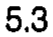 |
| r08_c04 | PDW | Scoles (1988) | PDW | T7 | - | (none) | - | - | 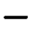 |
| r08_c05 | PDW | Krag (1986, 1988) | PDW | T7 | - | (none) | - | - | 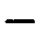 |
| r08_c06 | PDW | Cotterill (1986) | PDW | T7 | - | (none) | - | - |  |
| r09_c00 | PDW | Level | PDW | T8 | T8 | mean T8 | T8 | T8 |  |
| r09_c01 | PDW | Present Study | PDW | T8 | 6.7 | mean 6.7 mm | 6.7 | 6.7 | 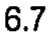 |
| r09_c02 | PDW | Berry (1987) | PDW | T8 | - | (none) | - | - | 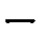 |
| r09_c03 | PDW | Zindrick (1987) | PDW | T8 | 5.9 | mean 5.9 mm | 5.9 | 5.9 | 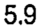 |
| r09_c04 | PDW | Scoles (1988) | PDW | T8 | - | (none) | - | - | 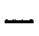 |
| r09_c05 | PDW | Krag (1986, 1988) | PDW | T8 | - | (none) | - | - |  |
| r09_c06 | PDW | Cotterill (1986) | PDW | T8 | - | (none) | - | - |  |
| r10_c00 | PDW | Level | PDW | T9 | T9 | mean T9 | T9 | T9 |  |
| r10_c01 | PDW | Present Study | PDW | T9 | 7.7 | mean 7.7 mm | 7.7 | 7.7 |  |
| r10_c02 | PDW | Berry (1987) | PDW | T9 | - | (none) | - | - |  |
| r10_c03 | PDW | Zindrick (1987) | PDW | T9 | 6.1 | mean 6.1 mm | 6.1 | 6.1 |  |
| r10_c04 | PDW | Scoles (1988) | PDW | T9 | 3.9 | mean 3.9 mm | 3.9 | 3.9 |  |
| r10_c05 | PDW | Krag (1986, 1988) | PDW | T9 | 6.9 | mean 6.9 mm | 6.9 | 6.9 |  |
| r10_c06 | PDW | Cotterill (1986) | PDW | T9 | - | (none) | - | - |  |
| r11_c00 | PDW | Level | PDW | T10 | T10 | mean T10 | T10 | T10 |  |
| r11_c01 | PDW | Present Study | PDW | T10 | 9.0 | mean 9.0 mm | 9.0 | 9.0 |  |
| r11_c02 | PDW | Berry (1987) | PDW | T10 | - | (none) | - | - |  |
| r11_c03 | PDW | Zindrick (1987) | PDW | T10 | 6.3 | mean 6.3 mm | 6.3 | 6.3 |  |
| r11_c04 | PDW | Scoles (1988) | PDW | T10 | - | (none) | - | - |  |
| r11_c05 | PDW | Krag (1986, 1988) | PDW | T10 | 7.5 | mean 7.5 mm | 7.5 | 7.5 |  |
| r11_c06 | PDW | Cotterill (1986) | PDW | T10 | - | (none) | - | - |  |
| r12_c00 | PDW | Level | PDW | T11 | T11 | mean T11 | T11 | T11 |  |
| r12_c01 | PDW | Present Study | PDW | T11 | 9.8 | mean 9.8 mm | 9.8 | 9.8 |  |
| r12_c02 | PDW | Berry (1987) | PDW | T11 | - | (none) | - | - |  |
| r12_c03 | PDW | Zindrick (1987) | PDW | T11 | 7.8 | mean 7.8 mm | 7.8 | 7.8 |  |
| r12_c04 | PDW | Scoles (1988) | PDW | T11 | - | (none) | - | - |  |
| r12_c05 | PDW | Krag (1986, 1988) | PDW | T11 | 7.8 | mean 7.8 mm | 7.8 | 7.8 |  |
| r12_c06 | PDW | Cotterill (1986) | PDW | T11 | - | (none) | - | - |  |
| r13_c00 | PDW | Level | PDW | T12 | T12 | mean T12 | T12 | T12 |  |
| r13_c01 | PDW | Present Study | PDW | T12 | 8.7 | mean 8.7 mm | 8.7 | 8.7 |  |
| r13_c02 | PDW | Berry (1987) | PDW | T12 | 7.7 | mean 7.7 mm | 7.7 | 7.7 |  |
| r13_c03 | PDW | Zindrick (1987) | PDW | T12 | 7.1 | mean 7.1 mm | 7.1 | 7.1 |  |
| r13_c04 | PDW | Scoles (1988) | PDW | T12 | 7.4 | mean 7.4 mm | 7.4 | 7.4 |  |
| r13_c05 | PDW | Krag (1986, 1988) | PDW | T12 | 7.6 | mean 7.6 mm | 7.6 | 7.6 |  |
| r13_c06 | PDW | Cotterill (1986) | PDW | T12 | 7.7 | mean 7.7 mm | 7.7 | 7.7 |  |
| r15_c00 | PDIs | Level | PDIs | T1 | T1 | mean T1 | T1 | T1 |  |
| r15_c01 | PDIs | Present Study | PDIs | T1 | 27.1 | mean 27.1 deg | 27.1 | 27.1 |  |
| r15_c02 | PDIs | Berry (1987) | PDIs | T1 | - | (none) | - | - |  |
| r15_c03 | PDIs | Zindrick (1987) | PDIs | T1 | 26.6 | mean 26.6 deg | 26.6 | 26.6 |  |
| r15_c04 | PDIs | Scoles (1988) | PDIs | T1 | 29.8 | mean 29.8 deg | 29.8 | 29.8 |  |
| r15_c05 | PDIs | Krag (1986, 1988) | PDIs | T1 | - | (none) | - | - |  |
| r15_c06 | PDIs | Cotterill (1986) | PDIs | T1 | - | (none) | - | - |  |
| r16_c00 | PDIs | Level | PDIs | T2 | T2 | mean T2 | T2 | T2 |  |
| r16_c01 | PDIs | Present Study | PDIs | T2 | 28.6 | mean 28.6 deg | 28.6 | 28.6 |  |
| r16_c02 | PDIs | Berry (1987) | PDIs | T2 | 23.0 | mean 23.0 deg | 23.0 | 23.0 |  |
| r16_c03 | PDIs | Zindrick (1987) | PDIs | T2 | 19.1 | mean 19.1 deg | 19.1 | 19.1 |  |
| r16_c04 | PDIs | Scoles (1988) | PDIs | T2 | - | (none) | - | - |  |
| r16_c05 | PDIs | Krag (1986, 1988) | PDIs | T2 | - | (none) | - | - |  |
| r16_c06 | PDIs | Cotterill (1986) | PDIs | T2 | - | (none) | - | - |  |
| r17_c00 | PDIs | Level | PDIs | T3 | T3 | mean T3 | T3 | T3 |  |
| r17_c01 | PDIs | Present Study | PDIs | T3 | 19.4 | mean 19.4 deg | 19.4 | 19.4 |  |
| r17_c02 | PDIs | Berry (1987) | PDIs | T3 | - | (none) | - | - |  |
| r17_c03 | PDIs | Zindrick (1987) | PDIs | T3 | 14.6 | mean 14.6 deg | 14.6 | 14.6 |  |
| r17_c04 | PDIs | Scoles (1988) | PDIs | T3 | 15.3 | mean 15.3 deg | 15.3 | 15.3 |  |
| r17_c05 | PDIs | Krag (1986, 1988) | PDIs | T3 | - | (none) | - | - |  |
| r17_c06 | PDIs | Cotterill (1986) | PDIs | T3 | - | (none) | - | - |  |
| r18_c00 | PDIs | Level | PDIs | T4 | T4 | mean T4 | T4 | T4 |  |
| r18_c01 | PDIs | Present Study | PDIs | T4 | 19.5 | mean 19.5 deg | 19.5 | 19.5 |  |
| r18_c02 | PDIs | Berry (1987) | PDIs | T4 | - | (none) | - | - |  |
| r18_c03 | PDIs | Zindrick (1987) | PDIs | T4 | 12.6 | mean 12.6 deg | 12.6 | 12.6 |  |
| r18_c04 | PDIs | Scoles (1988) | PDIs | T4 | - | (none) | - | - |  |
| r18_c05 | PDIs | Krag (1986, 1988) | PDIs | T4 | - | (none) | - | - |  |
| r18_c06 | PDIs | Cotterill (1986) | PDIs | T4 | - | (none) | - | - |  |
| r19_c00 | PDIs | Level | PDIs | T5 | T5 | mean T5 | T5 | T5 |  |
| r19_c01 | PDIs | Present Study | PDIs | T5 | 15.6 | mean 15.6 deg | 15.6 | 15.6 |  |
| r19_c02 | PDIs | Berry (1987) | PDIs | T5 | - | (none) | - | - |  |
| r19_c03 | PDIs | Zindrick (1987) | PDIs | T5 | 9.4 | mean 9.4 deg | 9.4 | 9.4 |  |
| r19_c04 | PDIs | Scoles (1988) | PDIs | T5 | - | (none) | - | - |  |
| r19_c05 | PDIs | Krag (1986, 1988) | PDIs | T5 | - | (none) | - | - |  |
| r19_c06 | PDIs | Cotterill (1986) | PDIs | T5 | - | (none) | - | - |  |
| r20_c00 | PDIs | Level | PDIs | T6 | T6 | mean T6 | T6 | T6 |  |
| r20_c01 | PDIs | Present Study | PDIs | T6 | 16.4 | mean 16.4 deg | 16.4 | 16.4 |  |
| r20_c02 | PDIs | Berry (1987) | PDIs | T6 | - | (none) | - | - |  |
| r20_c03 | PDIs | Zindrick (1987) | PDIs | T6 | 9.6 | mean 9.6 deg | 9.6 | 9.6 |  |
| r20_c04 | PDIs | Scoles (1988) | PDIs | T6 | 10.2 | mean 10.2 deg | 10.2 | 10.2 |  |
| r20_c05 | PDIs | Krag (1986, 1988) | PDIs | T6 | - | (none) | - | - |  |
| r20_c06 | PDIs | Cotterill (1986) | PDIs | T6 | - | (none) | - | - |  |
| r21_c00 | PDIs | Level | PDIs | T7 | T7 | mean T7 | T7 | T7 |  |
| r21_c01 | PDIs | Present Study | PDIs | T7 | 20.7 | mean 20.7 deg | 20.7 | 20.7 |  |
| r21_c02 | PDIs | Berry (1987) | PDIs | T7 | 7.5 | mean 7.5 deg | 7.5 | 7.5 |  |
| r21_c03 | PDIs | Zindrick (1987) | PDIs | T7 | 8.7 | mean 8.7 deg | 8.7 | 8.7 |  |
| r21_c04 | PDIs | Scoles (1988) | PDIs | T7 | - | (none) | - | - |  |
| r21_c05 | PDIs | Krag (1986, 1988) | PDIs | T7 | - | (none) | - | - |  |
| r21_c06 | PDIs | Cotterill (1986) | PDIs | T7 | - | (none) | - | - |  |
| r22_c00 | PDIs | Level | PDIs | T8 | T8 | mean T8 | T8 | T8 |  |
| r22_c01 | PDIs | Present Study | PDIs | T8 | 19.6 | mean 19.6 deg | 19.6 | 19.6 |  |
| r22_c02 | PDIs | Berry (1987) | PDIs | T8 | - | (none) | - | - |  |
| r22_c03 | PDIs | Zindrick (1987) | PDIs | T8 | 8.1 | mean 8.1 deg | 8.1 | 8.1 |  |
| r22_c04 | PDIs | Scoles (1988) | PDIs | T8 | - | (none) | - | - |  |
| r22_c05 | PDIs | Krag (1986, 1988) | PDIs | T8 | - | (none) | - | - |  |
| r22_c06 | PDIs | Cotterill (1986) | PDIs | T8 | - | (none) | - | - |  |
| r23_c00 | PDIs | Level | PDIs | T9 | T9 | mean T9 | T9 | T9 |  |
| r23_c01 | PDIs | Present Study | PDIs | T9 | 14.8 | mean 14.8 deg | 14.8 | 14.8 |  |
| r23_c02 | PDIs | Berry (1987) | PDIs | T9 | - | (none) | - | - |  |
| r23_c03 | PDIs | Zindrick (1987) | PDIs | T9 | 7.6 | mean 7.6 deg | 7.6 | 7.6 |  |
| r23_c04 | PDIs | Scoles (1988) | PDIs | T9 | 9.2 | mean 9.2 deg | 9.2 | 9.2 |  |
| r23_c05 | PDIs | Krag (1986, 1988) | PDIs | T9 | 6.0 | mean 6.0 deg | 6.0 | 6.0 |  |
| r23_c06 | PDIs | Cotterill (1986) | PDIs | T9 | - | (none) | - | - |  |
| r24_c00 | PDIs | Level | PDIs | T10 | T10 | mean T10 | T10 | T10 |  |
| r24_c01 | PDIs | Present Study | PDIs | T10 | 12.4 | mean 12.4 deg | 12.4 | 12.4 |  |
| r24_c02 | PDIs | Berry (1987) | PDIs | T10 | - | (none) | - | - |  |
| r24_c03 | PDIs | Zindrick (1987) | PDIs | T10 | 4.6 | mean 4.6 deg | 4.6 | 4.6 |  |
| r24_c04 | PDIs | Scoles (1988) | PDIs | T10 | - | (none) | - | - |  |
| r24_c05 | PDIs | Krag (1986, 1988) | PDIs | T10 | 6.0 | mean 6.0 deg | 6.0 | 6.0 |  |
| r24_c06 | PDIs | Cotterill (1986) | PDIs | T10 | - | (none) | - | - |  |
| r25_c00 | PDIs | Level | PDIs | T11 | T11 | mean T11 | T11 | T11 |  |
| r25_c01 | PDIs | Present Study | PDIs | T11 | 13.1 | mean 13.1 deg | 13.1 | 13.1 |  |
| r25_c02 | PDIs | Berry (1987) | PDIs | T11 | - | (none) | - | - |  |
| r25_c03 | PDIs | Zindrick (1987) | PDIs | T11 | 1.2 | mean 1.2 deg | 1.2 | 1.2 |  |
| r25_c04 | PDIs | Scoles (1988) | PDIs | T11 | - | (none) | - | - |  |
| r25_c05 | PDIs | Krag (1986, 1988) | PDIs | T11 | 0.0 | mean 0.0 deg | 0.0 | 0.0 |  |
| r25_c06 | PDIs | Cotterill (1986) | PDIs | T11 | - | (none) | - | - |  |
| r26_c00 | PDIs | Level | PDIs | T12 | T12 | mean T12 | T12 | T12 |  |
| r26_c01 | PDIs | Present Study | PDIs | T12 | 9.8 | mean 9.8 deg | 9.8 | 9.8 |  |
| r26_c02 | PDIs | Berry (1987) | PDIs | T12 | -3.0 | mean -3.0 deg | -3.0 | -3.0 |  |
| r26_c03 | PDIs | Zindrick (1987) | PDIs | T12 | -4.2 | mean -4.2 deg | -4.2 | -4.2 |  |
| r26_c04 | PDIs | Scoles (1988) | PDIs | T12 | 9.5 | mean 9.5 deg | 9.5 | 9.5 |  |
| r26_c05 | PDIs | Krag (1986, 1988) | PDIs | T12 | 0.0 | mean 0.0 deg | 0.0 | 0.0 |  |
| r26_c06 | PDIs | Cotterill (1986) | PDIs | T12 | - | (none) | - | - |  |
| r27_c00 | PDIt | Level | PDIt | T1 | T1 | mean T1 | T1 | T1 |  |
| r27_c01 | PDIt | Present Study | PDIt | T1 | 7.6 | mean 7.6 deg | 7.6 | 7.6 |  |
| r27_c02 | PDIt | Berry (1987) | PDIt | T1 | - | (none) | - | - |  |
| r27_c03 | PDIt | Zindrick (1987) | PDIt | T1 | 12.6 | mean 12.6 deg | 12.6 | 12.6 |  |
| r27_c04 | PDIt | Scoles (1988) | PDIt | T1 | - | (none) | - | - |  |
| r27_c05 | PDIt | Krag (1986, 1988) | PDIt | T1 | - | (none) | - | - |  |
| r27_c06 | PDIt | Cotterill (1986) | PDIt | T1 | - | (none) | - | - |  |
| r28_c00 | PDIt | Level | PDIt | T2 | T2 | mean T2 | T2 | T2 |  |
| r28_c01 | PDIt | Present Study | PDIt | T2 | 17.9 | mean 17.9 deg | 17.9 | 17.9 |  |
| r28_c02 | PDIt | Berry (1987) | PDIt | T2 | 137 | mean 137 deg | 137 | 137 |  |
| r28_c03 | PDIt | Zindrick (1987) | PDIt | T2 | 17.5 | mean 17.5 deg | 17.5 | 17.5 |  |
| r28_c04 | PDIt | Scoles (1988) | PDIt | T2 | - | (none) | - | - |  |
| r28_c05 | PDIt | Krag (1986, 1988) | PDIt | T2 | - | (none) | - | - |  |
| r28_c06 | PDIt | Cotterill (1986) | PDIt | T2 | - | (none) | - | - |  |
| r29_c00 | PDIt | Level | PDIt | T3 | T3 | mean T3 | T3 | T3 |  |
| r29_c01 | PDIt | Present Study | PDIt | T3 | 8.8 | mean 8.8 deg | 8.8 | 8.8 |  |
| r29_c02 | PDIt | Berry (1987) | PDIt | T3 | - | (none) | - | - |  |
| r29_c03 | PDIt | Zindrick (1987) | PDIt | T3 | 17.3 | mean 17.3 deg | 17.3 | 17.3 |  |
| r29_c04 | PDIt | Scoles (1988) | PDIt | T3 | - | (none) | - | - |  |
| r29_c05 | PDIt | Krag (1986, 1988) | PDIt | T3 | - | (none) | - | - |  |
| r29_c06 | PDIt | Cotterill (1986) | PDIt | T3 | - | (none) | - | - |  |
| r30_c00 | PDIt | Level | PDIt | T4 | T4 | mean T4 | T4 | T4 |  |
| r30_c01 | PDIt | Present Study | PDIt | T4 | 8.5 | mean 8.5 deg | 8.5 | 8.5 |  |
| r30_c02 | PDIt | Berry (1987) | PDIt | T4 | - | (none) | - | - |  |
| r30_c03 | PDIt | Zindrick (1987) | PDIt | T4 | 16.3 | mean 16.3 deg | 16.3 | 16.3 |  |
| r30_c04 | PDIt | Scoles (1988) | PDIt | T4 | - | (none) | - | - |  |
| r30_c05 | PDIt | Krag (1986, 1988) | PDIt | T4 | - | (none) | - | - |  |
| r30_c06 | PDIt | Cotterill (1986) | PDIt | T4 | - | (none) | - | - |  |
| r31_c00 | PDIt | Level | PDIt | T5 | T5 | mean T5 | T5 | T5 |  |
| r31_c01 | PDIt | Present Study | PDIt | T5 | 8.1 | mean 8.1 deg | 8.1 | 8.1 |  |
| r31_c02 | PDIt | Berry (1987) | PDIt | T5 | - | (none) | - | - |  |
| r31_c03 | PDIt | Zindrick (1987) | PDIt | T5 | 15.0 | mean 15.0 deg | 15.0 | 15.0 |  |
| r31_c04 | PDIt | Scoles (1988) | PDIt | T5 | - | (none) | - | - |  |
| r31_c05 | PDIt | Krag (1986, 1988) | PDIt | T5 | - | (none) | - | - |  |
| r31_c06 | PDIt | Cotterill (1986) | PDIt | T5 | - | (none) | - | - |  |
| r32_c00 | PDIt | Level | PDIt | T6 | T6 | mean T6 | T6 | T6 |  |
| r32_c01 | PDIt | Present Study | PDIt | T6 | 8.3 | mean 8.3 deg | 8.3 | 8.3 |  |
| r32_c02 | PDIt | Berry (1987) | PDIt | T6 | - | (none) | - | - |  |
| r32_c03 | PDIt | Zindrick (1987) | PDIt | T6 | 15.0 | mean 15.0 deg | 15.0 | 15.0 |  |
| r32_c04 | PDIt | Scoles (1988) | PDIt | T6 | - | (none) | - | - |  |
| r32_c05 | PDIt | Krag (1986, 1988) | PDIt | T6 | - | (none) | - | - |  |
| r32_c06 | PDIt | Cotterill (1986) | PDIt | T6 | - | (none) | - | - |  |
| r33_c00 | PDIt | Level | PDIt | T7 | T7 | mean T7 | T7 | T7 |  |
| r33_c01 | PDIt | Present Study | PDIt | T7 | 11.5 | mean 11.5 deg | 11.5 | 11.5 |  |
| r33_c02 | PDIt | Berry (1987) | PDIt | T7 | 110 | mean 110 deg | 110 | 110 |  |
| r33_c03 | PDIt | Zindrick (1987) | PDIt | T7 | 15.7 | mean 15.7 deg | 15.7 | 15.7 |  |
| r33_c04 | PDIt | Scoles (1988) | PDIt | T7 | - | (none) | - | - |  |
| r33_c05 | PDIt | Krag (1986, 1988) | PDIt | T7 | - | (none) | - | - |  |
| r33_c06 | PDIt | Cotterill (1986) | PDIt | T7 | - | (none) | - | - |  |
| r34_c00 | PDIt | Level | PDIt | T8 | T8 | mean T8 | T8 | T8 |  |
| r34_c01 | PDIt | Present Study | PDIt | T8 | 11.6 | mean 11.6 deg | 11.6 | 11.6 |  |
| r34_c02 | PDIt | Berry (1987) | PDIt | T8 | - | (none) | - | - |  |
| r34_c03 | PDIt | Zindrick (1987) | PDIt | T8 | 16.6 | mean 16.6 deg | 16.6 | 16.6 |  |
| r34_c04 | PDIt | Scoles (1988) | PDIt | T8 | - | (none) | - | - |  |
| r34_c05 | PDIt | Krag (1986, 1988) | PDIt | T8 | - | (none) | - | - |  |
| r34_c06 | PDIt | Cotterill (1986) | PDIt | T8 | - | (none) | - | - |  |
| r35_c00 | PDIt | Level | PDIt | T9 | T9 | mean T9 | T9 | T9 |  |
| r35_c01 | PDIt | Present Study | PDIt | T9 | 8.4 | mean 8.4 deg | 8.4 | 8.4 |  |
| r35_c02 | PDIt | Berry (1987) | PDIt | T9 | - | (none) | - | - |  |
| r35_c03 | PDIt | Zindrick (1987) | PDIt | T9 | 16.0 | mean 16.0 deg | 16.0 | 16.0 |  |
| r35_c04 | PDIt | Scoles (1988) | PDIt | T9 | - | (none) | - | - |  |
| r35_c05 | PDIt | Krag (1986, 1988) | PDIt | T9 | - | (none) | - | - |  |
| r35_c06 | PDIt | Cotterill (1986) | PDIt | T9 | - | (none) | - | - |  |
| r36_c00 | PDIt | Level | PDIt | T10 | T10 | mean T10 | T10 | T10 |  |
| r36_c01 | PDIt | Present Study | PDIt | T10 | 7.1 | mean 7.1 deg | 7.1 | 7.1 |  |
| r36_c02 | PDIt | Berry (1987) | PDIt | T10 | - | (none) | - | - |  |
| r36_c03 | PDIt | Zindrick (1987) | PDIt | T10 | 16.8 | mean 16.8 deg | 16.8 | 16.8 |  |
| r36_c04 | PDIt | Scoles (1988) | PDIt | T10 | - | (none) | - | - |  |
| r36_c05 | PDIt | Krag (1986, 1988) | PDIt | T10 | - | (none) | - | - |  |
| r36_c06 | PDIt | Cotterill (1986) | PDIt | T10 | - | (none) | - | - |  |
| r37_c00 | PDIt | Level | PDIt | T11 | T11 | mean T11 | T11 | T11 |  |
| r37_c01 | PDIt | Present Study | PDIt | T11 | 8.7 | mean 8.7 deg | 8.7 | 8.7 |  |
| r37_c02 | PDIt | Berry (1987) | PDIt | T11 | - | (none) | - | - |  |
| r37_c03 | PDIt | Zindrick (1987) | PDIt | T11 | 15.4 | mean 15.4 deg | 15.4 | 15.4 |  |
| r37_c04 | PDIt | Scoles (1988) | PDIt | T11 | - | (none) | - | - |  |
| r37_c05 | PDIt | Krag (1986, 1988) | PDIt | T11 | - | (none) | - | - |  |
| r37_c06 | PDIt | Cotterill (1986) | PDIt | T11 | - | (none) | - | - |  |
| r38_c00 | PDIt | Level | PDIt | T12 | T12 | mean T12 | T12 | T12 |  |
| r38_c01 | PDIt | Present Study | PDIt | T12 | 5.1 | mean 5.1 deg | 5.1 | 5.1 |  |
| r38_c02 | PDIt | Berry (1987) | PDIt | T12 | 20 | mean 20 deg | 20 | 20 |  |
| r38_c03 | PDIt | Zindrick (1987) | PDIt | T12 | 11.6 | mean 11.6 deg | 11.6 | 11.6 |  |
| r38_c04 | PDIt | Scoles (1988) | PDIt | T12 | - | (none) | - | - |  |
| r38_c05 | PDIt | Krag (1986, 1988) | PDIt | T12 | - | (none) | - | - |  |
| r38_c06 | PDIt | Cotterill (1986) | PDIt | T12 | - | (none) | - | - |  |
