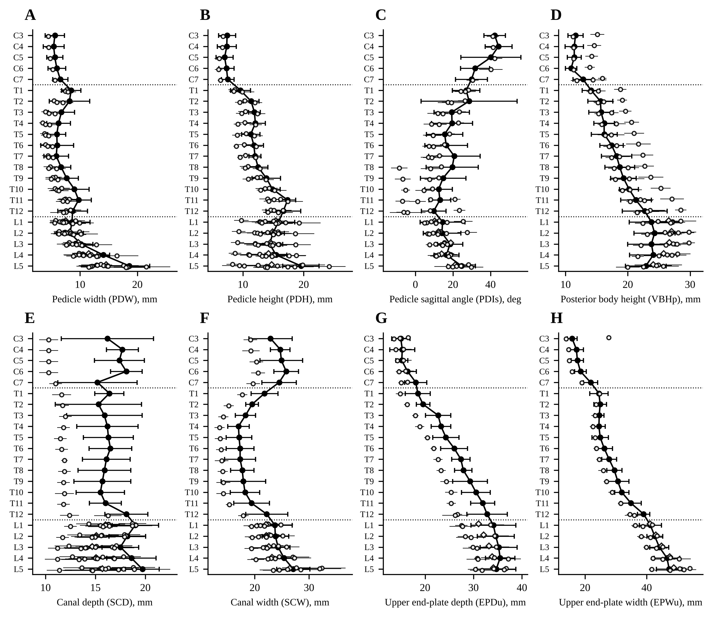
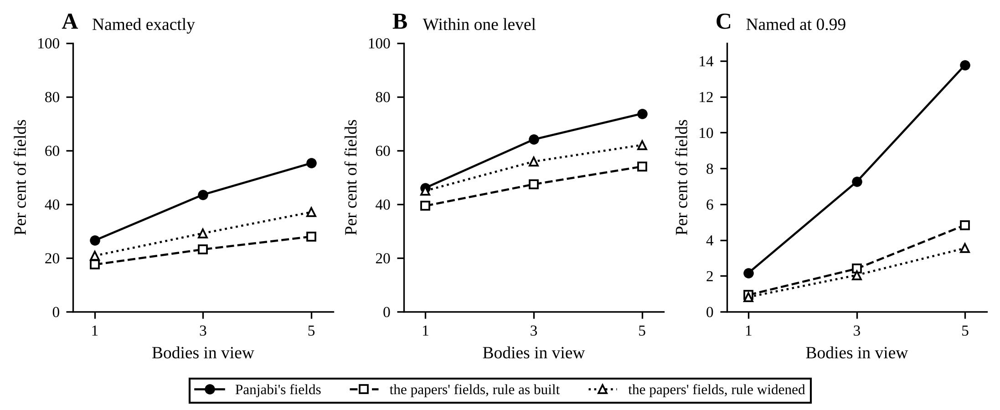

# The evaluation with every paper's tables

Source: thread "Finish the clinical reread", project symphony_4, 2026-10-29, for the owner's ask of 2026-10-28
22:10 UTC. Written by tools/results.py from data/ and the cross_naming record (cross_naming.json); every number here is in
a file beside it. Confidential, like the rest of this repository.

Each paper counts as its own people measured its own way, unless its text says it shares subjects or a
method (the owner, 2026-10-28). Pig spines are left out of every comparison (7 cohorts of Busscher 2010 and
van der Houwen 2009), and so are the two end-plate angles, since the L1 to L5 row of Panjabi's lumbar paper
reprints his cervical C3 to C7 row (../../panjabi-endplate-inclination.md). Measures: endplate_incl, endplate_lower_incl.

## The papers read

39 papers, 23,918 cells: the two blind readings agreed on 20,750, a third reader settled 2,271 on the page image, and 897
were read by one reader and checked on the page. The last two columns count Panjabi's measures among the
paper's own values (not values it quotes), by whether its definition is his or close to it, or differs.

| Paper | What it is | Read | Cells | Agreed | Resolved | Read once | Panjabi's, same or close | Differs |
| --- | --- | --- | ---: | ---: | ---: | ---: | ---: | ---: |
| Hinck 1966 | Normal interpediculate distances (minimum and maximum) in children and adults | 6 tables, 5 figures, text | 1,366 | 957 | 393 | 16 | 0 | 0 |
| Eisenstein 1977 | Lumbar morphometry and pathological anatomy in South African skeletons, with reference to spinal stenosis | 4 tables, text | 359 | 297 | 53 | 9 | 2 | 0 |
| Amonoo-Kuofi 1982 | Lumbar interpedicular distances in adult Nigerians | 4 tables, text | 123 | 101 | 21 | 1 | 0 | 1 |
| Amonoo-Kuofi 1985 | Sagittal diameter of the lumbar canal in normal adult Nigerians | 6 tables, text | 187 | 161 | 26 | 0 | 1 | 0 |
| Gilad 1985 | Sagittal evaluation of elemental geometrical dimensions of human vertebrae | 2 tables, text | 239 | 234 | 5 | 0 | 3 | 0 |
| Twomey 1985 | Age changes in lumbar intervertebral discs | 4 tables, text | 298 | 288 | 8 | 2 | 0 | 0 |
| Zindrick 1987 | Morphometry of the thoracic and lumbar pedicles | 5 tables, text | 611 | 611 | 0 | 0 | 4 | 0 |
| Krag 1988 | Morphometry of the thoracic and lumbar spine for transpedicular screws | 2 tables, 1 figure, text | 411 | 265 | 7 | 139 | 2 | 0 |
| Olsewski 1990 | Morphometry of the lumbar spine for transpedicular fixation | 3 tables, text | 556 | 523 | 12 | 21 | 3 | 1 |
| Hou 1993 | Pedicle morphology T9 to L5 in a Chinese population | 3 tables, 1 figure, text | 458 | 408 | 7 | 43 | 2 | 0 |
| Robertson 2000 | The radiologic anatomy of the lumbar and lumbosacral pedicles | 1 table, text | 98 | 89 | 5 | 4 | 2 | 0 |
| Ahn 2001 | The lumbar interpediculate distance is widened in adults with the Marfan syndrome | 1 table, 1 figure, text | 100 | 90 | 4 | 6 | 0 | 0 |
| Mitra 2002 | Lumbar pedicle morphometry in an Indian cadaver population | 2 tables, text | 414 | 305 | 71 | 38 | 3 | 1 |
| Tan 2004 | Quantitative 3D anatomy of C3 to L5 vertebrae in Chinese Singaporeans | 4 tables, text | 1,672 | 1,644 | 15 | 13 | 19 | 0 |
| Lien 2007 | Pedicle morphometry and the peri-pedicle safe zone, T1 to L5 | 4 tables, text | 625 | 615 | 5 | 5 | 4 | 0 |
| van der Houwen 2009 | Geometry of the intervertebral volume and vertebral endplates (lumbar CT) | 2 tables, 2 figures, text | 345 | 334 | 4 | 7 | 0 | 4 |
| Busscher 2010 | Comparative anatomical dimensions of the complete human and porcine spine | 5 tables, text | 745 | 547 | 12 | 186 | 11 | 1 |
| Chen 2011 | Geometry of thoracolumbar vertebral endplates (T10 inferior to L3 superior, CT) | 5 tables, 2 figures, text | 366 | 314 | 16 | 36 | 0 | 4 |
| Kunkel 2011 | Thoracic disc heights and their relation to vertebral body heights | 4 tables, 7 figures, text | 533 | 490 | 39 | 4 | 1 | 0 |
| Makino 2012 | Lumbar pedicle morphology in degenerative spines on MPR-CT, and a screw-diameter index | 1 table, 1 figure, text | 126 | 125 | 0 | 1 | 0 | 0 |
| Chaudhary 2015 | Lumbar interpedicular distance on plain AP radiographs in Haryana | 2 tables, text | 119 | 91 | 20 | 8 | 0 | 0 |
| Yu 2015 | Pedicle morphometry of lumbar vertebrae (male, taller and heavier specimens have bigger pedicles) | 5 tables, 1 figure, text | 693 | 646 | 45 | 2 | 2 | 0 |
| Griffith 2016 | Population reference range for developmental lumbar spinal canal size (CT, Hong Kong Chinese) | 13 tables, 3 figures, text | 964 | 936 | 18 | 10 | 3 | 0 |
| Tang 2016 | Lower lumbar disc and end-plate morphometry on MRI, compared with earlier studies | 6 tables, text | 1,757 | 1,703 | 54 | 0 | 6 | 0 |
| Pierro 2017 | Sagittal normal limits of the lumbosacral spine on MRI in 604 Italian adults | 6 tables, 2 figures, text | 341 | 279 | 58 | 4 | 1 | 0 |
| Ahmed 2019 | Radiological anatomy of the lumbar canal, an MRI study | 4 tables, 2 figures, text | 237 | 223 | 6 | 8 | 2 | 0 |
| Bach 2019 | Lumbar intervertebral disc height on CT by level, sex and decade | 12 tables, 7 figures, text | 2,499 | 1,466 | 1,025 | 8 | 0 | 0 |
| Yadav 2020 | Lumbar canal and body dimensions by CT in North Indian adults | 8 tables, text | 610 | 595 | 3 | 12 | 5 | 0 |
| Abbas 2021 | The role of vertebral morphometry in degenerative lumbar spinal stenosis | 5 tables, text | 532 | 492 | 5 | 35 | 2 | 1 |
| Abu-Leil 2021 | Morphology of the lumbar neural arch in degenerative spondylolisthesis | 6 tables, 1 figure, text | 1,128 | 957 | 149 | 22 | 5 | 0 |
| Alonge 2021 | Lumbar spinal canal dimensions in Nigerians on CT | 4 tables, text | 332 | 288 | 5 | 39 | 2 | 0 |
| Irie 2021 | Micro-computed tomography analysis of the lumbar pedicle wall | 4 tables, 2 figures, text | 368 | 319 | 3 | 46 | 3 | 0 |
| Cizmic 2023 | Lumbar spinal canal midsagittal and interpedicular diameters on CT in Bosnia and Herzegovina | 11 tables, text | 518 | 452 | 4 | 62 | 2 | 0 |
| Bonczar 2024 | lumbar vertebral morphology, a systematic review and meta-analysis | 7 tables, 1 figure, text | 1,214 | 1,186 | 8 | 20 | 16 | 3 |
| Arockiaraj 2025 | CT morphometry of lumbar pedicles in 1,500 Saudi vertebrae | 3 tables, text | 1,011 | 988 | 19 | 4 | 3 | 0 |
| Moncada-Habib 2025 | Lumbar pedicle morphometry in the Mexican population | 4 tables, 1 figure, text | 399 | 369 | 6 | 24 | 4 | 1 |
| Shin 2025 | Lumbar disc space height and neural foraminal dimensions on CT, L1-S1 | 7 tables, text | 711 | 673 | 16 | 22 | 0 | 0 |
| Duman 2026 | MDCT morphometry of the thoracolumbar junction (T11 to L2) and 12th-rib anomalies in 517 Turkish adults | 5 tables, 3 figures, text | 413 | 319 | 86 | 8 | 4 | 0 |
| Li 2026 | CT morphology of L1 to L5 bodies and regional HU distribution in 100 Chinese adults | 6 tables, 3 figures, text | 440 | 370 | 38 | 32 | 5 | 0 |

## Who was measured, and what papers share

Only what a paper's text states counts; an entry its readers inferred is listed in its cohorts file and not
used. Between papers of the list the text states these:

| Paper | Shares | With |
| --- | --- | --- |
| bonczar2024 | data pooled | panjabi1992, robertson2000, tan2004 |
| amonookuofi1985 | method | eisenstein1977 |
| chaudhary2015 | method | hinck1966 |
| chen2011 | method | gilad1985, panjabi1992 |
| duman2026 | method | zindrick1987 |
| hou1993 | method | olsewski1990 |
| kunkel2011 | method | amonookuofi1982, amonookuofi1985, panjabi1991t, twomey1985 |
| mitra2002 | method | hou1993, olsewski1990, zindrick1987 |
| robertson2000 | method | krag1988 |
| tan2004 | method | panjabi1991c, panjabi1991t, panjabi1992, zindrick1987 |
| tang2016 | method | panjabi1992 |

A paper that pools Panjabi's spines (Bonczar 2024's meta-analysis, which takes in Panjabi 1992, Tan 2004 and
Robertson 2000) is kept out of every pool that holds a source it took in. A shared method makes two papers'
techniques one, not their people: Tan 2004, Chen 2011, Kunkel 2011 and Tang 2016 measured as Panjabi did, so
where they differ from him the people differ, not the method.

## How far the papers sit from Panjabi

Per measure, over the levels the papers give: each paper's mean against Panjabi's, in his population SDs and in
levels (the difference over how far his mean moves from one level to the next there), and the spread between
the papers (tau of a random-effects pool, three papers or more, in his SDs). Definitions his or close to it.

| Measure | Papers | Levels | Cells | Median distance, SDs | Median distance, levels | Cells over one level | Median tau, SDs (cells) |
| --- | ---: | --- | ---: | ---: | ---: | ---: | ---: |
| pedicle_w | 14 | C3 to L5 | 266 | 0.47 | 0.84 | 44% | 0.33 (15) |
| pedicle_h | 13 | C3 to L5 | 229 | 0.68 | 1.17 | 55% | 0.92 (16) |
| canal_ap | 11 | C3 to L5 | 163 | 1.50 | 5.36 | 92% | 0.91 (6) |
| pedicle_incl_sag | 8 | C3 to L5 | 116 | 0.60 | 2.40 | 71% | 0.72 (15) |
| canal_w | 7 | C3 to L5 | 118 | 1.00 | 2.43 | 84% | 0.95 (5) |
| h_post | 7 | C3 to L5 | 77 | 0.66 | 2.00 | 71% | 0.51 (18) |
| endplate | 5 | C3 to L5 | 37 | 1.00 | 1.88 | 68% | 0.78 (6) |
| endplate_depth | 5 | C3 to L5 | 42 | 1.25 | 4.29 | 86% | 0.37 (6) |
| endplate_lower | 4 | C3 to L5 | 36 | 0.92 | 1.84 | 83% | 0.56 (6) |
| endplate_lower_depth | 4 | C3 to L5 | 41 | 1.17 | 3.02 | 83% | 0.77 (6) |
| canal_area | 3 | C3 to L5 | 62 | 0.81 | 3.95 | 85% | 0.71 (5) |
| pedicle_incl_trans | 3 | C3 to L5 | 56 | 0.89 | 3.42 | 88% | 1.28 (14) |
| endplate_area | 2 | C3 to L5 | 24 | 0.51 | 1.17 | 62% | 1.20 (2) |
| endplate_lower_area | 2 | C3 to L5 | 24 | 0.61 | 1.27 | 71% | 0.67 (2) |
| pedicle_area | 2 | C3 to L5 | 27 | 0.26 | 0.61 | 44% | 0.29 (5) |
| facet_w_sup | 1 | L1 to L5 | 10 | 1.41 | 3.00 | 100% |  |
| spinous_length | 1 | C3 to L5 | 22 | 0.60 | 2.61 | 68% |  |
| transverse_width | 1 | C3 to L5 | 22 | 1.76 | 2.92 | 86% |  |

Each paper's means beside Panjabi's, one series per paper and measure (the largest count, a definition his or close to it): filled circles on a solid line, Panjabi's 12 spines with one SD; open circles, each paper's mean with one SD, spread a little up and down so they do not overlap; open diamonds, a paper that pools Panjabi's spines, drawn with no bar since a meta-analysis's pooled SE gives no SD of its people. Dotted lines, the cervicothoracic and thoracolumbar junctions.

## Naming the papers' fields with Panjabi's rule

Fields drawn from each paper's own means and SDs, at every place its series covers, named by the rule built on
Panjabi's table on the measures that series has, beside the same count of fields drawn from Panjabi's own
table at the same places; and the same fields named by a rule whose table is the random-effects pool of every
paper but the series' own, widened by their spread. One series per paper; papers that pool Panjabi's spines
left out.

| Bodies | Fields from | Papers | Fields | Named exactly % | Within one level % | Named at 0.99 % | Right of those named % |
| ---: | --- | ---: | ---: | ---: | ---: | ---: | ---: |
| 1 | Panjabi's fields | 24 | 32,400 | 26.5 | 46.1 | 2.2 | 99.6 of 704 |
| 1 | the papers' fields, rule as built | 24 | 32,400 | 17.6 | 39.4 | 0.9 | 81.0 of 305 |
| 1 | the papers' fields, rule widened | 24 | 32,400 | 20.9 | 45.0 | 0.8 | 85.8 of 267 |
| 3 | Panjabi's fields | 24 | 23,000 | 43.6 | 64.1 | 7.3 | 100.0 of 1,671 |
| 3 | the papers' fields, rule as built | 24 | 23,000 | 23.2 | 47.4 | 2.4 | 89.5 of 554 |
| 3 | the papers' fields, rule widened | 24 | 23,000 | 29.2 | 55.9 | 2.0 | 91.1 of 471 |
| 5 | Panjabi's fields | 22 | 13,800 | 55.3 | 73.7 | 13.8 | 100.0 of 1,902 |
| 5 | the papers' fields, rule as built | 22 | 13,800 | 28.0 | 54.0 | 4.8 | 89.5 of 668 |
| 5 | the papers' fields, rule widened | 22 | 13,800 | 37.1 | 62.1 | 3.6 | 94.1 of 490 |

Naming fields drawn from the papers' own tables with the rule built on Panjabi's, by bodies in view, one series per paper, 200 fields per place, papers that pool Panjabi's spines left out: A, share named exactly; B, within one level; C, share named at a posterior of 0.99. Solid, filled circles: fields drawn from Panjabi's table at the same places; dashed, open squares: the papers' fields; dotted, open triangles: the papers' fields named by the widened rule. Widths 1, 3, 5.

By paper, three bodies:

| Paper | Series | Measures | Levels | Exact on Panjabi's fields % | Exact on the paper's % | Exact, widened % | Paper's, within one % |
| --- | --- | ---: | --- | ---: | ---: | ---: | ---: |
| Amonoo-Kuofi 1985 | ibadan_dry_bone | 1 | L1 to L5 | 19.3 | 6.2 | 29.2 | 7.8 |
| Gilad 1985 | haifa_transport_men, male | 3 | L1 to L5 | 41.5 | 29.7 | 27.3 | 74.0 |
| Zindrick 1987 | pooled_specimens_and_ct | 4 | T1 to L5 | 59.2 | 26.7 | 33.9 | 54.6 |
| Olsewski 1990 | part1_cadavers, Part 1 cadavers, direct | 3 | L1 to L5 | 69.3 | 42.3 | 49.7 | 60.0 |
| Hou 1993 | xian_dry_bone | 2 | T9 to L5 | 54.9 | 27.1 | 30.1 | 55.2 |
| Robertson 2000 | auckland_drybone | 2 | L1 to L5 | 62.7 | 37.7 | 43.8 | 55.8 |
| Tan 2004 | sg_chinese_cadavers10 | 17 | T9 to L2 | 99.4 | 71.5 | 75.6 | 95.6 |
| Lien 2007 | dry_sets, dry vertebrae | 2 | T3 to T11 | 18.2 | 11.4 | 10.1 | 34.9 |
| Busscher 2010 | human_cadaver, male, Human | 1 | C3 to L5 | 24.2 | 9.5 | 10.2 | 25.2 |
| Kunkel 2011 | ulm_thoracic_segments, radiographic | 1 | C7 to T12 | 20.5 | 17.3 | 15.3 | 43.0 |
| Yu 2015 | hamann_todd_503, Caucasian | 2 | L1 to L5 | 64.3 | 52.0 | 45.2 | 78.8 |
| Griffith 2016 | hk_ct_patients, adjusted for height and weight | 3 | L1 to L5 | 44.2 | 12.3 | 35.3 | 21.3 |
| Tang 2016 | utah_mri | 3 | L3 to L5 | 65.0 | 47.5 | 48.0 | 73.0 |
| Pierro 2017 | campobasso_604 | 1 | L1 to L5 | 22.8 | 13.7 | 23.0 | 31.3 |
| Yadav 2020 | yadav-ct | 5 | T12 to L5 | 63.5 | 35.6 | 41.5 | 78.4 |
| Abbas 2021 | control | 2 | L1 to L5 | 39.0 | 30.0 | 37.2 | 55.5 |
| Irie 2021 | rush_cadaver_6 | 3 | L1 to L5 | 68.8 | 27.0 | 31.7 | 45.8 |
| Alonge 2021 | lagos_ct | 1 | L1 to L5 | 25.8 | 4.2 | 21.2 | 8.2 |
| Abu-Leil 2021 | ds, DS | 4 | L1 to L5 | 74.7 | 26.8 | 39.7 | 52.3 |
| Cizmic 2023 | bih-sarajevo-ct | 1 | L1 to L5 | 28.5 | 28.2 | 34.8 | 54.2 |
| Moncada-Habib 2025 | mexico_ct37 | 4 | L1 to L4 | 65.0 | 41.2 | 57.2 | 91.8 |
| Arockiaraj 2025 | saudi_ct, Current study | 2 | L1 to L5 | 62.2 | 18.8 | 55.0 | 46.7 |
| Li 2026 | zhengzhou_ct_100 | 3 | L1 to L5 | 44.8 | 23.5 | 44.0 | 86.5 |
| Duman 2026 | izmir-mdct-517 | 1 | T11 to L2 | 25.8 | 2.8 | 7.8 | 20.5 |

## Files

- README.md, this page; transport.* and profiles.*, the figures as PNG and PDF with their captions and a CSV of
  every number drawn; transport_by_paper.csv, every series' fields by arm and bodies.
- ../data/: the readings, cohorts and series the record was made from; the record is ../data/cross_naming.json.
- Made with, from the repository's root: python research_notes/paper-tables/tools/cross_naming.py research_notes/paper-tables/data/series.csv research_notes/paper-tables/data/cross_naming.json --fields 200 --seed 2026 --cohorts research_notes/paper-tables/data/cohorts --leave-out endplate_incl,endplate_lower_incl (any --processes gives the same record),
  and python research_notes/paper-tables/tools/results.py research_notes/paper-tables/data
  research_notes/paper-tables/data/cross_naming.json research_notes/clinical-reread/notes research_notes/paper-tables/results.
