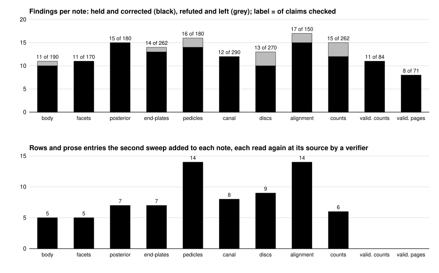

# Review round 1 of the prior-art notes and the validation folder

Source: thread "Finish the clinical reread", project symphony_5, 2026-10-29 23:36 UTC to 2026-10-30, on the branch
of pull request 39. Confidential, like the rest of this repository. First pushed at the owner's word of 2026-10-30
01:16 UTC ("PLEASE JUST PUSH ALL RESULTS NOW!") as the raw record, then rewritten here once every refuter and
verifier had finished, with where each change landed.

How to read it: the top panel is what a second reader found wrong, unsupported or imprecise in each note, out of
the claims it checked at their sources (the label); black is what a refuter held and was corrected, grey what the
refuter showed the note had right, left as written. The bottom panel is what the second sweep added to each note
from the searches the first readers' budgets had not reached; the two validation columns had no sweep.

- 2,109 claims checked (1,954 in the nine notes, 155 in the validation folder); 143 findings, 131 held and
  corrected, 12 refuted. Of the held, five went to the prior-art README's table, four to the reasons of
  ../../paper-tables/validation/mapping_audit.csv, the rest to the note they were found in.
- The vertebral-body refuter ran twice, the second time when the review resumed, and judged two of its ten held
  findings defensible as first written (Arakawa 2025's agreement figure, Loeffler 2020's Dice); the applied text
  covers both readings, and that run's reading of Germann 2023's millimetre limits was checked and added.
- 75 rows or prose entries added, each read again at its source; three proposed rows or facts were refused by a
  verifier and are not in any note.
- What the round left for the owner is at the top of ../../paper-tables/validation/README.md and in
  ../../clinical-reread/HANDOFF.md; the owner left it to the session on 2026-10-30, and it was decided that day
  (../../paper-tables/validation/README.md, Decided on 2026-10-30).

The files: [round-1-findings.json](round-1-findings.json), every finding with the claim, the source's own words cut
to twelve words, the reader's verdict, the refuter's verdict and replacement, and `applied_in`, the file it was
applied to; [gaps-round-1.json](gaps-round-1.json), every searched row and fact with the verifier's verdict and,
for each row, `added_to`, the note it now sits in. Local paths of the session's scratch files are written
`<session scratchpad>`; nothing in them was committed.
