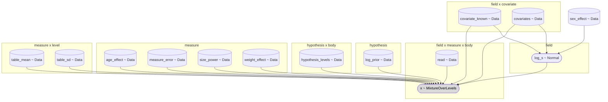

# schwingcheck: the exact rule as a package and as PyMC models

Steps c and d of item P ([TODO.md](../TODO.md)), and the first rung of step e, 27 October 2026. Step c lifted the archive's exact Bayes rule ([archive/bordercall/exact.py](../archive/bordercall/exact.py)), its column generator ([panjabi.py](../archive/bordercall/panjabi.py), [neighbour.py](../archive/bordercall/neighbour.py)) and its scores into one package whose data is shaped for the PyMC rewrite of step d: the checked table as one long CSV loaded into an xarray Dataset with named dimensions; columns and fields as arrays with NaN for a missing value and integer offsets for gaps; every result as ArviZ InferenceData in NetCDF with the command, the seeds and the digests in its attributes; the code vectorised, with no loop per body or per field. It is the same rule: the tests hold the log likelihoods and the posterior to the archive's within 1e-10 on contiguous complete fields of six widths, from one body to the whole column of 22, the generator to the archive's bit for bit, and the rescoring of seed 97's 2,000 columns to every rate [exact.json](../archive/records/exact-2026-10-26/exact.json) records for the three regimes at 1, 3 and 9 bodies. Items 1 and 2 of TODO.md are done by it. It also carries the twelve specimens Panjabi measured (the thoracic paper's Table 1: age, sex, weight, height), for the covariates the owner asked for on 27 October 2026. Step d rewrote the rule and the generator in PyMC beside the NumPy code, which stays the reference ([The PyMC models](#the-pymc-models)): the level of every body is summed out exactly and only the patient's size is sampled, so no sampler ever moves a discrete level; the rule is also one compiled PyTensor function, which rescores the record as the NumPy code does; the generator is a forward model whose columns match the NumPy generator's in distribution; height enters the size prior and weight, age and sex enter through hooks at zero; and each model's graph is drawn from PyMC's own analysis of it, beside a plate diagram. Step e's first rung gave each kind of measure its own power of the patient's size, a length s, an area s^2 and an angle none, in the rule, the compiled rule, the PyMC models and the generator alike, with each measure's own error by its kind, so every measure the four papers print with a spread at all of C3 to L5, 32 in all, can be scored ([The measures](#the-measures)); a selection of lengths alone is still the rule from before step e to the bit, and so the archive's within 1e-10.

## Install

The archive's 243 tests need numpy, scipy, matplotlib, nibabel and python-pptx, none of them pinned (they passed on 27 October 2026 with numpy 2.5.4, scipy 1.18.1, matplotlib 3.11.2, nibabel 5.4.2, python-pptx 1.0.2 and lxml 6.1.3). The package needs the pinned environment of [requirements-schwingcheck.txt](../requirements-schwingcheck.txt), a full freeze made on Python 3.13.17: pymc 6.3.2, pytensor 3.3.4, arviz 1.3.0, xarray 2026.9.0, h5netcdf 1.8.2 with h5py 3.16.0 (the NetCDF engine; h5netcdf was allowed as one more pinned dependency by the owner's word of 27 October 2026, 10:04 UTC), numpy 2.5.4, scipy 1.18.1, pandas 3.1.0, and what they bring.

```
python3 -m venv ~/venv-sc
~/venv-sc/bin/pip install -r requirements-schwingcheck.txt
~/venv-sc/bin/python -m unittest discover -s tests          # the package's tests, from the repository's root
cd archive && python3 -m unittest discover -s tests         # the archive's 243
```

## Commands

Run every command from the repository's root.

```
python -m schwingcheck table check                 # the committed CSVs are what write would write
python -m schwingcheck table write                 # rewrite them from the provenance record
python -m schwingcheck name FIELD.csv [--measures endplate h_post ...] [--offsets 0 1 2] [--engine numpy|pytensor|nuts]
python -m schwingcheck rescore --n 1 3 9 --outdir records/exact-rescore [--engine numpy|pytensor|pymc]
python -m schwingcheck graph check                 # the committed graphs are the PyMC models' graphs
python -m schwingcheck graph write                 # redraw them from the models
```

`name` names one field. The CSV has a column `body` (0, 1, 2, ... down the column), one column per measure in its own units (millimetres for a length, square millimetres for an area, degrees for an angle), blank where the value was not read, and optionally a column `offset`, each body's offset from the first (0, 2, 4 for every other body; without it the bodies are consecutive, whatever their numbers); `--offsets` gives the offsets on the command line instead, one per body. [examples/t11-t12-l1.csv](examples/t11-t12-l1.csv) is Panjabi's means at T11, T12 and L1 for the seven measures, the README's example:

```
$ python -m schwingcheck name schwingcheck/examples/t11-t12-l1.csv
field of 3 bodies at offsets [0, 1, 2], measures endplate, endplate_depth, endplate_lower, endplate_lower_depth, h_post, canal_w, canal_ap
place (level of the first body)  posterior
  T11   0.607628  <- named
  T10   0.285740
  T12   0.075913
  L1    0.015071
  ...
99% set: {T9, T10, T11, T12, L1} (5 places)
the top place reaches 0.99: no
```

The archive's example in [README.md](../README.md) prints the same three leading posteriors. `--engine` chooses how the posterior is computed: `numpy`, the default, is rule.py, the reference; `pytensor` is the same rule as one compiled function (compiled.py), which prints the same numbers; `nuts` is the PyMC naming model sampled by NUTS (`--draws`, `--chains`, `--seed`; below, [The naming model](#the-naming-model)), which prints each posterior with its Monte Carlo error. With no body the command says there is nothing to name and exits 1; with no measure read on any body it says the posterior is the prior and exits 1; it refuses, and exits 2, before computing anything, each by what is wrong with it: a file that is not UTF-8 text or has no column `body` (a byte-order mark before it, and blank lines, are read past), a row with no body number or one that is not a whole number, a measure not registered, one with no table row at a level of the rule's, or one selected twice, on one side or as a pair's side and its mean, offsets for some bodies and not others, a count of them other than the bodies', offsets that do not rise down the column, and, with `nuts`, no chain or fewer than 20 draws a chain, the batches its error is computed from. With `nuts` it ends by saying that below 0.001 a place's estimate tends to run low and its error can be too small ([The naming model](#the-naming-model)).

`rescore` draws the archive's scoring columns (seed 97, 2,000 columns, the typical phenotype) and scores every field of the widths given under the three regimes, both planes, AP and lateral, writing one InferenceData file per width and regime and `rates.json` beside them, 12 to 19 MB a file (12.0 MB for one body under the AP regime, 19.1 MB for nine bodies under both planes). It reproduces every rate exact.json records for the three regimes, the share named identically and the rest within 1e-12, since the checked table equals the archive's in every value the record used (below). `--engine pytensor` rescores with the compiled rule and `--engine pymc` with the PyMC naming model's likelihood of each hypothesis, built from the model's own variables, integrated over the size, and both reproduce the record the same way ([The PyMC models](#the-pymc-models)).

`graph check` fails when a graph committed under [graphs/](graphs/) differs from the one PyMC finds in its model, and `graph write` redraws them ([The graphs](#the-graphs)).

## Layout

- [`__init__.py`](__init__.py): the levels (C2 to L5, and the rule's C3 to L5), the sides, the kinds and the planes.
- [`mnemonics.py`](mnemonics.py): every mnemonic the four papers print (EPWu, SCD, PDWr, FCAs, ...) with its measure name, its side, its kind (length, area, angle), the planes that show it (a SPINEPS mask, an AP view, a lateral view, only a CT) and its definition in words.
- [`table.py`](table.py): the long CSV and the specimens CSV, written from the provenance record and loaded as xarray Datasets.
- [`data/panjabi_long.csv`](data/panjabi_long.csv): the checked table, generated; do not edit it by hand.
- [`data/panjabi_specimens.csv`](data/panjabi_specimens.csv): the twelve specimens, generated; do not edit it by hand.
- [`measures.py`](measures.py): one `Measure` object per measurement and side, the registry, the selection the rule reads, the pool of every measure it can take, and each kind's error and power of the size.
- [`rule.py`](rule.py): the exact rule, vectorised over fields, with gaps and missing values.
- [`columns.py`](columns.py): the generator, every phenotype, and the cutting of fields from columns.
- [`score.py`](score.py): the archive's rates, computed the same way.
- [`records.py`](records.py): a result as InferenceData, written and read as NetCDF.
- [`compiled.py`](compiled.py): the exact rule as one compiled PyTensor function, step d's engine for scoring at scale.
- [`model.py`](model.py): the three PyMC models, the naming rule, the fixed-level baseline and the generator, and the Mermaid writer of their graphs.
- [`covariates.py`](covariates.py): a patient's height, weight, age and sex, and where each enters the models.
- [`graphs/`](graphs/): the three models' graphs, generated; do not edit them by hand.
- [`__main__.py`](__main__.py): the commands above.
- [`examples/`](examples/): the field above, and [quadrature_check.py](examples/quadrature_check.py), which prints how well the two quadratures integrate the size with every measure of the pool ([The rule](#the-rule)).
- Tests in [tests/](../tests/): `test_schwingcheck_table.py`, `test_schwingcheck_rule.py`, `test_schwingcheck_columns.py`, `test_schwingcheck_record.py`, `test_schwingcheck_cli.py`, `test_schwingcheck_model.py`.

## The table

[data/panjabi_long.csv](data/panjabi_long.csv) is written by `table write` from the provenance record of step b, [archive/bordercall/reference/provenance/provenance.csv](../archive/bordercall/reference/provenance/provenance.csv) (two readings by eye of every cell, both agreeing), and nothing else; `table check` fails when the committed file differs from what `write` would write, and a test runs it. It holds every present-study mean and standard error of the papers' dimension tables (cervical Tables 2 to 6, thoracic 3 to 7, lumbar 2 to 5, facets 2 to 8), one row per value, each from the cell it was read from:

| column | what it holds |
|---|---|
| `measure`, `side` | the measure's name and `whole`, `right` or `left` |
| `level` | C2 to L5 |
| `mnemonic` | the paper's own, as the provenance record names the cell |
| `statistic`, `value`, `units` | `mean` or `sem`; mm, mm2 or deg |
| `kind`, `planes` | length, area or angle; which of mask, ap, lateral, ct show it |
| `n` | the specimens, 12 in every table |
| `paper`, `table`, `cell` | the paper, its table and the provenance cell id |

2,690 rows from 2,008 cells, 682 of which print a mean with its standard error: 1,455 means and 1,235 standard errors, 1,144 lengths, 672 areas and 874 angles, from the cervical (358), thoracic (784), lumbar (260) and facets (1,288) papers, 49 measure names under 75 mnemonics. The thoracic body table (Table 3, printed page 892), which the first scan lacked, is read like every other table since 27 October 2026, from the one page of the owner's second scan: its 228 rows are five lengths, two areas and two inclinations with their standard errors, and the wedge angle's mean, at T1 to T12.

`table.load()` gives an xarray Dataset with dimensions (level, measure, side) and the variables `mean`, `sem`, `sd` (sem x sqrt(12), the population SD the rule and the generator use), `n` and `cell`, with `kind`, `units`, `planes`, `definition` and `mnemonic` as coordinates and the file's sha256 in its attributes; NaN where a paper prints nothing.

**The checked table and the archive's are one.** The archive's [panjabi_full_spine.csv](../archive/bordercall/reference/panjabi_full_spine.csv) and the long table agree in all 592 values they share; the lower end-plate depth at T3 is 23.3 in both, as Table 3 prints it, and Table 8's 23.2 is the paper's own contradiction (step b, [CONTRADICTIONS.md](../archive/bordercall/reference/provenance/CONTRADICTIONS.md)). A test compares the two value for value, and the rescoring reproduces the archive's record from the checked table.

## The specimens

[data/panjabi_specimens.csv](data/panjabi_specimens.csv) is the thoracic paper's Table 1 (printed page 889), written by `table write` from its 72 cells in the provenance record and checked by `table check`: one row per specimen, its age in years, sex, weight in kg, height in cm and cause of death, each with the cell it was read from. `table.load_specimens()` gives it as a Dataset with the dimension `specimen`.

| | age (years) | weight (kg) | height (cm) |
|---|---|---|---|
| mean | 46.3 | 67.8 | 167.8 |
| range | 19 to 59 | 54 to 84 | 157 to 178 |

Eight men and four women, and all four papers measured these same twelve spines. The thoracic paper calls them fresh autopsy whole-spine specimens from C2 to L5. The cervical paper says its twelve specimens are the initial study's ("Individual details are given in the initial study", page 861); the lumbar and facets papers describe twelve C2 to L5 spines, refer to the initial study for the methods and print the same summary to the decimal, and the facets paper's 276 vertebrae are the other three papers' 72 + 144 + 60, twelve spines of six, twelve and five levels. Each of the three later papers prints one summary of the twelve in its Methods, the same 12 numbers in each (12 spines, 8 men, 4 women, and the mean, minimum and maximum of age, weight and height; `table.SPECIMEN_SUMMARIES`, which a test holds to the provenance record, where two independent passes read all 36). The summaries agree with Table 1 in every number but one: each gives the weight's range as 54-85 kg, while Table 1's heaviest specimen, S15, weighs 84 kg, and a test holds that as the papers' own contradiction. The provenance record holds the three summaries with what each pass read, beside the abstracts' counts of vertebrae, and reports that contradiction with the papers' others ([CONTRADICTIONS.md](../archive/bordercall/reference/provenance/CONTRADICTIONS.md)).

**What they can and cannot do.** The owner asked on 27 October 2026, 11:06 UTC, for age, sex, weight and height as variables for modelling: height should increase the size of every vertebra in most dimensions, weight should compress the disc spaces and affect the facets' articulation, age should affect the facets, and populations from several studies will need to be adjusted for them. Panjabi prints no measurement of one specimen, only each level's mean and standard error over the twelve, so no coefficient of height, weight, age or sex can be estimated from the papers alone. They describe the population the table comes from. Step d conditions the patient's size on height and leaves hooks for weight and age, whose coefficients wait for data with a measurement per patient (TODO.md, item 5); any pooling of populations then adjusts for them.

## The measures

`measures.registry()` has one `Measure` per measurement and side, 101 in all, keyed `measure` for a whole-body measure and `measure:right`, `measure:left` or `measure:mean` for a paired one. Each carries its kind, planes and definition; its mnemonics, the paper's own (the right's and the left's for a pair's mean); the levels the table gives it; its table rows, one `Row` per level with the mean, the population SD, the number of specimens and the provenance cells it comes from (for a pair's mean, the mean of the two sides' means and of their SDs, as the archive's build took them, from the right's and the left's cells); its error in its own units (`error`) and its power of the size (`size_power`), both by its kind (below); its measurers, the code that reads it from a patient; and its correlations with other measures. `measures.select(keys)` is what the rule reads: it refuses a key that is not registered (KeyError), a measure with no table row at a level asked for (ValueError, naming the levels) or with no error of its own, and a measure selected twice, the two sides of a pair or a side with the pair's mean among them, so a pair enters the rule once, as one side or as the mean of the two, never as two independent measures (TODO.md, step 4). `pedicle` and `pedicle_h`, the archive's names, resolve to the pair's mean. The mean of a mirrored pair, which the facets paper prints with the right side's sign opposite to the left's at every level (`mnemonics.MIRRORED`: the sagittal-plane angles and the card angles about y of both facets), negates the right first, or the mean would sit near zero and carry nothing. `measures.reference`, `measures.arrays`, `measures.errors` and `measures.powers` read the selected objects alone, and `measures.name` runs the rule from them. A test selects every registered measure and asserts that each is scored or has no table row.

**Each kind its own term.** Since step e's first rung a length scales with the patient's size s, an area with s squared and an angle not at all, in the rule, the compiled rule, the PyMC models and the generator alike. Each kind has its own error, a stated assumption, the same in the generator and in the rule, so the errors never part the two: 1 mm for a length, the archive's `noise_mm`; for an area of mean A square millimetres over the levels it is printed at, sqrt(pi A / 2) square millimetres, the error of a circle's area whose diameter is read 1 mm off on each of two axes (19.6 for the canal's area, 31.1 for the upper end plate's); and 3 degrees for an angle, the error of the direction of a line about 27 mm long whose two ends are each read 1 mm off, a round figure rather than a measured one. The build-up study of step e runs them halved and doubled. What does part the rule from the generator is the generator's floor at 0.5 for a measure that scales with the size, which the likelihood leaves out, as the archive's did. On the seven it is negligible, 3 of 308,000 values in 2,000 typical columns of seed 1234. The pool's areas and interfacet heights reach it: 1,647 of its 1,056,000 values that can be floored sit at the floor in those columns, in 1,054 of the 2,000, most at the interfacet height and the upper facets' area at C4, the pedicles' area at C4 and the canal's area at C7, and 1,155 and 4,490 with the errors halved and doubled. Scored by the generator's mass at the floor in place of the density there, such a value moves a one-body field's posterior over places by up to 0.22 and changes the top place of 18 of the 1,600 one-body fields that hold one, and of 4 of 1,136 and 100 of 4,224 with the errors halved and doubled ([examples/floor_check.py](examples/floor_check.py)). `columns.floor_hits` counts the values the floor touched, as the archive's record did, and the build-up study's record counts them at every measure and level.

**The pool.** `measures.pool()` is every measure the rule can take over C3 to L5, each once, in the papers' order, a pair as its mean: 32 of the 49 measures the papers print, 18 lengths, 6 areas and 8 angles. They are the archive's seven; the pedicles' widths, heights, areas and two inclinations; the spinous process length and the transverse process width; the upper and lower end plates' areas and inclinations and the canal's area; the facets' widths, heights, areas and sagittal- and transverse-plane angles, superior and inferior; and the interfacet widths and heights. `measures.left_out()` says why each of the other 17 is not in it. Seven are printed as a mean with no spread, which no rule can take until a spread is found for them: the thoracic body table's wedge angle, `endplate_wedge`; the rib articulation totals of the thoracic paper's Table 6, `costovertebral_area` and `rib_articulation_area`; and the facets paper's four card angles, `facet_card_x_sup`, `facet_card_x_inf`, `facet_card_y_sup` and `facet_card_y_inf`. Ten are printed at only part of C3 to L5: the pars area from T3 down, six uncovertebral measures of C3 to C7, and three rib articulation areas of the thoracic spine, which a rule over the whole of C3 to L5 cannot take as they stand. The facets paper's X-card angle would duplicate its transverse-plane angle if it had a spread, as it is the negative of it, within 0.1, in 91 of the 92 cells both print ([CONTRADICTIONS.md](../archive/bordercall/reference/provenance/CONTRADICTIONS.md)), so the rule scores the transverse-plane angle. The measurers are the archive's [spineps_map.py](../archive/bordercall/spineps_map.py) for the seven and nothing yet for the rest: its extents of the spinous and transverse processes are not registered, since its spinous length starts at the body's centroid where Panjabi's starts at the canal's posterior wall. The correlations are empty until a CT table estimates them.

## The rule

`rule.name(X, offsets, mu, sd, synth)` takes every field at once: `X` is (fields, measures, bodies) in each measure's own units with NaN for a value not read, `offsets` the bodies' offsets from the first (0, 1, 2 for three consecutive bodies, 0, 2, 4 for every other body), `mu` and `sd` the table as (measures, levels). A place is the level of the first body, and there are as many places as starts at which the last offset still fits (`places_of`). The likelihood of one measure given the patient's size is the archive's, Delta + u u' inverted by Sherman-Morrison, and the size is integrated by default by the same 161-node Gauss-Hermite rule over log s ([the quadrature](#the-rule), below); the product over measures and the uniform prior give the posterior, and `name` returns it for every subset of measures asked (the archive's regimes are subsets). Each measure's error is its own: `name`, `loglik` and `table_blocks` take `noise`, one value per measure, synth's `noise_mm` for every one by default, and `measures.name` passes each object's `error`. Each measure also scales with its own power of the size, `power`, one value per measure (`measures.powers`): wherever the archive's closed form has s, a measure's has s^p, so its mean is s^p mu, its spread s^p sd and its error unscaled. With every power 1, the default, the answers are those of the rule from before step e to the bit, and so the archive's within 1e-10 (the closed form sums its terms in another order than exact.py's, which moves the log likelihoods by about 1e-11).

Two things the archive did not do:

- **Gaps.** The offsets place the bodies; a gap is an offset skipped, and the places shrink accordingly.
- **Missing values.** Given s, the covariance of one measure's values on any subset of bodies is the same form on that subset, so a NaN is dropped from the sums and the likelihood is the exact marginal. A measure missing on every body contributes a constant; a field with no value at all gets the prior back.

The whole likelihood is one matrix product per block of fields: the sums the Sherman-Morrison form needs (sum of x^2 / v, sum of x / v, sum of 1 / v over the bodies, with the missing ones weighted out) are rows of one matrix and the table's terms at every place and node are its columns, so one product gives every field's log likelihood at every place, measure and node, and NaN never enters it. Fields go through in blocks of 32 so the product's operands fit the cache; on the cloud container's 4 CPUs the seven measures with 161 nodes take about 1,100 fields a second at one body and 1,700 at nine. The tests hold the result to the archive's `field_loglik` and posterior within 1e-10, absolutely, on contiguous complete fields of six widths (1, 2, 3, 5, 9 and 22 bodies, the whole column), and to a dense multivariate normal computed independently (scipy) on gapped fields and on fields with values missing; and the guarantee holds on fresh columns: of the fields named at 0.99 or more, 99.7 per cent of the three-body fields and all of the every-other-body ones are named right, and the test holds both at 99 per cent or more.

**The quadrature.** The size is integrated over log s by the archive's 161 Gauss-Hermite nodes by default (`quadrature`), or by the trapezoid rule on an even grid of log s (`trapezoid`: a step of 0.004 out to 8 SD, 281 nodes), which `name`, the compiled rule and the naming model's `quadrature_evidence` take as `nodes`, and `loglik` as its `sizes`. Its 8 SD are those of the archive's size prior, N(0, 0.07^2): a field's own prior, which a known height moves and widens, it holds whole only for a height from 161 to 175 cm, and a cut-off prior makes a tall or a short patient's evidence wrong, so the compiled rule and the naming model refuse nodes on which a field's prior is not whole to 1e-12 in log mass (`rule.check_prior_held`); a trapezoid of reach 30 holds every height from 108 to 262 cm, and the Gauss-Hermite nodes, whose outermost lie at 24 SD, every height from 117 to 242 cm. The more measures a field has, the narrower the size's posterior, and with all 32 of the pool it gets about as narrow as the Gauss-Hermite nodes are apart near the middle, 0.017 in log s. On 40 typical columns of seed 1234 ([examples/quadrature_check.py](examples/quadrature_check.py)) its SD at the true place was 0.018 to 0.027 at one body, 0.014 to 0.018 at three and 0.011 to 0.013 at nine. Against a trapezoid four times as fine, the Gauss-Hermite log evidence at the true place was off by at most 3.4e-10, 1.1e-5 and 6.9e-4, and the trapezoid's by 2.8e-14, 1.1e-13 and 3.4e-13. The posterior over places moved less, by at most 6.0e-11, 9.8e-8 and 1.1e-12 with Gauss-Hermite, since its error is nearly the same at every place that matters, and on the seven measures the two rules name every field within 1e-9 of each other. Far from the truth a place asks for a size past the trapezoid's 8 SD, where every grid of that reach falls short alike: against the closed form summed on a grid of step 0.0005 out to 40 SD, at the three places of each width where the two rules part most, the log evidence of the trapezoid four times as fine was short by up to 694 and the Gauss-Hermite rule's off by at most 2.7e-3, and those places hold too little of the posterior for either to matter. The build-up study of step e integrates on the trapezoid throughout, since a table estimated from a few people can narrow the posterior further.

## The generator and the fields

`columns.draw_columns(ref, phenotypes, seed, n, measures, ...)` is the archive's `neighbour.draw_columns` with the random stream consumed in the same order (the size, the offsets, 24 level draws per measure, 24 noise draws per measure), so the same seed gives the same columns bit for bit, for every phenotype (typical, four_lumbar, six_lumbar, t13, lumbar_rib, no_rib_t12), with the exchangeable correlation between measures' offsets and with the archive's settings or others. It returns a `Columns` object whose `values` are (column, body, measure) with NaN past the end of a column shorter than the longest, with each column's levels, phenotype, transitional position and scale. `columns.fields(values, offsets)` cuts every field of the offsets given from every column, in the archive's order for consecutive offsets, with the truth (the place) and the column of each field, and leaves out a column too short for the pattern.

Each measure is drawn with its own power of the size and its own error (`power`, and `noise_mm` as one value per measure), and floored at 0.5 only where it scales with the size, since an angle may be negative; with every power 1 the columns are the archive's bit for bit. Given the patients' sizes (`scale`), no size is drawn and the stream starts at the offsets, so further measures can be drawn for the same patients from a stream of their own, leaving the first measures' columns as they were. That holds at `r_between` 0, the default: at any other, the further measures' offsets are drawn apart from the first measures' and do not correlate with them as one call's would. The build-up study of step e draws the record's seven so and adds the rest.

## The scores and the records

`score.summary` and `score.claims` are the archive's `exact.summary` and `exact.claims_summary` with the same keys, so a rate here means what it meant in the record: the share named exactly with its standard error clustered by column, within one, the Bayes error predicted and counted, the log loss, the share answered and the precision at 0.9, 0.99 and 0.999, the 99 per cent set's size and coverage, the mapping quality, the calibration, the rates by true start and by true centre, the landmark windows, the confusion of offsets, and the claims about the middle body (the cuts, the regions, the shortest interval).

`records.build` puts one scoring into an InferenceData tree, written and read as NetCDF (`records.write`, `records.read`): the group `posterior` (every field's posterior over the places), `observed_data` (the fields), `truth`, `constant_data` (the offsets, the table and each measure's error) and `rates` (the summary and the claims), and in the root's attributes the command (the arguments `main` parsed, quoted for the shell), the seeds, the generator's settings, the digests (the long CSV's and the provenance record's sha256, and the sha256 of the package's own code) and the measures, levels, offsets and versions. `rescore` writes one per width and regime.

**The record of 2026-10-26 reproduced.** `rescore --n 1 3 9` reproduces every rate exact.json records for the three regimes (`widths[n].regimes`) at 1, 3 and 9 bodies, the share named identically and the rest within 1e-12, over every key (`n_fields`, `places`, `exact`, `se_cluster`, `within_one`, `errors`, `bayes_error_predicted`, `bayes_error_counted`, `log_loss`, `selective`, `selective_099_by_called_region`, `credible`, `mapq`, `calibration`, `by_start`, `by_centre`, `landmarks`, `confusion_offsets`, `measures`, `claims`); `tests/test_schwingcheck_record.py` holds the share named to the digit and the rest to 1e-9. The 127 subsets of the seven measures that exact.json also records at each width (`widths[n].subsets`) are not rescored. The run takes about two minutes on 4 CPUs (56, 44 and 15 seconds for 1, 3 and 9 bodies, nearly all of it the rule).

## The PyMC models

Step d of item P: the rule and the generator rewritten in PyMC (6.3.2, on PyTensor 3.3.4 with its default Numba backend, and ArviZ 1.3.0), beside the NumPy code of step c, which stays the reference: the tests hold the compiled rule to rule.py, and the PyMC models to the compiled rule or to rule.py itself. Four pieces:

- [`compiled.py`](compiled.py): the exact rule as one compiled PyTensor function, `ExactRule(mu, sd, noise=..., power=...)`, the engine that scores at scale.
- [`model.py`](model.py): three PyMC models over the same table and the same covariates: `naming`, the rule; `fixed_level`, the development baseline, every level known; `generator`, columns.py's generator as a forward model.
- [`covariates.py`](covariates.py): a patient's height, weight, age and sex, and where each enters.
- [`graphs/`](graphs/): the three models' graphs as PyMC finds them, drawn below.

### The model as a plate diagram

One patient, whose field is named or whose column is drawn, is one plate; inside it is one plate per measure, and inside that one per body. This diagram is drawn by hand from the code, to show the model as one would write it down; the three graphs further on are drawn by PyMC from each model's own variables. Shaded nodes are observed, cylinders are data, the hexagon is the discrete hypothesis and the rounded nodes are continuous random variables.


Read from the top. The patient's size s is log-normal about the size their height predicts: isometric scaling, every length in proportion to stature, with beta_height ~ N(1, 0.5^2) as a starting belief and not a measurement, 167.75 cm the mean height of Panjabi's twelve specimens, and 0.07 the archive's SD of log s when nothing is known, kept as the SD left once height is known, which overstates it ([covariates.py](covariates.py)). The hypothesis h says which level each body of the field is, a pattern of offsets and the place of the first body. In each measure the patient has an offset z of their own, shared by every body, which with rho = 0.5 makes a patient's values run large or small together down the column, and each body has its own level draw e. Each value read is then normal about the patient's scaled table value, mu and sd being the table's at measure m and the level h gives body b, with the measure's own error, the scale being s^p, p the power of the size the measure's kind scales with: 1 for a length, 2 for an area and 0 for an angle, which a patient's size does not change. f is the weight and age hooks' factor, exp(gamma_weight w + gamma_age a), w and a the patient's weight and age standardised on the twelve specimens, which is 1 while the hooks are zero. The generator also floors a length at 0.5 mm, as the archive's does, and an area at 0.5 mm2, and leaves an angle unfloored, since an angle may be negative; the likelihood has no floor. The rule takes a patient's offsets in different measures as independent, as the archive's does; the generator can also draw them correlated (`r_between`), to try the rule on columns it does not assume. The table, each measure's error and the weight and age hooks are indexed by measure too, but belong to no patient: a plate diagram's plates may overlap where Mermaid's boxes cannot, so they stand outside the patient's box.

What each model does with each node:

| node | `naming`, the rule | `fixed_level`, the baseline | `generator` |
|---|---|---|---|
| h, the levels | summed out exactly, by a logsumexp over every hypothesis inside the observed density | known, given as data | the column's own levels, from its phenotype |
| log s | sampled by NUTS, or integrated on the rule's 161 nodes (`quadrature_evidence`) | sampled by NUTS | drawn |
| z and e | integrated in closed form, the covariance Delta + u u' inverted by Sherman-Morrison | z sampled by NUTS, e integrated in closed form | drawn |
| beta_height | integrated in closed form into each patient's size prior | sampled by NUTS, one shared by every patient | drawn |
| x | observed, as `MixtureOverLevels` | observed, one normal per value read | drawn |

**No discrete variable is ever sampled.** A sampler that has to move the level, as PyMC's CategoricalGibbsMetropolis would, mixes slowly between places far apart and turns every answer into a count of visits. Here the level is enumerated and summed out in the density itself, so NUTS sees only the continuous size, and the posterior over places is the Rao-Blackwellised average of p(h | x, s) over the draws of s, which has a smaller error than a count of visits would (the owner's word of 27 October 2026, 09:46 UTC, on Metropolis bottlenecks). A field whose gap pattern is not known (TODO.md 4c) is scored the same way over every (pattern, place) pair in one call (`compiled.hypotheses`, `compiled.marginal`).

### The compiled rule

`compiled.ExactRule` is rule.py's arithmetic as one PyTensor graph, compiled once per process: the same four Sherman-Morrison sums as one matrix product per chunk of fields, the same 161 Gauss-Hermite nodes or the trapezoid's (`nodes`), each measure's own error and power of the size. It generalises rule.py in three ways that leave rule.py's answers unchanged: a hypothesis is any row of level indices, so several gap patterns are scored at once; the size prior may differ by field, as a known height makes it, each field carrying its own weights on the same nodes, which must hold its prior whole ([the quadrature](#the-rule)); and a measure's mean may be scaled field by field, as the weight and age hooks will scale it once they are not zero. It equals rule.py within 1e-10 at 1, 3 and 9 bodies under every regime, on gapped fields with values missing and with each measure's own error. Rescoring seed 97's 2,000 columns with it (`rescore --engine pytensor`) reproduces exact.json as the NumPy engine does, every rate of the three regimes at 1, 3 and 9 bodies within 8.1e-13 and the share named identical, in 43, 40 and 18 seconds where NumPy took 56, 44 and 15 in the same run of the record test, on the container's 4 CPUs. It is the engine step e scores with.

### The naming model

`model.naming(X, hyp, mu, sd, keys, noise=..., power=...)` is the rule as one PyMC model over every field at once. Its observed x is a `pm.CustomDist` named `MixtureOverLevels`, whose log density is the log of the sum over hypotheses of the prior times the closed-form likelihood given the size, so the one free variable is log s, one per field, each on its patient's size prior. `model.sample` runs NUTS on it, keeping log s alone, and `model.hypothesis_posterior` returns p(h | x) for every field with its Monte Carlo standard error, by batch means, 20 batches in each chain, the draws that fill no batch left out of the mean and the error alike. `model.quadrature_evidence` integrates over log s, on rule.py's nodes instead of by sampling, each hypothesis's likelihood, the term the observed density sums, built from the model's own variables and size prior, on nodes that must hold that prior whole, as the compiled rule's must, which is the exact rule computed from the PyMC model: it equals the compiled rule within 1e-6 in the tests, and within 5.2e-13 over every field of seed 97's columns at 1, 3 and 9 bodies. The observed density itself is rule.py's likelihood summed over the hypotheses, at three sizes and at each of the 161 nodes, and integrated over the sizes on them (the tests, to 1e-9), and a prior over the hypotheses is normalised whatever its sum. Rescoring seed 97's 2,000 columns from it (`rescore --engine pymc`, one model per width and regime) reproduces exact.json too, every rate of the three regimes at 1, 3 and 9 bodies within 8.1e-13 and the share named identical, in 174, 184 and 140 seconds.

On the example field, four chains of 2,000 draws after 1,000 tuning steps take about 8 seconds in all, 3 to 4 of them sampling, once PyTensor's caches on disk are warm, and about 40 with them empty (its base_compiledir, which holds the Numba cache beside the C one), printing the same numbers either way:

```
$ python -m schwingcheck name schwingcheck/examples/t11-t12-l1.csv --engine nuts
field of 3 bodies at offsets [0, 1, 2], measures endplate, endplate_depth, endplate_lower, endplate_lower_depth, h_post, canal_w, canal_ap
place (level of the first body)  posterior
  T11   0.608433 +- 0.005557  <- named
  T10   0.279324 +- 0.006858
  T12   0.078821 +- 0.002395
  L1    0.016709 +- 0.000815
  ...
```

The exact rule gives 0.607628, 0.285740, 0.075913 and 0.015071, and every one of the six leading places is within 2.1 of its standard errors of it. Further into the tail the estimate tends to run low: T8 is 0.000471 against the exact 0.000619 and T7 0.000042 against 0.000073, each within one of its errors, but T6 is 0.0000010 against 0.0000063, 5.1 of its errors, while L3 runs high, 0.001125 against 0.000923, 1.7 errors. A place that far out is likely only at sizes in the tail of the size's posterior, so its average is carried by the few draws that reach there, converges slowly and can have a batch-means error that is too small; the command says so under its table.

The tests run NUTS on 24 one-body fields and on 12 every-other-body fields with a fifth of their values missing, 130 places above 0.05 in all, and hold every place above 0.05 within five of its standard errors of the exact one, every place within five of them plus 1e-3, R-hat below 1.02, the error of every place above 0.05 within 0.6 to 1.6 of ArviZ's own error for the same draws, which ArviZ computes from their effective sample size, and the mean square of those places' distances from the exact posterior, each in units of its error, between 0.4 and 2.5 over both kinds of field, so that an error twice or half the true one fails. The bounds come from 96 seeds of the sampler besides the test's own, over which the errors are right: the mean square distance over every run's places is 1.01 and 1.09 errors squared on the two kinds of field, and 4.8 and 5.2 per cent of the places are more than two errors off, as 4.6 per cent of a normal's draws are. The largest of a run's 130 distances is the tail of the tail, though: it passed four errors in two of the 96 runs (4.5, 4.4), and by Student's t with the 79 degrees of freedom of the 80 batches four fails a correct sampler about one run in 54, five fewer than one run in 2,000. The other bounds were set the same way: over those runs the ratio to ArviZ's error ran from 0.71 to 1.26, the mean square from 0.63 to 1.61 a run, where the gapped fields' alone, the mean over a run's 30 places there, which varies over the 96 runs as a mean of about 16 independent terms would (2 over its variance), reached 0.37 and would fall below 0.4 about one run in 60, and R-hat to 1.008, a spread by which R-hat below 1.01 would fail about one run in 300 and below 1.02 fewer than one in 100,000. Together these fail a correct sampler in fewer than one run in a thousand. That reckoning leaves out the check at every place, of which the sweep kept only each run's largest distance past four errors: no run came within 3e-4 of even four errors plus 1e-3, so five errors plus 1e-3 holds by a wide margin, though no rate is reckoned for it. None of the 96 runs failed any of the bounds.

They replace the first version of the test, which held every place to four errors plus 1e-3 and R-hat below 1.01 and had no check of the errors themselves: that failed none of the 96 runs, about one run in 150 by the same reckoning of the places above 0.05 and R-hat, about half of it R-hat's. Its words said four errors. A version between the two held the places above 0.05 to four errors alone, as those words said, with each kind of field's mean square taken alone; that fails a correct sampler about one run in 25, and failed three of the 96 runs. Four errors plus 1e-3 is tighter than five wherever an error is above 1e-3, as it is at 80 and 93 per cent of the places above 0.05 on the two kinds of field; what the test gained in return is the two checks of the errors.

At the test's own seed the draws depend on what PyTensor has compiled already. It keeps its compiled code on disk under its base_compiledir (~/.pytensor), the Numba code beside the C, and the seed draws otherwise when a function is compiled in the run than when the same function is read back from there, so a run that compiles any of the test's functions, the first on a fresh machine or one after an edit, draws otherwise than a run that finds them all. Three such states were checked, and the test passes in each. With every function read back, the cache warm, and with every one compiled, the cache empty, the largest distance is 2.7 errors either way, the ratio 0.80 to 1.14 with the cache warm and 0.82 to 1.13 with it empty, the mean square 1.24 and 1.20, and R-hat 1.003 and 1.004. In the far tail of the same fields, the places between 1e-6 and 1e-3, the estimate is a median 7 and 4 per cent low on the two kinds of field with the cache warm and 7 and 1 per cent with it empty, and 10 and 12 per cent of those places are more than four of their errors off (13 and 15 with it empty), 6 and 10 per cent more than five (12 and 15). One run of the suite on 27 October, with three of the test's functions not yet in the cache, put a place of the one-body fields 4.8 errors off, within the five errors the test now allows; with the cache rebuilt as it stood before that run those fields' draws come back exactly, and the whole test passes in that state too, the largest distance 4.8 errors on the one-body fields and 1.45 on the others, the ratio 0.87 to 1.20, the mean square 1.39 and R-hat 1.004.

The exact rule is what names; NUTS shows the model samples, which models that cannot be integrated on nodes will need. Why its far tail runs low is open here: the owner's review of the fixed-k NUTS workflow, which was to take it up, moved with the rest of the owner's queue to the owner's other account on 27 October 2026 at 15:41 UTC ([TODO.md](../TODO.md), item P).

### The fixed-level baseline

`model.fixed_level(X, field_levels, mu, sd, keys)` knows every body's level and makes three of the generator's continuous variables explicit, the patient's size, the patient's offset in each measure and the beta_height every patient shares; each value read is normal given them, each body's own draw and the measure's error integrated in closed form. NUTS on it gives the closed form's posterior of log s, integrated on a grid, within four Monte Carlo standard errors in its mean and its SD, with R-hat below 1.01, bounds a correct sampler fails about one run in a thousand (over 20 seeds of the sampler the largest distance was 3.1 errors, the mean square 0.97 for the means and 0.95 for the SDs, and R-hat at most 1.003), and its draws are ordinary continuous variables that ArviZ reads directly. It is the baseline for the review of the fixed-k NUTS workflow that the owner queued on 27 October 2026 at 09:44 UTC and took to another account at 15:41 UTC ([TODO.md](../TODO.md), item P), and the model in which item 5's spines of known level, with their covariates, will estimate what the naming model takes as given: beta_height is free in it today, while the hooks of weight, age and sex are data at zero, as in the naming model, and the SD of log s and rho constants, each needing a prior in its place before it can be estimated.

### The generator

`model.generator(ref, keys, phenotypes, n)` is columns.py's generator as a PyMC forward model, and `model.draw(model, seed)` returns its columns as a `Columns` object, laid out as columns.py's, every column padded to the widest phenotype listed however few columns are drawn. The random streams differ, so its columns match the NumPy generator's in distribution and not draw for draw. Over 6,000 columns of each, 1,000 of every phenotype, more than 5,000 two-sample z scores, of every body's mean and SD, of every correlation between neighbouring bodies and between measures, and of the size's mean and SD, are all within 4.8 (Bonferroni at 1 per cent) and their mean square is within 0.15 of 1, with independent offsets and again with correlated ones (r = 0.3) and each measure's own error.

### The covariates

The owner asked on 27 October 2026, 11:06 UTC, for age, sex, weight and height as variables of the model. Panjabi prints no measurement of one specimen, so no coefficient can be estimated from the papers ([The specimens](#the-specimens)). What the models carry is the place where each enters, with a prior where anatomy gives one and a hook at zero where it does not, so that item 5's patients can estimate them without changing the models' shape:

- Height scales the size: log s = beta_height log(height / 167.75) + eps, with eps ~ N(0, 0.07^2) and beta_height ~ N(1, 0.5^2), isometric scaling as a starting belief. The naming model integrates beta_height out patient by patient, log s ~ N(log(h / 167.75), 0.07^2 + 0.5^2 log(h / 167.75)^2); the fixed-level model and the generator keep one beta_height shared by every patient.
- Sex shifts log s by a hook, `sex_size`, and weight and age scale each measure's mean by exp(gamma_weight w + gamma_age a), w and a the weight and age standardised on the twelve specimens and each gamma one per measure (`weight_effects`, `age_effects`). Every hook is zero today. The owner expects weight to act on the disc spaces and the facets and age on the facets; the facets are in step e's pool, and no disc space is in Panjabi's tables.
- A patient of whom nothing is known has the archive's size prior and table exactly, so every record is reproduced, and a known height, or a hook set off zero, moves the naming model exactly as it moves the compiled rule (tests, to 1e-6).

Pooling populations from several studies, the owner's future direction, then adjusts each study's table for its specimens' covariates through these terms, so that a difference in stature between two series is not read as a difference in anatomy.

### The graphs

`python -m schwingcheck graph write` writes each model's graph to [graphs/](graphs/) from PyMC's own analysis of the model, its `ModelGraph` (every variable, its parents and the dimensions it spans), on the archive's seven measures: a field of three consecutive bodies named over the twenty places it fits, the same field at a known place, and the generator over the six phenotypes. `graph check` and a test fail when a committed graph differs from its model's, and another test fails when this README does not draw each of them exactly as committed. A cylinder is data, a rounded node a random variable, a rectangle a deterministic function and the shaded node the observed one; each box is a plate, named by the dimensions its nodes span.

The naming model, [graphs/naming.mmd](graphs/naming.mmd), where `x ~ MixtureOverLevels` is the density summed over the hypotheses and `read` marks the values read:



The fixed-level baseline, [graphs/fixed_level.mmd](graphs/fixed_level.mmd), where `offset` is z and `x` has one entry per value read:


The generator, [graphs/generator.mmd](graphs/generator.mmd), where `level_draw` is e, `raw` the value before the floor and `value` the column, NaN past its end:


They are Mermaid because GitHub draws Mermaid in Markdown, while PyMC's other drawing, `pm.model_to_graphviz`, needs the graphviz package and its binaries, which are not among the pinned dependencies. PyMC's own `pm.model_to_mermaid` is not used either: it orders the plates by a hash that changes from one process to the next, so a committed graph would never stay checked, and it writes node shapes in the `@{ shape: ... }` syntax that only recent versions of Mermaid draw. `model.mermaid` writes the same ModelGraph in a fixed order with Mermaid's classic shapes.

## Tests

90 tests, about eight minutes in the pinned environment (460 s on 28 October 2026, with other jobs sharing the CPU), most of it the record test, which rescores the record twice, and the NUTS runs:

- `test_schwingcheck_table.py` (21): the long CSV is what `write` writes, to the byte, and the check catches a header line, the columns' order, one value, CRLF and the last newline; every row is a cell read twice, Table 3's from page 892; the archive's CSV agrees in all 592 values, none of them missing; the Dataset's dimensions and coordinates; the archive's shape of the reference; every registered measure scored, or with no table row, the 15 entries printed with no spread; each kind's own error and power; the pool of 32, 18 lengths, 6 areas and 8 angles, each once in the papers' order, a pair as its mean, and the 17 left out, each with its reason; a mirrored pair has opposite signs at every level, each of the other 22 pairs one sign, and the mirrored mean negates the right; the seven in the archive's order; the checked and the archive's table are one; each measure carries its table rows with their cells, its mnemonics, its measurers and its correlations; the rule reads each measure's own error; a measure enters once and a pair as one side or its mean; the specimens CSV is Table 1 cell for cell, its Dataset, and the other papers' summaries agree but for the heaviest weight and are what both prose passes of the provenance record read.
- `test_schwingcheck_rule.py` (12): the archive's log likelihoods and posteriors to 1e-10 at widths 1, 2, 3, 5, 9 and 22 under every regime; whatever the chunk and the block; the archive's quadrature; gapped and missing-value fields equal to a dense normal from scipy to 1e-9, with lengths alone and with mixed kinds, an angle's likelihood the same at every size; every power given as 1 is no power given to the bit, and the archive's rule to 1e-10; the trapezoid rule over log s agrees with a grid twice as fine with every measure of the pool at 1, 3 and 9 bodies, and names the seven within 1e-9 of the Gauss-Hermite rule; a measure missing on every body adds a constant; a field with nothing gets the prior back; a missing last body is the shorter field's marginal; offsets are checked; names given at 0.99 are right at least 99 per cent of the time on fresh columns.
- `test_schwingcheck_columns.py` (12): the archive's columns bit for bit for seed 97, every phenotype, a correlated offset and other settings, and with every power 1; each kind drawn with its own power and floor in the archive's stream, an angle never floored, a length at the floor the archive's floor of 0.5 to the bit, and a power of the wrong shape refused by its own message; the floor's count takes only the measures that scale with the size; given sizes, no size is drawn and the stream starts at the offsets; the stream order; every column padded to the widest phenotype listed, however few are drawn; the checked table draws the archive's columns; the fields are exact.fields' and gapped fields skip short columns.
- `test_schwingcheck_record.py` (2): seed 97 reproduces the three regimes' rates of exact.json at 1, 3 and 9 bodies, the share named to the digit and the rest to 1e-9, with the NumPy engine and with the compiled one (`SCHWINGCHECK_RECORD_ENGINES="numpy pytensor pymc"` adds the naming model's own quadrature, about eight minutes more); a record reads back whole.
- `test_schwingcheck_cli.py` (15): `name` on a field of three, on gaps and missing values, with no body and with no measure; a length, an area and an angle named by the numpy and pytensor engines with each kind's own power, every place printed as rule.py gives it, where every power 1 names another place; offsets as the docstring says, and refused when they do not fit; the numpy and pytensor engines print the same, and nuts names the same place, every place within 0.01 of the exact one, and prints every place at 1e-6 or more with the posterior and the Monte Carlo error the model returned, to the six places printed, with the note on the tail; on a posterior made to sit at the edges, a place at 1e-6 is printed and one just under it is not, all seventeen places at 1e-6 or more in order, each value as the engine returned it; a measure with no table row at a level of the rule's and an unknown measure refused, a file that is not UTF-8 text, has no column `body`, or has a row with no body number or one that is not a whole number, refused by what is wrong with it, a byte-order mark and a blank line before the header read past, bodies written 0.0 and 1.000000000000000000e+00, as numpy writes whole numbers, read as 0 and 1, and a NUTS run too short for its error refused before it samples; `rescore`'s three engines give the same rates on four columns, and an unknown engine is refused; `graph check` passes; `table check` in process and as a program.
- `test_schwingcheck_model.py` (28): the compiled rule equals rule.py to 1e-10 at 1, 3 and 9 bodies under every regime, with each measure's own error and on gapped fields with values missing, with each kind's own power on either nodes, and its generalisations (several gap patterns at once, a size prior of each field's own, scaled means) equal what rule.py computes case by case; nodes that cut off a field's own size prior are refused, the trapezoid's of the default reach for a height of 210 cm, and on a trapezoid of reach 30 a tall patient's evidence is Gauss-Hermite's to 1e-10; the naming model integrated on the Gauss-Hermite nodes equals the compiled rule to 1e-6 on five kinds of field, and on either nodes with each kind's own power on three, its observed density is rule.py's likelihood summed over the hypotheses, at three sizes, at each node and integrated over the sizes, with a prior of any sum normalised, NUTS's posterior is within five Monte Carlo errors of the exact one at every place above 0.05 and within five plus 1e-3 everywhere, with R-hat below 1.02, its errors within 0.6 to 1.6 of ArviZ's and their mean square z over both kinds of field between 0.4 and 2.5, bounds none of 96 other seeds of the sampler crossed, set so that a correct sampler crosses those at the places above 0.05, of R-hat and of the errors in fewer than one run in a thousand and held at every place by a wide margin, the posterior and its error come from the same batches of draws, and its prior draws have the fields' shape; the covariates' reference is the twelve specimens, nothing known leaves the archive's size prior and table, and a known height or a hook off zero moves the model as it moves the compiled rule, whose size prior is the covariates' and whose evidence refuses nodes that cut it off; the fixed-level baseline's NUTS posterior of log s is the closed form's, and it reads each kind with its own power given the size and the offsets, to 1e-9; the generator lays the columns out as the NumPy generator does, at any number of columns, and matches its columns in distribution, with correlated offsets, each measure's own error and each kind's own power, an angle never floored; the committed graphs are the models' and this README draws each.

## What step e takes from here

Step e's first rung is done: each kind's own power of the size and error, and the pool of 32. The next pull request is the build-up study itself, every rung scored from one record (TODO.md, item P, step e): rung 0, the seven under the exact rule at 1, 3 and 9 bodies and per phenotype, the five anomalous phenotypes scored anew; then the measures added a family at a time, by plane, and in a greedy order chosen on selection columns of a seed of its own, up to all 32; the time to name one field at each count, single-threaded; and the data axis, the table re-estimated from 12, 50, 200 and 2,000 people. The 7 measures printed with no spread wait for a spread, and the 10 printed at only part of C3 to L5 for a rule that reads a measure where it is printed.
