# schwingcheck: the exact rule as a package and as PyMC models

Steps c and d of item P ([TODO.md](../TODO.md)), and the first rung of step e, 27 October 2026. Step c lifted the archive's exact Bayes rule ([archive/bordercall/exact.py](../archive/bordercall/exact.py)), its column generator ([panjabi.py](../archive/bordercall/panjabi.py), [neighbour.py](../archive/bordercall/neighbour.py)) and its scores into one package whose data is shaped for the PyMC rewrite of step d: the checked table as one long CSV loaded into an xarray Dataset with named dimensions; columns and fields as arrays with NaN for a missing value and integer offsets for gaps; every result as ArviZ InferenceData in NetCDF with the command, the seeds and the digests in its attributes; the code vectorised, with no loop per body or per field. It is the same rule: the tests hold the log likelihoods and the posterior to the archive's within 1e-10 on contiguous complete fields of six widths, from one body to the whole column of 22, the generator to the archive's bit for bit, and the rescoring of seed 97's 2,000 columns to every rate [exact.json](../archive/records/exact-2026-10-26/exact.json) records for the three regimes at 1, 3 and 9 bodies. Items 1 and 2 of TODO.md are done by it. It also carries the twelve specimens Panjabi measured (the thoracic paper's Table 1: age, sex, weight, height), for the covariates the owner asked for on 27 October 2026. Step d rewrote the rule and the generator in PyMC beside the NumPy code, which stays the reference ([The PyMC models](#the-pymc-models)): the level of every body is summed out exactly and only the patient's size is sampled, so no sampler ever moves a discrete level; the rule is also one compiled PyTensor function, which rescores the record as the NumPy code does; the generator is a forward model whose columns match the NumPy generator's in distribution; height enters the size prior and weight, age and sex enter through hooks at zero; and each model's graph is drawn from PyMC's own analysis of it, beside a plate diagram. Step e's first rung gave each kind of measure its own power of the patient's size, a length s, an area s^2 and an angle none, in the rule, the compiled rule, the PyMC models and the generator alike, with each measure's own error by its kind, so every measure the four papers print with a spread at all of C3 to L5, 32 in all, can be scored ([The measures](#the-measures)); a selection of lengths alone is still the rule from before step e to the bit, and so the archive's within 1e-10. The first of step e's methods, the column as a chain of levels with a missed body and an L6 or a T13 summed out exactly, was added on 28 October 2026 and scored against step d's rule ([The chain of levels](#the-chain-of-levels)). The fixed-k NUTS review of 29 October 2026 checks the continuous part with every level fixed and shows why a level is summed out and never sampled ([The fixed-k NUTS review](#the-fixed-k-nuts-review)).

## Install

The archive's 243 tests need numpy, scipy, matplotlib, nibabel and python-pptx, none of them pinned (they passed on 27 October 2026 with numpy 2.5.4, scipy 1.18.1, matplotlib 3.11.2, nibabel 5.4.2, python-pptx 1.0.2 and lxml 6.1.3). The package needs the pinned environment of [requirements-schwingcheck.txt](../requirements-schwingcheck.txt), a full freeze made on Python 3.13.17: pymc 6.3.2, pytensor 3.3.4, arviz 1.3.0, xarray 2026.9.0, h5netcdf 1.8.2 with h5py 3.16.0 (the NetCDF engine; h5netcdf was allowed as one more pinned dependency by the owner's word of 27 October 2026, 10:04 UTC), numpy 2.5.4, scipy 1.18.1, pandas 3.1.0, and what they bring. pymc-extras 0.15.1, for the chain's PyMC models, and the eight packages it brings (annotated-types, better_optimize, joblib, preliz, pydantic, pydantic_core, pytensor-distributions and typing-inspection) were added by pull request 20 and allowed by the owner's word of 28 October 2026, 23:03 UTC ("yes you can bring in new packages"). The chain's records were made on Python 3.12.3 with the same pins.

```
python3 -m venv ~/venv-sc
~/venv-sc/bin/pip install -r requirements-schwingcheck.txt
~/venv-sc/bin/python -m unittest discover -s tests          # the package's tests, from the repository's root
cd archive && python3 -m unittest discover -s tests         # the archive's 243
```

## Commands

Run every command from the repository's root.

```
python -m schwingcheck table check                 # the committed CSVs are what write would write
python -m schwingcheck table write                 # rewrite them from the provenance record
python -m schwingcheck name FIELD.csv [--measures endplate h_post ...] [--offsets 0 1 2] [--engine numpy|pytensor|nuts]
python -m schwingcheck rescore --n 1 3 9 --outdir records/exact-rescore [--engine numpy|pytensor|pymc]
python -m schwingcheck graph check                 # the committed graphs are the PyMC models' graphs
python -m schwingcheck graph write                 # redraw them from the models
python -m schwingcheck curve run --outdir records/curve [--processes 4] [--quick] [--skip-speed]
python -m schwingcheck curve speed --record records/curve/curve.nc
python -m schwingcheck curve table|figures|check --record records/curve/curve.nc
```

`name` names one field. The CSV has a column `body` (0, 1, 2, ... down the column), one column per measure in its own units (millimetres for a length, square millimetres for an area, degrees for an angle), blank where the value was not read, and optionally a column `offset`, each body's offset from the first (0, 2, 4 for every other body; without it the bodies are consecutive, whatever their numbers); `--offsets` gives the offsets on the command line instead, one per body. [examples/t11-t12-l1.csv](examples/t11-t12-l1.csv) is Panjabi's means at T11, T12 and L1 for the seven measures, the README's example:

```
$ python -m schwingcheck name schwingcheck/examples/t11-t12-l1.csv
field of 3 bodies at offsets [0, 1, 2], measures endplate, endplate_depth, endplate_lower, endplate_lower_depth, h_post, canal_w, canal_ap
place (level of the first body)  posterior
  T11   0.607628  <- named
  T10   0.285740
  T12   0.075913
  L1    0.015071
  ...
99% set: {T9, T10, T11, T12, L1} (5 places)
the top place reaches 0.99: no
```

The archive's example in [README.md](../README.md) prints the same three leading posteriors. `--engine` chooses how the posterior is computed: `numpy`, the default, is rule.py, the reference; `pytensor` is the same rule as one compiled function (compiled.py), which prints the same numbers; `nuts` is the PyMC naming model sampled by NUTS (`--draws`, `--chains`, `--seed`; below, [The naming model](#the-naming-model)), which prints each posterior with its Monte Carlo error. With no body the command says there is nothing to name and exits 1; with no measure read on any body it says the posterior is the prior and exits 1; it refuses, and exits 2, before computing anything, each by what is wrong with it: a file that is not UTF-8 text or has no column `body` (a byte-order mark before it, and blank lines, are read past), a row with no body number or one that is not a whole number, a measure not registered, one with no table row at a level of the rule's, or one selected twice: the same key twice, the two sides of a pair, or a side and the pair's mean, offsets for some bodies and not others, a count of them other than the bodies', offsets that do not rise down the column, and, with `nuts`, no chain or fewer than 20 draws a chain, the batches its error is computed from. With `nuts` it ends by saying that below 0.001 a place's estimate tends to run low and its error can be too small ([The naming model](#the-naming-model)).

`rescore` draws the archive's scoring columns (seed 97, 2,000 columns, the typical phenotype) and scores every field of the widths given under the three regimes, both planes, AP and lateral, writing one InferenceData file per width and regime and `rates.json` beside them, 12 to 19 MB a file (12.0 MB for one body under the AP regime, 19.1 MB for nine bodies under both planes). It reproduces every rate exact.json records for the three regimes, the share named identically and the rest within 1e-12, since the checked table equals the archive's in every value the record used (below). `--engine pytensor` rescores with the compiled rule and `--engine pymc` with the PyMC naming model's likelihood of each hypothesis, built from the model's own variables, integrated over the size, and both reproduce the record the same way ([The PyMC models](#the-pymc-models)).

`graph check` fails when a graph committed under [graphs/](graphs/) differs from the one PyMC finds in its model, and `graph write` redraws them ([The graphs](#the-graphs)).

`curve` is step e's build-up study ([The build-up study](#the-build-up-study)): `run` scores it and writes `curve.nc` into `--outdir`, once the scoring is done and again with the times (`--skip-speed` leaves the times out, `--quick` shrinks every count, for the tests); `speed` takes the times again into a record, with nothing else running; `table` prints this README's tables of the study from a record; `figures` draws its figures beside the record, or into `--outdir`; and `check` says, table by table, whether this README carries the record's tables, and exits 1 when one is missing, stale or written twice.

`python -m schwingcheck.chain_study` scores the column as a chain of levels against step d's rule and checks this README's tables of it, and `python -m schwingcheck.chain_figures` draws its figures ([The chain of levels](#the-chain-of-levels)).

`python -m schwingcheck.fixed_k` runs the fixed-k NUTS review, draws its figures and checks this README's tables of it ([The fixed-k NUTS review](#the-fixed-k-nuts-review)).

## Layout

- [`__init__.py`](__init__.py): the levels (C2 to L5, and the rule's C3 to L5), the sides, the kinds and the planes.
- [`mnemonics.py`](mnemonics.py): every mnemonic the four papers print (EPWu, SCD, PDWr, FCAs, ...) with its measure name, its side, its kind (length, area, angle), the planes that show it (a SPINEPS mask, an AP view, a lateral view, only a CT) and its definition in words.
- [`table.py`](table.py): the long CSV and the specimens CSV, written from the provenance record and loaded as xarray Datasets.
- [`data/panjabi_long.csv`](data/panjabi_long.csv): the checked table, generated; do not edit it by hand.
- [`data/panjabi_specimens.csv`](data/panjabi_specimens.csv): the twelve specimens, generated; do not edit it by hand.
- [`measures.py`](measures.py): one `Measure` object per measurement and side, the registry, the selection the rule reads, the pool of every measure it can take, and each kind's error and power of the size.
- [`rule.py`](rule.py): the exact rule, vectorised over fields, with gaps and missing values.
- [`columns.py`](columns.py): the generator, every phenotype, and the cutting of fields from columns.
- [`score.py`](score.py): the archive's rates, computed the same way.
- [`records.py`](records.py): a result as InferenceData, written and read as NetCDF.
- [`compiled.py`](compiled.py): the exact rule as one compiled PyTensor function, step d's engine for scoring at scale.
- [`model.py`](model.py): the three PyMC models, the naming rule, the fixed-level baseline and the generator, and the Mermaid writer of their graphs.
- [`covariates.py`](covariates.py): a patient's height, weight, age and sex, and where each enters the models.
- [`curve.py`](curve.py): step e's build-up study: the greedy order of the 32 measures, the subsets and the arms it scores, their rates and the times, written as one record.
- [`curve_report.py`](curve_report.py): the study's tables and figures from its record, and the check that this README carries the tables.
- [`figures.py`](figures.py): the house format for line graphs, the build-up study's, which every study of the package draws its line graphs in (the owner's default since 28 October 2026); a drawing of the anatomy takes Benzel's textbook drawing instead.
- [`chain.py`](chain.py): the column as a chain of levels: its three types, its missed bodies, the paths it can take and their prior; its exact answer, rule.py's blocks for every path (`path_logev`) and the same sum along the paths' shared beginnings (`prepare`, `logev`); and the L6 and T13 columns of the table.
- [`chain_pymc.py`](chain_pymc.py): the chain as two PyMC models, the offsets sampled with the chain left to pymc-extras' forward algorithm, and a marginalisation of the model's own that gives each body's level back through `recover()`.
- [`chain_study.py`](chain_study.py): the chain scored against step d's rule, the papers' type weights, the data axis and the times, written as three records, with this README's tables of them and the check.
- [`chain_figures.py`](chain_figures.py): the chain study's figures, from its three records.
- [`categorical.py`](categorical.py): CategoricalGibbsMetropolis with Liu's acceptance on its proportional proposal, which PyMC 6.3.2 computes wrong ([The corrected step](#the-corrected-step)); no result uses it.
- [`fixed_k.py`](fixed_k.py): the fixed-k NUTS review: the fixed-level model held to its closed form, the place free under PyMC's two Metropolis proposals and summed out by pymc-extras, both proposals on a bare place against their kernels written out, and the naming model's far tail, written as one record, with its tables, its figures and the check.
- [`graphs/`](graphs/): the three models' graphs, generated; do not edit them by hand.
- [`__main__.py`](__main__.py): the commands above.
- [`examples/`](examples/): the field above; [quadrature_check.py](examples/quadrature_check.py), which prints how well the two quadratures integrate the size with every measure of the pool ([The rule](#the-rule)); [floor_check.py](examples/floor_check.py), how often the generator's floor binds and how far it moves the posterior ([The measures](#the-measures)); and [anomalous_check.py](examples/anomalous_check.py), which fields the rule names wrong at 0.99 on the anomalous spines of the build-up study ([What it found](#what-it-found)).
- Tests in [tests/](../tests/): `test_schwingcheck_table.py`, `test_schwingcheck_rule.py`, `test_schwingcheck_columns.py`, `test_schwingcheck_record.py`, `test_schwingcheck_cli.py`, `test_schwingcheck_model.py`, `test_schwingcheck_curve.py`, `test_schwingcheck_chain.py`, `test_schwingcheck_chain_study.py`, `test_schwingcheck_chain_figures.py`, `test_schwingcheck_fixed_k.py`, `test_schwingcheck_categorical.py`.

## The table

[data/panjabi_long.csv](data/panjabi_long.csv) is written by `table write` from the provenance record of step b, [archive/bordercall/reference/provenance/provenance.csv](../archive/bordercall/reference/provenance/provenance.csv) (two readings by eye of every cell, both agreeing), and nothing else; `table check` fails when the committed file differs from what `write` would write, and a test runs it. It holds every present-study mean and standard error of the papers' dimension tables (cervical Tables 2 to 6, thoracic 3 to 7, lumbar 2 to 5, facets 2 to 8), one row per value, each from the cell it was read from:

| column | what it holds |
|---|---|
| `measure`, `side` | the measure's name and `whole`, `right` or `left` |
| `level` | C2 to L5 |
| `mnemonic` | the paper's own, as the provenance record names the cell |
| `statistic`, `value`, `units` | `mean` or `sem`; mm, mm2 or deg |
| `kind`, `planes` | length, area or angle; which of mask, ap, lateral, ct show it |
| `n` | the specimens, 12 in every table |
| `paper`, `table`, `cell` | the paper, its table and the provenance cell id |

2,690 rows from 2,008 cells, 682 of which print a mean with its standard error: 1,455 means and 1,235 standard errors, 1,144 lengths, 672 areas and 874 angles, from the cervical (358), thoracic (784), lumbar (260) and facets (1,288) papers, 49 measure names under 75 mnemonics. The thoracic body table (Table 3, printed page 892), which the first scan lacked, is read like every other table since 27 October 2026, from the one page of the owner's second scan: its 228 rows are five lengths, two areas and two inclinations with their standard errors, and the wedge angle's mean, at T1 to T12.

`table.load()` gives an xarray Dataset with dimensions (level, measure, side) and the variables `mean`, `sem`, `sd` (sem x sqrt(12), the population SD the rule and the generator use), `n` and `cell`, with `kind`, `units`, `planes`, `definition` and `mnemonic` as coordinates and the file's sha256 in its attributes; NaN where a paper prints nothing.

**The checked table and the archive's are one.** The archive's [panjabi_full_spine.csv](../archive/bordercall/reference/panjabi_full_spine.csv) and the long table agree in all 592 values they share; the lower end-plate depth at T3 is 23.3 in both, as Table 3 prints it, and Table 8's 23.2 is the paper's own contradiction (step b, [CONTRADICTIONS.md](../archive/bordercall/reference/provenance/CONTRADICTIONS.md)). A test compares the two value for value, and the rescoring reproduces the archive's record from the checked table.

## The specimens

[data/panjabi_specimens.csv](data/panjabi_specimens.csv) is the thoracic paper's Table 1 (printed page 889), written by `table write` from its 72 cells in the provenance record and checked by `table check`: one row per specimen, its age in years, sex, weight in kg, height in cm and cause of death, each with the cell it was read from. `table.load_specimens()` gives it as a Dataset with the dimension `specimen`.

| | age (years) | weight (kg) | height (cm) |
|---|---|---|---|
| mean | 46.3 | 67.8 | 167.8 |
| range | 19 to 59 | 54 to 84 | 157 to 178 |

Eight men and four women, and all four papers measured these same twelve spines. The thoracic paper calls them fresh autopsy whole-spine specimens from C2 to L5. The cervical paper says its twelve specimens are the initial study's ("Individual details are given in the initial study", page 861); the lumbar and facets papers describe twelve C2 to L5 spines, refer to the initial study for the methods and print the same summary to the decimal, and the facets paper's 276 vertebrae are the other three papers' 72 + 144 + 60, twelve spines of six, twelve and five levels. Each of the three later papers prints one summary of the twelve in its Methods, the same 12 numbers in each (12 spines, 8 men, 4 women, and the mean, minimum and maximum of age, weight and height; `table.SPECIMEN_SUMMARIES`, which a test holds to the provenance record, where two independent passes read all 36). The summaries agree with Table 1 in every number but one: each gives the weight's range as 54-85 kg, while Table 1's heaviest specimen, S15, weighs 84 kg, and a test holds that as the papers' own contradiction. The provenance record holds the three summaries with what each pass read, beside the abstracts' counts of vertebrae, and reports that contradiction with the papers' others ([CONTRADICTIONS.md](../archive/bordercall/reference/provenance/CONTRADICTIONS.md)).

**What they can and cannot do.** The owner asked on 27 October 2026, 11:06 UTC, for age, sex, weight and height as variables for modelling: height should increase the size of every vertebra in most dimensions, weight should compress the disc spaces and affect the facets' articulation, age should affect the facets, and populations from several studies will need to be adjusted for them. Panjabi prints no measurement of one specimen, only each level's mean and standard error over the twelve, so no coefficient of height, weight, age or sex can be estimated from the papers alone. They describe the population the table comes from. Step d conditions the patient's size on height and leaves hooks for weight and age, whose coefficients wait for data with a measurement per patient (TODO.md, item 5); any pooling of populations then adjusts for them.

## The measures

`measures.registry()` has one `Measure` per measurement and side, 101 in all, keyed `measure` for a whole-body measure and `measure:right`, `measure:left` or `measure:mean` for a paired one. Each carries its kind, planes and definition; its mnemonics, the paper's own (the right's and the left's for a pair's mean); the levels the table gives it; its table rows, one `Row` per level with the mean, the population SD, the number of specimens and the provenance cells it comes from (for a pair's mean, the mean of the two sides' means and of their SDs, as the archive's build took them, from the right's and the left's cells); its error in its own units (`error`) and its power of the size (`size_power`), both by its kind (below); its measurers, the code that reads it from a patient; and its correlations with other measures. `measures.select(keys)` is what the rule reads: it refuses a key that is not registered (KeyError), a measure with no table row at a level asked for (ValueError, naming the levels) or with no error of its own, and a measure selected twice, the two sides of a pair or a side with the pair's mean among them, so a pair enters the rule once, as one side or as the mean of the two, never as two independent measures (TODO.md, step 4). `pedicle` and `pedicle_h`, the archive's names, resolve to the pair's mean. The mean of a mirrored pair, which the facets paper prints with the right side's sign opposite to the left's at every level (`mnemonics.MIRRORED`: the sagittal-plane angles and the card angles about y of both facets), negates the right first, or the mean would sit near zero and carry nothing. `measures.reference`, `measures.arrays`, `measures.errors` and `measures.powers` read the selected objects alone, and `measures.name` runs the rule from them. A test selects every registered measure and asserts that each is scored or has no table row.

**Each kind its own term.** Since step e's first rung a length scales with the patient's size s, an area with s squared and an angle not at all, in the rule, the compiled rule, the PyMC models and the generator alike. Each kind has its own error, a stated assumption, the same in the generator and in the rule, so the errors never part the two: 1 mm for a length, the archive's `noise_mm`; for an area of mean A square millimetres over the levels it is printed at, sqrt(pi A / 2) square millimetres, the error of a circle's area whose diameter is read 1 mm off on each of two axes (19.6 for the canal's area, 31.1 for the upper end plate's); and 3 degrees for an angle, the error of the direction of a line about 27 mm long whose two ends are each read 1 mm off, a round figure rather than a measured one. The build-up study of step e runs them halved and doubled. What does part the rule from the generator is the generator's floor at 0.5 for a measure that scales with the size, which the likelihood leaves out, as the archive's did. On the seven it is negligible, 3 of 308,000 values in 2,000 typical columns of seed 1234. The pool's areas, the pedicles' width and the interfacet height reach it: 1,647 of its 1,056,000 values that can be floored sit at the floor in those columns, in 1,054 of the 2,000, 1,268 of them areas, 191 the pedicles' width, 180 the interfacet height at C4 and 8 other lengths, most at the interfacet height and the upper facets' area at C4, the pedicles' area at C4 and the canal's area at C7, and 1,155 and 4,490 with the errors halved and doubled. Scored by the generator's mass at the floor in place of the density there, such a value moves a one-body field's posterior over places by up to 0.22 and changes the top place of 18 of the 1,600 one-body fields that hold one, and of 4 of 1,136 and 100 of 4,224 with the errors halved and doubled ([examples/floor_check.py](examples/floor_check.py)). `columns.floor_hits` counts the values the floor touched, as the archive's record did, and the build-up study's record counts them at every measure and level ([Values at the floor](#values-at-the-floor)).

**The pool.** `measures.pool()` is every measure the rule can take over C3 to L5, each once, in the papers' order, a pair as its mean: 32 of the 49 measures the papers print, 18 lengths, 6 areas and 8 angles. They are the archive's seven; the pedicles' widths, heights, areas and two inclinations; the spinous process length and the transverse process width; the upper and lower end plates' areas and inclinations and the canal's area; the facets' widths, heights, areas and sagittal- and transverse-plane angles, superior and inferior; and the interfacet widths and heights. `measures.left_out()` says why each of the other 17 is not in it. Seven are printed as a mean with no spread, which no rule can take until a spread is found for them: the thoracic body table's wedge angle, `endplate_wedge`; the rib articulation totals of the thoracic paper's Table 6, `costovertebral_area` and `rib_articulation_area`; and the facets paper's four card angles, `facet_card_x_sup`, `facet_card_x_inf`, `facet_card_y_sup` and `facet_card_y_inf`. Ten are printed at only part of C3 to L5: the pars area from T3 down, six uncovertebral measures of C3 to C7, and three rib articulation areas of the thoracic spine, which a rule over the whole of C3 to L5 cannot take as they stand. The facets paper's X-card angle would duplicate its transverse-plane angle if it had a spread, as it is the negative of it, within 0.1, in 91 of the 92 cells both print ([CONTRADICTIONS.md](../archive/bordercall/reference/provenance/CONTRADICTIONS.md)), so the rule scores the transverse-plane angle. The measurers are the archive's [spineps_map.py](../archive/bordercall/spineps_map.py) for the seven and nothing yet for the rest: its extents of the spinous and transverse processes are not registered, since its spinous length starts at the body's centroid where Panjabi's starts at the canal's posterior wall. The correlations are empty until a CT table estimates them.

## The rule

`rule.name(X, offsets, mu, sd, synth)` takes every field at once: `X` is (fields, measures, bodies) in each measure's own units with NaN for a value not read, `offsets` the bodies' offsets from the first (0, 1, 2 for three consecutive bodies, 0, 2, 4 for every other body), `mu` and `sd` the table as (measures, levels). A place is the level of the first body, and there are as many places as starts at which the last offset still fits (`places_of`). The likelihood of one measure given the patient's size is the archive's, Delta + u u' inverted by Sherman-Morrison, and the size is integrated by default by the same 161-node Gauss-Hermite rule over log s ([the quadrature](#the-rule), below); the product over measures and the uniform prior give the posterior, and `name` returns it for every subset of measures asked (the archive's regimes are subsets). Each measure's error is its own: `name`, `loglik` and `table_blocks` take `noise`, one value per measure, synth's `noise_mm` for every one by default, and `measures.name` passes each object's `error`. Each measure also scales with its own power of the size, `power`, one value per measure (`measures.powers`): wherever the archive's closed form has s, a measure's has s^p, so its mean is s^p mu, its spread s^p sd and its error unscaled. With every power 1, the default, the answers are those of the rule from before step e to the bit, and so the archive's within 1e-10 (the closed form sums its terms in another order than exact.py's, which moves the log likelihoods by about 1e-11).

Two things the archive did not do:

- **Gaps.** The offsets place the bodies; a gap is an offset skipped, and the places shrink accordingly.
- **Missing values.** Given s, the covariance of one measure's values on any subset of bodies is the same form on that subset, so a NaN is dropped from the sums and the likelihood is the exact marginal. A measure missing on every body contributes a constant; a field with no value at all gets the prior back.

The whole likelihood is one matrix product per block of fields: the sums the Sherman-Morrison form needs (sum of x^2 / v, sum of x / v, sum of 1 / v over the bodies, with the missing ones weighted out) are rows of one matrix and the table's terms at every place and node are its columns, so one product gives every field's log likelihood at every place, measure and node, and NaN never enters it. Fields go through in blocks of 32 so the product's operands fit the cache; on the cloud container's 4 CPUs the seven measures with 161 nodes take about 1,100 fields a second at one body and 1,700 at nine. The tests hold the result to the archive's `field_loglik` and posterior within 1e-10, absolutely, on contiguous complete fields of six widths (1, 2, 3, 5, 9 and 22 bodies, the whole column), and to a dense multivariate normal computed independently (scipy) on gapped fields and on fields with values missing; and the guarantee holds on fresh columns: of the fields named at 0.99 or more, 99.7 per cent of the three-body fields and all of the every-other-body ones are named right, and the test holds both at 99 per cent or more.

**The quadrature.** The size is integrated over log s by the archive's 161 Gauss-Hermite nodes by default (`quadrature`), or by the trapezoid rule on an even grid of log s (`trapezoid`: a step of 0.004 out to 8 SD, 281 nodes), which `name`, the compiled rule and the naming model's `quadrature_evidence` take as `nodes`, and `loglik` as its `sizes`. Its 8 SD are those of the archive's size prior, N(0, 0.07^2): a field's own prior, which a known height moves and widens, it holds whole only for a height from 161 to 175 cm, and a cut-off prior makes a tall or a short patient's evidence wrong, so `compiled.size_log_weights`, which weights the compiled rule's nodes for each field's own prior, and the naming model refuse nodes on which a field's prior is not whole to 1e-12 in log mass (`rule.check_prior_held`; weights handed to `ExactRule.evaluate` directly are taken as they are); a trapezoid of reach 30 holds every height from 108 to 262 cm, and the Gauss-Hermite nodes, whose outermost lie at 24 SD, every height from 117 to 242 cm. The more measures a field has, the narrower the size's posterior, and with all 32 of the pool it gets about as narrow as the Gauss-Hermite nodes are apart near the middle, 0.017 in log s. On 40 typical columns of seed 1234 ([examples/quadrature_check.py](examples/quadrature_check.py)) its SD at the true place was 0.018 to 0.027 at one body, 0.014 to 0.018 at three and 0.011 to 0.013 at nine. Against a trapezoid four times as fine, the Gauss-Hermite log evidence at the true place was off by at most 3.4e-10, 1.1e-5 and 6.9e-4, and the trapezoid's by 2.8e-14, 1.1e-13 and 3.4e-13. The posterior over places moved less, by at most 6.0e-11, 9.8e-8 and 1.1e-12 with Gauss-Hermite, since its error is nearly the same at every place that matters, and on the seven measures the two rules name every field within 1e-9 of each other. Far from the truth a place asks for a size past the trapezoid's 8 SD, where every grid of that reach falls short alike: against the closed form summed on a grid of step 0.0005 out to 40 SD, at the three places of each width where the two rules part most, the log evidence of the trapezoid was short by up to 693, that of the trapezoid four times as fine by up to 694 and the Gauss-Hermite rule's off by at most 2.7e-3, and those places hold too little of the posterior for either to matter. The build-up study of step e integrates on the trapezoid throughout, since a table estimated from a few people can narrow the posterior further.

## The generator and the fields

`columns.draw_columns(ref, phenotypes, seed, n, measures, ...)` is the archive's `neighbour.draw_columns` with the random stream consumed in the same order (the size, the offsets, 24 level draws per measure, 24 noise draws per measure), so the same seed gives the same columns bit for bit, for every phenotype (typical, four_lumbar, six_lumbar, t13, lumbar_rib, no_rib_t12), with the exchangeable correlation between measures' offsets and with the archive's settings or others. It returns a `Columns` object whose `values` are (column, body, measure) with NaN past the end of a column shorter than the longest, with each column's levels, phenotype, transitional position and scale. `columns.fields(values, offsets)` cuts every field of the offsets given from every column, in the archive's order for consecutive offsets, with the truth (the place) and the column of each field, and leaves out a column too short for the pattern.

Each measure is drawn with its own power of the size and its own error (`power`, and `noise_mm` as one value per measure), and floored at 0.5 only where it scales with the size, since an angle may be negative; with every power 1 the columns are the archive's bit for bit. Given the patients' sizes (`scale`), no size is drawn and the stream starts at the offsets, so further measures can be drawn for the same patients from a stream of their own, leaving the first measures' columns as they were. That holds at `r_between` 0, the default: at any other, the further measures' offsets are drawn apart from the first measures' and do not correlate with them as one call's would. The build-up study of step e draws the record's seven so and adds the rest. `floor=False` draws with no floor at all, as the build-up study draws the specimens of its re-estimated tables, which carry no error (curve.estimated_table); the `Columns` say so in their `meta`, and the floor's count (`columns.floor_hits`) finds nothing in them.

## The scores and the records

`score.summary` and `score.claims` are the archive's `exact.summary` and `exact.claims_summary` with the same keys, so a rate here means what it meant in the record: the share named exactly with its standard error clustered by column, within one, the Bayes error predicted and counted, the log loss, the share answered and the precision at 0.9, 0.99 and 0.999, the 99 per cent set's size and coverage, the mapping quality, the calibration, the rates by true start and by true centre, the landmark windows, the confusion of offsets, and the claims about the middle body (the cuts, the regions, the shortest interval).

`records.build` puts one scoring into an InferenceData tree, written and read as NetCDF (`records.write`, `records.read`): the group `posterior` (every field's posterior over the places), `observed_data` (the fields), `truth`, `constant_data` (the offsets, the table and each measure's error) and `rates` (the summary and the claims), and in the root's attributes the command (the arguments `main` parsed, quoted for the shell), the seeds, the generator's settings, the digests (the long CSV's and the provenance record's sha256, and the sha256 of the package's own code) and the measures, levels, offsets and versions. `records.write` writes through a temporary file beside the record, which takes the record's name (`os.replace`) only once it is whole, so a write that fails part way leaves the record that was there before. `rescore` writes one per width and regime.

**The record of 2026-10-26 reproduced.** `rescore --n 1 3 9` reproduces every rate exact.json records for the three regimes (`widths[n].regimes`) at 1, 3 and 9 bodies, the share named identically and the rest within 1e-12, over every key (`n_fields`, `places`, `exact`, `se_cluster`, `within_one`, `errors`, `bayes_error_predicted`, `bayes_error_counted`, `log_loss`, `selective`, `selective_099_by_called_region`, `credible`, `mapq`, `calibration`, `by_start`, `by_centre`, `landmarks`, `confusion_offsets`, `measures`, `claims`); `tests/test_schwingcheck_record.py` holds the share named to the digit and the rest to 1e-9. The 127 subsets of the seven measures that exact.json also records at each width (`widths[n].subsets`) are not rescored. The run takes about two minutes on 4 CPUs (56, 44 and 15 seconds for 1, 3 and 9 bodies, nearly all of it the rule).

## The PyMC models

Step d of item P: the rule and the generator rewritten in PyMC (6.3.2, on PyTensor 3.3.4 with its default Numba backend, and ArviZ 1.3.0), beside the NumPy code of step c, which stays the reference: the tests hold the compiled rule to rule.py, and the PyMC models to the compiled rule or to rule.py itself. Four pieces:

- [`compiled.py`](compiled.py): the exact rule as one compiled PyTensor function, `ExactRule(mu, sd, noise=..., power=...)`, the engine that scores at scale.
- [`model.py`](model.py): three PyMC models over the same table and the same covariates: `naming`, the rule; `fixed_level`, the development baseline, every level known; `generator`, columns.py's generator as a forward model.
- [`covariates.py`](covariates.py): a patient's height, weight, age and sex, and where each enters.
- [`graphs/`](graphs/): the three models' graphs as PyMC finds them, drawn below.

### The model as a plate diagram

One patient, whose field is named or whose column is drawn, is one plate; inside it is one plate per measure, and inside that one per body. This diagram is drawn by hand from the code, to show the model as one would write it down; the three graphs further on are drawn by PyMC from each model's own variables. Shaded nodes are observed, cylinders are data, the hexagon is the discrete hypothesis and the rounded nodes are continuous random variables.

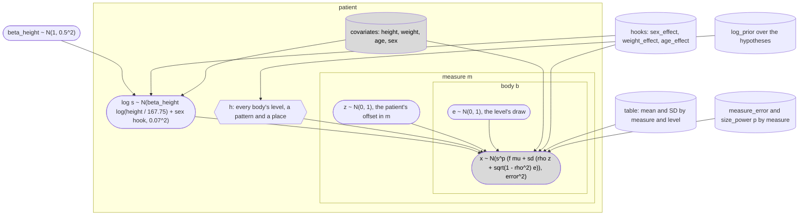

Read from the top. The patient's size s is log-normal about the size their height predicts: isometric scaling, every length in proportion to stature, with beta_height ~ N(1, 0.5^2) as a starting belief and not a measurement, 167.75 cm the mean height of Panjabi's twelve specimens, and 0.07 the archive's SD of log s when nothing is known, kept as the SD left once height is known, which overstates it ([covariates.py](covariates.py)). The hypothesis h says which level each body of the field is, a pattern of offsets and the place of the first body. In each measure the patient has an offset z of their own, shared by every body, which with rho = 0.5 makes a patient's values run large or small together down the column, and each body has its own level draw e. Each value read is then normal about the patient's scaled table value, mu and sd being the table's at measure m and the level h gives body b, with the measure's own error, the scale being s^p, p the power of the size the measure's kind scales with: 1 for a length, 2 for an area and 0 for an angle, which a patient's size does not change. f is the weight and age hooks' factor, exp(gamma_weight w + gamma_age a), w and a the patient's weight and age standardised on the twelve specimens, which is 1 while the hooks are zero. The generator also floors a length at 0.5 mm, as the archive's does, and an area at 0.5 mm2, and leaves an angle unfloored, since an angle may be negative; the likelihood has no floor. The rule takes a patient's offsets in different measures as independent, as the archive's does; the generator can also draw them correlated (`r_between`), to try the rule on columns it does not assume. The table, each measure's error and the weight and age hooks are indexed by measure too, but belong to no patient: a plate diagram's plates may overlap where Mermaid's boxes cannot, so they stand outside the patient's box.

What each model does with each node:

| node | `naming`, the rule | `fixed_level`, the baseline | `generator` |
|---|---|---|---|
| h, the levels | summed out exactly, by a logsumexp over every hypothesis inside the observed density | known, given as data | the column's own levels, from its phenotype |
| log s | sampled by NUTS, or integrated on the rule's 161 nodes (`quadrature_evidence`) | sampled by NUTS | drawn |
| z and e | integrated in closed form, the covariance Delta + u u' inverted by Sherman-Morrison | z sampled by NUTS, e integrated in closed form | drawn |
| beta_height | integrated in closed form into each patient's size prior | sampled by NUTS, one shared by every patient | drawn |
| x | observed, as `MixtureOverLevels` | observed, one normal per value read | drawn |

**No discrete variable is ever sampled.** A sampler that has to move the level, as PyMC's CategoricalGibbsMetropolis would, mixes slowly between places far apart and turns every answer into a count of visits. Here the level is enumerated and summed out in the density itself, so NUTS sees only the continuous size, and the posterior over places is the Rao-Blackwellised average of p(h | x, s) over the draws of s, which has a smaller error than a count of visits would (the owner's word of 27 October 2026, 09:46 UTC, on Metropolis bottlenecks). A field whose gap pattern is not known (TODO.md 4c) is scored the same way over every (pattern, place) pair in one call (`compiled.hypotheses`, `compiled.marginal`).

### The compiled rule

`compiled.ExactRule` is rule.py's arithmetic as one PyTensor graph, compiled once per process: the same four Sherman-Morrison sums as one matrix product per chunk of fields, the same 161 Gauss-Hermite nodes or the trapezoid's (`nodes`), each measure's own error and power of the size. It generalises rule.py in three ways that leave rule.py's answers unchanged: a hypothesis is any row of level indices, so several gap patterns are scored at once; the size prior may differ by field, as a known height makes it, each field carrying its own weights on the same nodes, which must hold its prior whole ([the quadrature](#the-rule)); and a measure's mean may be scaled field by field, as the weight and age hooks will scale it once they are not zero. It equals rule.py within 1e-10 at 1, 3 and 9 bodies under every regime, on gapped fields with values missing and with each measure's own error. Rescoring seed 97's 2,000 columns with it (`rescore --engine pytensor`) reproduces exact.json as the NumPy engine does, every rate of the three regimes at 1, 3 and 9 bodies within 8.1e-13 and the share named identical, in 43, 40 and 18 seconds where NumPy took 56, 44 and 15 in the same run of the record test, on the container's 4 CPUs. `ExactRule.prepare(hyp)` computes the table's side of the product once for a set of hypotheses, as a service that names many fields builds it once, and `evaluate(..., prepared=...)` then computes only the fields' side, which gives what the one function gives to the bit (tests/test_schwingcheck_curve.py). Step e's build-up study scores with rule.py, whose log likelihood comes one measure at a time, so that every subset of the measures is a sum of their terms, and times the compiled rule beside it ([The build-up study](#the-build-up-study)).

### The naming model

`model.naming(X, hyp, mu, sd, keys, noise=..., power=...)` is the rule as one PyMC model over every field at once. Its observed x is a `pm.CustomDist` named `MixtureOverLevels`, whose log density is the log of the sum over hypotheses of the prior times the closed-form likelihood given the size, so the one free variable is log s, one per field, each on its patient's size prior. `model.sample` runs NUTS on it, keeping log s alone, and `model.hypothesis_posterior` returns p(h | x) for every field with its Monte Carlo standard error, by batch means, 20 batches in each chain, the draws that fill no batch left out of the mean and the error alike. `model.quadrature_evidence` integrates over log s, on rule.py's nodes instead of by sampling, each hypothesis's likelihood, the term the observed density sums, built from the model's own variables and size prior, on nodes that must hold that prior whole, as the compiled rule's must, which is the exact rule computed from the PyMC model: it equals the compiled rule within 1e-6 in the tests, and within 5.2e-13 over every field of seed 97's columns at 1, 3 and 9 bodies. The observed density itself is rule.py's likelihood summed over the hypotheses, at three sizes and at each of the 161 nodes, and integrated over the sizes on them (the tests, to 1e-9), and a prior over the hypotheses is normalised whatever its sum. Rescoring seed 97's 2,000 columns from it (`rescore --engine pymc`, one model per width and regime) reproduces exact.json too, every rate of the three regimes at 1, 3 and 9 bodies within 8.1e-13 and the share named identical, in 174, 184 and 140 seconds.

On the example field, four chains of 2,000 draws after 1,000 tuning steps take about 8 seconds in all, 3 to 4 of them sampling, once PyTensor's caches on disk are warm, and about 40 with them empty (its base_compiledir, which holds the Numba cache beside the C one), printing the same numbers either way:

```
$ python -m schwingcheck name schwingcheck/examples/t11-t12-l1.csv --engine nuts
field of 3 bodies at offsets [0, 1, 2], measures endplate, endplate_depth, endplate_lower, endplate_lower_depth, h_post, canal_w, canal_ap
place (level of the first body)  posterior
  T11   0.608433 +- 0.005557  <- named
  T10   0.279324 +- 0.006858
  T12   0.078821 +- 0.002395
  L1    0.016709 +- 0.000815
  ...
```

The exact rule gives 0.607628, 0.285740, 0.075913 and 0.015071, and every one of the six leading places is within 2.1 of its standard errors of it. Further into the tail the estimate tends to run low: T8 is 0.000471 against the exact 0.000619 and T7 0.000042 against 0.000073, each within one of its errors, but T6 is 0.0000010 against 0.0000063, 5.1 of its errors, while L3 runs high, 0.001125 against 0.000923, 1.7 errors. A place that far out is likely only at sizes in the tail of the size's posterior, so its average is carried by the few draws that reach there, converges slowly and can have a batch-means error that is too small; the command says so under its table.

The tests run NUTS on 24 one-body fields and on 12 every-other-body fields with a fifth of their values missing, 130 places above 0.05 in all, and hold every place above 0.05 within five of its standard errors of the exact one, every place within five of them plus 1e-3, R-hat below 1.02, the error of every place above 0.05 within 0.6 to 1.6 of ArviZ's own error for the same draws, which ArviZ computes from their effective sample size, and the mean square of those places' distances from the exact posterior, each in units of its error, between 0.4 and 2.5 over both kinds of field, so that an error twice or half the true one fails. The bounds come from 96 seeds of the sampler besides the test's own, over which the errors are right: the mean square distance over every run's places is 1.01 and 1.09 errors squared on the two kinds of field, and 4.8 and 5.2 per cent of the places are more than two errors off, as 4.6 per cent of a normal's draws are. The largest of a run's 130 distances is the tail of the tail, though: it passed four errors in two of the 96 runs (4.5, 4.4), and by Student's t with the 79 degrees of freedom of the 80 batches four fails a correct sampler about one run in 54, five fewer than one run in 2,000. The other bounds were set the same way: over those runs the ratio to ArviZ's error ran from 0.71 to 1.26, the mean square from 0.63 to 1.61 a run, where the gapped fields' alone, the mean over a run's 30 places there, which varies over the 96 runs as a mean of about 16 independent terms would (2 over its variance), reached 0.37 and would fall below 0.4 about one run in 60, and R-hat to 1.008, a spread by which R-hat below 1.01 would fail about one run in 300 and below 1.02 fewer than one in 100,000. Together these fail a correct sampler in fewer than one run in a thousand. That reckoning leaves out the check at every place, of which the sweep kept only each run's largest distance past four errors: no run came within 3e-4 of even four errors plus 1e-3, so five errors plus 1e-3 holds by a wide margin, though no rate is reckoned for it. None of the 96 runs failed any of the bounds.

They replace the first version of the test, which held every place to four errors plus 1e-3 and R-hat below 1.01 and had no check of the errors themselves: that failed none of the 96 runs, about one run in 150 by the same reckoning of the places above 0.05 and R-hat, about half of it R-hat's. Its words said four errors. A version between the two held the places above 0.05 to four errors alone, as those words said, with each kind of field's mean square taken alone; that fails a correct sampler about one run in 25, and failed three of the 96 runs. Four errors plus 1e-3 is tighter than five wherever an error is above 1e-3, as it is at 80 and 93 per cent of the places above 0.05 on the two kinds of field; what the test gained in return is the two checks of the errors.

At the test's own seed the draws depend on what PyTensor has compiled already. It keeps its compiled code on disk under its base_compiledir (~/.pytensor), the Numba code beside the C, and the seed draws otherwise when a function is compiled in the run than when the same function is read back from there, so a run that compiles any of the test's functions, the first on a fresh machine or one after an edit, draws otherwise than a run that finds them all. Three such states were checked, and the test passes in each. With every function read back, the cache warm, and with every one compiled, the cache empty, the largest distance is 2.7 errors either way, the ratio 0.80 to 1.14 with the cache warm and 0.82 to 1.13 with it empty, the mean square 1.24 and 1.20, and R-hat 1.003 and 1.004. In the far tail of the same fields, the places between 1e-6 and 1e-3, the estimate is a median 7 and 4 per cent low on the two kinds of field with the cache warm and 7 and 1 per cent with it empty, and 10 and 12 per cent of those places are more than four of their errors off (13 and 15 with it empty), 6 and 10 per cent more than five (12 and 15). One run of the suite on 27 October, with three of the test's functions not yet in the cache, put a place of the one-body fields 4.8 errors off, within the five errors the test now allows; with the cache rebuilt as it stood before that run those fields' draws come back exactly, and the whole test passes in that state too, the largest distance 4.8 errors on the one-body fields and 1.45 on the others, the ratio 0.87 to 1.20, the mean square 1.39 and R-hat 1.004.

The exact rule is what names; NUTS shows the model samples, which models that cannot be integrated on nodes will need. Why its far tail runs low the fixed-k NUTS review took up on 29 October 2026: mostly the estimator, whose far places' mass lies on a sliver of the size's posterior that most runs miss, and NUTS's correlated draws make it lower ([The fixed-k NUTS review](#the-fixed-k-nuts-review)).

### The fixed-level baseline

`model.fixed_level(X, field_levels, mu, sd, keys)` knows every body's level and makes three of the generator's continuous variables explicit, the patient's size, the patient's offset in each measure and the beta_height every patient shares; each value read is normal given them, each body's own draw and the measure's error integrated in closed form. NUTS on it gives the closed form's posterior of log s, integrated on a grid, within four Monte Carlo standard errors in its mean and its SD, with R-hat below 1.01, bounds a correct sampler fails about one run in a thousand (over 20 seeds of the sampler the largest distance was 3.1 errors, the mean square 0.97 for the means and 0.95 for the SDs, and R-hat at most 1.003), and its draws are ordinary continuous variables that ArviZ reads directly. It is the baseline of the review of the fixed-k NUTS workflow that the owner queued on 27 October 2026 at 09:44 UTC, done on 29 October ([The fixed-k NUTS review](#the-fixed-k-nuts-review)), and the model in which item 5's spines of known level, with their covariates, will estimate what the naming model takes as given: beta_height is free in it today, while the hooks of weight, age and sex are data at zero, as in the naming model, and the SD of log s and rho constants, each needing a prior in its place before it can be estimated.

### The generator

`model.generator(ref, keys, phenotypes, n)` is columns.py's generator as a PyMC forward model, and `model.draw(model, seed)` returns its columns as a `Columns` object, laid out as columns.py's, every column padded to the widest phenotype listed however few columns are drawn. The random streams differ, so its columns match the NumPy generator's in distribution and not draw for draw. Over 6,000 columns of each, 1,000 of every phenotype, more than 5,000 two-sample z scores, of every body's mean and SD, of every correlation between neighbouring bodies and between measures, and of the size's mean and SD, are all within 4.8 (Bonferroni at 1 per cent) and their mean square is within 0.15 of 1, with independent offsets and again with correlated ones (r = 0.3) and each measure's own error.

### The covariates

The owner asked on 27 October 2026, 11:06 UTC, for age, sex, weight and height as variables of the model. Panjabi prints no measurement of one specimen, so no coefficient can be estimated from the papers ([The specimens](#the-specimens)). What the models carry is the place where each enters, with a prior where anatomy gives one and a hook at zero where it does not, so that item 5's patients can estimate them without changing the models' shape:

- Height scales the size: log s = beta_height log(height / 167.75) + eps, with eps ~ N(0, 0.07^2) and beta_height ~ N(1, 0.5^2), isometric scaling as a starting belief. The naming model integrates beta_height out patient by patient, log s ~ N(log(h / 167.75), 0.07^2 + 0.5^2 log(h / 167.75)^2); the fixed-level model and the generator keep one beta_height shared by every patient.
- Sex shifts log s by a hook, `sex_size`, and weight and age scale each measure's mean by exp(gamma_weight w + gamma_age a), w and a the weight and age standardised on the twelve specimens and each gamma one per measure (`weight_effects`, `age_effects`). Every hook is zero today. The owner expects weight to act on the disc spaces and the facets and age on the facets; the facets are in step e's pool, and no disc space is in Panjabi's tables.
- A patient of whom nothing is known has the archive's size prior and table exactly, so every record is reproduced, and a known height, or a hook set off zero, moves the naming model exactly as it moves the compiled rule (tests, to 1e-6).

Pooling populations from several studies, the owner's future direction, then adjusts each study's table for its specimens' covariates through these terms, so that a difference in stature between two series is not read as a difference in anatomy.

### The graphs

`python -m schwingcheck graph write` writes each model's graph to [graphs/](graphs/) from PyMC's own analysis of the model, its `ModelGraph` (every variable, its parents and the dimensions it spans), on the archive's seven measures: a field of three consecutive bodies named over the twenty places it fits, the same field at a known place, and the generator over the six phenotypes. `graph check` and a test fail when a committed graph differs from its model's, and another test fails when this README does not draw each of them exactly as committed. A cylinder is data, a rounded node a random variable, a rectangle a deterministic function and the shaded node the observed one; each box is a plate, named by the dimensions its nodes span.

The naming model, [graphs/naming.mmd](graphs/naming.mmd), where `x ~ MixtureOverLevels` is the density summed over the hypotheses and `read` marks the values read:


The fixed-level baseline, [graphs/fixed_level.mmd](graphs/fixed_level.mmd), where `offset` is z and `x` has one entry per value read:

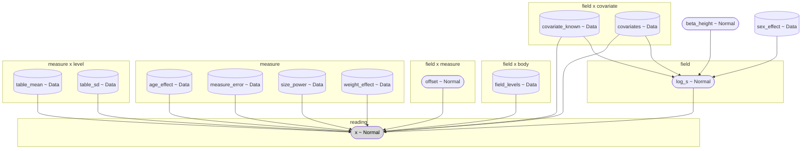

The generator, [graphs/generator.mmd](graphs/generator.mmd), where `level_draw` is e, `raw` the value before the floor and `value` the column, NaN past its end:

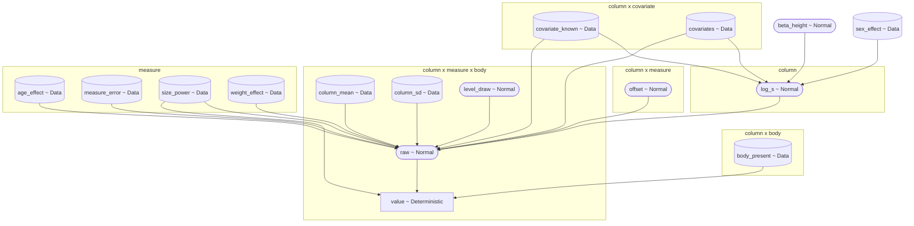

They are Mermaid because GitHub draws Mermaid in Markdown, while PyMC's other drawing, `pm.model_to_graphviz`, needs the graphviz package and its binaries, which are not among the pinned dependencies. PyMC's own `pm.model_to_mermaid` is not used either: it orders the plates by a hash that changes from one process to the next, so a committed graph would never stay checked, and it writes node shapes in the `@{ shape: ... }` syntax that only recent versions of Mermaid draw. `model.mermaid` writes the same ModelGraph in a fixed order with Mermaid's classic shapes.

## The build-up study

Step e of item P ([TODO.md](../TODO.md)): how often the rule names a field right, and how long it takes, as the measures are added one at a time, from one to all 32 of the pool, as the owner asked on 27 October 2026 at 21:27 UTC ([curve.py](curve.py), whose docstring gives every setting; [curve_report.py](curve_report.py)). The rule integrates the size on the trapezoid throughout.

```
python -m schwingcheck curve run --outdir records/curve-2026-10-28 --processes 4 --skip-speed   # the scoring, into curve.nc
python -m schwingcheck curve speed --record records/curve-2026-10-28/curve.nc                    # the times, into the same record
python -m schwingcheck curve table --record records/curve-2026-10-28/curve.nc
python -m schwingcheck curve figures --record records/curve-2026-10-28/curve.nc --outdir records/curve-2026-10-28/figures
python -m schwingcheck curve check --record records/curve-2026-10-28/curve.nc
```

These are the commands the record below was made with; `run` without `--skip-speed` takes the times too, in the same process.

**The order and the subsets.** A forward order of the 32, chosen greedily on 100 selection columns (seeds 311 and 312) by the log loss of the true place summed over 1, 3 and 9 bodies, and every prefix of it scored on the 2,000 scoring columns of seed 97, whose seven are the values the record of 2026-10-26 scored and whose other 25 measures are drawn for the same patients from seed 197; beside the prefixes, the seven (rung 0), each family added to them alone and the families one after another, the kinds, and the planes.

**The arms.** The nominal arm scores every subset at 1, 3, 5 and 9 bodies, the others the prefixes and the seven at 1, 3 and 9.

- nominal: the table as printed, on the scoring columns and on 150 columns of each of the five anomalous phenotypes from seed 99, the seed of the archive's supplement, which drew six_lumbar, four_lumbar and t13 (lumbar_rib and no_rib_t12 are new here), at 1, 3, 5 and 9 bodies. The five are drawn for the same 150 patients, with the same sizes and the same values at every body they share by name but the rib-bearing L1 and the ribless T12, so their rows are paired, not independent samples;
- errors-0.5 and errors-2: every measure's error halved or doubled, in the columns and the rule alike;
- correlated: a patient's offsets correlated at 0.4 between measures, every other setting as assumed, which is the archive's misspecified world at r 0.4 (exact.py's `MISSPEC`), not its combined world (`COMBINED`, which also draws 1.5 mm of error and builds the rule on twelve-specimen tables). It shows how the independence rule fares on correlated columns and whether its answers at 0.99 stay right. It does not measure what treating the measures as independent costs, which needs a rule that knows r, scored against this rule on the same columns; that rule is not built here;
- the data axis: the table re-estimated from P = 12, 50, 200 and 2,000 people drawn with no size spread, no measurement error and no floor, 8, 4, 2 and 2 tables from seed 317 (`WORLDS`), the rule built on each as if it were exact (people-P-nominal) or with each SD widened to a new person's spread about a P-person table (people-P-predictive), each scored on the first 200 scoring columns, the tables' fields pooled; and people-printed, the table as printed scored on the same 200 columns, against which every table of the axis is read.

**The rates.** For every arm, phenotype, subset and width: the share named exactly, the share within one level, the share named at a posterior of 0.99 and the precision there with the count answered, the log loss of the true place and the error the posterior predicts (typical columns only), and the 99 per cent set's mean size, each share and the precision with its standard error clustered by column. Within one level is read on a half-step scale on which a T13 sits half-way between T12 and L1 and an L6 one below L5, so on a T13 column a T12 called L1, or an L1 called T12, counts as within one level though the two are two bodies apart. Where no answered field is wrong, the clustered standard error of the precision is 0 however few were answered, so the record carries the precision's exact two-sided 95 per cent lower bound (Clopper-Pearson, 0.025 to the power 1 over the count answered) and the report prints it in place of that 0; on the data axis, where the count answered counts a field once for every table that answered it and every table answers the same fields, the bound is taken over the count of the table that answered fewest, which bounds the precision of the table whose precision is lowest and so the pooled one, the tables' weighted by the fields each answered. On the data axis, whose tables share the columns, the clustered standard errors hold the tables drawn fixed, as that bound does, and `*_se_tables`, beside every share and the precision, counts the variation between tables too: the crossed two-way random-effects estimate on the means of the (column, table) cells, sqrt((MS_columns + max(MS_tables - MS_interaction, 0)) / (C T)), whose table term has one degree of freedom fewer than the tables, 7, 3, 1 and 1 at P = 12, 50, 200 and 2,000.

**The times.** Single-threaded, on the fields of the first 20 scoring columns, at every prefix of the order and at 1, 3 and 9 bodies, with each engine's table built beforehand (rule.py's table blocks, `compiled.ExactRule.prepare`): one field alone, the median and the largest of 30 calls after one that warms them, and per field in a batch of 128, the median and the largest of five calls after one at the batch's own size; rule.py on the trapezoid's nodes and on the Gauss-Hermite ones, and the compiled rule on the trapezoid's. The compiled rule's functions are compiled before the thread limit is set, since compiling loads scipy's own BLAS, which the limit would otherwise leave at every CPU's thread, and every thread pool is recorded inside the limit. NUTS on the naming model runs at 7, 16 and 32 measures of the order and three bodies, on one field at each of the 20 places, the i-th place's from the i-th column, sampled together, and on the middle one, at T6, alone: the seconds to build the model, to set the sampler up (compiling, which a compiled graph already on disk shortens), of NUTS's own loop and of averaging the posterior, each apart, and each field's distance from the exact posterior, its Monte Carlo error and R-hat, and the divergences. Beside each run are the files it added to PyTensor's Numba cache, `base_compiledir/numba`, which PyTensor's `compiledir` flag does not move: a run that compiled some of its graph adds files there, and one whose graph was compiled already, by an earlier run or an earlier process, adds none and sets up far faster, so the NUTS table says which setups hold a compile; a cold setup is timed with `base_compiledir`, not `compiledir`, pointed at an empty folder.

**The record.** `curve.nc`, an xarray DataTree, written through `records.write` twice: once the scoring is done, before any time is taken, and again with the times. The digests of the package and of the long table and the git state are taken when the run begins (`code_state`), and what changed by the time the record is built is recorded beside them (`changed_during_run`); the root's attributes also carry the counts the arms were scored at, under `--quick` too, the seeds and settings, the floor's counts, and how the times were taken (`speed` and `nuts`: the calls, the batch and its calls, the timed fields' places and columns, every thread pool, the machine and the versions of Python, numpy, scipy, PyTensor, PyMC, Numba and the rest, and for NUTS the files in PyTensor's Numba cache when it began). `curve speed` takes the times again into a record, with digests and a git state of its own.

**Where it stands.** The full run was made on 28 October 2026 from a clean tree at commit a7dcf15, on the container's 4 CPUs, with the commands above: the scoring from 11:15 to 12:33 UTC, 4,721 s by the run's own clock, 598 s of it choosing the order, and then the times, from 12:34 to 12:55 UTC, with no other job running; the speed table gives the load average when the rule's timings ended, before the NUTS runs. The record is [records/curve-2026-10-28/curve.nc](../records/curve-2026-10-28/curve.nc), 3.1 MB, sha256 c4d0cc979da8454609c19a2c7337c7eed1723d0a654c02cbe8536fd0f5167672. It names the commit and the digests of the package and of the long table that both steps began with, and records that neither changed while it scored or timed. The tables below are what `curve table` prints from it, and `curve check` finds each of them here as printed. The figures, with a CSV of every number drawn and their captions, are in [records/curve-2026-10-28/figures/](../records/curve-2026-10-28/figures/FIGURES.md), whose FIGURES.md names the record and the code they were drawn with. The tests of `CommittedRecord` hold all three: the tables, the figures' numbers and captions as the code now draws them (the PNG and PDF files only to be there, since their bytes follow the fonts), and that no code the run names changed while it scored or timed. The report was changed after the record was made, which changed how the record's numbers are printed and none of the numbers: the floor's table now comes in the other tables' order with its measures and levels by count and a note on what it counts, the answers at 0.99 on the anomalous spines are added, panel C of the accuracy figure is drawn only where 1,000 fields or more were named at 0.99, and its CSV gives the fields each share rests on and whether it is drawn, the speed figure's axes are labelled 0.1, 1 and 10, counts are printed with thousands marks, a share is printed with as many places as it takes, up to six, for one short of all not to read 100 nor one above none 0, and the exact lower bound beside a precision with no field wrong is rounded down, so that it never reads above the bound.

Every number below comes from synthetic columns, where the generator is the truth and the rule is the generator inverted.

### What it found

- **Adding measures names more fields, and the answers at 0.99 stay right.** Of the 40,000 three-body fields of the 2,000 typical columns, one measure names 42.0% exactly, the first seven of the greedy order 89.2% and all 32 98.3%. From 25 measures on, every one of the 28,000 nine-body fields is named exactly. At one and three bodies the share named exactly rises with every measure added; at five and nine bodies it falls back by one or two fields at four counts, each above 99.6%. The share named at a posterior of 0.99 grows from 2.5% to 87.0% at three bodies, and at nine bodies it is every field from 29 measures on. Of the fields named at 0.99, 99.59% or more were right at every count and at every width scored, 1, 3, 5 and 9 bodies, wherever any field was named; the least, 99.59%, is 9 wrong of 2,196, at two measures and three bodies.
- **The seven are not the best seven.** The seven measures in use today, rung 0, name 73.1% of three-body fields exactly. The first seven of the greedy order, chosen on columns of a seed of their own and sharing none of the seven, name 89.2%, 16.1 points more, and the 7 measures an AP view reads, three of them among the seven, name 85.1%. Each family added to the seven helps, the facets most (91.4% with 17 measures), and the seven with the pedicles, the processes and the facets, 24 measures, name 97.0%.
- **Errors move the share named and not the promise; correlated offsets move neither.** With every measure's error doubled, in the columns and the rule alike, the seven name 63.0% of three-body fields exactly and all 32 name 95.3%; with it halved, 76.8% and 99.2%; with offsets correlated at 0.4 between measures, which the rule takes as independent, 73.8% and 98.3%, against 73.1% and 98.3% as assumed. The correlated arm's differences from the nominal arm are under two standard errors: at three bodies 0.8 points with the seven, 1.9 standard errors of the difference, on columns of their own, and 0.0 with all 32. In every cell of the arms table the answers at 0.99 are right 99.77% of the time or more. The errors arms change the rule's errors with the columns', so their rule is still the generator inverted and the promise holds there by construction, the floor aside; what a rule whose errors are wrong does is not scored here, though the archive's record scored one for the seven: taking 3 mm of measurement error as 1 mm, its answers at 0.99 at three bodies were right 82.6% of the time ([README.md](../README.md#where-the-rule-is-weak-the-table-not-the-mathematics)).
- **A table from twelve people breaks the promise; with all 32 measures one from 50 keeps it, and with the seven these columns cannot tell.** A table estimated from 12 people, as many as Panjabi measured, names 13.2 points fewer three-body fields exactly with the seven, and 5.2 fewer with all 32, than the table as printed does on the same 200 columns, and its answers at 0.99 are right only 95.75% and 98.05% of the time, below the 99% the posterior promises; widening every SD for a new person, the predictive rule, raises those to 97.65% and 98.66%. From 50 people on, the answers at 0.99 in that table, the seven's and all 32's at three bodies, are right 99.36% of the time or more, and the largest loss is 4.1 points, the seven's from 50 people; from 200 on, half a point or less. With all 32 that precision is far above 99%, 99.82% at 50 people, more than 13 standard errors above it counting the tables. With the seven it is not: 99.41%, 99.38% and 99.54% at 50, 200 and 2,000 people are 1.1 to 1.6 standard errors above 99% counting the tables (0.32 points at 50 people, on 3 degrees of freedom), and the table as printed is itself 99.54% (0.34 points) on these 200 columns, so they cannot tell whether a seven-measure table from 50 people or more keeps the promise. The axis's people all have one size and are measured without error, so its rows give what the people's own variation costs a table and nothing more. Panjabi's twelve specimens were 157 to 178 cm tall, and the CTs of TODO.md item 5 would be measured from SPINEPS masks, which give the seven, so even if real spines vary from person to person as the generator's people do, where a rule built on his table or on item 5's stands beside these rows is not measured, nor whether real spines vary that way. His table is also one draw, where the twelve-person rows pool eight, whose precision at 0.99 with the seven spreads by 1.1 points from one table to the next.
- **A body the rule has no name for is named wrong at 0.99, and more measures make more of those answers wrong.** A six-lumbar spine has an L6, and a spine with a thirteenth rib-bearing body a T13, names the rule does not have. With all 32 measures at three, five and nine bodies, 5.1% to 7.2% of its answers at 0.99 on those two spines are wrong, and at one body 9.1% on six-lumbar spines (150 of 1,655) and 3.3% on spines with a T13 (52 of 1,557). More measures make it answer more often and give more wrong answers at every width scored, though they name more fields exactly: on six-lumbar spines at three bodies, the seven name 16.9% of fields at 0.99, 97.18% of them right (15 wrong of 531), and all 32 name 87.9%, 94.47% right (153 wrong of 2,769), while the share named exactly rises from 70.3% to 93.7%. Nearly all the wrong answers are fields that reach the body it cannot name: with all 32 at one, three, five and nine bodies, 149 of 150, 150 of 153, 150 of 151 and 150 of 150 wrong on six-lumbar spines hold the L6, and 51 of 52, 134 of 137, 197 of 198 and 124 of 124 on spines with a T13 hold it; the others, one to three at one, three and five bodies and none at nine, are fields between T3 and T12, the same fields on both spines, whose columns are drawn for the same patients ([examples/anomalous_check.py](examples/anomalous_check.py)). At nine bodies the 150 wrong on six-lumbar spines are the 150 fields, one a column, whose lowest body is the L6, and 117 of the 124 wrong on spines with a T13 have it as their middle body, the other 7 the T12 or the T11. That is the case for TODO.md item 6, places for the anomalous bodies.
- **A body drawn half-way between two names is named wrong at 0.99 too.** On four-lumbar spines, whose bodies all carry names the rule has, the answers at 0.99 are right 99.40% of the time or more at every count and width. A rib-bearing L1 and a ribless T12 are drawn half-way between T12 and L1 (columns.SYNTH's blend) and named, by the count from C2, L1 and T12, names the rule has too. With the seven or all 32 at three, five and nine bodies, the answers at 0.99 on spines with a rib on L1 or no rib on T12 are right 99.25% of the time or more, and all 32 name every nine-body field exactly. They fall below 99% at three bodies with the first 1 to 17 measures of the order on spines with a rib on L1, and the first 1 to 15 or 21 to 25 on spines with no rib on T12, the least 55.56% of 18 answers and 45.45% of 22, with one measure; at five and nine bodies with the first 1 to 6 and 1 to 5 measures with a rib on L1, and the first 1 to 5 and 1 to 2 with no rib on T12; and at one body from 6 measures on with a rib on L1, and at 18 and from 21 on with no rib on T12, all 32 being right 98.38% of the time with a rib on L1, 24 wrong of 1,478, 23 of them that L1, and 98.66% with no rib on T12, 19 wrong of 1,420, all of them that T12, against 99.89% on typical columns. Why, at one body, more measures do worse there than fewer is not measured. That too is item 6.
- **The exact rule names a field in milliseconds.** On one thread, rule.py on the trapezoid's nodes names a three-body field in 0.31 ms from one measure, 1.12 ms from seven, 4.02 ms from 16 and 9.68 ms from all 32. No engine's median for one field alone passed 13.4 ms at any count or width, that one the compiled rule's at 31 measures and nine bodies. Per field, a batch of 128 is faster than one field alone at nine bodies for every engine and count, and slower at one body for most counts; why is not measured.
- **NUTS is slower, and at 16 measures an R-hat of 1.00 hid a wrong posterior.** On the naming model, NUTS's own loop took 0.33 s a field for 20 three-body fields sampled together at seven measures, after 34.4 s of setup. Setup aside, at 7, 16 and 32 measures a field sampled alone took NUTS 166 to 712 times as long as rule.py's median for one field alone, and a field among the 20 sampled together 113 to 300 times as long as a field in one of rule.py's batches of 128. At seven measures its largest gap from the exact posterior, at any place of any field, was 1.2e-2. At 16 measures, sampled together, it gave the field at L2 a posterior 1.0 from the exact one at some place, so that one of the two puts nearly all its weight where the other puts almost none, while that field's R-hat was 1.00; three other fields had R-hats of 1.46 to 1.84, and there were 156 divergences. The field at T6 alone, with the same 16 measures, had a largest gap of 3.1e-2, and the 20 fields with all 32, sampled together, one of 1.5e-2. Why the 16-measure run failed is not measured. A trial that samples, the methods' rung among them, is to be checked against the exact rule field by field, not by its R-hat.
- **The rule does not know the floor, and from 25 measures on it names every nine-body field exactly anyway.** The generator sets a value it draws below 0.5, in the measure's own units, to 0.5, and the rule does not know it. On the typical columns as assumed it did so to 1,611 of the 1,056,000 values of the 24 measures that scale with the size, three in four of them areas (1,210, the pedicle area alone 553) and half at C3 to C5 (814); from 28 measures on, 20.6% of nine-body fields hold such a value, and every nine-body field is still named exactly.

### Naming as the measures are added

The greedy order and each prefix of it, on the 2,000 typical columns as assumed. The order was chosen on 100 selection columns of seeds 311 and 312, so these columns did not choose it.

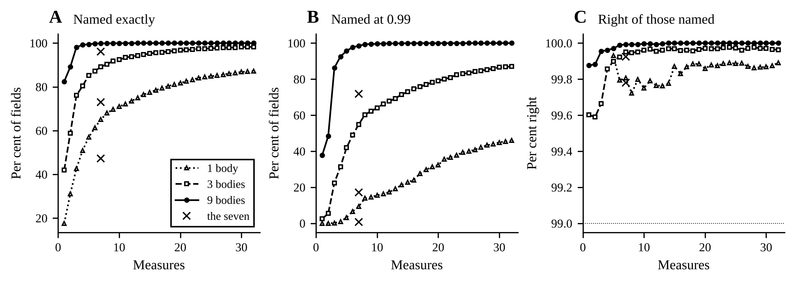

<!-- curve:curve -->
| Measures | Added | Kind | Named exactly, 1 body | 3 bodies | 9 bodies | Named at 0.99, 3 bodies | Right of those | Named at 0.99, 9 bodies | Right of those | Fields with a value at the floor, 9 bodies |
|---:|---|---|---:|---:|---:|---:|---:|---:|---:|---:|
| 1 | `spinous_length` | length | 17.6% | 42.0% | 82.4% | 2.5% | 99.60% | 37.7% | 99.88% | 0.0% |
| 2 | `endplate_lower_area` | area | 31.2% | 58.9% | 89.2% | 5.5% | 99.59% | 48.4% | 99.88% | 0.0% |
| 3 | `transverse_width` | length | 42.7% | 76.1% | 98.2% | 22.4% | 99.67% | 86.3% | 99.95% | 0.0% |
| 4 | `interfacet_w_sup` | length | 50.8% | 80.4% | 99.2% | 31.5% | 99.86% | 92.6% | 99.96% | 0.0% |
| 5 | `interfacet_h:mean` | length | 56.9% | 85.2% | 99.5% | 42.0% | 99.90% | 95.7% | 99.97% | 1.2% |
| 6 | `facet_sag_inf:mean` | angle | 61.3% | 87.2% | 99.8% | 49.0% | 99.92% | 97.7% | 99.99% | 1.2% |
| 7 | `pedicle_w:mean` | length | 65.1% | 89.2% | 99.9% | 54.9% | 99.95% | 98.5% | 99.99% | 6.3% |
| 8 | `pedicle_incl_trans:mean` | angle | 68.0% | 90.4% | 99.9% | 60.3% | 99.95% | 99.3% | 99.99% | 6.3% |
| 9 | `endplate_area` | area | 69.7% | 91.8% | 99.9% | 62.2% | 99.95% | 99.5% | 99.99% | 6.3% |
| 10 | `facet_area_inf:mean` | area | 71.0% | 92.4% | 99.95% | 64.0% | 99.96% | 99.6% | 99.996% | 6.8% |
| 11 | `endplate_depth` | length | 72.2% | 93.4% | 99.99% | 66.2% | 99.97% | 99.8% | 99.996% | 6.8% |
| 12 | `facet_area_sup:mean` | area | 73.5% | 93.9% | 99.99% | 67.8% | 99.96% | 99.8% | 99.99% | 9.3% |
| 13 | `endplate_lower_depth` | length | 75.0% | 94.2% | 99.99% | 69.3% | 99.96% | 99.8% | 99.996% | 9.3% |
| 14 | `pedicle_h:mean` | length | 76.5% | 94.8% | 99.99% | 71.5% | 99.97% | 99.9% | 100.00% (at least 99.98%) | 9.3% |
| 15 | `endplate_lower` | length | 77.5% | 95.2% | 99.996% | 73.0% | 99.97% | 99.9% | 100.00% (at least 99.98%) | 9.3% |
| 16 | `facet_w_sup:mean` | length | 78.5% | 95.7% | 99.996% | 74.6% | 99.96% | 99.98% | 100.00% (at least 99.98%) | 9.3% |
| 17 | `interfacet_w_inf` | length | 79.4% | 95.8% | 99.996% | 75.8% | 99.96% | 99.98% | 100.00% (at least 99.98%) | 9.3% |
| 18 | `pedicle_incl_sag:mean` | angle | 80.3% | 96.2% | 99.996% | 77.0% | 99.96% | 99.98% | 100.00% (at least 99.98%) | 9.3% |
| 19 | `canal_w` | length | 81.1% | 96.5% | 99.996% | 78.2% | 99.96% | 99.98% | 100.00% (at least 99.98%) | 9.3% |
| 20 | `endplate` | length | 81.7% | 96.7% | 100.0% | 79.1% | 99.97% | 99.98% | 100.00% (at least 99.98%) | 9.3% |
| 21 | `facet_sag_sup:mean` | angle | 82.6% | 96.9% | 99.996% | 80.1% | 99.97% | 99.99% | 100.00% (at least 99.98%) | 9.3% |
| 22 | `canal_area` | area | 83.3% | 97.1% | 99.996% | 80.9% | 99.97% | 99.99% | 100.00% (at least 99.98%) | 13.8% |
| 23 | `facet_trans_sup:mean` | angle | 84.1% | 97.4% | 99.99% | 82.4% | 99.98% | 99.99% | 100.00% (at least 99.98%) | 13.8% |
| 24 | `endplate_incl` | angle | 84.5% | 97.5% | 99.99% | 83.0% | 99.98% | 99.99% | 100.00% (at least 99.98%) | 13.8% |
| 25 | `h_post` | length | 84.8% | 97.6% | 100.0% | 83.5% | 99.97% | 99.99% | 100.00% (at least 99.98%) | 13.8% |
| 26 | `facet_h_inf:mean` | length | 85.2% | 97.8% | 100.0% | 84.2% | 99.96% | 99.99% | 100.00% (at least 99.98%) | 13.8% |
| 27 | `canal_ap` | length | 85.6% | 97.9% | 100.0% | 84.8% | 99.97% | 99.99% | 100.00% (at least 99.98%) | 13.9% |
| 28 | `pedicle_area:mean` | area | 86.1% | 97.9% | 100.0% | 85.4% | 99.98% | 99.996% | 100.00% (at least 99.98%) | 20.6% |
| 29 | `facet_trans_inf:mean` | angle | 86.3% | 98.0% | 100.0% | 85.9% | 99.97% | 100.0% | 100.00% (at least 99.98%) | 20.6% |
| 30 | `facet_w_inf:mean` | length | 86.9% | 98.2% | 100.0% | 86.6% | 99.97% | 100.0% | 100.00% (at least 99.98%) | 20.6% |
| 31 | `endplate_lower_incl` | angle | 87.0% | 98.2% | 100.0% | 86.8% | 99.97% | 100.0% | 100.00% (at least 99.98%) | 20.6% |
| 32 | `facet_h_sup:mean` | length | 87.2% | 98.3% | 100.0% | 87.0% | 99.96% | 100.0% | 100.00% (at least 99.98%) | 20.6% |

2,000 typical columns; the standard errors of the shares named exactly, clustered by column, are 0.00 to 0.34 points, and of the precision at 0.99, where a field named at 0.99 was wrong, 0.00 to 0.20 points. Where no field named at 0.99 was wrong, the precision is followed by its exact two-sided 95 per cent lower bound (Clopper-Pearson, the answered fields counted as independent trials), rounded down, in place of a standard error of 0.
<!-- /curve:curve -->

### The families, the kinds and the views

The seven with each family added alone, the families added one after another, the lengths, the seven with the areas or the angles, what each view reads, and all 32.

<!-- curve:subsets -->
| Measures scored | Count | Named exactly, 1 body | 3 bodies | 9 bodies | Named at 0.99, 3 bodies | Right of those |
|---|---:|---:|---:|---:|---:|---:|
| the seven (rung 0) | 7 | 47.3% | 73.1% | 96.1% | 17.1% | 99.78% |
| the seven and the pedicles | 12 | 63.6% | 87.9% | 99.7% | 45.1% | 99.88% |
| the seven and the processes | 9 | 61.7% | 88.7% | 99.8% | 49.6% | 99.87% |
| the seven and the facets | 17 | 69.7% | 91.4% | 99.9% | 60.7% | 99.88% |
| the seven and the interfacet distances | 10 | 59.8% | 83.7% | 99.1% | 36.1% | 99.87% |
| the seven and the rest of the body and the canal | 12 | 55.4% | 82.3% | 98.4% | 28.6% | 99.84% |
| the seven, the pedicles and the processes | 14 | 73.0% | 93.9% | 99.98% | 68.1% | 99.92% |
| the seven, the pedicles, the processes and the facets | 24 | 82.2% | 97.0% | 100.0% | 80.7% | 99.96% |
| the seven, the pedicles, the processes, the facets and the interfacet distances | 27 | 85.0% | 97.6% | 100.0% | 84.0% | 99.96% |
| the lengths | 18 | 77.5% | 95.8% | 99.996% | 74.6% | 99.93% |
| the seven and the areas | 13 | 60.6% | 86.0% | 99.4% | 35.6% | 99.86% |
| the seven and the angles | 15 | 68.2% | 90.3% | 99.9% | 58.7% | 99.94% |
| what an AP view reads | 7 | 59.4% | 85.1% | 99.7% | 41.9% | 99.88% |
| what a lateral view reads | 10 | 57.9% | 86.8% | 99.6% | 47.0% | 99.88% |
| both views | 17 | 77.1% | 95.0% | 99.99% | 73.2% | 99.93% |
| all 32 | 32 | 87.2% | 98.3% | 100.0% | 87.0% | 99.96% |
<!-- /curve:subsets -->

### Errors and correlated offsets

<!-- curve:arms -->
| Columns and rule | Seven, named exactly, 3 bodies | Right of those named at 0.99 | Seven, 9 bodies | Right at 0.99 | All 32, 3 bodies | Right at 0.99 | All 32, 9 bodies | Right at 0.99 |
|---|---:|---:|---:|---:|---:|---:|---:|---:|
| As assumed | 73.1% | 99.78% | 96.1% | 99.93% | 98.3% | 99.96% | 100.0% | 100.00% (at least 99.98%) |
| Every error halved, in the columns and the rule | 76.8% | 99.77% | 97.6% | 99.94% | 99.2% | 99.98% | 100.0% | 100.00% (at least 99.98%) |
| Every error doubled, in the columns and the rule | 63.0% | 99.82% | 89.3% | 99.80% | 95.3% | 99.96% | 99.99% | 100.00% (at least 99.98%) |
| Offsets correlated 0.4 between measures, the rule unaware | 73.8% | 99.90% | 96.4% | 99.95% | 98.3% | 99.96% | 100.0% | 100.00% (at least 99.98%) |

Each row is scored on columns of its own: the errors' rows on the first row's patients with every error scaled, the correlated row on columns drawn in one stream from seed 331. Its rule, which takes the measures as independent, does not know the correlation, so the row shows how that rule fares on correlated columns and whether its answers at 0.99 stay right; its difference from the first row is not what treating the measures as independent costs, which needs a rule that knows the correlation scored on the same columns, not built here.

Where no field named at 0.99 was wrong, the precision is followed by its exact two-sided 95 per cent lower bound (Clopper-Pearson, the answered fields counted as independent trials), rounded down, in place of a standard error of 0.
<!-- /curve:arms -->

### Tables from fewer people

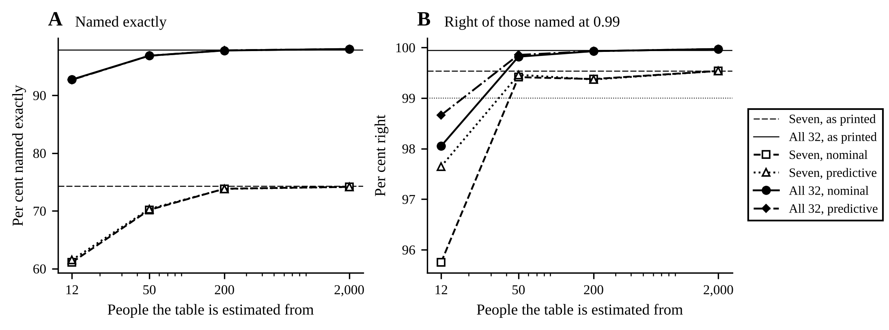

<!-- curve:data -->
| People | Rule | Tables | Seven, named exactly, 3 bodies | Against the table as printed, points | Right of those named at 0.99 | All 32, 3 bodies | Against the table as printed, points | Right at 0.99 |
|---:|---|---:|---:|---:|---:|---:|---:|---:|
| as printed | - | 1 | 74.3% (0.88 / -) | - | 99.54% (0.34 / -) | 97.9% (0.25 / -) | - | 99.94% (0.04 / -) |
| 12 | nominal | 8 | 61.1% (0.61 / 0.65) | -13.2 | 95.75% (0.45 / 0.55) | 92.7% (0.27 / 0.30) | -5.2 | 98.05% (0.13 / 0.16) |
| 12 | predictive | 8 | 61.5% (0.63 / 0.71) | -12.8 | 97.65% (0.36 / 0.40) | 92.7% (0.27 / 0.28) | -5.2 | 98.66% (0.10 / 0.15) |
| 50 | nominal | 4 | 70.2% (0.83 / 0.93) | -4.1 | 99.41% (0.27 / 0.32) | 96.9% (0.25 / 0.29) | -1.0 | 99.82% (0.06 / 0.06) |
| 50 | predictive | 4 | 70.3% (0.84 / 0.91) | -4.0 | 99.46% (0.25 / 0.30) | 96.9% (0.24 / 0.29) | -1.0 | 99.85% (0.05 / 0.05) |
| 200 | nominal | 2 | 73.8% (0.86 / 0.86) | -0.5 | 99.38% (0.33 / 0.34) | 97.8% (0.24 / 0.30) | -0.1 | 99.93% (0.04 / 0.04) |
| 200 | predictive | 2 | 73.8% (0.85 / 0.85) | -0.5 | 99.37% (0.34 / 0.35) | 97.8% (0.24 / 0.32) | -0.1 | 99.93% (0.04 / 0.04) |
| 2,000 | nominal | 2 | 74.2% (0.87 / 0.87) | -0.1 | 99.54% (0.35 / 0.35) | 98.0% (0.24 / 0.24) | +0.1 | 99.97% (0.02 / 0.03) |
| 2,000 | predictive | 2 | 74.2% (0.87 / 0.87) | -0.1 | 99.54% (0.35 / 0.35) | 98.0% (0.24 / 0.24) | +0.1 | 99.97% (0.02 / 0.03) |

Each table is scored on the same 200 typical columns, the first of the nominal arm's, and so is the table as printed, the first row, against which every other row is read; a difference is paired on the same fields, and its own standard error is not recorded.
In brackets, standard errors in points: clustered by column, the tables drawn held fixed / counting the variation between tables too (columns and tables crossed, the two-way estimate), on one degree of freedom fewer than the tables: 7 at 12 people, 3 at 50, 1 at 200 and 1 at 2,000; the table as printed is one fixed table, with no such term.
<!-- /curve:data -->

### Spines the rule has no place for

<!-- curve:anomalous -->
| Spine | Seven, 3 bodies: exact / within one | Seven, 5 bodies | Seven, 9 bodies | All 32, 3 bodies | All 32, 5 bodies | All 32, 9 bodies |
|---|---:|---:|---:|---:|---:|---:|
| Typical | 73.1% / 91.0% | 85.7% / 96.6% | 96.1% / 99.7% | 98.3% / 99.8% | 99.8% / 99.99% | 100.0% / 100.0% |
| Four lumbar | 73.6% / 90.8% | 85.5% / 96.0% | 95.6% / 99.3% | 98.2% / 99.8% | 99.8% / 100.0% | 100.0% / 100.0% |
| Six lumbar | 70.3% / 90.0% | 81.1% / 95.2% | 89.3% / 99.1% | 93.7% / 99.8% | 94.5% / 100.0% | 93.3% / 100.0% |
| Thirteenth rib-bearing body | 69.1% / 89.6% | 77.3% / 95.1% | 87.2% / 99.2% | 92.6% / 99.8% | 91.9% / 100.0% | 92.8% / 100.0% |
| Rib on L1 | 72.1% / 90.4% | 84.3% / 95.7% | 94.9% / 99.1% | 97.4% / 99.8% | 99.7% / 100.0% | 100.0% / 100.0% |
| No rib on T12 | 72.9% / 90.7% | 85.4% / 96.4% | 95.0% / 99.2% | 97.1% / 99.8% | 99.7% / 100.0% | 100.0% / 100.0% |

A field is judged by its own column's names, so a T13 or an L6 is never named right. On a spine with a thirteenth rib-bearing body those names are the rib reading, which calls the thirteenth rib-bearing body T13 where the count from C2 calls it L1; with a rib on L1 or no rib on T12 they are the count from C2, under which the rib-bearing L1 stays L1 and the ribless T12 stays T12 where the rib reading calls them T13 and L1; on four- and six-lumbar spines the two agree. Within one level is read on a half-step scale on which a T13 sits half-way between T12 and L1 and an L6 one below L5, so on a T13 spine a T12 called L1, or an L1 called T12, counts as within one level though the two are two bodies apart.

| Spine | Seven, 3 bodies: named at 0.99 / right of those | Seven, 5 bodies | Seven, 9 bodies | All 32, 3 bodies | All 32, 5 bodies | All 32, 9 bodies |
|---|---:|---:|---:|---:|---:|---:|
| Typical | 17.1% / 99.78% | 36.7% / 99.81% | 71.8% / 99.93% | 87.0% / 99.96% | 97.9% / 99.99% | 100.0% / 100.00% (at least 99.98%) |
| Four lumbar | 17.7% / 100.00% (at least 99.27%) | 38.4% / 99.90% | 72.3% / 99.86% | 86.7% / 99.88% | 97.5% / 99.96% | 100.0% / 100.00% (at least 99.81%) |
| Six lumbar | 16.9% / 97.18% | 37.6% / 96.37% | 73.3% / 92.90% | 87.9% / 94.47% | 97.7% / 94.58% | 100.0% / 93.33% |
| Thirteenth rib-bearing body | 16.1% / 100.00% (at least 99.27%) | 33.8% / 98.65% | 66.0% / 95.01% | 85.7% / 94.93% | 96.1% / 92.77% | 98.0% / 94.38% |
| Rib on L1 | 16.8% / 100.00% (at least 99.27%) | 35.7% / 99.69% | 70.9% / 99.73% | 86.0% / 99.30% | 97.4% / 99.96% | 100.0% / 100.00% (at least 99.82%) |
| No rib on T12 | 17.2% / 100.00% (at least 99.28%) | 38.7% / 99.81% | 73.4% / 99.87% | 85.2% / 99.26% | 97.2% / 99.92% | 99.9% / 100.00% (at least 99.82%) |

The share of the fields named at a posterior of 0.99, and the share of those that are right, on 2,000 typical columns and 150 columns of each anomalous spine; the standard errors of the share right, clustered by column, where a field named at 0.99 was wrong, are 0.00 to 0.67 points.

Where no field named at 0.99 was wrong, the precision is followed by its exact two-sided 95 per cent lower bound (Clopper-Pearson, the answered fields counted as independent trials), rounded down, in place of a standard error of 0.
<!-- /curve:anomalous -->

### Time to name a field

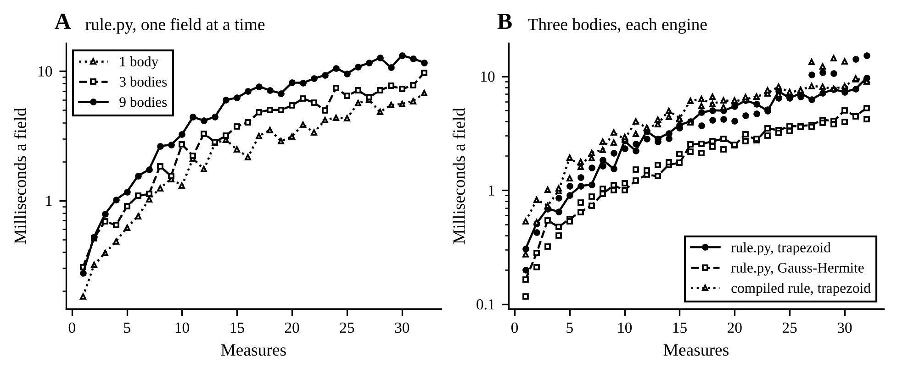

<!-- curve:speed -->
| Engine | Bodies | 1 measure | 7 measures | 16 measures | 32 measures |
|---|---:|---:|---:|---:|---:|
| rule.py, trapezoid | 1 | 0.18 / 0.25 | 1.02 / 1.88 | 2.17 / 3.73 | 6.75 / 12.9 |
| rule.py, trapezoid | 3 | 0.31 / 0.20 | 1.12 / 1.58 | 4.02 / 3.98 | 9.68 / 15.3 |
| rule.py, trapezoid | 9 | 0.27 / 0.13 | 1.73 / 1.05 | 6.97 / 3.13 | 11.6 / 5.78 |
| rule.py, Gauss-Hermite | 1 | 0.15 / 0.12 | 0.73 / 0.99 | 1.47 / 1.96 | 3.04 / 4.76 |
| rule.py, Gauss-Hermite | 3 | 0.16 / 0.12 | 0.73 / 0.88 | 2.53 / 2.19 | 5.25 / 4.22 |
| rule.py, Gauss-Hermite | 9 | 0.21 / 0.08 | 1.25 / 0.60 | 3.09 / 1.60 | 9.23 / 3.66 |
| compiled rule, trapezoid | 1 | 0.46 / 0.27 | 1.05 / 1.90 | 2.64 / 4.63 | 5.69 / 16.1 |
| compiled rule, trapezoid | 3 | 0.53 / 0.27 | 2.12 / 1.91 | 6.11 / 3.93 | 9.35 / 8.97 |
| compiled rule, trapezoid | 9 | 0.43 / 0.16 | 2.93 / 1.39 | 7.92 / 3.73 | 12.5 / 6.30 |

Milliseconds to name one field, each engine's table built beforehand: alone, the median of 30 calls / per field in a batch of 128, the median of 5 such calls after one that warms them, on the fields of 20 scoring columns. Every thread pool was at one thread inside the limit (libscipy_openblas-5f890258.so, libscipy_openblas64_-f48b354e.so). Timed on Linux-6.18.44-fc-v180-x86_64-with-glibc2.39 with 4 CPUs, load average 1.00 / 1.07 / 1.88 at the end; Python 3.13.17, numpy 2.5.4, scipy 1.18.1, PyTensor 3.3.4, PyMC 6.3.2, Numba 0.68.0.
<!-- /curve:speed -->

### NUTS on the naming model

<!-- curve:nuts -->
| Measures | Sampled | Fields | Build, s a call | Setup, s a call | NUTS's loop, s a field | Posterior, s a field | Largest gap from the exact posterior | Largest R-hat | Divergences | Files added to the Numba cache |
|---:|---|---:|---:|---:|---:|---:|---:|---:|---:|---:|
| 7 | together | 20 | 0.19 | 34.4 | 0.33 | 0.02 | 1.2e-02 at T4 | 1.02 | 0 | 120 |
| 7 | alone, at T6 | 1 | 0.05 | 26.7 | 0.80 | 0.25 | 3.3e-04 at T6 | 1.00 | 0 | 39 |
| 16 | together | 20 | 0.06 | 11.2 | 1.19 | 0.07 | 1.0e+00 at L2 | 1.84 | 156 | 4 |
| 16 | alone, at T6 | 1 | 0.04 | 16.1 | 1.56 | 0.23 | 3.1e-02 at T6 | 1.02 | 0 | 4 |
| 32 | together | 20 | 0.07 | 12.9 | 1.72 | 0.05 | 1.5e-02 at T6 | 1.01 | 0 | 4 |
| 32 | alone, at T6 | 1 | 0.05 | 16.7 | 1.60 | 0.28 | 9.8e-03 at T6 | 1.01 | 0 | 4 |

| Place | 7 measures: gap (R-hat) | 16 measures: gap (R-hat) | 32 measures: gap (R-hat) |
|---|---:|---:|---:|
| C3 | 7.5e-06 (1.01) | 2.5e-10 (1.01) | 2.2e-13 (1.00) |
| C4 | 7.3e-04 (1.00) | 2.6e-05 (1.01) | 4.6e-08 (1.00) |
| C5 | 3.1e-06 (1.00) | 3.4e-01 (1.46) | 4.8e-12 (1.01) |
| C6 | 3.1e-08 (1.00) | 1.0e-13 (1.00) | 7.7e-23 (1.00) |
| C7 | 3.8e-07 (1.01) | 8.9e-12 (1.02) | 8.2e-18 (1.01) |
| T1 | 1.3e-04 (1.00) | 2.3e-23 (1.00) | 2.1e-28 (1.00) |
| T2 | 5.0e-05 (1.01) | 3.8e-05 (1.00) | 1.7e-12 (1.01) |
| T3 | 5.3e-04 (1.02) | 4.0e-04 (1.01) | 7.8e-05 (1.00) |
| T4 | 1.2e-02 (1.00) | 7.2e-03 (1.01) | 7.5e-04 (1.00) |
| T5 | 2.3e-03 (1.00) | 1.5e-02 (1.01) | 7.9e-03 (1.01) |
| T6 | 6.3e-04 (1.00) | 5.0e-01 (1.83) | 1.5e-02 (1.01) |
| T7 | 3.1e-03 (1.01) | 1.8e-02 (1.00) | 1.3e-03 (1.00) |
| T8 | 2.7e-03 (1.00) | 1.0e-02 (1.00) | 7.2e-04 (1.01) |
| T9 | 1.7e-07 (1.00) | 8.3e-07 (1.01) | 6.2e-13 (1.00) |
| T10 | 3.5e-07 (1.00) | 2.8e-11 (1.00) | 1.2e-13 (1.00) |
| T11 | 1.9e-15 (1.00) | 5.0e-01 (1.84) | 1.5e-24 (1.00) |
| T12 | 3.3e-09 (1.00) | 1.9e-12 (1.00) | 1.7e-18 (1.00) |
| L1 | 5.7e-04 (1.00) | 7.0e-07 (1.01) | 5.4e-07 (1.01) |
| L2 | 1.9e-03 (1.01) | 1.0e+00 (1.00) | 2.6e-04 (1.01) |
| L3 | 1.1e-09 (1.00) | 1.7e-14 (1.00) | 2.2e-15 (1.00) |

NUTS on the naming model, 2 chains of 500 draws after 500 tuning steps, seed 7, on one field of 3 bodies at each place, the i-th place's from the i-th of 20 scoring columns, sampled together in one model, and on the field at T6 alone. The setup is a call's, whatever its fields: compiling the model's log density and gradient, which every new set of fields pays again, since the observed values are constants of the compiled graph, and which a compiled graph already on disk shortens. The loop is NUTS's own, tuning and draws; the posterior is the second call of the average over the draws, the first having compiled it. The gap is the largest difference over places between NUTS's posterior and the exact rule's, below for each field sampled together. A run that added files to PyTensor's Numba cache (base_compiledir/numba) compiled some of its graph, and its setup holds that compile; one that added none found its graph compiled already, by an earlier run or process, and its setup is the shorter for it. Compiled: 7 measures together, 7 measures alone, 16 measures together, 16 measures alone, 32 measures together and 32 measures alone; compiled already: none. Every thread pool was at one thread inside the limit (libscipy_openblas-5f890258.so, libscipy_openblas64_-f48b354e.so).
<!-- /curve:nuts -->

### Values at the floor

<!-- curve:floor -->
| Columns | Spine | Values at the floor | Of | Columns touched | Most at |
|---|---|---:|---:|---:|---|
| As assumed | Typical | 1,611 | 1,056,000 | 1,033 | `interfacet_h:mean C4` 174, `facet_area_sup:mean C4` 125, `pedicle_area:mean C4` 85 |
| Every error halved, in the columns and the rule | Typical | 1,113 | 1,056,000 | 795 | `interfacet_h:mean C4` 171, `facet_area_sup:mean C4` 114, `facet_area_inf:mean C3` 60 |
| Every error doubled, in the columns and the rule | Typical | 4,481 | 1,056,000 | 1,708 | `pedicle_area:mean C3` 289, `pedicle_area:mean C4` 283, `pedicle_area:mean C5` 248 |
| Offsets correlated 0.4 between measures, the rule unaware | Typical | 1,687 | 1,056,000 | 967 | `interfacet_h:mean C4` 200, `facet_area_sup:mean C4` 111, `pedicle_area:mean C5` 96 |
| As assumed | Four lumbar | 150 | 75,600 | 87 | `pedicle_area:mean T12` 11, `facet_area_sup:mean C4` 10, `interfacet_h:mean C4` 10 |
| As assumed | Six lumbar | 152 | 82,800 | 89 | `pedicle_area:mean T12` 11, `facet_area_sup:mean C4` 10, `interfacet_h:mean C4` 10 |
| As assumed | Thirteenth rib-bearing body | 155 | 82,800 | 88 | `pedicle_area:mean T12` 11, `facet_area_sup:mean C4` 10, `interfacet_h:mean C4` 10 |
| As assumed | Rib on L1 | 150 | 79,200 | 87 | `pedicle_area:mean T12` 11, `facet_area_sup:mean C4` 10, `interfacet_h:mean C4` 10 |
| As assumed | No rib on T12 | 149 | 79,200 | 87 | `pedicle_area:mean T12` 11, `facet_area_sup:mean C4` 10, `interfacet_h:mean C4` 10 |

A value at the floor is one the generator drew below 0.5, in its measure's own units, and set to 0.5 (columns.FLOOR). The rule's likelihood has no floor, so at such a value the rule is not the generator's posterior. The values counted are those of the measures that scale with the size, at every level of every column of the arm and spine; Columns touched counts the columns that hold at least one such value, and Most at gives the three measures and levels that hold the most, by count, the first by name among equal counts.
<!-- /curve:floor -->

## The chain of levels

The first of step e's methods (TODO.md, item P, step e), begun on 28 October 2026 in pull request 20 and finished in pull request 23. The owner asked on 27 October 2026 at 16:40 UTC for pymc-extras' marginalisation of its `DiscreteMarkovChain`, the column as a chain of levels with a missed body and an L6 or a T13 as its transitions ("i absolutely want this"), and at 16:43 UTC for the build-up study's reverse ablation and for how each method improves with more data.

The chain ([chain.py](chain.py)). A field is B bodies read in order down a column, and the hidden state of each read body is its column's type and its level. The types are the typical column (C3 to L5), the six-lumbar column (an L6 after L5) and the column with a T13 (between T12 and L1), drawn once per column with prior weights 0.9, 0.05 and 0.05, a stated choice (chain.WEIGHTS). From one read body to the next the level moves down the type's own column, missing a body at a step with probability one in six and never two in a row (chain.step_law at chain.SKIP 0.2, the odds of a miss, and chain.MAX_STEP 2), and the chain is conditioned on fitting the column, so every path of it is a field. Given a path, a field's values have rule.py's closed form, the patient's offset shared by every body of a measure, so the likelihood does not factor along the chain and the forward algorithm alone cannot sum it; the exact answer enumerates the chain's paths and integrates the size on rule.py's nodes. With one step and the typical type alone it is step d's rule, within 1e-12 in the tests. The L6 and the T13 take table columns made by the generator's own construction (chain.extended_table: L6 = L5 + 0.5 (L5 - L4) with L5's SD, T13 half-way between T12 and L1), so on those columns the chain is scored against the truth it was built from.

The same sum is computed two ways. chain.path_logev puts every field through rule.py's blocks for every (type, offsets) the paths hold. chain.prepare and chain.logev read it along the paths' shared beginnings: each body's terms depend on its name alone, so a path's sums are its bodies' sums and paths that begin with the same names share them up to where they part; the name paths are walked in sorted order, each from where it parts from the one before, in loops compiled by Numba (which PyMC's PyTensor brings). The tests hold the two within 1e-9, on whole fields and on fields with values not read. The two PyMC models ([chain_pymc.py](chain_pymc.py)), (a) the offsets sampled with the chain left to pymc-extras' forward algorithm, and (b) a marginalisation of the model's own registered in pymc-extras' rewrite database, which keeps the closed form exact and gives each body's level back through `recover()`, do none of the scoring: the tests hold model (b)'s density given the size to the exact answer's, within 1e-10, and model (a)'s to its own emissions enumerated given the offsets, and `pymc` sets each model's NUTS posterior over the middle body's name against the exact answer on some of `run`'s fields ([The PyMC models against the exact answer](#the-pymc-models-against-the-exact-answer)).

```
python -m schwingcheck.chain_study run                 # records/chain-2026-10-28/chain.json, the scoring
python -m schwingcheck.chain_study axis --processes 3  # axis.json, the data axis
python -m schwingcheck.chain_study speed               # speed.json, the time to name one field, with nothing else running
python -m schwingcheck.chain_study pymc --processes 3  # pymc.json, the two PyMC models against the exact answer
python -m schwingcheck.chain_study table --table main  # a record's table (main, claims, weights, axis, speed, pymc)
python -m schwingcheck.chain_study check               # whether this README carries the records' tables
python -m schwingcheck.chain_figures                   # the figures, from the three records, into records/chain-2026-10-28/figures/
```

**The fields and the rules.** The fields are drawn by the chain's own law (chain.draw_fields) from the generator's columns of the three types, 100 columns of each with every measure of the pool drawn for the same patients (curve.draw_pool, seeds 401 and 501 plus the type's index), two fields a column (seed 601 plus ten times the type's index plus the bodies), so 200 fields a cell, the same fields for every rule. Four rules name the middle body of each: consecutive is step d's rule, which takes the bodies as consecutive on a typical column; gaps is the chain of the typical column alone, its missed bodies summed out; chain is the whole chain, its missed bodies and its types summed out; known gaps is the rule told each field's true gaps, on the typical column (TODO.md item 4c). Only the chain has names for the L6 and the T13, so a field whose middle body is one of them is named wrong by the other three whatever they read. Each is scored as the build-up study scores (curve.rates): the share named exactly, within one level on the half-step scale, the answers at 0.99 with how often they are right and the count answered, each with its standard error clustered by column; seven is the seven SPINEPS measures and all the 32 of the pool, at 1, 3, 5 and 9 bodies.

**The type weights.** `run` also scores the chain at the weights the clinical reread found in the papers (chain_study.WEIGHT_SETS, pull request 21), each the paper's own count: six lumbar bodies in 2 of 443 skeletons (0.45%, Eisenstein 1977, a true L6) to 11 of the same 443 (2.48%, the lumbarised S1 added), and a rib-bearing body below T12 in 12 of 517 adults on CT (2.32%, Duman 2026). No paper tells such a body apart from a T13, so the chain takes its rate as a stand-in for the T13's, which is neither a count of T13s nor a bound on them; the typical type takes the rest. The fields are the same, so the rows differ only by the prior.

**The data axis.** `axis` builds the four rules on the build-up study's own tables (curve.WORLDS from curve.WORLD_SEED, drawn in curve.make_arms' order, so the same 8, 4, 2 and 2 tables re-estimated from 12, 50, 200 and 2,000 people), as if exact (nominal) and with each SD widened to a new person's spread about a P-person table (predictive, curve.predictive_factor), the L6 and the T13 built from each table as from the printed one, and scores them on the same fields as `run`, so every row of the axis is read against the table as printed on the same fields. Its standard errors are curve.pooled_rates': clustered by column with the tables held fixed, and crossed with the tables, on one degree of freedom fewer than the tables.

**The times.** `speed` times naming the middle body of one typical field, single-threaded, with each rule built beforehand as a service would build it once (chain.prepare), at 1, 3, 5, 7 and 9 bodies, for the consecutive, gaps and chain rules; the rule told the true gaps is no rule a service could run, and is not timed. Each rule is built for one measure set's own measures (chain_study.cut), so the seven are timed as a rule of seven measures and not as a mask on the rule for all 32, and the chain's loops are compiled before the thread limit is set (load_loops), so every thread pool is at one thread while it times: the median and the largest of 30 single fields, and per field in a batch of 128, the median and the largest of five calls after one that warms them, as curve.time_engine takes them. chain.path_logev, which builds its blocks inside every call, is timed beside the chain at every width on fewer calls (3 single fields, and two batches of 16).

**The records.** chain.json, axis.json, speed.json and pymc.json in [records/chain-2026-10-28/](../records/chain-2026-10-28/), each with the command, the seeds, the machine, the versions, and the digests of the package and of the long table and the git state taken when it began (`made_by`), with what changed by the time it was written (`changed_during_run`). All four were made from commit 9d94314 on 29 October 2026, on a cloud machine with 4 CPUs, in Python 3.12.3 with the pins above: `run` (6 minutes) and `axis` (29 minutes on 3 processes) at the same time, so `run`'s seconds a field are not timings, then `speed` (8 minutes) and `pymc` (25 minutes on 3 processes), each with nothing else running. The first records, of commit 03b31c2 on 28 October, gave the same value in every row of chain.json but the seconds, and every share, count and standard error of axis.json; its log loss and predicted error differ by 3e-16 of their size at most, since `axis` now sums its processes' results in one order, whatever order they finish in. The type weights' rows moved where the weights became the papers' counts (11 and 2 of 443 and 12 of 517, where they had been 0.025, 0.005 and 0.023).

Every number below comes from synthetic columns, where the generator is the truth. The fields are drawn type by type, while the chain's posterior is calibrated over the mix its type weights describe, so on one rare type alone even an exact rule's answers at 0.99 may be right less than 99% of the time.

### What it found

- **Summing out a missed body is most of the gain, and the column's types are the rest.** A step of a field misses a body about one time in six, as the chain assumes. At nine bodies with all 32 measures, step d's consecutive rule names 72.5% of typical fields exactly, the gaps rule 99.0%, the chain 99.0% and the rule told the true gaps 100.0%; with the seven, 68.0%, 83.0%, 83.0% and 97.5%; at five bodies with all 32, 88.0%, 98.0%, 98.0% and 99.5%. On typical columns the gaps rule and the chain name the same share exactly at every width and with either set of measures, so the two types the chain adds cost nothing there in the share named, though the chain answers a few fewer of those fields at 0.99 (33 against 42 of the 200 nine-body fields with the seven). On six-lumbar columns and columns with a T13 the chain names 98.0% and 97.5% of nine-body fields exactly, the gaps rule 95.0% and 89.0%, and the rule told the true gaps 91.0% and 90.0%, since only the chain has names for the L6 and the T13. At one body there is nothing to miss, and every rule names the same share of typical fields (40.5% with the seven, 86.5% with all 32); on the other two types the chain names a little more with all 32 (85.0% against 84.0% on six-lumbar columns, 84.0% against 79.5% on columns with a T13).
- **The chain's answers at 0.99 stay right, and step d's do not when bodies are missed.** With all 32 at three, five and nine bodies, the chain's answers at 0.99 are right 99.37% of the time or more on every type, the least 1 wrong of 158 (six-lumbar columns at three bodies, and columns with a T13 at five), and at one body all 261 of them are right. Step d's consecutive rule answers more often and is right far less: at nine bodies 75.13%, 73.85% and 72.11% of its answers at 0.99 are right on typical, six-lumbar and T13 columns, and at three bodies 94.41% on typical columns (9 wrong of 161). The gaps rule's are right on typical columns, 100% at three and five bodies and 99.44% at nine, and not on the other two types, 90.12% to 96.41% at five and nine bodies; the rule told the true gaps', 91.00% and 91.28% there at nine bodies. With the seven the chain names few fields at 0.99, 7.0% to 19.0% of them at three to nine bodies, and 1 of its 33 answers on typical nine-body fields is wrong, which 33 answers cannot tell from 99%.
- **The papers' type weights change little, and most at one body.** At the clinical reread's weights, six lumbar bodies in 0.45% to 2.48% of people and the T13's stand-in in 2.32%, against the stated 5% each, the chain names the same share exactly with all 32 at three, five and nine bodies on every type, and with the seven to within two fields in 200 (77.0% against 76.0% on nine-body fields with a T13, and 74.5% against 73.5% on five-body six-lumbar fields, the most). At one body, where the prior is most of what the chain has, it names fewer: 81.5% of the lone bodies of columns with a T13 against 84.0%, at both sets of weights, and 84.5% and 84.0% of six-lumbar ones against 85.0%; and it answers more of the six-lumbar ones at 0.99, 104 and 108 of 200 against 97, with 1 and 5 of them wrong where none was, so at the lower weights its answers there are right 95.37% of the time. That breaks no promise by itself: the 0.99 holds over the mix the weights describe, in which a six-lumbar column is one in 200, and on six-lumbar columns alone an exact rule at those weights may be wrong more often than once in a hundred. A lone body of a rare column is where the type prior decides most. At three to nine bodies its answers at 0.99 move by more than a hundredth of a point only where the seven answer few: from 96.97% to 97.22% right on typical nine-body fields, and from 100% to 97.37% on six-lumbar ones.
- **A table from twelve people breaks the chain's promise too, and with all 32 one from 50 keeps it.** On tables re-estimated from 12 people, as many as Panjabi measured, and taken as exact, the chain names 5.0 to 6.7 points fewer five-body fields exactly with all 32, and 12.1 to 12.4 fewer with the seven, than with the table as printed on the same fields, and its answers at 0.99 are right 97.99% to 98.83% of the time with all 32 and 94.27% to 94.98% with the seven; on typical columns, 90% of the prior's mix, 97.99% and 94.98%, below the 99% the posterior promises; widening every SD for a new person, the predictive rule, raises those to 98.79% to 99.10% and 97.61% to 97.79%. From 50 people on, with all 32 at three, five and nine bodies, the chain's answers at 0.99 are right 99.34% of the time or more on every type, nominal or predictive, and the largest loss in the share named exactly is 3.2 points, on six-lumbar columns at three bodies from 50 people. With the seven these fields cannot tell: at five bodies from 50 people the answers on columns with a T13 are right 98.80% of the time (2 wrong of 166, a standard error of 1.2 points counting the tables), and the share named exactly falls by up to 5.4 points. The chain keeps its lead over step d's rule at every number of people: at five bodies with all 32 on typical columns, the tables taken as exact, it names 91.3% against 83.8% from 12 people and 98.0% against 87.8% from 2,000. The people are drawn as the build-up study's are, with one size and no measurement error, so these rows give what the people's own variation costs a table and nothing more.
- **Built once, the chain names a field in milliseconds; summed path by path it takes up to seconds.** With each rule built beforehand, as a service would build it once, the chain names the middle body of one field with all 32 measures in 1.28 ms at one body, 2.39 at three, 6.6 at five and 78.6 at nine (the median of 30 single fields, single-threaded, every thread pool at one thread), against 0.688 to 4.86 ms for step d's rule and 0.753 to 53.6 for the gaps rule, and in a batch of 128 in 0.775 to 77.8 ms a field; its time grows with its paths, 24 at one body to 3,896 at nine. With the seven, built as a rule of seven measures, it takes 0.267 ms at one body to 23.1 at nine, from a fifth to a half of its time with all 32. chain.path_logev, the same sum built anew in every call, takes 11.8 ms to 16.4 s for a field alone with all 32 and 5.76 ms to 1.96 s a field in a batch, 9 to 208 times the chain's time alone and 7 to 25 times in a batch, the ratio rising with the bodies. These are one machine's medians, with no 95th percentile and no port to the device a service would run on.
- **What is not measured.** The fields are drawn by the chain's own law, so a body is missed about one step in six and never two in a row, and every L6 and T13 is the generator's construction; how the chain fares when real fields miss bodies at another rate, or when a real L6 or T13 differs from that construction, is not measured here. The chain's anomalous types are item 6's case: the exact rule's places for the anomalous bodies, which the owner's other account works on, replace the construction when they land.

### Naming the middle body

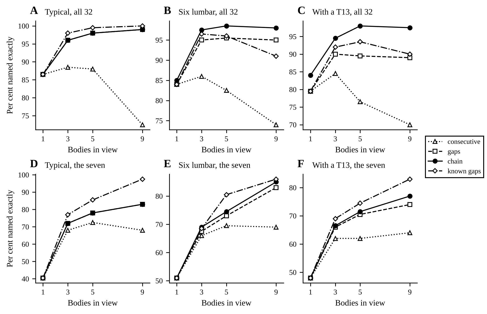

<!-- chain:main -->
| Column | Bodies | Measures | consecutive | gaps | chain | known gaps |
|---|---:|---|---:|---:|---:|---:|
| typical | 1 | seven | 40.5 (3.3) | 40.5 (3.3) | 40.5 (3.3) | 40.5 (3.3) |
| typical | 1 | all | 86.5 (2.2) | 86.5 (2.2) | 86.5 (2.2) | 86.5 (2.2) |
| typical | 3 | seven | 68.0 (3.5) | 72.0 (3.3) | 72.0 (3.3) | 77.0 (3.1) |
| typical | 3 | all | 88.5 (2.4) | 96.0 (1.5) | 96.0 (1.5) | 98.0 (1.0) |
| typical | 5 | seven | 72.5 (3.3) | 78.0 (3.2) | 78.0 (3.2) | 85.5 (2.5) |
| typical | 5 | all | 88.0 (2.1) | 98.0 (1.0) | 98.0 (1.0) | 99.5 (0.5) |
| typical | 9 | seven | 68.0 (3.4) | 83.0 (2.6) | 83.0 (2.6) | 97.5 (1.1) |
| typical | 9 | all | 72.5 (3.0) | 99.0 (0.7) | 99.0 (0.7) | 100.0 (0.0) |
| six-lumbar | 1 | seven | 51.0 (3.4) | 51.0 (3.4) | 51.0 (3.4) | 51.0 (3.4) |
| six-lumbar | 1 | all | 84.0 (2.6) | 84.0 (2.6) | 85.0 (2.5) | 84.0 (2.6) |
| six-lumbar | 3 | seven | 66.0 (3.5) | 67.5 (3.4) | 69.0 (3.3) | 68.5 (3.5) |
| six-lumbar | 3 | all | 86.0 (2.6) | 95.0 (1.5) | 97.5 (1.1) | 96.5 (1.3) |
| six-lumbar | 5 | seven | 69.5 (3.3) | 73.0 (3.0) | 74.5 (2.9) | 80.5 (2.8) |
| six-lumbar | 5 | all | 82.5 (2.7) | 95.5 (1.6) | 98.5 (0.9) | 96.0 (1.5) |
| six-lumbar | 9 | seven | 69.0 (3.2) | 83.0 (2.7) | 85.0 (2.6) | 86.0 (2.7) |
| six-lumbar | 9 | all | 74.0 (3.0) | 95.0 (1.5) | 98.0 (1.0) | 91.0 (2.1) |
| t13 | 1 | seven | 48.0 (3.7) | 48.0 (3.7) | 48.0 (3.7) | 48.0 (3.7) |
| t13 | 1 | all | 79.5 (2.9) | 79.5 (2.9) | 84.0 (2.7) | 79.5 (2.9) |
| t13 | 3 | seven | 62.0 (3.4) | 66.0 (3.3) | 66.5 (3.3) | 69.0 (3.1) |
| t13 | 3 | all | 84.5 (2.8) | 90.0 (2.4) | 94.5 (1.6) | 92.0 (2.2) |
| t13 | 5 | seven | 62.0 (3.5) | 70.5 (3.2) | 71.5 (3.1) | 74.5 (3.0) |
| t13 | 5 | all | 76.5 (3.1) | 89.5 (2.2) | 98.0 (1.0) | 93.5 (1.7) |
| t13 | 9 | seven | 64.0 (3.3) | 74.0 (3.1) | 77.0 (2.9) | 83.0 (2.9) |
| t13 | 9 | all | 70.0 (3.3) | 89.0 (2.2) | 97.5 (1.1) | 90.0 (2.1) |

Per cent of the middle bodies named exactly, of 200 fields a cell, two from each of 100 columns of the type; in brackets the standard error, clustered by column. On typical columns the gaps and the chain rules name the same share exactly at every width and measure set, so their lines lie on each other in the figure. At one body there is nothing to miss, and the consecutive, gaps and known gaps rules are one rule.
<!-- /chain:main -->

### The answers at 0.99

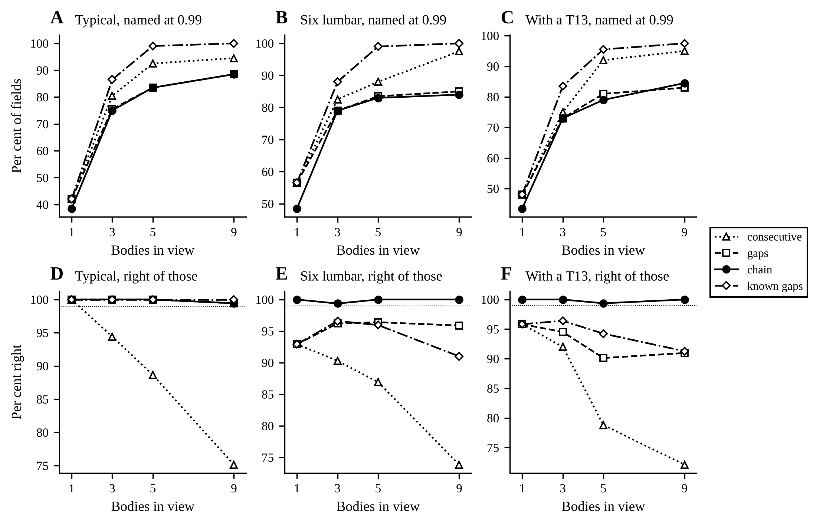

<!-- chain:claims -->
| Column | Bodies | consecutive: answered / right | gaps: answered / right | chain: answered / right | known gaps: answered / right |
|---|---:|---:|---:|---:|---:|
| typical | 1 | 42.0 / 100.00 (84 of 84) | 42.0 / 100.00 (84 of 84) | 38.5 / 100.00 (77 of 77) | 42.0 / 100.00 (84 of 84) |
| typical | 3 | 80.5 / 94.41 (152 of 161) | 75.5 / 100.00 (151 of 151) | 75.0 / 100.00 (150 of 150) | 86.5 / 100.00 (173 of 173) |
| typical | 5 | 92.5 / 88.65 (164 of 185) | 83.5 / 100.00 (167 of 167) | 83.5 / 100.00 (167 of 167) | 99.0 / 100.00 (198 of 198) |
| typical | 9 | 94.5 / 75.13 (142 of 189) | 88.5 / 99.44 (176 of 177) | 88.5 / 99.44 (176 of 177) | 100.0 / 100.00 (200 of 200) |
| six-lumbar | 1 | 56.5 / 92.92 (105 of 113) | 56.5 / 92.92 (105 of 113) | 48.5 / 100.00 (97 of 97) | 56.5 / 92.92 (105 of 113) |
| six-lumbar | 3 | 82.5 / 90.30 (149 of 165) | 79.0 / 96.20 (152 of 158) | 79.0 / 99.37 (157 of 158) | 88.0 / 96.59 (170 of 176) |
| six-lumbar | 5 | 88.0 / 86.93 (153 of 176) | 83.5 / 96.41 (161 of 167) | 83.0 / 100.00 (166 of 166) | 99.0 / 95.96 (190 of 198) |
| six-lumbar | 9 | 97.5 / 73.85 (144 of 195) | 85.0 / 95.88 (163 of 170) | 84.0 / 100.00 (168 of 168) | 100.0 / 91.00 (182 of 200) |
| t13 | 1 | 48.0 / 95.83 (92 of 96) | 48.0 / 95.83 (92 of 96) | 43.5 / 100.00 (87 of 87) | 48.0 / 95.83 (92 of 96) |
| t13 | 3 | 75.0 / 92.00 (138 of 150) | 73.0 / 94.52 (138 of 146) | 73.0 / 100.00 (146 of 146) | 83.5 / 96.41 (161 of 167) |
| t13 | 5 | 92.0 / 78.80 (145 of 184) | 81.0 / 90.12 (146 of 162) | 79.0 / 99.37 (157 of 158) | 95.5 / 94.24 (180 of 191) |
| t13 | 9 | 95.0 / 72.11 (137 of 190) | 83.0 / 90.96 (151 of 166) | 84.5 / 100.00 (169 of 169) | 97.5 / 91.28 (178 of 195) |

All 32 measures: the per cent of the 200 fields named at a posterior of 0.99, and the per cent of those right, with the count right of the count named. The figure draws a share right only where 50 fields or more were named.
<!-- /chain:claims -->

### The type weights

<!-- chain:weights -->
| Bodies | Measures | Weights | Six-lumbar, t13 | typical: exact / right at 0.99 | six-lumbar: exact / right at 0.99 | t13: exact / right at 0.99 |
|---:|---|---|---|---:|---:|---:|
| 1 | all | stated | 0.05, 0.05 | 86.5 (2.2) / 100.00 | 85.0 (2.5) / 100.00 | 84.0 (2.7) / 100.00 |
| 1 | all | papers, high | 0.02483, 0.02321 | 86.5 (2.2) / 100.00 | 84.5 (2.5) / 99.04 | 81.5 (2.9) / 100.00 |
| 1 | all | papers, low | 0.004515, 0.02321 | 86.5 (2.2) / 100.00 | 84.0 (2.6) / 95.37 | 81.5 (2.9) / 100.00 |
| 1 | seven | stated | 0.05, 0.05 | 40.5 (3.3) / - | 51.0 (3.4) / 100.00 | 48.0 (3.7) / 100.00 |
| 1 | seven | papers, high | 0.02483, 0.02321 | 40.5 (3.3) / - | 51.0 (3.4) / 100.00 | 48.0 (3.7) / 100.00 |
| 1 | seven | papers, low | 0.004515, 0.02321 | 40.5 (3.3) / - | 51.0 (3.4) / 100.00 | 48.0 (3.7) / 100.00 |
| 5 | all | stated | 0.05, 0.05 | 98.0 (1.0) / 100.00 | 98.5 (0.9) / 100.00 | 98.0 (1.0) / 99.37 |
| 5 | all | papers, high | 0.02483, 0.02321 | 98.0 (1.0) / 100.00 | 98.5 (0.9) / 100.00 | 98.0 (1.0) / 99.37 |
| 5 | all | papers, low | 0.004515, 0.02321 | 98.0 (1.0) / 100.00 | 98.5 (0.9) / 100.00 | 98.0 (1.0) / 99.37 |
| 5 | seven | stated | 0.05, 0.05 | 78.0 (3.2) / 100.00 | 74.5 (2.9) / 100.00 | 71.5 (3.1) / 100.00 |
| 5 | seven | papers, high | 0.02483, 0.02321 | 77.5 (3.2) / 100.00 | 74.0 (2.9) / 100.00 | 71.0 (3.1) / 100.00 |
| 5 | seven | papers, low | 0.004515, 0.02321 | 78.0 (3.2) / 100.00 | 73.5 (3.0) / 100.00 | 71.0 (3.1) / 100.00 |
| 9 | all | stated | 0.05, 0.05 | 99.0 (0.7) / 99.44 | 98.0 (1.0) / 100.00 | 97.5 (1.1) / 100.00 |
| 9 | all | papers, high | 0.02483, 0.02321 | 99.0 (0.7) / 99.44 | 98.0 (1.0) / 100.00 | 97.5 (1.1) / 100.00 |
| 9 | all | papers, low | 0.004515, 0.02321 | 99.0 (0.7) / 99.44 | 98.0 (1.0) / 100.00 | 97.5 (1.1) / 100.00 |
| 9 | seven | stated | 0.05, 0.05 | 83.0 (2.6) / 96.97 | 85.0 (2.6) / 100.00 | 77.0 (2.9) / 100.00 |
| 9 | seven | papers, high | 0.02483, 0.02321 | 83.0 (2.6) / 97.22 | 85.5 (2.6) / 97.37 | 76.0 (3.1) / 100.00 |
| 9 | seven | papers, low | 0.004515, 0.02321 | 83.0 (2.6) / 97.22 | 85.0 (2.6) / 97.37 | 76.0 (3.1) / 100.00 |

The chain at its stated weights and at the papers' (chain_study.WEIGHT_SETS), on the same fields: the per cent named exactly (standard error, clustered by column) and the per cent of the answers at 0.99 that are right. The typical type's weight is the rest, 0.9, 0.9520 and 0.9723; each paper's weight is its count over its people, 11 and 2 of 443 and 12 of 517.
<!-- /chain:weights -->

### Tables from fewer people

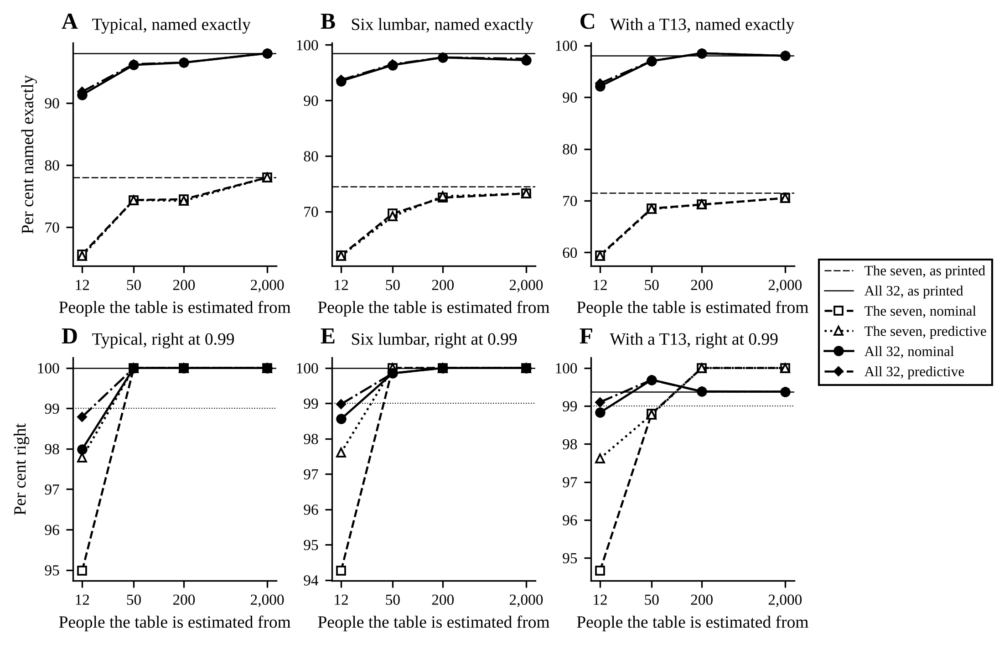

All 32 measures, five bodies:

<!-- chain:axis-5 -->
| People | Rule | Tables | Chain, typical | Chain, six-lumbar | Chain, t13 | Chain, right at 0.99 (typical / six-lumbar / t13) | Consecutive, typical |
|---:|---|---:|---:|---:|---:|---:|---:|
| as printed | - | 1 | 98.0 (1.0) | 98.5 (0.9) | 98.0 (1.0) | 100.00 / 100.00 / 99.37 | 88.0 (2.1) |
| 12 | nominal | 8 | 91.3 (1.1 / 1.2), -6.7 | 93.5 (1.1 / 1.1), -5.0 | 92.1 (1.0 / 1.0), -5.9 | 97.99 / 98.56 / 98.83 | 83.8 (2.0 / 2.0), -4.2 |
| 12 | predictive | 8 | 91.8 (1.1 / 1.1), -6.2 | 93.7 (1.0 / 1.1), -4.8 | 92.7 (1.0 / 1.0), -5.3 | 98.79 / 98.98 / 99.10 | 84.0 (2.0 / 2.0), -4.0 |
| 50 | nominal | 4 | 96.1 (1.0 / 1.0), -1.9 | 96.4 (1.0 / 1.0), -2.1 | 97.0 (0.9 / 0.9), -1.0 | 100.00 / 99.85 / 99.69 | 86.8 (2.1 / 2.1), -1.2 |
| 50 | predictive | 4 | 96.2 (1.0 / 1.0), -1.7 | 96.5 (0.9 / 0.9), -2.0 | 97.0 (0.9 / 0.9), -1.0 | 100.00 / 99.85 / 99.69 | 86.8 (2.1 / 2.1), -1.2 |
| 200 | nominal | 2 | 96.5 (1.1 / 1.4), -1.5 | 97.8 (0.9 / 1.1), -0.7 | 98.5 (0.8 / 0.8), +0.5 | 100.00 / 100.00 / 99.38 | 86.8 (2.2 / 2.3), -1.2 |
| 200 | predictive | 2 | 96.5 (1.1 / 1.4), -1.5 | 97.8 (0.9 / 1.1), -0.7 | 98.5 (0.8 / 0.8), +0.5 | 100.00 / 100.00 / 99.38 | 86.8 (2.2 / 2.3), -1.2 |
| 2,000 | nominal | 2 | 98.0 (1.0 / 1.0), +0.0 | 97.2 (1.1 / 1.1), -1.2 | 98.0 (1.0 / 1.0), +0.0 | 100.00 / 100.00 / 99.38 | 87.8 (2.1 / 2.1), -0.3 |
| 2,000 | predictive | 2 | 98.0 (1.0 / 1.0), +0.0 | 97.5 (1.0 / 1.1), -1.0 | 98.0 (1.0 / 1.0), +0.0 | 100.00 / 100.00 / 99.38 | 87.8 (2.1 / 2.1), -0.3 |

Per cent of the 200 five-body fields of each type named exactly by the chain with all 32 measures, on tables re-estimated from that many people and pooled over the tables; in brackets the standard error clustered by column with the tables held fixed / counting the variation between tables too, on one degree of freedom fewer than the tables; then the difference from the table as printed on the same fields. Right at 0.99 is the per cent of the chain's answers at 0.99 that are right on each type, and the last column step d's consecutive rule on the typical fields, on the same tables. The people are drawn with no size spread, no measurement error and no floor (curve.WORLDS).
<!-- /chain:axis-5 -->

The seven, five bodies:

<!-- chain:axis-5-seven -->
| People | Rule | Tables | Chain, typical | Chain, six-lumbar | Chain, t13 | Chain, right at 0.99 (typical / six-lumbar / t13) | Consecutive, typical |
|---:|---|---:|---:|---:|---:|---:|---:|
| as printed | - | 1 | 78.0 (3.2) | 74.5 (2.9) | 71.5 (3.1) | 100.00 / 100.00 / 100.00 | 72.5 (3.3) |
| 12 | nominal | 8 | 65.6 (2.2 / 2.3), -12.4 | 62.1 (2.1 / 2.1), -12.4 | 59.4 (2.5 / 2.6), -12.1 | 94.98 / 94.27 / 94.66 | 62.5 (2.3 / 2.5), -10.0 |
| 12 | predictive | 8 | 65.4 (2.2 / 2.2), -12.6 | 62.0 (2.2 / 2.2), -12.5 | 59.3 (2.4 / 2.4), -12.2 | 97.79 / 97.61 / 97.62 | 62.4 (2.4 / 2.7), -10.1 |
| 50 | nominal | 4 | 74.4 (2.7 / 3.0), -3.6 | 69.6 (2.5 / 2.5), -4.9 | 68.5 (2.8 / 3.0), -3.0 | 100.00 / 100.00 / 98.80 | 68.6 (2.9 / 3.6), -3.9 |
| 50 | predictive | 4 | 74.4 (2.6 / 2.9), -3.6 | 69.1 (2.5 / 2.5), -5.4 | 68.4 (2.8 / 3.0), -3.1 | 100.00 / 100.00 / 98.77 | 68.8 (2.9 / 3.6), -3.7 |
| 200 | nominal | 2 | 74.5 (3.1 / 3.3), -3.5 | 72.5 (2.8 / 3.0), -2.0 | 69.2 (3.0 / 3.0), -2.2 | 100.00 / 100.00 / 100.00 | 70.8 (3.1 / 3.1), -1.7 |
| 200 | predictive | 2 | 74.2 (3.1 / 3.2), -3.7 | 72.8 (2.8 / 2.9), -1.7 | 69.2 (3.0 / 3.0), -2.2 | 100.00 / 100.00 / 100.00 | 70.8 (3.1 / 3.1), -1.7 |
| 2,000 | nominal | 2 | 78.0 (3.2 / 3.2), +0.0 | 73.2 (2.9 / 2.9), -1.2 | 70.5 (3.1 / 3.1), -1.0 | 100.00 / 100.00 / 100.00 | 72.2 (3.3 / 3.3), -0.2 |
| 2,000 | predictive | 2 | 78.0 (3.2 / 3.2), +0.0 | 73.2 (2.9 / 2.9), -1.2 | 70.5 (3.1 / 3.1), -1.0 | 100.00 / 100.00 / 100.00 | 72.2 (3.3 / 3.3), -0.2 |

The same, with the seven SPINEPS measures.
<!-- /chain:axis-5-seven -->

### Time to name a field

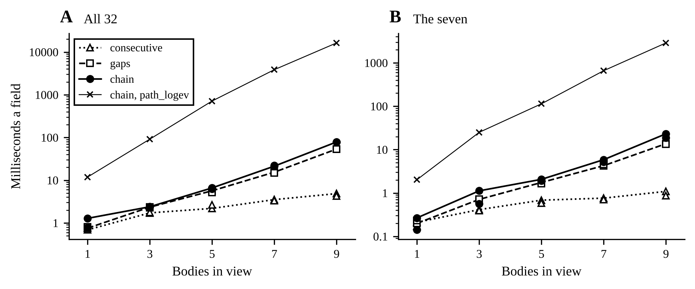

<!-- chain:speed -->
| Bodies | Paths, chain | consecutive, all 32 | consecutive, seven | gaps, all 32 | gaps, seven | chain, all 32 | chain, seven | chain, all 32, path_logev |
|---:|---:|---:|---:|---:|---:|---:|---:|---:|
| 1 | 24 | 0.688 / 3.42; 0.759 | 0.212 / 0.303; 0.17 | 0.753 / 0.986; 0.814 | 0.199 / 0.328; 0.232 | 1.28 / 2.06; 0.775 | 0.267 / 0.492; 0.141 | 11.8 / 12.3; 5.76 |
| 3 | 92 | 1.72 / 3.36; 1.76 | 0.414 / 0.517; 0.394 | 2.34 / 2.95; 2.29 | 0.712 / 0.969; 0.719 | 2.39 / 2.88; 2.34 | 1.12 / 1.85; 0.565 | 91.4 / 112; 26.1 |
| 5 | 339 | 2.19 / 2.67; 2.63 | 0.683 / 0.853; 0.583 | 5.66 / 7.35; 5.17 | 1.75 / 2.25; 1.65 | 6.6 / 8.51; 6.29 | 2.06 / 5.52; 1.92 | 713 / 1,203; 117 |
| 7 | 1,166 | 3.51 / 4.7; 3.33 | 0.76 / 1.58; 0.707 | 15.4 / 19.5; 14.7 | 4.27 / 5.3; 4.53 | 21.3 / 31.3; 21.9 | 5.86 / 13.8; 5.24 | 3,865 / 4,219; 552 |
| 9 | 3,896 | 4.86 / 6.34; 4.25 | 1.09 / 1.35; 0.873 | 53.6 / 55.4; 53.8 | 13.7 / 32.5; 13.3 | 78.6 / 104; 77.8 | 23.1 / 33.8; 18.6 | 16,363 / 16,484; 1,958 |

Milliseconds to name one field on the typical fields of `run`'s seeds, each rule built beforehand for its own measures: alone, the median / the largest of 30 single fields; then per field in a batch of 128, the median of 5 calls after one that warms them; chain.path_logev on 3 single fields and 2 batches of 16. Every thread pool was at one thread inside the limit (libscipy_openblas64_-f48b354e.so, libscipy_openblas-5f890258.so), the chain's loops compiled before it was set. Timed on Linux-6.18.44-fc-v185-x86_64-with-glibc2.39 with 4 CPUs, load average 1.00 / 1.48 / 2.54 at the end; Python 3.12.3, numpy 2.5.4, scipy 1.18.1, PyTensor 3.3.4, PyMC 6.3.2, Numba 0.68.0.
<!-- /chain:speed -->

### The PyMC models against the exact answer

`pymc` samples each PyMC model by NUTS on fields of `run`'s, one field at a time as a service would name a field (each its own model and its own `pm.sample`), and sets the model's posterior over the middle body's 24 names against the exact answer on the same field: at three bodies, the first field of each of the first six columns of each type, 36 fields a model, with each measure set as a rule of its own measures. Model (b), the closed form with the paths summed out, samples log s alone and gives each name's probability given it; model (a) samples log s and an offset for every measure, the chain summed by pymc-extras' forward algorithm. Four chains of 500 draws after 500 tuning steps, seed 701, PyMC's default start, and each model's posterior the mean over the draws of each name's probability given them, its Monte Carlo error by batch means, ten batches a chain. Sampled together, the six fields of a cell made NUTS take trees of depth 8, 255 leapfrog steps a draw, in a trial before the record, where one field alone takes 2 to 7, so each field is sampled alone.

<!-- chain:pymc -->
| Column | Bodies | Measures | Model | Fields within | Same name | Largest gap (MC error) | Gap in MC errors, above 0.05 (fields) | Largest R-hat | Steps a draw | Divergences | Seconds a field |
|---|---:|---|---|---:|---:|---:|---:|---:|---:|---:|---:|
| typical | 3 | seven | enumerated | 6 of 6 | 6 of 6 | 0.0055 (0.0044) | 1.3 (6) | 1.015 | 2.2 | 0 | 6.47 |
| typical | 3 | seven | sampled | 6 of 6 | 6 of 6 | 0.0152 (0.0103) | 1.5 (6) | 1.006 | 6.1 | 0 | 75 |
| typical | 3 | all | enumerated | 6 of 6 | 6 of 6 | 0.2500 (0.0693) | 3.6 (3) | 1.542 | 2.2 | 0 | 15.1 |
| typical | 3 | all | sampled | 6 of 6 | 6 of 6 | 0.0031 (0.0092) | 1.1 (2) | 1.012 | 7.0 | 0 | 112 |
| six-lumbar | 3 | seven | enumerated | 6 of 6 | 6 of 6 | 0.0036 (0.0016) | 2.3 (4) | 1.006 | 2.1 | 0 | 6.3 |
| six-lumbar | 3 | seven | sampled | 6 of 6 | 6 of 6 | 0.0051 (0.0040) | 1.6 (4) | 1.007 | 5.7 | 0 | 68.6 |
| six-lumbar | 3 | all | enumerated | 6 of 6 | 6 of 6 | 0.0000 (0.0000) | 0.9 (1) | 1.011 | 2.1 | 0 | 15.3 |
| six-lumbar | 3 | all | sampled | 6 of 6 | 6 of 6 | 0.0000 (0.0000) | 3.5 (1) | 1.011 | 7.0 | 0 | 119 |
| t13 | 3 | seven | enumerated | 6 of 6 | 6 of 6 | 0.0077 (0.0028) | 2.8 (6) | 1.005 | 2.2 | 0 | 6.62 |
| t13 | 3 | seven | sampled | 6 of 6 | 6 of 6 | 0.0183 (0.0072) | 2.6 (6) | 1.006 | 6.0 | 0 | 69.9 |
| t13 | 3 | all | enumerated | 6 of 6 | 6 of 6 | 0.0041 (0.0038) | 2.9 (5) | 1.006 | 2.1 | 0 | 14.5 |
| t13 | 3 | all | sampled | 6 of 6 | 6 of 6 | 0.0096 (0.0072) | 1.6 (5) | 1.013 | 7.0 | 0 | 112 |

Fields within are those whose every name is within five Monte Carlo errors plus 0.001 of the exact posterior, as the naming model's NUTS test holds it, and same name those whose likeliest name is the exact rule's. The largest gap is over the fields and names, with its Monte Carlo error; the gap in Monte Carlo errors is the largest at a name the exact posterior puts above 0.05, over the fields where the model differs from the exact answer by 1e-6 or more somewhere (in brackets how many; on the others both differ by rounding alone). R-hat is the largest of log s's and, for model (a), the offsets'. The seconds are NUTS's own a field, the mean of six, with three processes on 4 CPUs.
<!-- /chain:pymc -->

- **Both models name all 36 of their fields as the exact rule names them, and come within 0.02 of its posterior at every name but on one field.** Model (b) is within 0.008 of the exact posterior at every name on 35 of its 36 fields, model (a) within 0.019 on all 36, with no divergence in either.
- **On that field one chain of four sat in a mode the exact posterior gives no weight, and R-hat said so where the error did not.** On the fifth typical field with all 32 measures (column 4, a T1 in the middle), one of model (b)'s four chains stayed at log s -0.34 from its start to its end, while the other three sat at 0.03; the prior SD of log s is 0.07, so that chain sat almost five SDs out, where the field reads as another path, and it gave the true name almost none of its weight, so the model's posterior for the T1 is 0.750 where the exact one is 1.000. R-hat is 1.54 there, every other field's 1.015 or less, yet the field counts as within, since the stuck chain made the batch-means error 0.069 (made again with the same seed outside the record, its four chains' means of log s are -0.341, 0.030, 0.028 and 0.033). PyMC's default start moves every variable by up to 1 on its own scale (`jitter+adapt_diag`), as much as 14 SDs of log s, and in its 1,000 steps NUTS on log s alone did not cross from that mode to the one that holds the mass. So a model that samples the size is read with its R-hat as well as against the exact answer, and the exact rule, which integrates the size on fixed nodes, has no such failure.
- **NUTS takes seconds where the exact rule takes milliseconds.** Model (b) takes 6.3 to 6.6 s of NUTS a field with the seven and 14.5 to 15.3 s with all 32, about 2 leapfrog steps a draw; model (a), which samples an offset for each measure, 68.6 to 75.0 s and 111.8 to 119.1 s, 6 to 7 steps a draw. The exact rule names the same three-body fields in 1.12 and 2.39 ms (Time to name a field). Only three bodies and six fields a cell are sampled; the models' agreement at other widths is the tests' (model (b)'s density given the size equal to the exact answer's within 1e-10), not this record's.

## The fixed-k NUTS review

Item 2 of the owner's queue of 27 October 2026, 09:44 UTC, the review of a fixed-k NUTS workflow (TODO.md quotes its prompt word for word), given to the thread finishing the chain on 28 October 2026 at 23:03 UTC and done on 29 October. The prompt asks two things: whether fixing every body's level, k, and sampling the continuous rest with NUTS is a correct way to use NUTS and ArviZ's diagnostics while the model is built; and what goes wrong when the level is later sampled, with the proper way to handle it in a model that names. [fixed_k.py](fixed_k.py) answers both with runs, on schwingcheck's own models, each held to an exact answer; its docstring states each model and each rule it takes.

```
python -m schwingcheck.fixed_k run        # records/fixed-k-2026-10-29/fixed_k.json and the known runs' draws
python -m schwingcheck.fixed_k table --table known|free|sharp|tail|spread|categorical
python -m schwingcheck.fixed_k figures    # the figures and FIGURES.md, into records/fixed-k-2026-10-29/figures/
python -m schwingcheck.fixed_k check      # whether this README carries the record's tables
```

**The models.** One model in four states, on synthetic typical columns: known, every body's level fixed (model.fixed_level), NUTS on the patients' sizes, their offsets and beta_height, read by az.summary, az.plot_trace and az.plot_forest as they stand, and held to the posterior of log s in closed form, integrated on a grid; free, the same model for one field with its place, the level of its first body, a Categorical with a uniform prior, sampled by PyMC's compound step, NUTS on the size and the offsets and CategoricalGibbsMetropolis on the place, with its default proposal, uniform over the other places, and with its proportional one; marginal, the place summed out by pymc-extras' marginalize, NUTS on the size and the offsets alone, and the place given back afterwards, its share the average over the draws of its conditional probability; and exact, rule.py's posterior over the places, the truth the others are held to. Beside them the two proposals on a Categorical alone, its probabilities fixed, and the stationary law of each proposal's transition matrix written out (proposal_kernel).

**The fields.** Forty typical columns drawn by curve.draw_pool, seeds 1101 and 1201, every measure of the pool for the same patients and cut to the seven SPINEPS measures where a table says so. The known runs take 8 three-body fields, once with the seven and once with all 32; the free runs the fields whose second place is likeliest, if it holds 0.1 or more, three-body fields with the seven and five-body fields with all 32, of which one passes; the sharp runs 4 nine-body fields with all 32, drawn at random, every one's place all but certain; and the tail the README's example field ([The naming model](#the-naming-model)) and the two three-body fields with the seven that put the most places between 1e-6 and 0.001.

**The record.** fixed_k.json in [records/fixed-k-2026-10-29/](../records/fixed-k-2026-10-29/figures/FIGURES.md), with the known runs' draws as known-seven.nc and known-all.nc beside it, the command, the seeds, the machine, the versions, the digests and the git state taken when it began (`made_by`), was made from commit 3db7307 on 29 October 2026, on a cloud machine with 4 CPUs in Python 3.12.3 with PyMC 6.3.2, pymc-extras 0.15.1 and ArviZ 1.3.0, in 14 minutes while another job ran; nothing changed while it ran. NUTS took four chains of 1,000 draws after 1,000 tuning steps, seed 7, and the errors are by batch means, ten batches a chain, unless a table says otherwise.

Every number below comes from synthetic columns drawn from Panjabi's tables, where the generator is the truth; nothing here is a patient.

### What it found

- **Fixing the level is the right way to check the continuous part, and the check passes.** With every level known, NUTS gives log s the closed form's posterior on all 16 fields: every mean and every SD within 1.9 Monte Carlo errors of the closed form's, R-hat 1.002 at most, a bulk effective sample size of 2,941 to 6,698 from 4,000 draws, and no divergence, at 7.0 leapfrog steps a draw with the seven and 14.6 with all 32, 6.9 and 16.0 s for the 8 fields together. ArviZ reads the draws as they stand, and the trace and the forest below are its own plots of them. It checks what it can see: beta_height comes back as its prior, 0.999 with an SD of 0.51, since no field's height is known, so these fields test the size and the offsets and not the height's coefficient.
- **NUTS cannot move the level, and PyMC's default Metropolis step on it hardly moves.** With the place free, the uniform proposal offers a place the field gives almost nothing nearly every time, so the place changes in 0.15% to 2.9% of draws and each chain sits at one place for hundreds of them: on the third field with the seven the four chains put 0.72, 0.32, 0.82 and 1.00 of their draws at the top place, the share is 0.714 where the exact posterior gives 0.519, R-hat 1.314 and log s's effective sample size 23 from 4,000. R-hat flags it on that field and on the five-body one (1.157), and not on the first (1.006), whose four chains still differ by 0.12.
- **PyMC's proportional proposal mixes and is wrong, its chains agreeing.** It changes the place in 41% to 97% of draws with R-hat 1.001 at most, and its share is 3 to 37 Monte Carlo errors off the exact posterior on every field: 0.593 at the five-body field's top place, which the exact posterior gives 0.890. It is not Liu's Metropolised Gibbs, though it proposes as Liu's does: PyMC 6.3.2 renormalises the other places' probabilities over themselves and accepts the proposed place with one less the current place's probability over one less the proposed place's renormalised probability, where Liu's takes the proposed place's whole probability. On a Categorical alone the chains sample the stationary law of PyMC's own kernel and not the place's: 0.479, 0.411 and 0.110 where the probabilities are 0.6, 0.3 and 0.1 and the kernel's law is 0.480, 0.408 and 0.112, while Liu's ratio leaves each of the four laws stationary. On two places the proposal is the other place for certain and its ratio's denominator is zero or a rounding error, so the chain never moves, at 0.5 and 0.5, or moves at every draw, at 0.89 and 0.11, where it gives each place half. The step with Liu's acceptance is in [categorical.py](categorical.py) ([The corrected step](#the-corrected-step)).
- **Where the place is all but certain, the proportional step stops.** On all four nine-body fields with all 32, where the exact posterior gives the true place 1.000000, it divides by one less that place's probability, which is 0 in floating point, and stops with NaN on three and with probabilities that do not sum to one on the fourth. The uniform step never moves there and is right, within 4e-22 of the exact posterior.
- **Summing the place out is the proper way, and it is not the whole of it.** With the place summed out and given back as the average of its conditional over the draws, the share is within 0.001 to 0.010 of the exact posterior on the three fields with the seven, R-hat 1.005 at most. On the five-body field with all 32 one chain of four took the bodies for L1 to L5, where the exact posterior gives them 9e-53, so the share at the top place is 0.668 where it is 0.890, R-hat 1.825 at the place and 1.53 at log s. That is the stuck chain of the chain of levels again ([The PyMC models against the exact answer](#the-pymc-models-against-the-exact-answer)): the size sampled by NUTS alone can sit in a far mode, and a five-error bound passes the field, since that chain inflates the error to 0.062, where R-hat does not. So in production the level is summed out exactly and never sampled, as rule.py, the naming model and the chain do; the size is integrated on fixed nodes where the model allows, as the exact rule does, and wherever it is sampled the answer is held to the exact rule field by field and read with its R-hat; and the level is given back afterwards, by recover() or by the average of its conditional.
- **The far tail runs low mostly from the estimator, and NUTS makes it lower.** At the places whose exact posterior is between 1e-6 and 0.001, the naming model's estimate, the average over the draws of the place's probability given the size, runs low on most runs whether its draws of log s come from NUTS or are drawn independently from the exact posterior of log s: the median estimate over the exact one is 0.948 and 0.965 on the example field, 0.863 and 0.984 on the second field, and 0.406 and 0.850 on the third, while the mean over the runs is 0.97 to 1.04 for both. A far place's mass lies on a sliver of the size's posterior: on the example field T6, at 6.35e-6, has 90% of its mass on 0.013% of the size's posterior, so an estimate within 10 per cent takes about 3.5 million independent draws, and most runs of 8,000 miss the sliver and run low while a few reach it and run high. NUTS's draws are correlated, fewer in effect, and so run lower still where the sliver is far out (0.406 against 0.850). Ten times as many NUTS draws bring the median to 0.987, 0.981 and 0.792. The exact rule, which integrates the size on nodes, has neither failure.

### The level known

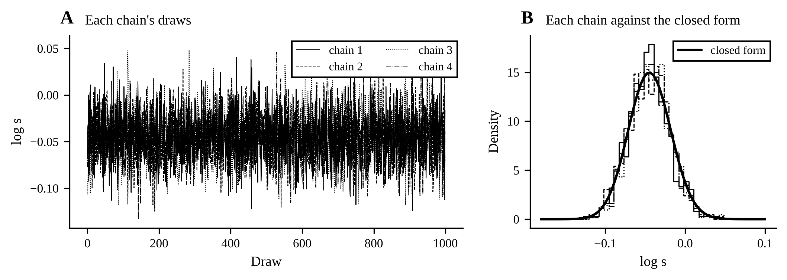

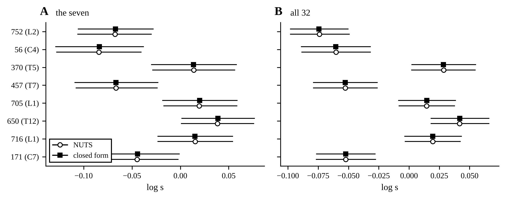

<!-- fixed_k:known -->
| Measures | Field (place) | NUTS: mean, SD | Closed form: mean, SD | NUTS: 89% interval | Closed form: 89% interval | Mean off, MC errors | SD off, MC errors | ESS bulk | R-hat |
|---|---|---:|---:|---:|---:|---:|---:|---:|---:|
| the seven, 3 bodies | 171 (C7) | -0.0447, 0.0260 | -0.0443, 0.0267 | -0.0854 to -0.0024 | -0.0886 to -0.0034 | -1.0 | -1.6 | 3732 | 1.001 |
| the seven, 3 bodies | 716 (L1) | 0.0154, 0.0243 | 0.0151, 0.0241 | -0.0233 to 0.0541 | -0.0252 to 0.0519 | +0.8 | +0.6 | 3024 | 1.002 |
| the seven, 3 bodies | 650 (T12) | 0.0383, 0.0238 | 0.0388, 0.0234 | 0.0010 to 0.0758 | -0.0003 to 0.0746 | -1.1 | +1.3 | 3103 | 1.000 |
| the seven, 3 bodies | 705 (L1) | 0.0196, 0.0239 | 0.0199, 0.0240 | -0.0169 to 0.0586 | -0.0201 to 0.0567 | -0.7 | -0.4 | 3022 | 1.000 |
| the seven, 3 bodies | 457 (T7) | -0.0666, 0.0269 | -0.0665, 0.0267 | -0.1079 to -0.0239 | -0.1109 to -0.0254 | -0.2 | +0.4 | 3882 | 1.002 |
| the seven, 3 bodies | 370 (T5) | 0.0138, 0.0274 | 0.0137, 0.0274 | -0.0285 to 0.0564 | -0.0316 to 0.0558 | +0.2 | +0.1 | 2986 | 1.000 |
| the seven, 3 bodies | 56 (C4) | -0.0843, 0.0276 | -0.0837, 0.0283 | -0.1279 to -0.0406 | -0.1307 to -0.0403 | -1.2 | -1.8 | 3698 | 1.000 |
| the seven, 3 bodies | 752 (L2) | -0.0676, 0.0236 | -0.0671, 0.0242 | -0.1061 to -0.0300 | -0.1074 to -0.0300 | -1.3 | -1.9 | 2941 | 1.001 |
| all 32, 3 bodies | 171 (C7) | -0.0523, 0.0153 | -0.0522, 0.0150 | -0.0765 to -0.0277 | -0.0782 to -0.0300 | -0.1 | +1.3 | 6605 | 1.001 |
| all 32, 3 bodies | 716 (L1) | 0.0197, 0.0143 | 0.0196, 0.0145 | -0.0032 to 0.0424 | -0.0055 to 0.0410 | +0.2 | -0.7 | 5238 | 1.000 |
| all 32, 3 bodies | 650 (T12) | 0.0418, 0.0150 | 0.0420, 0.0147 | 0.0182 to 0.0659 | 0.0165 to 0.0637 | -1.0 | +1.0 | 6323 | 1.000 |
| all 32, 3 bodies | 705 (L1) | 0.0144, 0.0145 | 0.0147, 0.0145 | -0.0082 to 0.0377 | -0.0105 to 0.0360 | -1.5 | -0.3 | 5978 | 1.002 |
| all 32, 3 bodies | 457 (T7) | -0.0527, 0.0165 | -0.0527, 0.0163 | -0.0788 to -0.0262 | -0.0805 to -0.0285 | -0.2 | +1.1 | 6698 | 1.001 |
| all 32, 3 bodies | 370 (T5) | 0.0285, 0.0164 | 0.0285, 0.0163 | 0.0022 to 0.0545 | 0.0006 to 0.0527 | +0.3 | +0.3 | 5659 | 1.002 |
| all 32, 3 bodies | 56 (C4) | -0.0603, 0.0178 | -0.0604, 0.0177 | -0.0884 to -0.0320 | -0.0907 to -0.0339 | +0.4 | +0.2 | 6140 | 1.000 |
| all 32, 3 bodies | 752 (L2) | -0.0740, 0.0150 | -0.0743, 0.0147 | -0.0978 to -0.0493 | -0.0996 to -0.0527 | +1.9 | +1.6 | 6382 | 1.000 |

log s of each field, every level known (model.fixed_level), NUTS with 4 chains of 1000 draws after 1000 tuning steps, seed 7, as az.summary(kind="stats") and az.summary(kind="diagnostics") give it; the closed form is the posterior of log s given the levels, integrated on a grid. the seven, 3 bodies: 6.9 s of NUTS for the 8 fields together, 7.0 leapfrog steps a draw, 0 divergences; beta_height 0.999 (SD 0.510), its prior, since no field's height is known. all 32, 3 bodies: 16.0 s of NUTS for the 8 fields together, 14.6 leapfrog steps a draw, 0 divergences; beta_height 0.999 (SD 0.511), its prior, since no field's height is known.
<!-- /fixed_k:known -->

### The level free

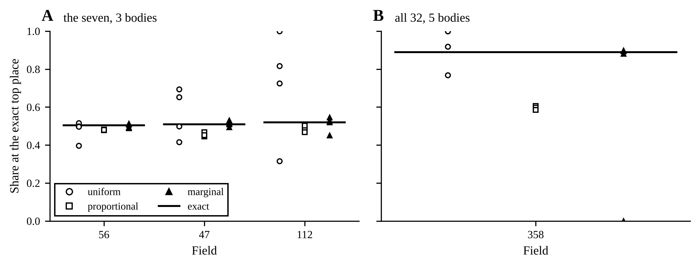

<!-- fixed_k:free -->
| Measures | Field (truth): exact | Sampler | Share at the top place (MC error) | Each chain's share | Largest gap | Place changes a draw | ESS, top place | R-hat, top place | az.summary: place mean (R-hat) | ESS, log s | Seconds |
|---|---|---|---:|---|---:|---:|---:|---:|---:|---:|---:|
| the seven, 3 bodies | 56 (C4): C3 0.503, C4 0.493 | uniform | 0.478 (0.038), counted | 0.52 0.40 0.50 0.50 | 0.026 | 0.029 | 144 | 1.006 | 0.53 (1.01) | 2090 | 5.3 |
| the seven, 3 bodies | 56 (C4): C3 0.503, C4 0.493 | proportional | 0.480 (0.002), counted | 0.48 0.48 0.48 0.48 | 0.023 | 0.965 | 1.44e+04 | 0.999 | 0.53 (1.00) | 3206 | 7.7 |
| the seven, 3 bodies | 56 (C4): C3 0.503, C4 0.493 | marginal | 0.503 (0.005), averaged | 0.49 0.51 0.49 0.51 | 0.001 | 0.495 | 3.67e+03 | 1.000 | 0.50 (1.00) | 3294 | 5.9 |
| the seven, 3 bodies | 47 (C4): C5 0.510, C4 0.486 | uniform | 0.566 (0.057), counted | 0.65 0.42 0.69 0.50 | 0.055 | 0.014 | 63.7 | 1.071 | 1.57 (1.07) | 234 | 5.4 |
| the seven, 3 bodies | 47 (C4): C5 0.510, C4 0.486 | proportional | 0.453 (0.005), counted | 0.47 0.45 0.45 0.45 | 0.057 | 0.776 | 1.06e+04 | 1.000 | 1.42 (1.00) | 3289 | 8.0 |
| the seven, 3 bodies | 47 (C4): C5 0.510, C4 0.486 | marginal | 0.509 (0.006), averaged | 0.49 0.51 0.51 0.53 | 0.001 | 0.491 | 3.8e+03 | 1.000 | 1.51 (1.00) | 3777 | 5.0 |
| the seven, 3 bodies | 112 (C5): C5 0.519, C3 0.481 | uniform | 0.714 (0.067), counted | 0.72 0.32 0.82 1.00 | 0.195 | 0.002 | 10.5 | 1.314 | 1.43 (1.31) | 23 | 5.6 |
| the seven, 3 bodies | 112 (C5): C5 0.519, C3 0.481 | proportional | 0.488 (0.010), counted | 0.50 0.48 0.47 0.50 | 0.031 | 0.411 | 2.97e+03 | 1.001 | 0.98 (1.00) | 2470 | 7.3 |
| the seven, 3 bodies | 112 (C5): C5 0.519, C3 0.481 | marginal | 0.509 (0.015), averaged | 0.53 0.45 0.52 0.55 | 0.010 | 0.187 | 771 | 1.005 | 1.02 (1.01) | 1104 | 5.6 |
| all 32, 5 bodies | 358 (T4): T4 0.890, T5 0.110 | uniform | 0.922 (0.037), counted | 1.00 1.00 0.92 0.77 | 0.032 | 0.002 | 18.9 | 1.157 | 8.08 (1.16) | 104 | 7.2 |
| all 32, 5 bodies | 358 (T4): T4 0.890, T5 0.110 | proportional | 0.593 (0.008), counted | 0.61 0.60 0.58 0.58 | 0.296 | 0.532 | 4.15e+03 | 1.000 | 8.35 (1.00) | 2298 | 10.9 |
| all 32, 5 bodies | 358 (T4): T4 0.890, T5 0.110 | marginal | 0.668 (0.062), averaged | 0.00 0.88 0.90 0.89 | 0.250 | 0.074 | 5.86 | 1.825 | 10.33 (2.76) | 7 | 14.0 |

One field, its place free (free_level): uniform and proportional are NUTS on log s and the offsets with CategoricalGibbsMetropolis on the place, PyMC's default proposal and the proportional one, which proposes another place by its conditional probability; marginal is the place summed out by pymc-extras, NUTS alone, the share the average of the place's conditional over the draws. 4 chains of 1000 draws after 1000 tuning steps, seed 7; errors by batch means, 10 batches a chain.
<!-- /fixed_k:free -->

<!-- fixed_k:sharp -->
| Field (truth) | Exact: place (posterior) | uniform: largest gap, place changes | proportional | marginal: largest gap |
|---|---|---:|---|---:|
| 211 (T1) | T1 (1.000000) | 1.1e-28, 0.000 | stopped: Probabilities contain NaN | 3.64e-29 |
| 29 (C3) | C3 (1.000000) | 7e-50, 0.000 | stopped: Probabilities contain NaN | 6.89e-50 |
| 489 (T8) | T8 (1.000000) | 3.88e-28, 0.000 | stopped: Probabilities contain NaN | 3.83e-28 |
| 303 (T3) | T3 (1.000000) | 3.7e-22, 0.000 | stopped: Probabilities do not sum to 1. See Notes section of docstring for more information. | 2.2e-22 |

All 32 measures at 9 bodies, fields drawn at random: the place all but certain. The proportional proposal divides the other places' probabilities by one less the current place's, which in floating point is 0, giving NaN, or a rounding error far above what the other places hold, giving probabilities that do not sum to one.
<!-- /fixed_k:sharp -->

### The proposal on a bare place

<!-- fixed_k:categorical -->
| Probabilities | Proposal | Share at each place (MC error) | Each chain's share at the first place | Place changes a draw | Stationary: PyMC's kernel | Stationary: Liu's |
|---|---|---|---|---:|---|---|
| 0.89, 0.11 | uniform | 0.888 (0.002), 0.112 (0.002) | 0.88 0.89 0.89 0.89 | 0.224 | 0.890, 0.110 | 0.890, 0.110 |
| 0.89, 0.11 | proportional | 0.500 (0.000), 0.500 (0.000) | 0.50 0.50 0.50 0.50 | 1.000 | not one | 0.890, 0.110 |
| 0.889, 0.11, 0.001 | uniform | 0.891 (0.004), 0.108 (0.004), 0.001 (0.000) | 0.89 0.89 0.90 0.89 | 0.110 | 0.889, 0.110, 0.001 | 0.889, 0.110, 0.001 |
| 0.889, 0.11, 0.001 | proportional | 0.502 (0.000), 0.497 (0.000), 0.001 (0.000) | 0.50 0.50 0.50 0.50 | 0.995 | 0.502, 0.497, 0.001 | 0.889, 0.110, 0.001 |
| 0.6, 0.3, 0.1 | uniform | 0.605 (0.005), 0.294 (0.004), 0.101 (0.002) | 0.60 0.61 0.61 0.60 | 0.498 | 0.600, 0.300, 0.100 | 0.600, 0.300, 0.100 |
| 0.6, 0.3, 0.1 | proportional | 0.479 (0.001), 0.411 (0.002), 0.110 (0.002) | 0.48 0.47 0.48 0.48 | 0.932 | 0.480, 0.408, 0.112 | 0.600, 0.300, 0.100 |
| 0.5, 0.5 | uniform | 0.500 (0.000), 0.500 (0.000) | 0.50 0.50 0.50 0.50 | 1.000 | 0.500, 0.500 | 0.500, 0.500 |
| 0.5, 0.5 | proportional | 1.000 (0.000), 0.000 (0.000) | 1.00 1.00 1.00 1.00 | 0.000 | not one | 0.500, 0.500 |

A Categorical alone, its probabilities fixed, sampled by CategoricalGibbsMetropolis with each proposal: 4 chains of 4000 draws after 500 tuning steps, seed 13, errors by batch means, 10 batches a chain. Beside it the stationary law of the proposal's transition matrix written out (proposal_kernel), PyMC's as its code computes the acceptance and Liu's Metropolised Gibbs; not one where the chain cannot leave some places, as on two places, where PyMC's chain never moves or moves at every draw, by the rounding of its ratio.
<!-- /fixed_k:categorical -->

### The corrected step

The owner asked on 29 October 2026, 13:01 UTC, for the step corrected and lightly tested, in case a later model has a discrete variable that cannot be summed out. [categorical.py](categorical.py)'s `MetropolisedGibbs` is CategoricalGibbsMetropolis with Liu's acceptance on the proportional proposal, which is its default, and every one less a probability computed as the log-sum-exp of the other values' log probabilities, so that a value all but certain is kept with no NaN and a certain one stays where it is. Its four tests hold one move from each value to Liu's kernel above, a bare Categorical sampled with it in pm.sample to its own law on 0.6, 0.3 and 0.1 and on 0.89 and 0.11, and a value certain or all but certain to staying put; with PyMC's ratio put back the first two fail. This review's record does not use it, and no result in this repository does, since the level is summed out exactly.

### The far tail

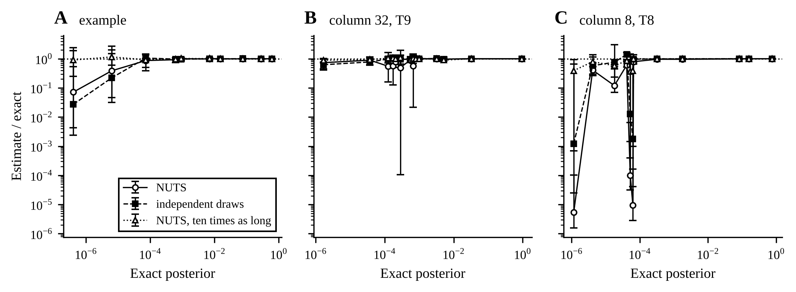

<!-- fixed_k:tail -->
| Field | Draws of log s | Runs | Places | Median estimate / exact | Mean estimate / exact | Runs low | Over four errors off | Places above 0.05: over four errors off |
|---|---|---:|---:|---:|---:|---:|---:|---:|
| example | NUTS | 16 | 4 | 0.948 | 1.043 | 59% | 19% | 0% |
| example | independent draws | 16 | 4 | 0.965 | 1.019 | 59% | 16% | 0% |
| example | NUTS, ten times as long | 4 | 4 | 0.987 | 0.988 | 50% | 6% | 0% |
| column 32, T9 | NUTS | 16 | 9 | 0.863 | 0.981 | 62% | 22% | 0% |
| column 32, T9 | independent draws | 16 | 9 | 0.984 | 0.966 | 54% | 6% | 0% |
| column 32, T9 | NUTS, ten times as long | 4 | 9 | 0.981 | 0.994 | 53% | 0% | 0% |
| column 8, T8 | NUTS | 16 | 8 | 0.406 | 0.994 | 87% | 57% | 0% |
| column 8, T8 | independent draws | 16 | 8 | 0.850 | 1.022 | 59% | 33% | 0% |
| column 8, T8 | NUTS, ten times as long | 4 | 8 | 0.792 | 0.712 | 78% | 22% | 0% |

The naming model's estimate at the places whose exact posterior is between 1e-06 and 0.001, the seven at 3 bodies: model.hypothesis_posterior on NUTS's draws (4 chains of 2000 after 1000 tuning steps), on as many draws made independently from the exact posterior of log s, and on NUTS's draws 4 chains of 20000; 20 batches a chain. Mean estimate / exact is the median over the places of the runs' mean.
<!-- /fixed_k:tail -->

<!-- fixed_k:spread -->
| Field | Place | Posterior | Relative variance of one draw | Draws for 10 per cent | Size's posterior carrying 90% of it |
|---|---|---:|---:|---:|---:|
| example | T11 | 0.608 | 0.316 | 32 | 0.661 |
| example | T10 | 0.286 | 1.56 | 156 | 0.41 |
| example | L3 | 0.000923 | 72.5 | 7,249 | 0.0529 |
| example | T8 | 0.000619 | 400 | 40,001 | 0.0091 |
| example | T7 | 7.31e-05 | 2.77e+03 | 276,670 | 0.0013 |
| example | T6 | 6.35e-06 | 3.45e+04 | 3,454,310 | 0.000126 |
| column 32, T9 | T9 | 0.955 | 0.0178 | 2 | 0.875 |
| column 32, T9 | T10 | 0.0329 | 5.43 | 543 | 0.42 |
| column 32, T9 | T7 | 0.000805 | 112 | 11,182 | 0.109 |
| column 32, T9 | T3 | 0.000673 | 906 | 90,574 | 0.000963 |
| column 32, T9 | L1 | 0.000561 | 184 | 18,390 | 0.00614 |
| column 32, T9 | T2 | 0.000283 | 1.81e+03 | 181,152 | 0.000664 |
| column 8, T8 | T8 | 0.758 | 0.171 | 17 | 0.761 |
| column 8, T8 | T7 | 0.157 | 1.19 | 119 | 0.535 |
| column 8, T8 | T9 | 0.000322 | 28.7 | 2,871 | 0.339 |
| column 8, T8 | T4 | 6.54e-05 | 1.6e+03 | 160,224 | 0.0169 |
| column 8, T8 | L1 | 6.28e-05 | 9.34e+03 | 934,395 | 0.000102 |
| column 8, T8 | T12 | 5.26e-05 | 8.89e+03 | 888,715 | 0.000101 |

q(s), the place's posterior given the size, under the exact posterior of log s on a grid 0.0005 apart: the variance of q over the square of its mean, which is the variance of one independent draw's estimate relative to the place's posterior squared, so that an estimate within 10 per cent takes that over 0.01 draws; and the share of the size's posterior on which 90 per cent of the place's mass lies.
<!-- /fixed_k:spread -->

## Tests

177 tests, whose full run in the pinned environment on Python 3.12.3 was not finished at the checkpoint of 29 October 2026, 00:40 UTC (the next account times it), run as `python -m unittest tests/test_schwingcheck_*.py` with no other job sharing the CPU (the 146 before the chain took 566 s, the 143 before the build-up study's final review 764 s, the 135 before its full run's record 563 s, the 132 before its second review 554 s, the 92 before the build-up study 1,114 s with other jobs sharing the CPU, and the 90 before the review's third check 460 s), the slowest the record test, which rescores the record twice, and the NUTS runs:

- `test_schwingcheck_table.py` (21): the long CSV is what `write` writes, to the byte, and the check catches a header line, the columns' order, one value, CRLF and the last newline; every row is a cell read twice, Table 3's from page 892; the archive's CSV agrees in all 592 values, none of them missing; the Dataset's dimensions and coordinates; the archive's shape of the reference; every registered measure scored, or with no table row, the 15 entries printed with no spread; each kind's own error and power; the pool of 32, 18 lengths, 6 areas and 8 angles, each once in the papers' order, a pair as its mean, and the 17 left out, each with its reason; a mirrored pair has opposite signs at every level, each of the other 22 pairs one sign, and the mirrored mean negates the right; the seven in the archive's order; the checked and the archive's table are one; each measure carries its table rows with their cells, its mnemonics, its measurers and its correlations; the rule reads each measure's own error; a measure enters once and a pair as one side or its mean; the specimens CSV is Table 1 cell for cell, its Dataset, and the other papers' summaries agree but for the heaviest weight and are what both prose passes of the provenance record read.
- `test_schwingcheck_rule.py` (12): the archive's log likelihoods and posteriors to 1e-10 at widths 1, 2, 3, 5, 9 and 22 under every regime; whatever the chunk and the block; the archive's quadrature; gapped and missing-value fields equal to a dense normal from scipy to 1e-9, with lengths alone and with mixed kinds, an angle's likelihood the same at every size; every power given as 1 is no power given to the bit, and the archive's rule to 1e-10; the trapezoid rule over log s agrees with a grid twice as fine with every measure of the pool at 1, 3 and 9 bodies, and names the seven within 1e-9 of the Gauss-Hermite rule; a measure missing on every body adds a constant; a field with nothing gets the prior back; a missing last body is the shorter field's marginal; offsets are checked; names given at 0.99 are right at least 99 per cent of the time on fresh columns.
- `test_schwingcheck_columns.py` (13): the archive's columns bit for bit for seed 97, every phenotype, a correlated offset and other settings, and with every power 1; each kind drawn with its own power and floor in the archive's stream, an angle never floored, a length at the floor the archive's floor of 0.5 to the bit, and a power of the wrong shape refused by its own message; the floor's count takes only the measures that scale with the size, counts the columns and the levels it touched and leaves out the padding of a column with fewer bodies; given sizes, no size is drawn and the stream starts at the offsets; the stream order; every column padded to the widest phenotype listed, however few are drawn; the checked table draws the archive's columns; the fields are exact.fields' and gapped fields skip short columns.
- `test_schwingcheck_record.py` (2): seed 97 reproduces the three regimes' rates of exact.json at 1, 3 and 9 bodies, the share named to the digit and the rest to 1e-9, with the NumPy engine and with the compiled one (`SCHWINGCHECK_RECORD_ENGINES="numpy pytensor pymc"` adds the naming model's own quadrature, about eight minutes more); a record reads back whole.
- `test_schwingcheck_cli.py` (15): `name` on a field of three, on gaps and missing values, with no body and with no measure; a length, an area and an angle named by the numpy and pytensor engines with each kind's own power, every place printed as rule.py gives it, where every power 1 names another place, and by nuts with every place within 0.02 of it; offsets as the docstring says, and refused when they do not fit; the numpy and pytensor engines print the same, and nuts names the same place, every place within 0.01 of the exact one, and prints every place at 1e-6 or more with the posterior and the Monte Carlo error the model returned, to the six places printed, with the note on the tail; on a posterior made to sit at the edges, a place at 1e-6 is printed and one just under it is not, all seventeen places at 1e-6 or more in order, each value as the engine returned it; a measure with no table row at a level of the rule's and an unknown measure refused, a file that is not UTF-8 text, has no column `body`, or has a row with no body number or one that is not a whole number, refused by what is wrong with it, a byte-order mark and a blank line before the header read past, bodies written 0.0 and 1.000000000000000000e+00, as numpy writes whole numbers, read as 0 and 1, and a NUTS run too short for its error refused before it samples; `rescore`'s three engines give the same rates on four columns, and an unknown engine is refused; `graph check` passes; `table check` in process and as a program.
- `test_schwingcheck_model.py` (29): the compiled rule equals rule.py to 1e-10 at 1, 3 and 9 bodies under every regime, with each measure's own error and on gapped fields with values missing, with each kind's own power on either nodes, and its generalisations (several gap patterns at once, a size prior of each field's own, scaled means) equal what rule.py computes case by case; nodes that cut off a field's own size prior are refused, the trapezoid's of the default reach for heights of 160, 176 and 210 cm and not for 161 or 175 cm, and on a trapezoid of reach 30 a tall patient's evidence is Gauss-Hermite's to 1e-10; the naming model integrated on the Gauss-Hermite nodes equals the compiled rule to 1e-6 on five kinds of field, and on either nodes with each kind's own power on three, its observed density is rule.py's likelihood summed over the hypotheses, at three sizes, at each node and integrated over the sizes, with a prior of any sum normalised, NUTS's posterior is within five Monte Carlo errors of the exact one at every place above 0.05 and within five plus 1e-3 everywhere, with R-hat below 1.02, its errors within 0.6 to 1.6 of ArviZ's and their mean square z over both kinds of field between 0.4 and 2.5, bounds none of 96 other seeds of the sampler crossed, set so that a correct sampler crosses those at the places above 0.05, of R-hat and of the errors in fewer than one run in a thousand and held at every place by a wide margin, the posterior and its error come from the same batches of draws, and its prior draws have the fields' shape; the covariates' reference is the twelve specimens, nothing known leaves the archive's size prior and table, and a known height or a hook off zero moves the model as it moves the compiled rule, whose size prior is the covariates', also for heights set after it is built, and whose evidence refuses nodes that cut it off; the fixed-level baseline's NUTS posterior of log s is the closed form's, and it reads each kind with its own power given the size and the offsets, to 1e-9; the generator lays the columns out as the NumPy generator does, at any number of columns, and matches its columns in distribution, with correlated offsets, each measure's own error and each kind's own power, an angle never floored; the committed graphs are the models' and this README draws each.
- `test_schwingcheck_curve.py` (54): the build-up study on columns small enough for a test: the seven's values in the study's columns are rescore's from seed 97, draw_pool's meta is the pool's, and the data axis's specimens are drawn with no floor, so that a 2,000-person table's SD at interfacet_h:mean C4 is the printed one within 3 SE where the same specimens with the floor hold it more than 3 SE below; each prefix is the order's start, the seven, the families and the ladder are what their names say and each set is printed once; the nominal arm's typical columns are scored at 5 bodies too, the correlated arm is exact.py's misspecified world and its docstring and TODO.md say what it does not measure, the supplement drew three of the five phenotypes, each judged by its column's own names, the rib reading on t13 and the count from C2 on lumbar_rib and no_rib_t12, as the docstring and the report say, the five are drawn for the same patients, the same at every body they share by name but the rib-bearing L1 and the ribless T12, and the narrowest fields go first; on a T13 column a T12 and an L1 are within one level; the predictive SD is exact.py's for twelve, a large table is close to the printed one, every number of people has two tables at least, the table as printed is scored on the axis's own columns, crossed_se is the two-way analysis of variance written out, and the axis's rates count the tables, the precision's equal to the ratio estimator on the cells; only a measure that scales with the size floors a field; a precision with no error carries its exact lower bound, on the data axis that of the table that answered fewest, every cell its count answered, and the report prints the bound; the share named exactly is rule.py's, counted by hand, the data axis pools its tables and the record holds every arm and the floor; the compiled rule builds its table once and the prepared rule is the one function to the bit, its blocks of the shape its docstring gives; every thread pool is at one thread inside the limit, speed()'s and nuts_speed()'s each in a fresh interpreter; the batch is timed after a warm-up at its own size, its median told from its mean; the record says how its times were taken; NUTS runs on every place and on one field alone, each field's gap taken from its own exact posterior on the trapezoid's nodes, a second of setup added before its loop going to the setup and none of it to the loop, and a second added to the first posterior call going to the setup and none of it to the posterior's time, and each run records the files it added to the Numba cache, which numba_cache_files counts where PyTensor keeps it; the record names the code the run began with, whose state is taken before the order is chosen, a run whose timing fails keeps its scoring, a write that fails leaves the record that was there, and add_speed writes through records.write, its code's state taken before the timing; check_readme holds the tables and finds what differs, a record without times says so, the data table reads every table against the printed one, the arms and anomalous tables say what they hold, the speed caption and the notes name what the record does not give, never a count's place filled with it nor one thread assumed, the curve commands run on a record through the command line, and the figures are the same files when drawn twice, the speed caption's counts the record's; 100.0% and 100.00% mean every field and 0.0% none, a share short of all or above none taking more places, up to six, and a lower bound is rounded down, never reading above itself; the anomalous table gives the answers at 0.99 and how often they are right, read against the record itself, with their standard errors, and the floor table its measures and levels by count, in the other tables' order, each row with its own counts; panel C draws no share right on fewer than 1,000 fields, and a floor between the cells' counts draws some and not the others; the speed figure's axes read 0.1, 1 and 10; with all 32 measures at nine bodies, on 30 columns of each spine, every six-lumbar field is named at 0.99 and the wrong ones are exactly those that reach the L6, and on a T13 spine no field whose middle body is the T13 is named right and every field wrong at 0.99 has the T11, T12 or T13 in the middle; and the full run's committed record is held: this README carries its tables, its figures' numbers and captions are what the code as it stands draws from it, FIGURES.md names that code, and the run changed no code it names.
- `test_schwingcheck_chain.py` (11): the chain's start and rows are laws, block diagonal by type, and its support paths every path of positive probability, summing to one; with one step and the typical type alone its prior is step d's and its posterior rule.name's within 1e-12; with uniform steps every fitting pattern and place is equally likely, counted by brute force; forward-backward equals enumeration; the extended table is the generator's to the bit; path_logev is a dense normal from scipy integrated on the same nodes, within 1e-9 on six paths of three bodies; the sum along the paths' shared beginnings is path_logev's within 1e-9, on whole fields and on fields with values not read, of every type, at 1, 3 and 5 bodies and two subsets of the seven at once; model (b)'s density given the size is the dense normal summed over the paths within 1e-10, model (a)'s its emissions enumerated given the offsets with a finite gradient, and recover() draws the middle body's level as often as the posterior says.
- `test_schwingcheck_chain_study.py` (13): a name within one level is read on the half-step scale, so a T13 is within one of T12 and of L1 and an L6 of L5 alone; the data axis's tables are the build-up study's to the bit, and the printed table scores on the axis as `run` scores it; a quick run, axis and speed give every row, the main and axis tables read the rows they name, at one body the consecutive and the gaps rules are one rule, the weights' rows carry the papers' weights on the stated chain's fields, the quick speed ran at one thread and every record names the code it was made by; `check` finds a table stale, missing, written twice, followed by rows of its own or by text with no blank line, or with no record; the committed records' tables are this README's, they hold 9 bodies, and one commit, unchanged while they ran, made the three.
- `test_schwingcheck_chain_figures.py` (7): the build-up study's figures and the chain's are drawn in one format, figures.py's; the chain's four figures drawn twice are the same files; every caption is under sixty words; each CSV holds the records' numbers, and a share right on fewer than 50 answers is not drawn; the committed figures' CSVs and captions are what the code as it stands draws from the committed records, to the byte, FIGURES.md names records and code by sha256, and this README shows each figure.
- `test_schwingcheck_fixed_k.py` (26): free_level's log density at a place, a size and offsets is place_loglik's with the priors, and with the offsets integrated out rule.py's likelihood at that size; the batch-means helpers give a share and its error as a hand count does, and the averaged posterior is the mean of the place's conditional; draws of log s made independently from its exact posterior have its mean and SD, and the spread rows' posteriors are the exact posterior; Liu's Metropolised Gibbs and the uniform proposal leave a place's law stationary, and PyMC's proportional proposal, as its code computes the acceptance, another law, or none on two places; a quick run gives every row its tables read, the proportional proposal stops on a place all but certain and says why, the summed-out model is exact within its errors, each proposal on a bare place gives the law its kernel leaves stationary, check finds a stale or missing table, and the figures drawn twice are the same files; the committed record: this README carries its tables, committed code that did not change while it ran made it, NUTS with the levels known is the closed form within four errors with R-hat below 1.01, the uniform proposal leaves chains that disagree, the proportional one agreeing chains more than 2.9 errors off on every field and on a bare place its kernel's law, it stopped on every sharp field, the one summed-out field a stuck chain kept within five errors has R-hat above 1.5, and the far tail runs low on NUTS's draws and on independent ones, lower on NUTS's and less on NUTS ten times as long.
- `test_schwingcheck_categorical.py` (4): one Metropolised Gibbs move from each value goes where Liu's kernel says, counted over 40,000 moves; one less each probability is the log-sum-exp of the others' probabilities; in pm.sample the step gives a bare Categorical its own law, on three values and on the two where PyMC's proportional proposal gives each value half; and a value certain or all but certain is kept, with no NaN and no error.

## What step e takes from here

Step e's first rung and the build-up study are done: each kind's own power of the size and error, the pool of 32, and every rung of measures scored from one record ([The build-up study](#the-build-up-study)): rung 0, the seven under the exact rule at 1, 3, 5 and 9 bodies and per phenotype, the five anomalous phenotypes scored anew; the measures added a family at a time, by kind, by view, and in a greedy order chosen on selection columns of a seed of its own, up to all 32; the time to name one field at each count, single-threaded; the data axis, the table re-estimated from 12, 50, 200 and 2,000 people; and the assumptions, every error halved and doubled and the offsets correlated. Next come the methods, one at a time, on the best measures (TODO.md, item P, step e). The first, the column as a chain of levels with pymc-extras' `DiscreteMarkovChain`, is done ([The chain of levels](#the-chain-of-levels)): its exact answer sums out a missed body and an L6 or a T13, its enumerated PyMC model's density given the size is held to that answer by the tests rather than trusted, since NUTS on the naming model at 16 measures was wrong on one field whose R-hat was 1.00 (the NUTS table), and sampled one field at a time both PyMC models name all 36 of their three-body fields as the exact answer does, within 0.02 at every name but on the one field where a chain stuck far out in the size's prior and R-hat, not the Monte Carlo error, showed it; and on nine-body fields with all 32 measures it names 97.5% to 99.0% of each column type exactly where step d's rule names 70.0% to 74.0%. Two results bear on items after step e: at three bodies a table from twelve people breaks the promise at 0.99 and, with all 32 measures, one from 50 people or more keeps it, which is the case for item 5's table from CTs, though with the seven, the measures SPINEPS gives, these columns cannot tell whether one from 50 keeps it, and the axis's people have one size and no error, where Panjabi's twelve were 157 to 178 cm tall; and on six-lumbar spines and spines with a T13 nearly all the answers at 0.99 that are wrong are fields that reach the L6 or the T13, a body the rule has no name for (with all 32 at nine bodies, every one), while a rib-bearing L1 or a ribless T12, drawn half-way between two names, is named wrong at 0.99 too, which is item 6. The chain gives the L6 and the T13 names of their own, built as the generator builds them, so it answers the first of these on synthetic columns and leaves item 6's real places to replace that construction. Not built: a rule that knows the correlation between measures, against which the correlated arm would measure what treating the measures as independent costs, and a standard error for each difference against the table as printed, which the report reads on the same fields but does not record. The 7 measures printed with no spread wait for a spread, and the 10 printed at only part of C3 to L5 for a rule that reads a measure where it is printed.
